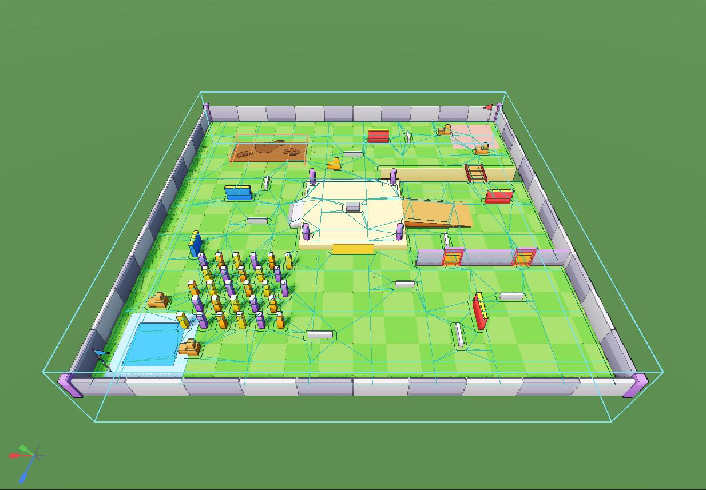
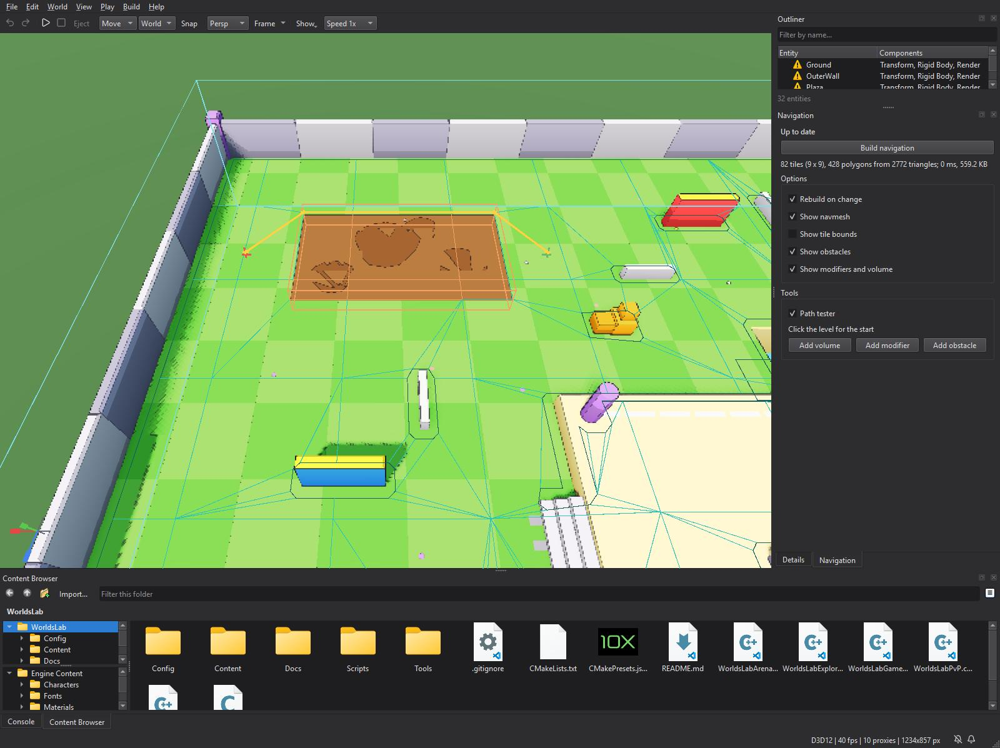
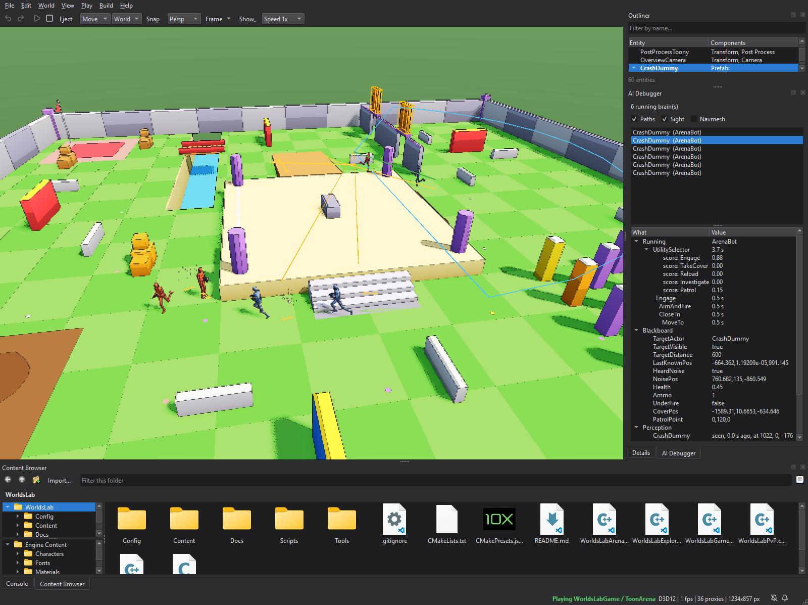
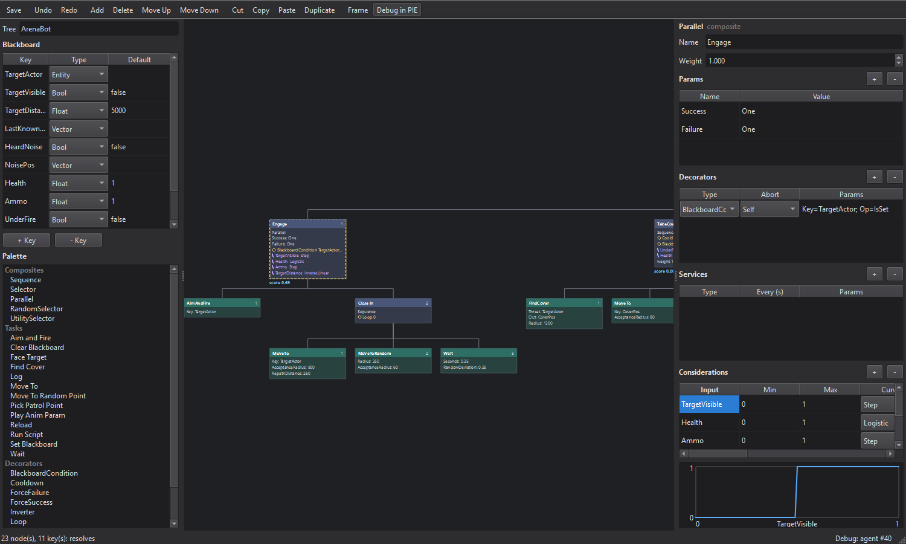

# AICore implementation guide

This guide covers how AICore is built: navigation, crowds, behavior trees,
utility and perception. It follows one tick of a bot through the module and
shows where to change things. It is for people working on the engine.

- To *use* AI in a game, read the [AICore guide](../../Modules/AICore/GUIDE.md).
- For the file formats, nodes and components, read the
  [AICore README](../../Modules/AICore/README.md) and the component pages
  ([AI Brain](../Components/AIBrain.md), [Nav Agent](../Components/NavAgent.md),
  [Nav Mesh Volume](../Components/NavMeshVolume.md),
  [Nav Modifier](../Components/NavModifier.md),
  [Nav Obstacle](../Components/NavObstacle.md),
  [Perception](../Components/Perception.md),
  [AI Stimulus](../Components/AIStimulus.md)).

**7** components · **3** systems · **5** composites, **10** tasks, **7** decorators, **1** service · **2** host interfaces · **2** file types, each with an authored and a cooked form



## Contents

1. [The shape of it](#1-the-shape-of-it)
2. [Navigation: building a navmesh](#2-navigation-building-a-navmesh)
3. [Navigation at runtime: NavWorld](#3-navigation-at-runtime-navworld)
4. [Behavior trees: the asset](#4-behavior-trees-the-asset)
5. [Behavior trees: ticking](#5-behavior-trees-ticking)
6. [Utility](#6-utility)
7. [Perception](#7-perception)
8. [AIWorld and the host: what the engine provides](#8-aiworld-and-the-host-what-the-engine-provides)
9. [Scripting and C++ entry points](#9-scripting-and-c-entry-points)
10. [Networking](#10-networking)
11. [The editor](#11-the-editor)
12. [Cooking and staging](#12-cooking-and-staging)
13. [Recipe: add a behavior tree node](#13-recipe-add-a-behavior-tree-node)
14. [Recipe: add a navigation area or filter](#14-recipe-add-a-navigation-area-or-filter)
15. [Recipe: add a sense, or a perceived key](#15-recipe-add-a-sense-or-a-perceived-key)
16. [Tests and the Toon Arena](#16-tests-and-the-toon-arena)
17. [Invariants and pitfalls](#17-invariants-and-pitfalls)

---

## 1. The shape of it

There are four layers. Each can be used without the layers above it.

```
  Editor (Modules/Editor/.../AI/)              Qt only, WITH_EDITOR && WITH_AICORE
    NavigationPanel  PathTesterTool  AIDebuggerPanel  BehaviorTreeEditorWindow
    EditorAI: the overlay, the edited World's AIWorld
        |  reads AIWorld / NavWorld / BTInstance; writes .nmnav and .nmbt
        v
  Engine glue (Source/Private/NimbleEngine/AIFacade.cpp)
    AttachLevelAI (authority only), the AIHost and BTHost callbacks,
    AIFacade.h for games: MakeAIBot, SteerInput, keys, noises
        |
        v
  Runtime (Modules/AICore/)                    SHARED library
    AIWorld          one per World: the three systems, the brains
      NavWorld       navmesh + query + crowd + obstacles
      PerceptionWorld  sight, hearing, memory -> blackboards
      BTInstance     one brain: node memory + Blackboard
    NavMesh / NavQuery / BehaviorTreeAsset       data and its files
        |
        v
  RecastNav (Engine/ThirdParty, STATIC, PRIVATE to AICore)
    Recast  Detour  DetourCrowd  DetourTileCache  DebugUtils
```

Link order is `Host exe -> NimbleEngine -> AICore -> GameCore`. NimbleEngine
links AICore **PRIVATE**. RecastNav is private to AICore, and no public
AICore header includes a Recast header. The two forward declarations
(`dtNavMesh`, `dtCrowd`) appear only as pointers. A game can therefore reach
AI through components, the `AI` script library and `NimbleEngine/AIFacade.h`
without naming an AICore type. It only links AICore if it defines its own
tree nodes.

The module is SHARED, like Sequencer and Audio. There must be exactly one
node registry, one tree cache, one `AIWorld` registry and one component
registration per process.

Three design decisions shape the rest:

- **We wrote our own behavior tree runtime.** Recast has no behavior trees,
  and the libraries that do either allocate per tick or tie node state to
  node objects. Here the asset is immutable and shared, an instance is flat
  memory, and node objects are stateless and `const`.
- **The navmesh is tiled and kept as DetourTileCache layers.** A moved door
  or a level edit then rebuilds a few tiles, not the whole mesh.
- **AI runs only on an authority.** A client never has an `AIWorld`, and
  bots replicate like any other avatar (§10).

| Piece | File | Role |
|---|---|---|
| Recast build | `NavBuild.cpp`, `NavGeometry.cpp` | Geometry in, tile cache layers out, `.nmnav` |
| Navmesh + queries | `NavMesh.h`, `NavQuery.cpp` | `dtNavMesh` + `dtTileCache`, paths, projections |
| Runtime navigation | `NavWorld.cpp` | Volume, load or build, crowd, agents, obstacles, tile rebuilds |
| Debug draw | `NavDebugDraw.cpp` | Navmesh and paths as plain lines, for any renderer |
| Blackboard | `Blackboard.cpp` | Typed keys, revisions, `ApplyAssignments` |
| Tree asset, registry | `BTRuntime.cpp` (`Resolve`), `BTRegistry.cpp` | Resolving types, slots, params |
| Tree files | `BTXml.cpp`, `BTBinary.cpp` | XML (`WITH_UNCOOKED`), `NMBT` binary |
| Tree runtime | `BTRuntime.cpp`, `UtilityNodes.cpp` | The tick, aborts, the UtilitySelector |
| Built-in nodes | `BTNodes.cpp` | Tasks, decorators, services |
| Perception | `Perception.cpp` | Sight, noise, memory, the blackboard keys |
| The World's AI | `AIWorld.cpp` | Systems, brains, tree hot reload |
| Components, Lua | `AIComponents.cpp`, `AIScriptLibrary.cpp` | Seven components, the `AI` library |
| Engine glue | `AIFacade.cpp`, `AIInternal.h` | Host callbacks, attach on authority, facade |

---

## 2. Navigation: building a navmesh

The pipeline follows RecastDemo's `Sample_TempObstacles`. Geometry goes in;
compressed tile cache layers come out. Detour polygons are built from those
layers whenever they are needed: at bake, at load, and when an obstacle
changes.

```
World --NavGeometry::Gather--> NavInputGeometry (world-space triangles + area boxes)
   per tile (TileSize voxels a side, plus a border of Agent Radius):
     rcRasterizeTriangles -> filter low obstacles, ledges, low ceilings
     -> rcErodeWalkableArea (Agent Radius) -> mark area boxes (Nav Modifiers)
     -> rcBuildHeightfieldLayers -> dtBuildTileCacheLayer (passthrough compressor)
   dtTileCache::buildNavMeshTile for each layer -> dtNavMesh
```

**Geometry** (`NavGeometry.cpp`) is what the physics would collide with. It
takes each static Rigid Body in the volume and the volume's **Layer Mask**:

- boxes, spheres and capsules as triangulated shapes;
- triangle meshes and convex hulls by their mesh's triangles, through
  GameCore's `CollisionMeshProvider`;
- terrain heightfields cell by cell, through the `TerrainProvider`, split the
  same way Jolt splits them.

Dynamic and kinematic bodies are never ground. That is why the arena's doors
are obstacles, not geometry. Each Nav Modifier becomes a `NavAreaBox` that
marks voxels after erosion.

**Coordinates.** Recast is Y-up, and so is GameCore, so nothing is swapped.
Units are centimetres throughout. Cell Size 15 and Cell Height 10 are a good
fit for 35 cm agents.

**Limits** (`NavBuild.cpp`): 4 layers per tile are expected, but more are
allowed (stairs over stairs). The tile cache holds 256 obstacles.
`MaxTiles` is the tile grid times the layers, rounded up to a power of two
for Detour's tile bits.

**The file** (`.nmnav`, `NavMesh::Save/Load`):

```
"NMNV" version, then CoreArchive chunks:
  HEAD v1   settings, settings hash, geometry hash, bounds, tile grid
  LAYR v1   one compressed tile cache layer, as built        (repeated)
```

Loading rebuilds the Detour tiles from the layers. Both hashes are stored so
`NavWorld::IsUpToDate` can tell whether a bake still matches the level. **No
detail mesh is built.** Polygon heights are therefore only good to about a
cell height, and §8 explains how the host corrects for that.

`NavWorld::RebuildTilesIn(AABB)` re-rasterises only the tiles a box touches.
The editor's Rebuild on change uses it, and so does a running level when its
terrain changes.

---

## 3. Navigation at runtime: NavWorld

`NavWorld` owns the navmesh, a `NavQuery` for the game thread, the
`dtCrowd`, and the obstacle handles. The `AI.Nav` system calls `Tick` in
TP_PrePhysics, after `AI.Brains`, so a tree's `MoveTo` is acted on in the
same frame.

```
NavWorld::Tick
  EnsureNavMesh()        first time: volume's file, else build (Build At Runtime)
  refresh area costs     Nav Modifiers' Cost into the default filter (every 1 s)
  UpdateObstacles()      Nav Obstacle components -> dtTileCache add/remove; Mesh.Update()
  UpdateTerrainWatch()   a terrain changed: RebuildTilesIn (Rebuild On Change)
  agents:
    new Nav Agent        -> addAgent (radius, height, speeds, separation, avoidance)
    entity moved itself  -> crowd copy follows; > 150 cm away it is re-added (teleport)
    target requested     -> requestMoveTarget on the nearest polygon
  dtCrowd::update
  per agent:  DesiredVelocity, Status (moving / arrived / failed), RemainingDistance
    Drive Transform on   -> position += velocity * dt, Y from Host.GroundHeight,
                            turn toward travel at Turn Rate (+ Mesh Yaw)
```

**Two kinds of agent.** A *driven* agent (Drive Transform on) moves its own
Transform, with no physics. An *undriven* agent leaves its entity alone and
only writes `DesiredVelocity`. The game feeds that velocity to a character
controller through `SteerInput` (§9), which is how the Toon Arena's
CrashDummies walk with the same capsule, steps and slopes as a player. For
an undriven agent, the crowd's copy is pulled to wherever physics actually
put the entity at the start of every tick.

**Status.** An agent is *arrived* within Acceptance Radius of its target. It
is *failed* when there is no path or it is off the mesh. Tasks read Status
and do not poll the path (`BTNodes.cpp`, `FollowMove`).

**Crowd sizing.** The crowd holds 256 agents. Its max agent radius is set
from the largest Nav Agent when the crowd is (re)made, and `ResetCrowd`
re-adds everyone. Any change that resets the crowd must reset each agent's
`CrowdIndex` and each obstacle's `Handle` to the "none" value, or stale
indices alias new agents.

**Queries** (`NavQuery`) wrap `dtNavMeshQuery`:

- `FindPath` runs findPath + findStraightPath (512 polys). A partial path is
  clamped onto the last polygon.
- `ProjectPoint` returns the nearest polygon within the search extents.
- `RandomPointInRadius` and `Raycast`.

The default `NavFilter` carries per-area costs. `DT_VIRTUAL_QUERYFILTER`
makes `dtQueryFilter` virtual so `NavQueryFilter` can override costs. That
define is a PUBLIC define of `RecastNav::RecastNav` for exactly this reason
(§17).

---

## 4. Behavior trees: the asset

```
BehaviorTreeAsset { Name, Keys[] (BlackboardKey), Nodes[] (depth-first, [0] = root) }
  BTNodeDef { Kind (Composite|Task), Composite, Type, Name, Params[], Children[] (indices),
              Decorators[] { Type, Params[], Abort, Impl, Slot },
              Services[]   { Type, Params[], Interval, Impl, Slot },
              Considerations[] (as a UtilitySelector's child), Weight,
              -- resolved: Task, Parent, IndexInParent, Depth }
  BTParam { Name, Text, Number, bBool, bIsNumber, Key }   pre-parsed at Resolve
```

The asset is **flat and depth-first**: a parent's index is always lower than
its children's. `Resolve` checks this and fails a tree that breaks it. The
debugger, the arena's statistics and the editor's **Debug in PIE** all
identify nodes by this index. The editor's tree (`BehaviorTreeEditorWindow::Node`)
flattens to the same order, which is why its highlights line up.

**Resolve** (`BTRuntime.cpp`) runs after every load and does the following:

- links types to the registry: a task by `FindBTTask`, decorators and
  services likewise;
- sets parents, depths and `IndexInParent`;
- gives each decorator and service a memory **slot**;
- pre-parses every param: as a number, as a bool, and as the blackboard key
  it names.

It fails, naming the node, on any of these:

- an unknown type;
- a composite with no children, or more than 32 (the `Mask` bitset);
- a task with children;
- a consideration reading an undeclared key.

**Files** (`BTXml.cpp`, `BTBinary.cpp`). The XML is the authored form, and
only builds with `WITH_UNCOOKED` read it. The binary is `"NMBT"`, a version,
then `KEYS` and `NODE` chunks; a chunk added by a newer build is skipped.
`DetectBehaviorTreeFormat` reads the first bytes. `WriteBehaviorTreeXml` is
deterministic, so a save that changes nothing changes no bytes.

`ParseBehaviorTreeXml(..., bInResolve = false)` keeps a tree whose types this
process hasn't registered. The editor uses it (§11), so a tree whose game
module isn't loaded still opens.

**The cache.** `BehaviorTreeAssetCache` maps a runtime path to a
`shared_ptr<const BehaviorTreeAsset>`. `Invalidate` bumps a generation
counter. `AIWorld::TickBrains` compares each brain's generation and restarts
a brain whose tree changed. Hot reload is that mechanism and nothing more.

---

## 5. Behavior trees: ticking

A `BTInstance` is one brain. It holds:

- `Memory[]`, one `BTNodeMemory` per node: status, `bActive`, current child,
  tried/finished mask, counter, start time, and scratch time, vector and
  floats;
- `DecoratorMemory[]` and `ServiceMemory[]`, by slot;
- a `Blackboard`, a clock, and a random stream.

No allocation happens after construction.

**Memory-based ticking.** A node remembers that it is active and which child
it is on. A tick walks only the running branch, root first, and never
re-evaluates siblings that already finished. That is Colledanchise & Ögren's
"memory" variant, as in the Game AI Pro *Behavior Tree Starter Kit*.

```
Tick(dt) -> TickNode(0)
TickNode(n):
  not active -> Enter(n): ConditionsPass? (decorators) else Failure
                          decorators' OnEnter, services (entering), task OnEnter / composite starts child 0
  active     -> SelfAbortFails(n)?  -> AbortNode(n), Failure      (Abort Self)
                TimeLimit-style KeepRunning false -> Aborted
                services due -> OnTick
                task: OnTick      composite: TickSequence / TickParallel / TickRandomSelector /
                                             UtilitySelector (UtilityNodes.cpp)
  Running -> stays active.  Success/Failure -> Finish(n): decorators' OnResult (a Loop may say Running:
             start again), OnExit, bActive = 0
```

**Selectors and LowerPriority aborts.** Before ticking its running child,
`TickSequence(bInSelector = true)` calls `FindLowerPriorityAbort`. That looks
at each *earlier* child with an observing condition decorator (LowerPriority
or Both). If the condition now passes, it aborts the running child and
enters that earlier one. It checks only when the blackboard's `Revision`
differs from the node's `SeenRevision`, so an idle tree costs nothing.

**Abort** means `AbortNode`, recursively: each active descendant gets
`OnExit(Aborted)` and its memory reset. `BTInstance::Abort()` does this from
the root. A stopped brain, a restarted tree, and an Abort Self all use it.

**Node code** sees a `BTContext`:

- `World`, `Self`, the `Board`, the `Instance`, `AI`;
- its `Node`, its own `Memory`, its `Params`;
- `DeltaSeconds` and `Time`;
- the helpers `GetNumber`, `GetBool`, `GetString`, `GetKey` and `Random`.

Built-in move tasks share `StartMove` / `FollowMove` / `EndMove`. They
request a crowd target, follow the agent's Status, re-path when an Entity
target moves more than RepathDistance, and stop the agent on exit.

---

## 6. Utility

`UtilityNodes.cpp`. A UtilitySelector is a composite whose children carry
`Considerations`.

```
s_k        = curve_k( clamp01( (input_k - Min_k) / (Max_k - Min_k) ) ) ^ Weight_k
s_k'       = s_k + (1 - s_k) * (1 - 1/n) * s_k          Dave Mark's compensation, n considerations
score      = Weight(child) * Π s_k'                      0 as soon as any factor is 0
```

- **Inputs.** A key's value (a Bool reads 0 or 1, a Vector its length,
  an Entity set or not), or `distance(Key)` from the brain's entity.
- **Curves** (`BTConsideration::Evaluate`): Linear, InverseLinear,
  Quadratic, Logistic, Step, Constant, and Points (piecewise-linear through
  `x0 y0 x1 y1 …`). The result is clamped to 0..1.
- A child whose **condition decorators** fail scores 0. It is not entered.
- **Choosing.** By default it takes the best. With `Pick=Weighted` it draws
  among the `TopN` best, weighted by score.
- **Re-scoring** happens every `Interval` (0.3 s) while a child runs. It
  switches only if another child beats the running one by more than
  `Hysteresis` (0.15). A child that fails is set aside until the selector is
  entered again.
- **Scores** go to `BTInstance::SetUtilityScore`, which the debugger, the
  tree editor's live scores and the arena's statistics read.

---

## 7. Perception

`PerceptionWorld` (`Perception.cpp`), in `AI.Perception` at TP_PostPhysics.
It runs after physics so it sees where everything ended up this frame.

```
Tick(dt)
  candidates = every enabled AI Stimulus, its feet and aim point (Target Height)
  for each Perception (staggered: each agent's next check is Sight Interval after its last,
                       first checks spread over the interval so 30 agents don't all ray-cast at once)
    for each hostile candidate (IsHostile: both teams non-zero and different)
      in Sight Range and within FOV Half Angle of facing (Nav Agent's facing if it has one)
      and Host.LineOfSight(eye -> aim) -> seen: memory entry refreshed (Seen, position, strength 1)
  noises reported since last tick (ReportNoise): within Hearing Range * Loudness -> Heard
  age every memory entry; drop after Forget Seconds
  write the brain's blackboard (only keys it declares): TargetActor (nearest seen, else
    nearest remembered), TargetVisible, TargetDistance, LastKnownPos, HeardNoise, NoisePos
```

Facing comes from the Nav Agent's `GetFacingYaw()` when there is one, and
from the entity's yaw otherwise. A Mesh Yaw of 180 must not make bots look
backwards (§17).

The blackboard writes go through `Blackboard::Set*`. A value that doesn't
change doesn't bump the revision, so a stable target never wakes
LowerPriority aborts.

---

## 8. AIWorld and the host: what the engine provides

`AIWorld::Attach(World)` creates the World's AI and registers the three
systems with the World's scheduler. Each `Attach` needs a matching `Detach`;
the World keeps a count.

```
AI.Brains      TP_PrePhysics   TickBrains: start Auto Start brains, restart changed trees,
                                tick each brain every Tick Interval
AI.Nav         TP_PrePhysics   TickNav  (after AI.Brains)
AI.Perception  TP_PostPhysics  TickPerception
```

AICore never calls physics, rendering or animation. It asks the host, which
is two structs of function pointers:

| Callback | Struct | The engine's (`AIFacade.cpp`) |
|---|---|---|
| `LineOfSight(World, From, To, Viewer, Target)` | `AIHost` | A physics raycast. It **steps out of the viewer's own capsules** (up to 8 steps, at least 12 cm a step) and succeeds on reaching the target's colliders or nothing |
| `GroundHeight(World, At, Agent, OutY)` | `AIHost` | A downward ray that **skips every Nav Agent's colliders**. False when nothing is hit, and the agent then keeps its Y |
| `SetAnimParam(World, Entity, Param, Value)` | `BTHost` | RenderCore's Animation component: PlayAnimParam, and the arena's Speed/Armed/AimPitch |

Null callbacks degrade gracefully. With no `LineOfSight`, everything in range
and cone is seen. With no `GroundHeight`, driven agents walk on the navmesh's
approximate heights. AICore's tests run this way.

**Where it attaches.** `GameSession` calls `AIDetail::AttachLevelAI` right
after the Sequencer's host is set, on every level load. That function returns
early on a client (`IsClient()`). The editor attaches its own `AIWorld` to
the *edited* World (§11). The edited World never ticks, so no brain runs
there.

---

## 9. Scripting and C++ entry points

| Want | Lua (`AI` library) | C++ without AICore (`AIFacade.h`) | C++ with AICore |
|---|---|---|---|
| Walk somewhere | `AI.MoveTo(e, x, y, z)` | `MoveAIAgent` | `NavWorld::MoveTo` |
| Stop | `AI.Stop(e)` | `StopAIAgent` | |
| Path length | `AI.FindPath(...)` | `NavPathLength` | `NavQuery::FindPath` |
| Random reachable point | `AI.RandomPoint` | `RandomNavPoint` | `NavQuery::RandomPointInRadius` |
| Snap to navmesh | `AI.ProjectPoint` | | `NavQuery::ProjectPoint` |
| Start/stop a brain | `AI.StartBrain`, `AI.StopBrain` | | `AIWorld::StartBrain` |
| Blackboard | `AI.SetKey`, `SetKeyEntity`, `SetKeyVector` | `SetAIKey`, `SetAIKeyEntity`, `GetAIKeyNumber`, `GetAIKeyEntity` | `AIWorld::GetBlackboard` |
| A noise | `AI.ReportNoise` | `ReportAINoise` | `PerceptionWorld::ReportNoise` |
| Make a bot | | `MakeAIBot(AIBotSetup)` | add the components |
| Drive a controller | | `SteerInput` | read `DesiredVelocity` |
| Bake | | `BuildNavigation` | `NavWorld::Build`, `NavMesh::SaveFile` |

`SteerInput(World, Avatar, Map, Yaw, dt, Input)` is the bridge between the
crowd and a character controller. It projects the desired velocity onto the
avatar's yaw to get move axes, and turns the look axis toward the facing
target (a tree's FaceTarget) or the direction of travel. It writes those into
an `InputSnapshot` exactly as a player's device would, so a bot obeys the
same movement rules as a player. It returns the yaw still to turn, which the
arena's AimAndFire uses to decide when to shoot.

Every facade function returns false or does nothing when `WITH_AICORE` is 0.

---

## 10. Networking

There is nothing AI-specific to replicate.

- **Brains, crowds and perception run only on an authority**: standalone, a
  listen server, or a dedicated server.
- **What they move replicates as usual.** A bot driven through `SteerInput`
  is an avatar whose input is produced on the server; clients see its
  replicated avatar. A driven agent's Transform replicates like any moved
  entity.
- **Animation parameters** set by `PlayAnimParam` are the Animation
  component's, and follow its replication.
- **Blackboards and trees never leave the server.** A client-side
  AI Debugger has nothing to show ("This Play has no AI here"). Debug from a
  listen server or a standalone Play.

The Steampunk PvP retrofit (`WorldsLabPvP.cpp`) is the networked example.
Bots on a dedicated server, `PvpBots=3`, run `PvpBot.nmbt`. Its `AiBotFilter`
falls back to the old waypoint bots when no brain runs, which is the case on
a build without AICore.

---

## 11. The editor

All under `Modules/Editor/Source/Private/Editor/AI/`, compiled to nothing
without `WITH_AICORE`.



**EditorAI** (`EditorAI.h/.cpp`) is shared state:

- **The host**: the `EditorContext`, the document, the viewport, and the
  level's file.
- **`GetAI()`**: the active World's `AIWorld`. During Play-in-Editor that is
  the game's own (borrowed World), with brains and all. Otherwise it is one
  that EditorAI attaches to the *edited* World, and detaches on
  `EditedWorldAboutToBeDestroyed`.
- **The overlay** (`InstallOverlay`): one `ViewportWidget::AddOverlay`
  callback, registered with `bInWhilePlaying` so it also draws through the
  game's camera. It turns the navmesh, tile bounds, obstacle components,
  modifier and volume boxes, the test path, agent corridors and sight cones
  into `EditorContext::DrawDebugLine`. Each gizmo has a flag in
  `OverlaySettings` and a line counter in `OverlayStats`, which
  `ai.overlaystats` prints.
- **The test path** and **the debugged agent**.

**The flags are shared** by three UIs:

- the viewport's **Show > Editor Gizmos > AI** (ViewportPanel, persisted as
  `[Editor] ViewAI*`);
- the Navigation dock's checkboxes;
- the AI Debugger's checkboxes.

Each UI re-reads the flags when shown (`aboutToShow`, `Refresh`), and
`ai.show` calls the docks' `SyncToggles`. Nothing caches a flag.

**NavigationPanel** is the dock:

- **Status**, from `NavWorld::IsUpToDate` and the volume.
- **Build** (`Build(bInSave)`): `NavWorld::Build`, then `SaveFile` to the
  disk path from `GetNavMeshPaths`. That is the volume's Nav Mesh, or
  `<level folder>/<level>.nmnav`. If the volume named no file, Build sets the
  field inside a Begin/EndEditGesture, so it is undoable.
- **Rebuild on change** debounces document edits by 0.7 s and rebuilds in
  memory. The bake is written on `AboutToSaveWorld`.
- **Path tester** makes `PathTesterTool` the viewport's tool. Its `OnPress`
  physics-raycasts, projects the hit onto the navmesh, and sets the start,
  or the end with Shift.



**AIDebuggerPanel** refreshes 4 times a second while visible. It lists
`AIWorld::ForEachBrain`. For the picked brain it shows:

- `GetActivePath` with `GetNodeMemory().StartTime`;
- `GetUtilityScore` under each UtilitySelector;
- the blackboard;
- `PerceptionWorld::GetMemory`;
- the Nav Agent.

Picking a brain sets `EditorAI::GetDebuggedAgent()`, which narrows the sight
gizmo and brightens that agent's corridor. Double-click opens the tree with
debugging on.



**BehaviorTreeEditorWindow** is a `QMainWindow`, one per file. It edits a
`unique_ptr<Node>` tree, not the flat asset.

- **Load.** `ParseBehaviorTreeXml(..., false)`, then `FromAsset` follows the
  `Children` indices. A cooked file is refused.
- **Edits** change `Node::Def` and call `Edited()`. That re-snapshots the
  tree as XML (`WriteBehaviorTreeXml(Flatten())`), and if the bytes changed,
  pushes the old snapshot on the undo stack (200 deep). Undo and redo are
  re-parses of snapshots, and selection is restored by flat index.
- **The canvas** (`Rebuild`) is a `QGraphicsScene` laid out as a tidy tree.
  Leaves go left to right and a parent is centred over its children. Rows
  are as tall as their tallest box. A box's lines come from `BoxLines` (type,
  params, ◇ decorators, ⟳ services, ∿ considerations, weight). It is red if
  `IsKnown` fails.
- **The status line** runs `Resolve` on a flattened copy after every edit.
- **Debug in PIE** runs a 200 ms timer. It finds a brain whose asset `Name`
  matches the window's, preferring the debugged agent, and maps `Flat`
  indices to `GetActivePath` and `GetUtilityScore`. It warns when the tree is
  dirty, because indices only match the saved file.
- **Save** calls `SaveBehaviorTreeXml` (which invalidates the cache, and so
  hot-reloads running brains), then `EditorContent::StageAsset`.

Other editor hooks:

- `PropertyWidgets` has `EAsset::NavMesh` and `EAsset::BehaviorTree` pickers,
  plus the Tree field's **Edit** button.
- `ContentBrowserPanel` opens `.nmbt` files and has **New Behavior Tree...**.
- `ContentPaths` has `List*Paths` and `*PathFor`.
- `ComponentDocs` has the asset kinds.

**Console hooks for scripted runs** (all usable from `-command`; `after <ms>`
sequences them):

| Command | |
|---|---|
| `ai.navigation`, `ai.debugger [row]` | show a dock; `row` picks a listed brain |
| `ai.buildnav` | build and write the navmesh |
| `ai.testpath ax ay az bx by bz` / `clear` | set the path tester's ends; prints `[AIPath]` |
| `ai.show <gizmo> <on/off>` | a gizmo flag; the docks re-sync |
| `ai.overlaystats` | `[AIOverlay]` lines per gizmo last frame: the gizmo tests |
| `ai.opentree <file> [debug] [node]` | open a tree, optionally debugging, a node selected |
| `ai.treeshot <file>` | grab the front tree window (Qt only: works on a locked desktop) |
| `screenshot -gizmos <file>`, `windowshot -gizmos <file>` | the viewport with its debug lines (`Renderer::RequestSceneCaptureWithDebugLines`) |

AI commands also log through `qInfo`, so a run with
`QT_FORCE_STDERR_LOGGING=1` can be checked from its stderr. The images in
this guide were made this way, for example:

```
NimbleEditor.exe Content/Levels/ToonArena.nmworld --command "ai.show navmesh on" ^
  --command "after 3000 camera 1700 2300 300 180 -52" ^
  --command "after 7000 ai.testpath 600 0 -1900 2650 0 -1900" ^
  --command "after 10000 windowshot -gizmos navigation_dock.jpg"
```

---

## 12. Cooking and staging

`Build > Cook Content` (`ContentCook.cpp`) has two AICore steps, after
Sequences:

- **Navmeshes** (`AT_NavMeshes`): `NavMesh::Load` each `.nmnav` to prove it
  reads, then copy it to `Saved/Cooked/<path>`. It is already binary.
- **Behavior trees** (`AT_BehaviorTrees`): `CookBehaviorTreeFile`. That
  reads the XML, which must **resolve**, so every node type must be
  registered in the cooking editor, and its game module is loaded while it
  cooks. It then writes `NMBT`.

Staging is in the game's CMake (WorldsLab and `Engine/Templates/Game`):

- `.nmnav` is staged with Content in every build.
- `.nmbt` is staged like `.nmseq`: XML when `NIMBLE_STAGE_TEXT_CONTENT`,
  otherwise the cooked files from `Saved/Cooked`. Configure warns if
  Content has trees but none are cooked.

---

## 13. Recipe: add a behavior tree node

**In a game module:**

1. Derive from `AICore::BTTask` (or `BTDecorator`, `BTService`). Make every
   method `const`. Keep per-brain state in `C.Memory`; there is no other
   per-brain storage.
2. Read params with `C.GetNumber("Radius", 500.0)` and `C.GetKey("Out")`.
   Read and write keys through `C.Board`.
3. `AICORE_DEFINE_BT_TASK(MyTask, "My Task")` at file scope. The second
   argument is the palette's display name.
4. Link AICore under `if(TARGET AICore)`.
5. Reference it in XML as `<Task Type="MyTask" .../>`. After the next game
   module load, the editor's palette lists it.

A **task** returns Running from `OnEnter` to be ticked. It returns
Success or Failure to finish at once. It cleans up in `OnExit`, which runs on
both finish and abort. A **decorator** that is a condition overrides
`IsCondition` and `Evaluate`. It also overrides `ObservesBlackboard` if it
reads only the blackboard, and only then can it carry abort modes. A
**service** overrides `OnTick`, which runs every Interval while its composite
is active.

**In AICore itself:**

- Add it to `BTNodes.cpp` with the same macros.
- Document it in README.md's tables.
- If it needs editor defaults, add them to `DefaultParams` in
  `BehaviorTreeEditorWindow.cpp`.
- Add a case to `AICoreTests.cpp`.

**A new composite** means a new `EBTComposite` value, its name in
`GetBTCompositeName` / `FindBTComposite`, a `Tick*` in `BTRuntime.cpp`
dispatched from `TickComposite`, and a binary version bump only if it needs
new data.

---

## 14. Recipe: add a navigation area or filter

Areas are 6-bit Recast area ids. `NAV_AREA_WALKABLE` and the reserved ids
are in `NavTypes.h`, and custom areas are 2..62.

1. **Marking.** A Nav Modifier with Area = Custom and the new Custom Area id
   marks voxels during the build (`NavGeometry` → `NavAreaBox`). Nothing
   else is needed to paint it.
2. **Cost.** The default filter takes each modifier's Cost (refreshed every
   second by `NavWorld::Tick`). For a per-agent filter, such as a heavy bot
   that avoids ladders, construct a `NavFilter` with its own area costs and
   exclude flags, and pass it to `NavQuery` calls. To use it in the crowd,
   register it as a `dtCrowd` query filter type and set the agent's
   `queryFilterType` in `NavWorld` (the crowd allows 16).
3. **Colour.** Add it to `GetNavAreaColor` (`NavDebugDraw.cpp`) so the
   overlay shows it.
4. **Bake impact.** Area ids are baked into the layers, so changing what a
   modifier marks requires a rebuild. Cost needs no rebuild.

---

## 15. Recipe: add a sense, or a perceived key

- **A perceived key.** Add the key name to the list `Perception.cpp` writes
  in its blackboard update. It is written only if the brain's tree declares
  it, so existing trees are unaffected. Document it in README.md
  ("Perception").
- **A sense** (smell, touch, team callouts) is a new kind of report. Add a
  `Report*` on `PerceptionWorld` that queues events, as `ReportNoise` does.
  Consume them in `Tick` against each Perception's range, and mark memory
  entries with a new flag beside `bSeen` and `bHeard`. Add a field to
  `PerceptionComponent` only for a range or toggle, and remember the
  component's serializer version.
- **A different visibility rule** (fog, stealth) belongs in the host's
  `LineOfSight`, or in a candidate filter, not in AICore's cone test.

---

## 16. Tests and the Toon Arena

`AICore.Tests` (`Tests/AICoreTests.cpp`, 154 checks) runs with no engine:
no renderer, no physics host, and no file provider (loaders fall back to
`appFileReadAll`). It covers:

- the blackboard: types, revisions, assignments;
- each composite, decorator and abort mode, and services;
- utility curves, compensation and hysteresis;
- XML ↔ asset ↔ binary round-trips and deterministic cooking, and the
  errors for an unknown task or a childless composite;
- navmesh builds from `Tests/Data/ToonArena.obj`, which is
  `make_toon_arena.py`'s geometry exported. It checks for a path base to
  base, that paths go around the mud, that none goes up the steep slope, and
  that the bridge connects;
- obstacles cutting and re-opening a corridor, and tile rebuilds;
- four agents crowding through a gap in a wall to their own targets;
- perception: range, cone, friend or foe, walls, memory and forgetting,
  gunshots versus faint far-off noises.

**The integration test** is the Toon Arena autoplay:

```
WorldsLab.exe -Game.StartLevel=ToonArena -WorldsLab.ArenaAutoplay=90
```

It spectates, then logs `[ToonArena]` lines and `PASS` or `FAIL`. To pass
there must be kills on both teams, no stuck agents and no ground bobbing,
and every branch must have run. The bobbing check counts frames in which a
grounded agent's height jumps; it is the regression test for the
GroundHeight fix in §17.

**Editor checks** without screenshots: `ai.overlaystats` before and after
`ai.show <gizmo> off` proves each gizmo draws and stops. `Editor.Details`
builds every editor source, so it catches AI editor compile breaks.

---

## 17. Invariants and pitfalls

- **`DT_VIRTUAL_QUERYFILTER` must match everywhere.** It changes
  `dtQueryFilter`'s layout. It is PUBLIC on `RecastNav::RecastNav`, so the
  library and AICore agree. Never define it per file.
- **The navmesh has no detail mesh.** Its Y is only good to about a cell
  height. Anything that stands on it (driven agents, spawn points) must take
  height from `Host.GroundHeight` or physics. Tests must allow for this.
- **The ground ray must not hit agents.** The first `GroundHeight` hit the
  agent's own hit boxes, and those of neighbours walking past, so agents
  popped up onto each other's heads and flickered. The fix was to skip
  *every* Nav Agent's colliders and keep the previous Y when nothing is hit.
- **Line of sight starts inside the viewer.** The eye is inside the head
  capsule, so a plain ray hits the viewer first. The engine steps out of the
  viewer's own colliders, at least 12 cm a step. A smaller step can stall
  inside a capsule.
- **Node objects are shared and `const`.** One object serves every brain.
  A member variable on a task is a bug that shows up as two bots sharing
  state.
- **The asset is depth-first.** The debugger, the editor's highlights and
  the arena's statistics index nodes by position. Anything that builds an
  asset in code must push a node before its children.
- **A composite has at most 32 children** (the `Mask` bits).
- **Abort modes need an observing condition.** `ObservesBlackboard` false
  means aborts are never re-checked, because there is no revision to watch.
- **Writes that don't change a value don't bump the revision.** Code that
  forces re-evaluation must change a key, not rewrite the same value.
- **One volume per level.** `FindVolume` takes the first, so a second is
  ignored silently.
- **Crowd resets must clear indices.** `CrowdIndex = -1` on every agent and
  `Handle = 0` on every obstacle, or old indices alias new agents.
- **256 agents, 256 obstacles.** Raise `MAX_AGENTS` (`NavWorld.cpp`) and
  `MAX_OBSTACLES` (`NavBuild.cpp`) together with their memory cost in mind.
- **Script signatures are at most 96 characters** (the script binder's
  limit). That is why `AI.FindPath` returns `Found, Length` and not the
  points.
- **The editor may lack a game's node types.** Load with
  `bInResolve = false` and show the tree red. Don't fail to open. Cooking
  must resolve.
- **Stale staged content looks like a code bug.** After regenerating content
  (materials, trees), rebuild the game target to restage before concluding
  that a change didn't work.
- **Tree hot reload restarts brains.** It resets their blackboards to the
  component's starting values. A game that keeps important state on the
  blackboard should restore it from its own state, as the arena's
  ArenaStatus service does every 0.15 s.

---

## Where to look next

- [AICore README](../../Modules/AICore/README.md): every node, param, key
  and component field.
- [AICore guide](../../Modules/AICore/GUIDE.md): a guard, end to end.
- `Games/WorldsLab/WorldsLabArena.cpp`: a full game mode on AICore. It has
  custom tasks, a service, `MakeAIBot`, `SteerInput` and the autoplay
  statistics.
- RecastDemo's `Sample_TempObstacles.cpp`: the upstream pattern `NavBuild.cpp`
  follows.
