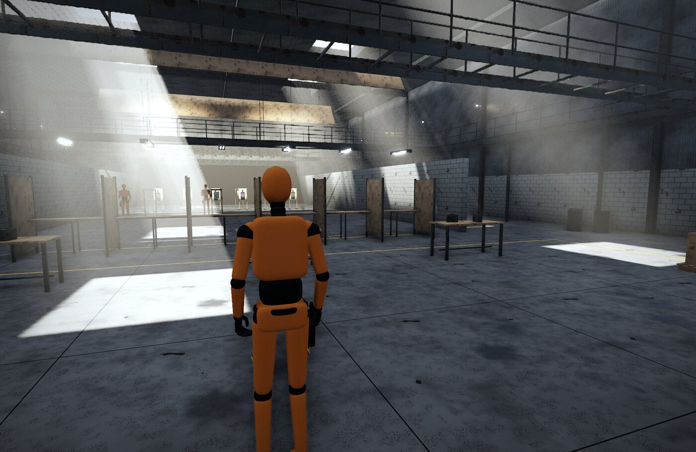
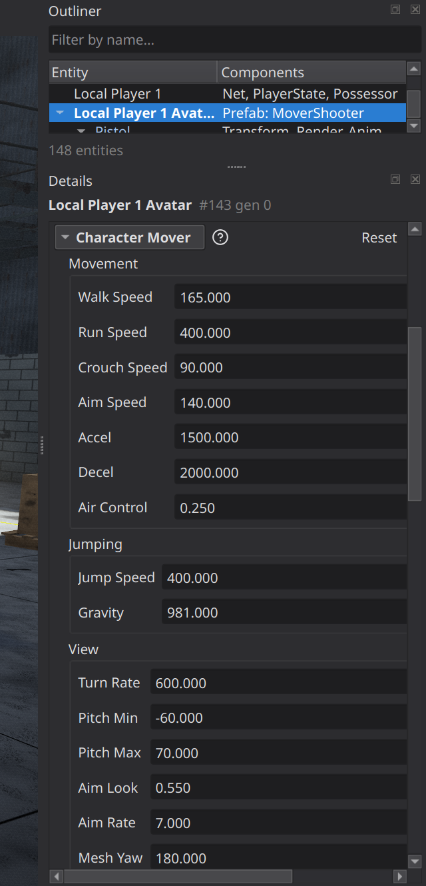
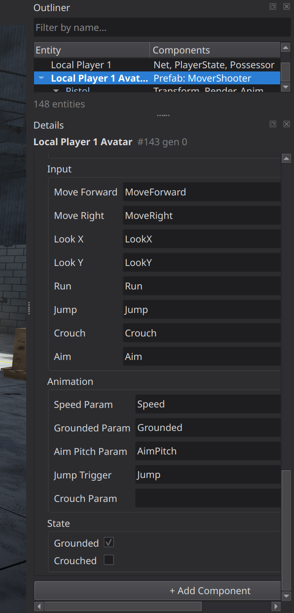
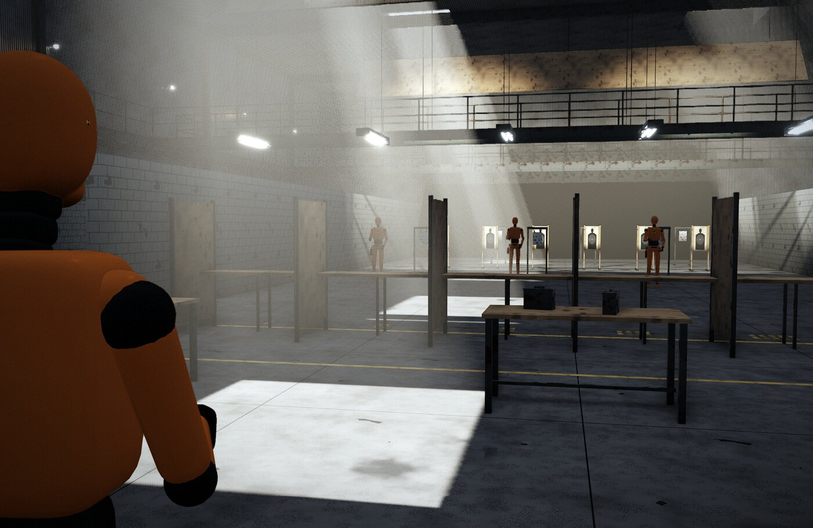
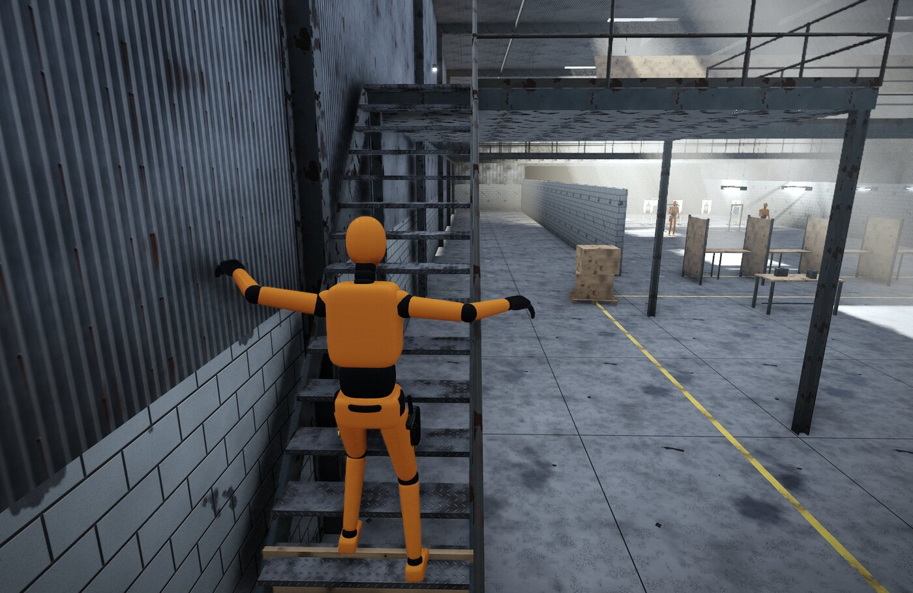

# The Character Mover

The **Character Mover** is the engine's third-person walker. Give an avatar
one, name **`CharacterMove`** as its harness's Simulation, and it walks, runs,
crouches, jumps, climbs stairs, slides along walls, aims over the shoulder
and turns its camera. It does all of this predicted over the network, with no
movement code of your own. Players and AI bots drive it in the same way:
through the avatar's input map.

[](Images/CharacterMover/standing.jpg)

*`MoverShooter` (Games/WorldsLab) at the Shooting Range's Player Start:
WorldsLab's crash dummy on a Character Mover, viewed through its camera boom.*

`Engine/Source/AVATARS.md` ("Character Mover") is the reference, and
`Public/NimbleEngine/CharacterMover.h` is the API. This guide covers setup,
tuning and the code you write around the mover. It assumes you know avatars
(`Engine/Source/AVATARS_GUIDE.md`).

Every C++ example here is compiled and run by
`Engine/Tests/CharacterMoverTests.cpp` (`NimbleEngine.CharacterMoverTests`).
If you change one, change the other.

---

## What it is made of

```
 Hero (prefab root)
 ├── Transform              where the feet are; turned to the body's facing + Mesh Yaw
 ├── AvatarHarness          InputMap = your map, Simulation = CharacterMove
 ├── Net                    Predicted: the owning client steps it at once
 ├── Character Mover        tunables, binding names, anim param names, the state
 ├── Animation, Render      optional: the mesh and its anim state
 └── CameraBoom             optional: turned to the view each frame
     └── Camera             placed behind and to the right, kept out of walls
```

| Runs | Where | Does |
|---|---|---|
| `CharacterMove` (the simulation) | `TP_PrePhysics`, wherever the avatar is stepped: the server, and a predicting owner client | Moves the Transform, and updates the mover's state, from one frame of input. Replayed on corrections. |
| `Engine.CharacterMover` (a system) | `TP_PostPhysics`, on every process | Sets the Animation params from the state, turns the `CameraBoom`, and places the `Camera`. |

The step changes only the Transform and the Character Mover. The rest is
presentation, so a replay never fires a Jump trigger twice.

---

## Setting it up in the editor

1. **Make a prefab** for the character (Content Browser > New Prefab) with a
   Transform, its mesh and anim state if it has them, and a **Net** component
   with **Predicted** on.
2. **Add an AvatarHarness.** Set **Input Map** to your game's map and
   **Simulation** to `CharacterMove`.
3. **Add a Character Mover.** The defaults are the Shooting Range's walker:
   a 180-unit body, a 165 walk and 400 run, a 400 jump. They suit
   the engine's CrashDummy.
4. **For a third-person camera,** add a child entity named `CameraBoom`, and
   under it one named `Camera` with a Camera component (**Active** off, so it
   never wins the level's first-active rule; the harness's **View Target**
   makes it the view).
5. Name the prefab as the **Player Start**'s Avatar Prefab, or return it from
   your mode's `GetAvatarPrefab`.

[](Images/CharacterMover/details.png)

*The Details panel while playing, with the avatar selected (`details focus
Character Mover` in the editor's Console collapses the other sections). Edits
made during Play apply to that run only.*

### The settings

| Category | Setting | Default | |
|---|---|---|---|
| Movement | Walk / Run / Crouch / Aim Speed | 165 / 400 / 90 / 140 | units per second; Aim wins over Crouch, Crouch over Run |
| | Accel, Decel | 1500, 2000 | units/s² toward the speed wanted, and to a stop |
| | Air Control | 0.25 | the share of Accel and Decel in the air |
| Jumping | Jump Speed, Gravity | 400, 981 | a jump rises Jump Speed² / 2·Gravity (81.5) |
| View | Turn Rate | 600 | degrees per second the body turns |
| | Pitch Min / Max | −60 / 70 | degrees, down-positive |
| | Aim Look, Aim Rate | 0.55, 7 | look speed aimed in; how fast the aim blends (1/s) |
| | Mesh Yaw | 180 | the body's Transform turned from where it faces: 180 for a mesh modelled facing −Z (glTF imports) |
| | Face View | off | on: the body always faces the view (a shooter); off: where it walks, and the view while aiming |
| Body | Radius, Height, Crouch Height | 30, 180, 110 | |
| | Step Height, Snap Down | 45, 35 | the highest ledge walked up; the lowest drop walked down without falling |
| | Max Slope | 56 | degrees; steeper ground is a wall |
| | Mask | −1 | physics layers it stands on and slides along. Its own bodies are always passed through, whatever their layer: the avatar's Rigid Body and ragdoll hit boxes, and those of every entity under it (a mesh child's). Leave out layers that are not the same on every process, such as other characters' ragdolls that are simulated only where they are drawn, or prediction drifts. |
| Camera | Boom Height | 150 | the pivot above the feet (lowered while crouched) |
| | Camera Back / Right / Up | 230 / 42 / 12 | over the shoulder |
| | Aim Back / Right / Up | 110 / 58 / 16 | aimed in |
| | Fov, Aim Fov | 62, 40 | |
| Input | Move Forward, Move Right, Look X, Look Y | axes of those names | in the harness's Input Map; "" not used |
| | Run, Jump, Crouch, Aim | actions of those names | |
| Animation | Speed / Grounded / Aim Pitch / Jump / Crouch | `Speed`, `Grounded`, `AimPitch`, `Jump`, "" | the Animation params it sets; "" not set |

---

## The input map

The mover reads names, not keys, so any map works as long as it has them:

```cpp
NIMBLE_DEFINE_INPUT_MAP(Hero)
{
    Map.Action("Run",    "LeftShift, Gamepad.LeftStick");
    Map.Action("Jump",   "Space, Gamepad.South");
    Map.Action("Crouch", "C, LeftControl, Gamepad.East");
    Map.Action("Aim",    "Mouse.Right, Gamepad.LeftTrigger");
    Map.Axis("MoveForward", "W, -S, -Gamepad.LeftY");
    Map.Axis("MoveRight",   "D, -A, Gamepad.LeftX");
    Map.Axis("LookX", "Mouse.DeltaX*0.15, Gamepad.RightX*2.5");   // degrees this frame
    Map.Axis("LookY", "Mouse.DeltaY*0.15, Gamepad.RightY*2.5");   // +down
}
```

Look axes are **degrees this frame**. A mouse delta scaled to degrees works
the same at any frame rate. Apply a player's sensitivity setting in an avatar
input filter, on the process that reads the devices, so the server replays
the same turn.

If your map uses other names (`Sprint` rather than `Run`), type them into
the Input settings. Nothing else changes.

[](Images/CharacterMover/details-input.png)

*The Input and Animation names, and the read-only State.*

---

## Aiming and crouching

[](Images/CharacterMover/aiming.jpg)

*Holding **Aim** blends the camera from Camera Back/Right/Up to Aim
Back/Right/Up and narrows the Fov. It also slows the look by Aim Look, walks
at Aim Speed and turns the body to the view. `Scope` (0..1) is the blend,
and it replicates.*

**Crouch** is held: the body drops to Crouch Height at once and walks at
Crouch Speed. When Crouch is let go, the body stands only if a ray up finds
room, so it stays down under a low ceiling until it walks out.

---

## Stairs, ledges and jumps

[](Images/CharacterMover/jump-stairs.jpg)

*Rays down around the feet find the highest walkable surface within Step
Height, so stairs are walked up like a ramp. Rays across at three heights slide
the move along walls. A jump is cut short by a ray up.*

`JumpCount` goes up by one each jump. The presentation system fires the
**Jump** trigger when it changes, on every process, so a remote player's jump
animates too. It fires once, however often prediction replays the step.

---

## Code around it

### A player prefab in C++

The same setup as in the editor, as a native prefab (`native:MoverTest.Hero`):

```cpp
static void BuildHero(GameCore::PrefabBuilder& B)
{
    GameCore::PrefabBuilder::Node Root = B.Root("Hero");
    Root.Add<GameCore::TransformComponent>();

    GameCore::NetComponent Net;
    Net.bPredicted = 1;                       // the owning client steps it at once
    Root.Add(Net);

    NimbleEngine::AvatarHarnessComponent Harness;
    std::snprintf(Harness.InputMap, sizeof(Harness.InputMap), "%s", "MoverTest");
    std::snprintf(Harness.Simulation, sizeof(Harness.Simulation), "%s", "CharacterMove");
    Root.Add(Harness);

    NimbleEngine::CharacterMoverComponent Mover;
    Mover.RunSpeed  = 450.0f;
    Mover.JumpSpeed = 420.0f;
    Root.Add(Mover);

    GameCore::PrefabBuilder::Node Boom = Root.Child("CameraBoom");
    Boom.Add<GameCore::TransformComponent>();
    GameCore::PrefabBuilder::Node Eye = Boom.Child("Camera");
    Eye.Add<GameCore::TransformComponent>();
    RenderCore::CameraComponent Camera;
    Camera.bActive = 0;                       // the view target; never the level's first active
    Eye.Add(Camera);
}
GAMECORE_DEFINE_NATIVE_PREFAB(MoverTestHero, "MoverTest.Hero", &BuildHero)
```

### Respawning

`TeleportCharacter` puts the character somewhere, facing a yaw, at rest. Call
it on the authority. It replicates, and a predicting client's next correction
takes it there too.

```cpp
static void Respawn(GameCore::World& InWorld, GameCore::EntityID InAvatar, GameCore::EntityID InStart)
{
    const GameCore::TransformComponent* Start = InWorld.GetEntity(InStart).GetComponent<GameCore::TransformComponent>();
    if(!Start) { return; }
    NimbleEngine::TeleportCharacter(InWorld, InAvatar, Start->Position, float(Start->Rotation.GetY()));
}
```

### A hit-scan shot

`GetCharacterAim` is the view from where the camera sits. The server and the
client compute it from the same replicated state, so the server traces the
shot its client saw:

```cpp
static GameCore::EntityID TraceShot(GameCore::World& InWorld, GameCore::EntityID InShooter, float InRange)
{
    EngineCore::Vector3 Origin, Dir;
    if(!NimbleEngine::GetCharacterAim(InWorld, InShooter, Origin, Dir)) { return GameCore::EntityID(); }
    NimbleEngine::PhysicsRaycastHit Hit;
    if(!NimbleEngine::PhysicsRaycast(InWorld, Origin, Dir, InRange, Hit)) { return GameCore::EntityID(); }
    return Hit.Entity;
}
```

The origin leaves out the camera's pull-in from walls, which only the local
view has. For lag-compensated hits, wrap the trace in the server's rewind
(`LagCompensation.h`).

### Your own rules on top

`StepCharacter` is the walk. A game with more state (stamina, a dash, a
grapple) defines its own simulation that calls it, and names that one on the
harness instead:

```cpp
NIMBLE_DEFINE_AVATAR_SIMULATION(MoverTestStaminaMove, 0.1f)
{
    NimbleEngine::StepCharacter(InWorld, InAvatar, InFrame);

    /* After the walk: anything else this game's avatars keep -- in a
     * replicated component, so prediction replays it too. */
    GameCore::Entity Avatar = InWorld.GetEntity(InAvatar);
    if(NimbleEngine::CharacterMoverComponent* Mover = Avatar.GetComponent<NimbleEngine::CharacterMoverComponent>())
    {
        Mover->RunSpeed = Mover->bGrounded ? 400.0f : 300.0f;
    }
}
```

The rule from AVATARS.md applies: whatever the step carries from one frame to
the next must live in a replicated component, because a replay restores
components and nothing else.

### Bots

An AI bot steers the same mover with AICore's `SteerInput` from an avatar
input filter. Build its `SteerInputMap` from the mover's own names, so a
renamed binding follows:

```cpp
static NimbleEngine::SteerInputMap SteerMapFor(GameCore::World& InWorld, GameCore::EntityID InAvatar)
{
    NimbleEngine::SteerInputMap Map;
    GameCore::Entity Avatar = InWorld.GetEntity(InAvatar);
    const NimbleEngine::AvatarHarnessComponent*  Harness = Avatar.GetComponent<NimbleEngine::AvatarHarnessComponent>();
    const NimbleEngine::CharacterMoverComponent* Mover   = Avatar.GetComponent<NimbleEngine::CharacterMoverComponent>();
    if(!Harness || !Mover) { return Map; }
    Map.MoveForward = NimbleEngine::FindInputAxis(Harness->InputMap, Mover->MoveForward);
    Map.MoveRight   = NimbleEngine::FindInputAxis(Harness->InputMap, Mover->MoveRight);
    Map.LookX       = NimbleEngine::FindInputAxis(Harness->InputMap, Mover->LookX);
    const int Run   = NimbleEngine::FindInputAction(Harness->InputMap, Mover->RunAction);
    Map.RunBits     = Run >= 0 ? 1u << Run : 0u;
    Map.WalkSpeed   = Mover->WalkSpeed;
    Map.RunSpeed    = Mover->RunSpeed;
    Map.TurnDegreesPerSecond = Mover->TurnRate * 0.5f;
    return Map;
}
```

---

## From Lua

```lua
return {
    OnStart = function(self)
        self.Mover = self.Entity:GetComponent("Character Mover")
        self.Mover:SetRunSpeed(450)
    end,
    OnTick = function(self, dt)
        if self.Mover:GetGrounded() and self.Mover:GetSpeed() > 300 then
            -- running on the ground
        end
    end,
    Respawn = function(self, x, y, z, yaw)
        self.Mover:Teleport(x, y, z, yaw)          -- the authority's
    end,
    Fire = function(self)
        local ox, oy, oz, dx, dy, dz = self.Mover:GetAim()
        local hit, entity = Physics.Raycast(ox, oy, oz, dx, dy, dz, 5000)
    end,
}
```

Read and write: `WalkSpeed`, `RunSpeed`, `CrouchSpeed`, `AimSpeed`,
`AirControl`, `JumpSpeed`, `Gravity`, `TurnRate`, `FaceView`. Read only:
`BodyYaw`, `CameraYaw`, `Pitch`, `Scope`, `AirTime`, `JumpCount`, `Grounded`,
`Crouched`.

---

## Networking

- Give the avatar a **Net** component with **Predicted** on. The owning client
  steps it at once and replays it over the server's state when that arrives.
  Others see it interpolated.
- What replicates: the view (`BodyYaw`, `CameraYaw`, `Pitch`, smoothed), the
  velocity (smoothed), `Scope`, `AirTime`, `JumpCount`, `Grounded`,
  `Crouched`. The tunables come from the prefab and are not sent: change them
  in a step (as the stamina example does), or on every process.
- Everything the step reads is the same on the server and the client: the
  input frame, the replicated state, the level's geometry (only through
  **Mask**). It does not read the Animation component.
- `AvatarWorld::TakePredictionStats` reports corrections. A walk on shared
  geometry should show none.

---

## How it was checked

- `NimbleEngine.CharacterMoverTests` steps it on Bounds with no physics. It
  checks that the same frames from the same start end in exactly the same
  state, and that a replay from the components alone lands where the first
  run did. It also covers walking, running, turning, jumps and landings,
  ledges, walls and sliding, steps, crouching under a ceiling, aiming,
  teleporting, the aim, the presentation system and every example above.
- `NimbleEngine.PhysicsTests` ("character mover: own bodies") walks it on Jolt
  with a hit box on a mesh child, on the layer it stands on: it stays on the
  floor and walks out of the box, and another entity's box still stops it.
- `WorldsLab.MoverParity` (Games/WorldsLab) runs it against WorldsLab's
  `RangeMove`, the walker it was generalised from, in the Shooting Range on
  Jolt. RangeMove is driven along the autoplay's walk: across the floor, up
  the stairs, over the mezzanine, along the west catwalk and out over the
  range, with two jumps. The Character Mover is then given the same frames.
  Every frame's place, facing, fall speed and footing match exactly (1670
  frames).

To see it yourself, play the Shooting Range on it: set
`[WorldsLab] RangeAvatar=Content/Prefabs/ShootingRange/MoverShooter.nmprefab`.
`[WorldsLab] MoverDemo=1|2|3` drives it into this guide's poses (standing,
aiming, mid-jump) and pauses there.
