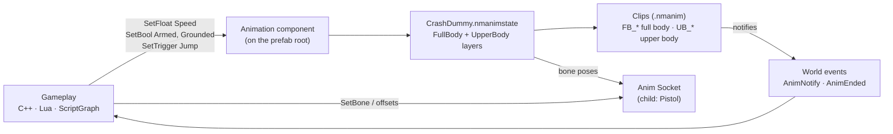
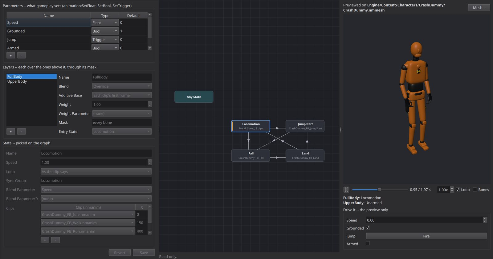
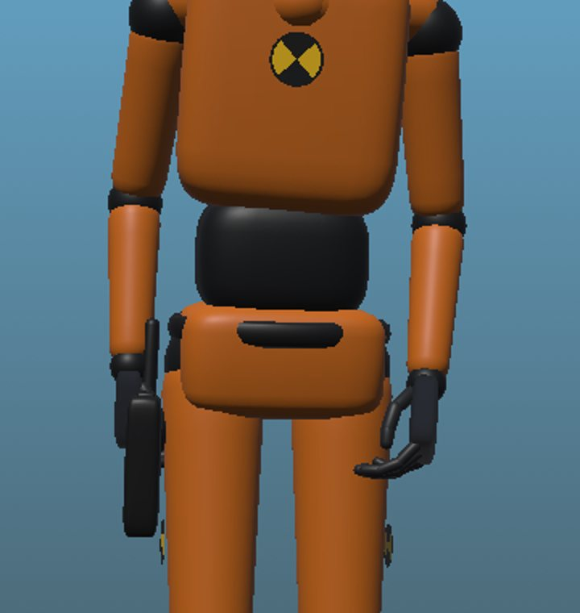
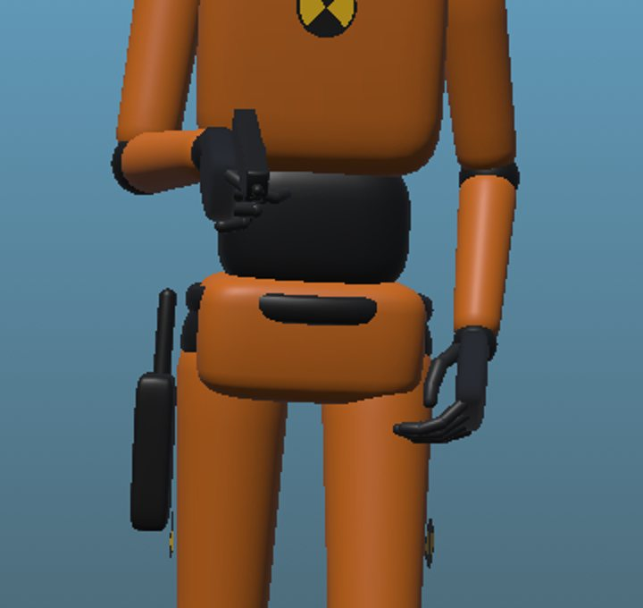
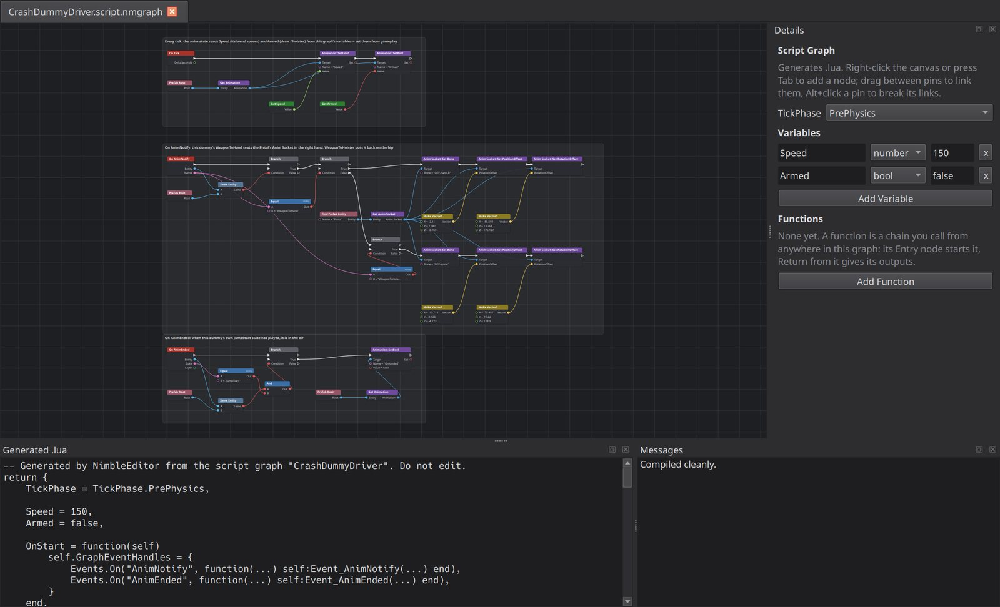
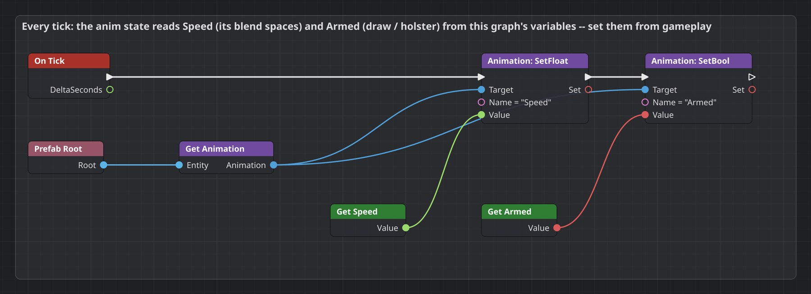
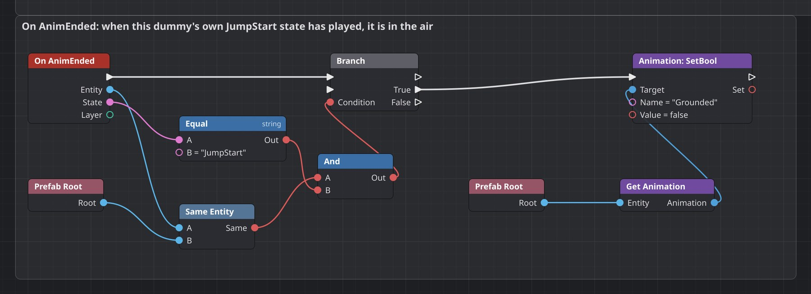
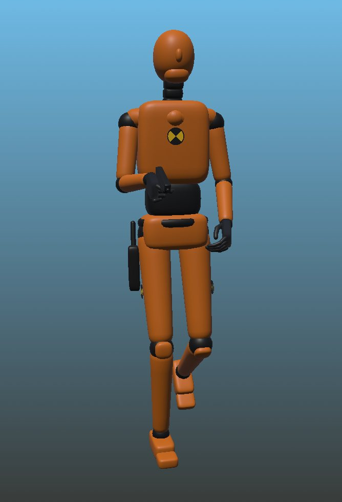
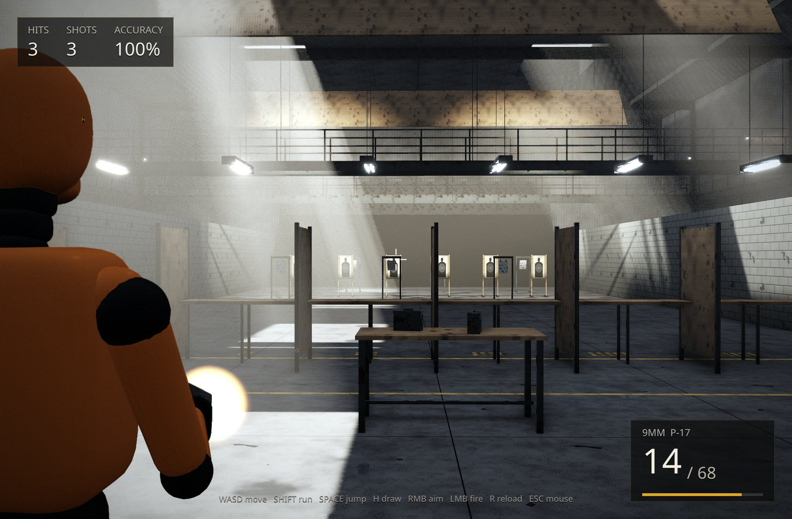
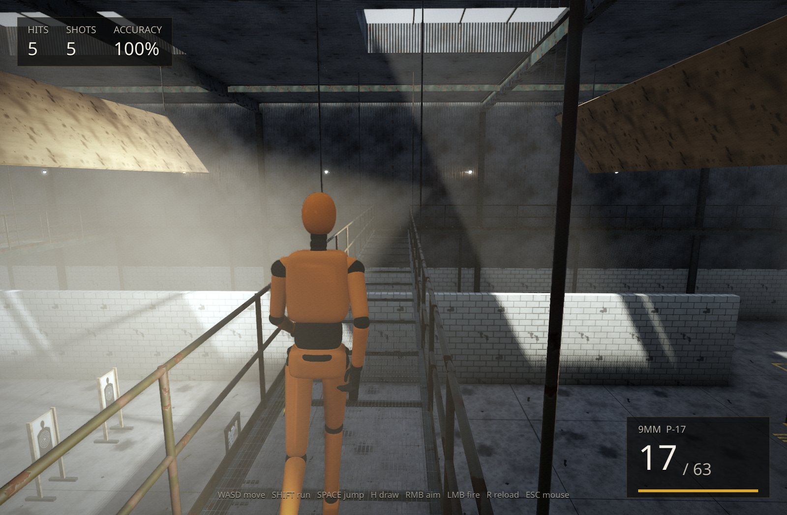

# Hooking up a layered character: the CrashDummy

From a Blender file to a character that walks, runs, jumps and draws a pistol,
with the arms in step with the legs. This guide follows the engine's CrashDummy
(`Engine/Content/Characters/CrashDummy`) and drives it three ways: C++, Lua and
a ScriptGraph.

**74** bones · **14** clips · **2** layers · **4** parameters · **2** notifies · **1** sync group

Reference: [ANIMATION.md](../../Modules/RenderCore/ANIMATION.md) (the animation
system), [Editor README](../../Modules/Editor/README.md) (the tools).

## Contents

0. [The moving parts](#the-moving-parts)
1. [Author in Blender](#1-author-in-blender)
2. [Import](#2-import)
3. [Build the anim state](#3-build-the-anim-state)
4. [Notifies and sockets](#4-notifies-and-sockets)
5. [Assemble the prefab](#5-assemble-the-prefab)
6. [Drive it](#6-drive-it): [C++](#c), [Lua](#lua), [ScriptGraph](#scriptgraph)
7. [Reference](#7-reference)
8. [Pitfalls](#8-pitfalls)

---

## The moving parts

Gameplay never plays clips directly. It sets a handful of **parameters** on the
character's Animation component and listens for **events**. The anim state
turns parameters into poses; the clips' notifies come back as events, and
gameplay answers them, here by moving the pistol's socket.



Each piece lives in its own file, so you can swap clips, retune the state
machine or rewrite gameplay without touching the others.

| Piece | File | Who edits it |
|---|---|---|
| Skinned mesh | `CrashDummy.nmmesh` | Importer |
| Skeleton | `CrashDummy_Skeleton.nmskel` | Importer |
| Clips and their notifies | `CrashDummy_FB_*.nmanim`, `CrashDummy_UB_*.nmanim` | Importer; notifies in the mesh viewer |
| State machine | `CrashDummy.nmanimstate` | Anim state editor |
| Character | `CrashDummyDemo.nmprefab` | Prefab editor |
| Behaviour | C++ system, `.lua` or `.script.nmgraph` | You |

## 1. Author in Blender

Most problems with layered characters start in the export, so settle these
before you animate.

### Keep a real bone hierarchy

Masks select a bone *and everything under it*. If the export flattens the
hierarchy, as Rigify's "deform bones only" does by parenting DEF bones under
ORG/MCH bones that are left out, the arms and legs come out as children of the
root. An upper-body mask then misses them, and they stop following the spine.
The CrashDummy was re-exported with every DEF bone parented to its nearest DEF
ancestor: thighs under `DEF-spine`, shoulders under `DEF-spine.003`.

### Split clips by the layer that plays them

Name full-body clips `FB_` and upper-body clips `UB_`. Upper-body clips should
key only the spine from the masked bone up, plus the arms. The engine bakes
every bone anyway, but a clean split makes the mask boundary obvious. Give
cyclic clips that blend together the same length (walk 32 frames on both
layers, run 24) so their steps line up.

### Record prop offsets as constraints

Parent the pistol with two **Child Of** constraints, one per bone it can ride
(`DEF-spine` for the holster, `DEF-hand.R` for the grip). Their inverse matrices
are exactly the socket offsets you need in the engine (step 4).

> **Facing.** glTF's forward is +Z and the importer mirrors Z, so an imported
> character faces **−Z** in the engine. A controller whose forward is +Z must
> turn the body 180°, for example by adding 180 to the body Transform's yaw.

## 2. Import

Import the `.glb` with the Content Browser's Import (or the console's
`import`). A skinned file writes a skeleton, the skinned mesh and one `.nmanim`
per animation, resampled at 30 fps.

```
import Engine/Content/Characters/CrashDummy/CrashDummy.glb Engine/Content/Characters/CrashDummy
```

- **Engine content.** Imported into `Engine/Content`, files record their
  skeleton and source as `Engine/Content/...` paths, so they reimport on any
  machine.
- **Colours.** Untextured glTF materials are baked into vertex colours (Bake
  Material Colours, on by default), so the mesh draws in its own colours with
  DefaultLit.
- **Re-exports are safe.** Importing the file again over existing clips keeps
  the notifies, looping, root motion and root bone you set in the editor.

## 3. Build the anim state

Create `CrashDummy.nmanimstate` (Content Browser › New Anim State) and give it
four parameters and two layers.



*The anim state editor on the FullBody layer. Left: parameters, layers and the
picked state's form; Locomotion is a 1D blend space on Speed in sync group
`Locomotion`. Middle: the state graph. Right: a live preview you can drive.*

| Layer | States | Transitions |
|---|---|---|
| **FullBody** (every bone) | Locomotion: blend on Speed, Idle 0 · Walk 150 · Run 400, sync `Locomotion`; JumpStart (once) · Fall (loop) · Land (once) | Locomotion → JumpStart when `Jump` triggered; JumpStart → Fall at end; Locomotion → Fall when not `Grounded`; Fall → Land when `Grounded`; Land → Locomotion at end |
| **UpperBody** (mask `DEF-spine.002`, weight × `Grounded`) | Unarmed: blend on Speed (UB_Idle/Walk/Run), sync `Locomotion`; Equip (once, holds) · Armed: blend (UB_*_Armed), sync `Locomotion` · Holster (once) | Unarmed → Equip when `Armed`; Equip → Armed at end; Armed or Equip → Holster when not `Armed`; Holster → Unarmed at end |

### Why the sync group matters

Each layer keeps its own clock. Without a sync group, drawing the pistol
mid-stride restarts the arms' walk cycle while the legs carry on, and the arms
swing out of step. With `Locomotion` on FullBody's Locomotion and on
UpperBody's Unarmed and Armed, the upper layer takes the full body's phase every
frame, whatever the clip lengths. A transition between two states of one group
(Unarmed to Armed) also continues from the current phase instead of frame 0.

> **Air time.** UpperBody's weight is scaled by `Grounded`, so in the air the
> full body's flailing arms play. The weight follows the parameter instantly,
> with no blend; see [Pitfalls](#8-pitfalls).

## 4. Notifies and sockets

The pistol is a separate entity. An **Anim Socket** holds it on a bone of its
parent's pose. Equip and Holster each carry a notify at the frame where the hand
meets the grip, and gameplay moves the socket when one fires.

| Clip | Notify | Time | Why that frame |
|---|---|---|---|
| `UB_EquipWeapon` | `WeaponToHand` | 0.333 s (frame 11) | the hand is on the holstered grip for frames 8–14 |
| `UB_HolsterWeapon` | `WeaponToHolster` | 0.633 s (frame 20) | the gun is back in the holster for frames 16–24 |

Add notifies in the mesh viewer (open a clip › Clip › Notifies: double-click the
timeline). The socket offsets are the Blender Child Of inverse matrices,
converted to engine axes (Z mirrored, ×100 for cm):

| Seat | Bone | Position offset | Rotation offset (°) |
|---|---|---|---|
| Holster | `DEF-spine` | −19.719, 0.128, −4.773 | −75.407, 7.744, 2.009 |
| Hand | `DEF-hand.R` | −2.110, 7.087, −0.769 | −85.592, 13.264, 175.197 |

| Before `WeaponToHand` | After it |
|---|---|
|  |  |
| Equip: the socket is still on `DEF-spine`. | The socket rides `DEF-hand.R`; the holster is empty. |

## 5. Assemble the prefab

Two entities: the character, with Render and Animation, and the pistol as its
child, with Render and Anim Socket. A socket only works under a parent that has
an Animation component. The script names whichever driver you choose in step 6.

```xml
<?xml version="1.0" encoding="UTF-8"?>
<Prefab Format="1" Name="CrashDummyDemo" NextId="3">
  <Script Path="Engine/Content/Characters/CrashDummy/CrashDummyDemo.lua" />
  <Tick Mode="Tick" />
  <Entity Id="1" Name="CrashDummy">
    <Component Type="Animation" Version="1">
      <Animation Value="Engine/Content/Characters/CrashDummy/CrashDummy.nmanimstate" />
      <PlayRate Value="1" />
      <Paused Value="false" />
      <ParameterCount Value="0" />
    </Component>
    <Component Type="Render" Version="5">
      <Visible Value="true" />
      <Material0 Value="" />
      <Mesh Value="Engine/Content/Characters/CrashDummy/CrashDummy.nmmesh" />
      <ParameterCount Value="0" />
      <CastShadows Value="true" />
    </Component>
    <Component Type="Transform" Version="1">
      <Position X="0" Y="0" Z="0" />
      <Rotation X="0" Y="0" Z="0" />
      <Scale X="1" Y="1" Z="1" />
    </Component>
  </Entity>
  <Entity Id="2" Name="Pistol" Parent="1">
    <Component Type="Anim Socket" Version="1">
      <Bone Value="DEF-spine" />
      <PositionOffset X="-19.719" Y="0.128" Z="-4.773" />
      <RotationOffset X="-75.407" Y="7.744" Z="2.009" />
    </Component>
    <Component Type="Render" Version="5">
      <Visible Value="true" />
      <Material0 Value="" />
      <Mesh Value="Engine/Content/Characters/CrashDummy/Weapon_Pistol.nmmesh" />
      <ParameterCount Value="0" />
      <CastShadows Value="true" />
    </Component>
    <Component Type="Transform" Version="1">
      <Position X="0" Y="0" Z="0" />
      <Rotation X="0" Y="0" Z="0" />
      <Scale X="1" Y="1" Z="1" />
    </Component>
  </Entity>
</Prefab>
```

## 6. Drive it

All three drivers do the same three jobs: set Speed from movement (and the other
parameters from gameplay), seat the pistol on the two notifies, and clear
Grounded when the take-off ends. Pick whichever fits the rest of your game.

### C++

*Verified: built and linked into a game module; in play its handlers logged
`WeaponToHand` then `WeaponToHolster`.*

A game-module system for every character with an Animation component, plus two
event handlers on the World's EventBus. Register it from your mode's `OnLoad`.
Systems in `TP_PrePhysics` run before the animation system ticks in
`TP_PostUpdate`, so parameters set here are read the same frame.

```cpp
#include "Public/GameCore/Components.h"
#include "Public/GameCore/Entity.h"
#include "Public/GameCore/EventBus.h"
#include "Public/GameCore/World.h"
#include "Public/RenderCore/AnimInstance.h"
#include "Public/RenderCore/AnimationSystem.h"
#include "Public/RenderCore/Components/AnimSocketComponent.h"
#include "Public/RenderCore/Components/AnimationComponent.h"

#include <cmath>
#include <cstdint>
#include <cstring>
#include <unordered_map>

/*
 * CrashDummyDriver: drives every CrashDummy-style character in a World from C++.
 *
 *   each tick   the anim state's Speed from how fast the entity moved, Grounded
 *               from a probe of your own, Armed from gameplay
 *   AnimNotify  WeaponToHand / WeaponToHolster move the child "Pistol"'s Anim Socket
 *   AnimEnded   JumpStart has played: off the ground
 *
 * Call CrashDummyDriverStart(World) from your mode's OnLoad and
 * CrashDummyDriverStop(World) from OnUnload.
 */
namespace
{
    /* Where the pistol sits: a bone and an offset in that bone's frame (the
     * source .blend's Child Of constraints, converted to engine space). */
    struct Seat
    {
        const char*         Bone;
        EngineCore::Vector3 Position;
        EngineCore::Vector3 Rotation;   // Euler degrees
    };
    const Seat HOLSTER { "DEF-spine",  EngineCore::Vector3(-19.719, 0.128, -4.773), EngineCore::Vector3(-75.407, 7.744, 2.009) };
    const Seat HAND    { "DEF-hand.R", EngineCore::Vector3(-2.110, 7.087, -0.769),  EngineCore::Vector3(-85.592, 13.264, 175.197) };

    /* Each character's position last tick, for its speed. */
    std::unordered_map<uint64_t, EngineCore::Vector3> GLastPosition;

    GameCore::EntityID FindChild(GameCore::World& InWorld, const GameCore::EntityID InParent, const char* InName)
    {
        for(GameCore::EntityID C = InWorld.GetEntity(InParent).GetFirstChild(); C.IsSet(); C = InWorld.GetEntity(C).GetNextSibling())
        {
            if(std::strcmp(InWorld.GetEntity(C).GetName(), InName) == 0) { return C; }
        }
        return GameCore::EntityID();
    }

    void SeatPistol(GameCore::World& InWorld, const GameCore::EntityID InCharacter, const Seat& InSeat)
    {
        const GameCore::EntityID Pistol = FindChild(InWorld, InCharacter, "Pistol");
        RenderCore::AnimSocketComponent* Socket =
            Pistol.IsSet() ? InWorld.GetEntity(Pistol).GetComponent<RenderCore::AnimSocketComponent>() : nullptr;
        if(!Socket) { return; }
        std::strncpy(Socket->Bone, InSeat.Bone, RenderCore::ANIM_SOCKET_BONE_MAX - 1);
        Socket->Bone[RenderCore::ANIM_SOCKET_BONE_MAX - 1] = '\0';
        Socket->PositionOffset = InSeat.Position;
        Socket->RotationOffset = InSeat.Rotation;
    }

    /* "AnimNotify" (Entity, Name): the animation system emits it as a clip passes a notify. */
    void OnAnimNotify(GameCore::EventID, const GameCore::EventArgs& InArgs, void* InUserData)
    {
        GameCore::World& World = *static_cast<GameCore::World*>(InUserData);
        const GameCore::EntityID Character = GameCore::EntityID::Unpack(InArgs.Args[0].Entity);
        const char* Name = InArgs.Args[1].String;
        if(std::strcmp(Name, "WeaponToHand") == 0)         { SeatPistol(World, Character, HAND); }
        else if(std::strcmp(Name, "WeaponToHolster") == 0) { SeatPistol(World, Character, HOLSTER); }
    }

    /* "AnimEnded" (Entity, State, Layer): a state that plays once reached its end. */
    void OnAnimEnded(GameCore::EventID, const GameCore::EventArgs& InArgs, void* InUserData)
    {
        GameCore::World& World = *static_cast<GameCore::World*>(InUserData);
        const GameCore::EntityID Character = GameCore::EntityID::Unpack(InArgs.Args[0].Entity);
        if(std::strcmp(InArgs.Args[1].String, "JumpStart") != 0) { return; }
        if(RenderCore::AnimationComponent* Animation = World.GetEntity(Character).GetComponent<RenderCore::AnimationComponent>())
        {
            Animation->SetBool("Grounded", false);   // your landing code sets it back
        }
    }

    /* TP_PrePhysics, before the animation system ticks in TP_PostUpdate: parameters
     * set here are read this frame. */
    void DriveCharacters(GameCore::World& InWorld, const float InDeltaSeconds, void*)
    {
        if(InDeltaSeconds <= 0.0f) { return; }
        InWorld.Each<RenderCore::AnimationComponent>([&InWorld, InDeltaSeconds](const GameCore::Entity& InEntity,
                                                                                RenderCore::AnimationComponent& InAnimation)
        {
            const GameCore::TransformComponent* Transform = InEntity.GetComponent<GameCore::TransformComponent>();
            if(!Transform) { return; }
            /* Speed: units/s across the ground since last tick (the blend spaces are
             * laid out in units/s: walk 150, run 400). */
            const EngineCore::Vector3 Now = Transform->Position;
            const auto Found = GLastPosition.find(InEntity.GetID().Pack());
            if(Found != GLastPosition.end())
            {
                const double DX = Now.GetX() - Found->second.GetX(), DZ = Now.GetZ() - Found->second.GetZ();
                InAnimation.SetFloat("Speed", float(std::sqrt(DX * DX + DZ * DZ) / InDeltaSeconds));
            }
            GLastPosition[InEntity.GetID().Pack()] = Now;

            /* Reading the playback: which state each layer is in, and where a bone is. */
            const RenderCore::AnimationSystem* Animation = RenderCore::AnimationSystem::Find(&InWorld);
            const RenderCore::AnimInstance* Instance = Animation ? Animation->FindInstance(InEntity.GetID()) : nullptr;
            if(Instance && Instance->GetLayerCount() > 1 && std::strcmp(Instance->GetCurrentStateName(1), "Armed") == 0)
            {
                GameCore::TransformPose Hand;
                if(Animation->GetBoneWorldPose(InEntity.GetID(), "DEF-hand.R", Hand))
                {
                    (void)Hand;   // e.g. where a muzzle flash or a laser sight starts
                }
            }
        });
    }
}

void CrashDummyDriverStart(GameCore::World& InWorld)
{
    InWorld.RegisterSystem("Game.CrashDummyDriver", GameCore::TP_PrePhysics, &DriveCharacters, nullptr);
    InWorld.GetEvents().Subscribe("AnimNotify", &OnAnimNotify, &InWorld);
    InWorld.GetEvents().Subscribe("AnimEnded", &OnAnimEnded, &InWorld);
}

void CrashDummyDriverStop(GameCore::World& InWorld)
{
    InWorld.UnregisterSystem(&DriveCharacters, nullptr);
    InWorld.GetEvents().UnsubscribeAll(&InWorld);
    GLastPosition.clear();
}
```

Your game mode:

```cpp
void CrashDummyDriverStart(GameCore::World& InWorld);
void CrashDummyDriverStop(GameCore::World& InWorld);

bool MyMode::OnLoad(NimbleEngine::GameSession& InSession)
{
    Session = &InSession;
    CrashDummyDriverStart(InSession.GetWorld());
    return true;
}

void MyMode::OnUnload()
{
    CrashDummyDriverStop(Session->GetWorld());
}
```

For a player-controlled character, set the parameters from your movement code
instead: call `SetFloat("Speed", …)` and `SetBool("Grounded", …)` right after
moving the body (an avatar simulation is a good place), and
`SetTrigger("Jump")` when it leaves the ground.

### Lua

*Verified: syntax-checked with luac 5.4; ran in play with no script errors.*

The prefab's own script (`<Script Path="…/CrashDummyDriver.lua" />`).
Components are reached through `self.Root` and `self.Instance:Find`. Events are
world-wide, so compare entity IDs to keep only this character's; Lua entity
handles are not `==`.

```lua
-- CrashDummyDriver.lua: a CrashDummy prefab's script (<Script Path> in the .nmprefab).
-- Each tick it tells the anim state how fast the character moves and reads two keys;
-- the clips' notifies move the pistol between holster and hand.

local HOLSTER = { Bone = "DEF-spine",  Position = { -19.719, 0.128, -4.773 }, Rotation = { -75.407,  7.744,   2.009 } }
local HAND    = { Bone = "DEF-hand.R", Position = {  -2.110, 7.087, -0.769 }, Rotation = { -85.592, 13.264, 175.197 } }

local function Seat(socket, where)
    socket:SetBone(where.Bone)
    socket:SetPositionOffset(where.Position[1], where.Position[2], where.Position[3])
    socket:SetRotationOffset(where.Rotation[1], where.Rotation[2], where.Rotation[3])
end

return {
    OnStart = function(self)
        self.Animation = self.Root:GetComponent("Animation")
        self.Transform = self.Root:GetComponent("Transform")
        self.Socket    = self.Instance:Find("Pistol"):GetComponent("Anim Socket")
        local x, _, z = self.Transform:GetWorldPosition()
        self.LastX, self.LastZ = x, z
        Seat(self.Socket, HOLSTER)

        -- Events are world-wide: keep only this character's.
        local id = self.Root:GetID()
        Events.On("AnimNotify", function(entity, name)
            if entity:GetID() ~= id then return end
            if name == "WeaponToHand" then Seat(self.Socket, HAND)
            elseif name == "WeaponToHolster" then Seat(self.Socket, HOLSTER) end
        end)
        Events.On("AnimEnded", function(entity, state, layer)
            if entity:GetID() == id and state == "JumpStart" then
                self.Animation:SetBool("Grounded", false)   -- your landing code sets it back
            end
        end)
    end,

    OnPostPhysics = function(self, dt)
        -- Speed in units/s across the ground: the blend spaces put walk at 150, run at 400.
        local x, _, z = self.Transform:GetWorldPosition()
        local speed = math.sqrt((x - self.LastX) ^ 2 + (z - self.LastZ) ^ 2) / math.max(dt, 1e-4)
        self.LastX, self.LastZ = x, z
        self.Animation:SetFloat("Speed", speed)

        if Input.WasKeyPressed("H") then
            self.Animation:SetBool("Armed", not self.Animation:GetBool("Armed"))
        end
        if Input.WasKeyPressed("Space") then
            self.Animation:SetTrigger("Jump")    -- spent when Locomotion -> JumpStart fires
        end

        -- Reading it back: each layer's state, and where a bone is in the world.
        if self.Animation:GetState(1) == "Armed" then
            local hx, hy, hz = self.Animation:GetBoneLocation("DEF-hand.R")
        end
    end,
}
```

The engine's own `CrashDummyDemo.lua` is the same idea on a timed loop (walk,
draw, run, jump, holster), with no input.

### ScriptGraph

*Verified: compiled cleanly in the graph editor; in play it walked at Speed 150
and seated the pistol in the hand.*

The same driver as a ScriptGraph: three event chains. The graph's variables
`Speed` and `Armed` are what gameplay changes; set them from another graph,
from Lua, or per instance.



*CrashDummyDriver.script.nmgraph in the graph editor. Bottom left: the Lua it
generates on save. Bottom right: "Compiled cleanly". The three chains follow at
full size.*

#### On Tick: parameters every frame



Prefab Root → Get Animation → Animation: Set Float (`Speed` ← variable) →
Animation: Set Bool (`Armed` ← variable).

#### On AnimNotify: seat the pistol


Same Entity (Entity, Prefab Root) → Branch → Equal (Name, `WeaponToHand`) →
Branch → Find Prefab Entity `Pistol` → Get Anim Socket → Anim Socket: Set Bone
(`DEF-hand.R`) → Set PositionOffset (Make Vector3) → Set RotationOffset (Make
Vector3). The False path checks `WeaponToHolster` and runs the same row for
`DEF-spine`. **Same Entity** keeps only this prefab's notifies.

#### On AnimEnded: leave the ground



Same Entity and Equal (State, `JumpStart`) → And → Branch → Animation: Set Bool
(`Grounded` = false). Your landing code sets it back.

#### What runs



*The graph alone driving the dummy (Armed true): Speed 150 walks it, Equip
played, and `WeaponToHand` moved the pistol.*

The editor generates this Lua for the notify chain; it is what runs:

```lua
Event_AnimNotify = function(self, Arg1, Arg2, Arg3, Arg4)
    local t1 = self.Root
    local t2 = (Arg1):GetID() == (t1):GetID()
    if t2 then
        local t3 = Arg2 == "WeaponToHand"
        if t3 then
            local t4 = self.Instance:Find("Pistol")
            local t5 = t4:GetComponent("Anim Socket")
            t5:SetBone("DEF-hand.R")
            local t6 = self.Instance:Find("Pistol")
            local t7 = t6:GetComponent("Anim Socket")
            t7:SetPositionOffset(-2.11, 7.087, -0.769)
            local t8 = self.Instance:Find("Pistol")
            local t9 = t8:GetComponent("Anim Socket")
            t9:SetRotationOffset(-85.592, 13.264, 175.197)
        else
            local t10 = Arg2 == "WeaponToHolster"
            if t10 then
                local t11 = self.Instance:Find("Pistol")
                local t12 = t11:GetComponent("Anim Socket")
                t12:SetBone("DEF-spine")
                local t13 = self.Instance:Find("Pistol")
                local t14 = t13:GetComponent("Anim Socket")
                t14:SetPositionOffset(-19.719, 0.128, -4.773)
                local t15 = self.Instance:Find("Pistol")
                local t16 = t15:GetComponent("Anim Socket")
                t16:SetRotationOffset(-75.407, 7.744, 2.009)
            end
        end
    end
end,
```

> **Staging.** Script graphs are staged from `Scripts/` only. A graph saved
> next to its prefab under `Content/Prefabs` fails at play with
> `could not read`.

## 7. Reference

### Parameters

| Name | Type | Default | Meaning | C++ | Lua | Graph node |
|---|---|---|---|---|---|---|
| `Speed` | float | 0 | ground speed, units/s: walk 150, run 400 | `SetFloat` | `animation:SetFloat` | Animation: Set Float |
| `Grounded` | bool | 1 | on the ground; also the upper layer's weight | `SetBool` | `animation:SetBool` | Animation: Set Bool |
| `Jump` | trigger | 0 | take off; spent by the transition | `SetTrigger` | `animation:SetTrigger` | Animation: Set Trigger |
| `Armed` | bool | 0 | draw (true) or holster (false) | `SetBool` | `animation:SetBool` | Animation: Set Bool |

### Events

| Event | Arguments | C++ | Lua | Graph |
|---|---|---|---|---|
| `AnimNotify` | Entity, Name | `World.GetEvents().Subscribe("AnimNotify", …)` | `Events.On("AnimNotify", fn)` | On AnimNotify |
| `AnimEnded` | Entity, State, Layer | `Subscribe("AnimEnded", …)` | `Events.On("AnimEnded", fn)` | On AnimEnded |

### Reading the playback

| Question | C++ | Lua |
|---|---|---|
| Which state is layer *n* in? | `AnimationSystem::Find(&World)->FindInstance(e)->GetCurrentStateName(n)` | `animation:GetState(n)` |
| Is it blending in? | `…->IsInTransition(n)` | `animation:IsInTransition(n)` |
| Where is a bone? | `AnimationSystem::GetBoneWorldPose(e, "DEF-hand.R", Pose)` | `animation:GetBoneLocation("DEF-hand.R")` |

## 8. Pitfalls

- **Filter events by entity.** AnimNotify and AnimEnded fire for every
  character in the world. Compare IDs: `entity:GetID() ~= id` in Lua,
  **Same Entity** in a graph, or the unpacked `EntityID` in C++.
- **One-shots hold their last frame.** Equip stays on its final pose until a
  transition leaves it. That's why Equip → Armed is an at-end transition.
- **Triggers are spent once.** `Jump` resets when a transition uses it. Set it
  again for the next jump; don't hold it.
- **Weights snap.** A layer's weight parameter takes effect immediately, so set
  Grounded a little late (keep it true for about 0.1 s of air) to avoid pops on
  small drops.
- **Crossfades restart from the leaving state.** A transition taken mid-fade
  starts from the state being left, not the blended pose. Keep crossfades short
  where states change quickly.
- **Twelve parameters per Animation component.** Keep extra state in your own
  code, not in spare parameters.
- **Reflection probes on this branch** render a skinned character like chrome
  whatever its roughness. Until that is fixed, light characters without probes,
  and give the dummy a matte material (roughness ~0.85) rather than DefaultLit.

## In a full game

The same character as a third-person shooter: a C++ avatar simulation sets
Speed and Grounded as it walks the physics, Lua shoots and seats the pistol, and
holding right mouse scopes the camera in.

| Scoped, firing | Walking, holstered |
|---|---|
|  |  |
| Armed state, pistol in hand. | Upper and lower layers in step through the Locomotion sync group. |

---

*Screenshots are from the editor's Vulkan viewport and its windows, captured
with the console's `screenshot`, `animstate windowshot`, `graph windowshot` and
`graph canvasshot` (the whole graph at 2x; see the Editor README's "Capturing
graphs for documentation").*
