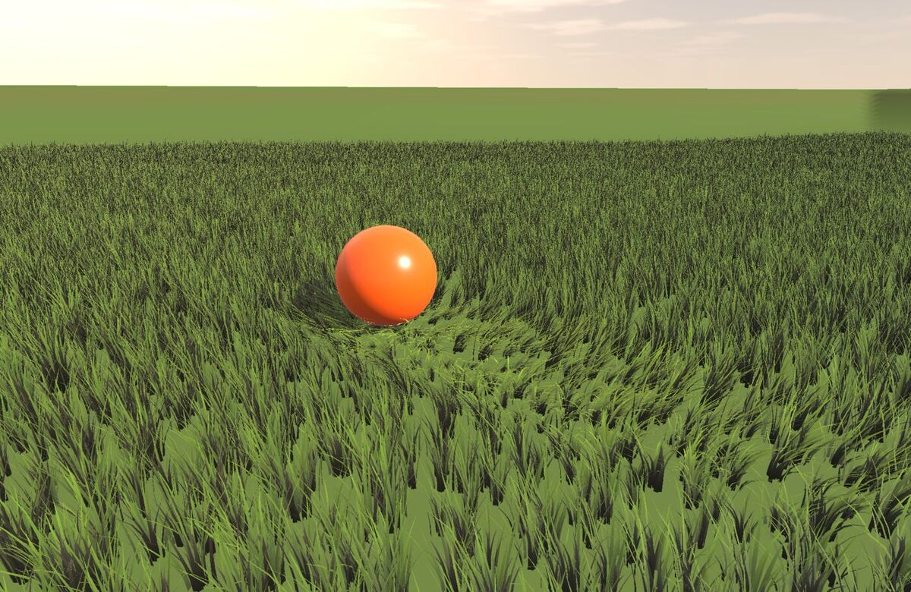
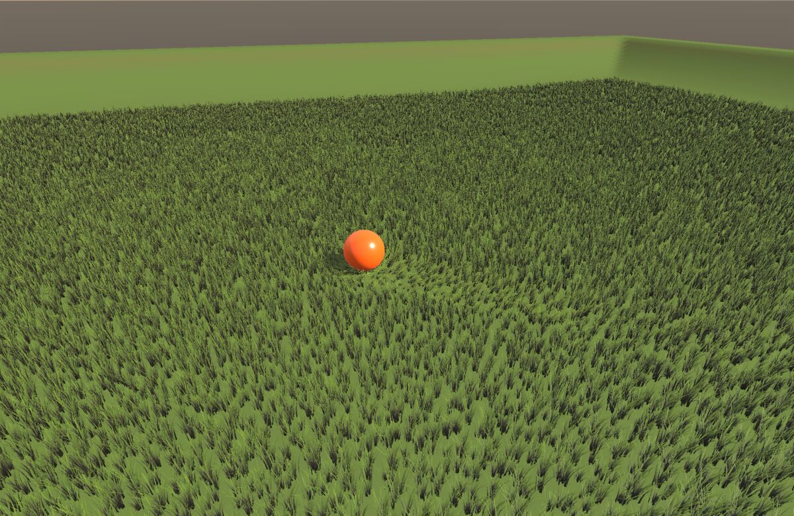
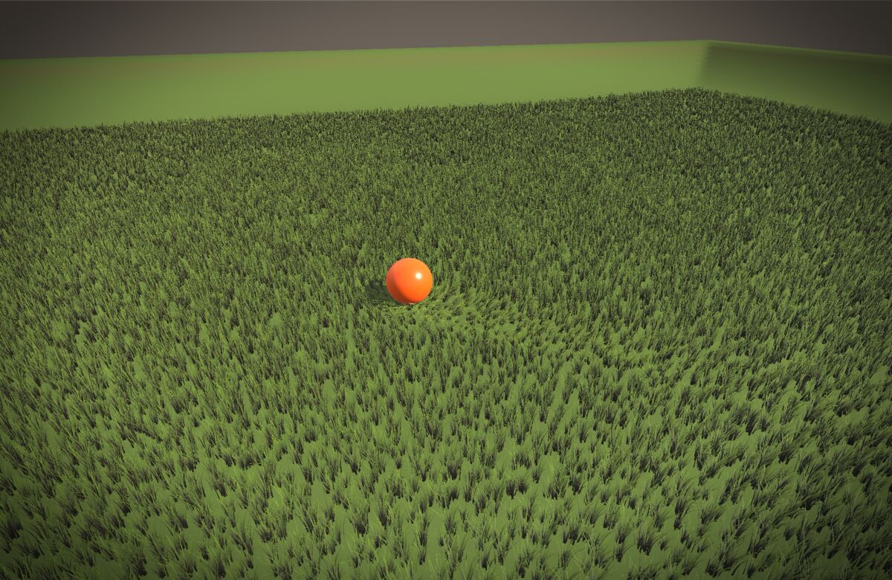
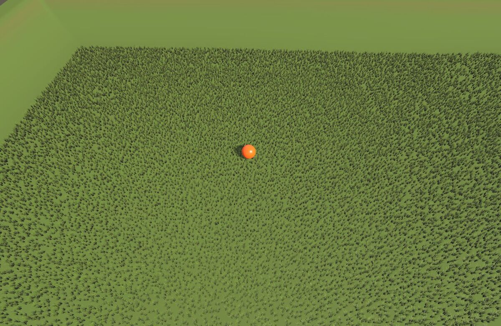
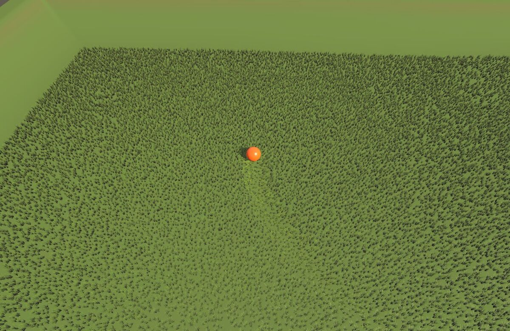
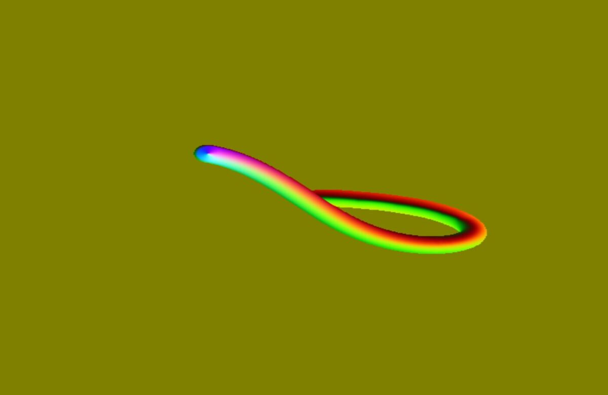
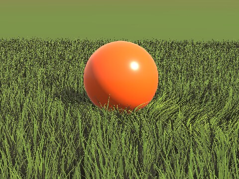
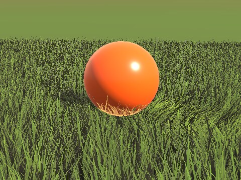
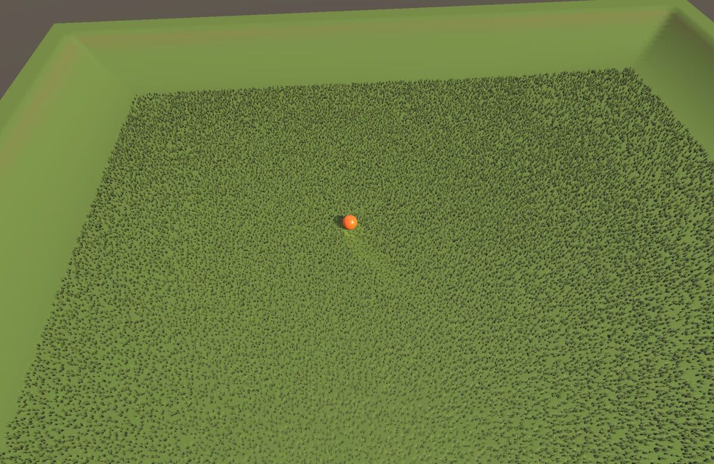

# Custom render passes: a guide

Add your own GPU work to a world's frames: a full-screen effect, a texture
your materials read, a second look at chosen meshes, a compute job. This
guide builds the passes of WorldsLab's **GrassLab** world, where a ball
rolls through a field of grass and the grass parts around it and springs
back. Nothing in the renderer knows about grass or balls. Four passes in the
game module do all of it:

| Pass | Hook | What it shows |
|---|---|---|
| Vignette | `AfterPostProcess` | the smallest pass: one full-screen shader over the finished picture |
| GrassTrail | `BeforeScene` | a pass that feeds a material: the grass bends by a texture the pass draws each frame |
| BallXRay | `AfterForward` | redrawing chosen meshes (a mesh group) with your own shader |
| TrailStats | `BeforeScene` | compute: state kept on the GPU, read back now and then |



`Engine/Modules/RenderCore/RENDERPIPELINE.md` ("Custom render passes") is
the reference, and `RenderCore/Public/RenderCore/CustomRenderPass.h` is the
API. Everything here is real code: `Games/WorldsLab/WorldsLabGrassLab.cpp`
and the shaders in `Games/WorldsLab/Content/Shaders/GrassLab*`. Run it with
`WorldsLab -Game.StartLevel=GrassLab`, or open
`Content/Levels/GrassLab.nmworld` in the editor and press Play.

---

## The model in one picture

```
 game thread                                       render thread
 ───────────                                       ─────────────
 OnLoad:  RegisterCustomRenderPass(&World,         RenderSceneStages, for each of the
            pass, ERenderHook::…, Order)           World's views:
                     │
 every frame:        │                               Background
   WorldBridge ──► pass->Extract()  ── values ──►   ├─ BeforeScene        ◄─ your passes
                     (RenderPassMailbox)             PrePass
                                                     ├─ AfterPrePass
                                                     Base Pass (G-buffer)
                                                     ├─ AfterBasePass
                                                     AO, Shadows, Lighting, IBL, SSR
                                                     ├─ AfterLighting
                                                     Unlit, Translucent
                                                     ├─ AfterForward
                                                     Volumetric fog
                                                     ├─ BeforePostProcess
                                                     TAA, exposure, tone map
                                                     ├─ AfterToneMap       (SetCurrent)
                                                     post process stack
                                                     ├─ AfterPostProcess   (SetCurrent)
 OnUnload: UnregisterCustomRenderPass(h)             UI, stats
           FlushRenderCommands()
```

A pass is a `CustomRenderPass` subclass. You register an instance for a
**World**, at a **hook**. Each frame the engine calls its `Extract` on the
game thread, then, on the render thread, its `ShouldRun` and `Execute` at
that hook. Inside `Execute` it draws through the `RenderPassContext` it is
handed. That context has no GDI types, so game modules can use it.

---

## 1. The smallest pass: a vignette

A full-screen shader that darkens the corners of the finished picture.

### The shader

Shaders for passes are plain cooked shaders, named by file. A game's go in
its `Content/Shaders/`. NimbleCook cooks them into the game's shader cache
next to its materials, the same as it does for the engine's own shaders.
**Names are global**, so prefix yours: `GrassLabVignette.fsh`, not
`Vignette.fsh`.

```glsl
#version 450 core
// GrassLabVignette.fsh -- darkens the corners of the finished picture.

#include <PostProcessCommon.glsl>

MATERIAL_SAMPLER2D(4, Picture)          // input 0: the picture so far

UBO_BLOCK_BEGIN(2, PP_Block)
    mat4 PP_Unused;                     // RenderPassParams::Matrix
    vec4 PP_Vignette;                   // RenderPassParams::A -- x: strength, y: radius
    vec4 PP_Unused2;                    // RenderPassParams::B
UBO_BLOCK_END(PP_Block)

void main(void)
{
    vec2  UV     = Interpolants.TexCoord;
    vec3  Colour = texture(Picture, Scene_ViewUv(UV)).rgb;
    float Edge   = smoothstep(PP_Vignette.y, 1.0, length(UV - 0.5) * 1.41421);
    Output = vec4(Colour * (1.0 - PP_Vignette.x * Edge), 1.0);
}
```

What a full-screen pass shader gets:

| | |
|---|---|
| `PostProcessCommon.glsl` | the full-screen interpolants (`Interpolants.TexCoord`: 0,0 is the top left of what the pass draws), `Output`, the scene block |
| `Scene_ViewUv(UV)` | `Interpolants.TexCoord` as a UV in a scene texture, or in a target you acquired with no `Width` (sized from the view). Under dynamic resolution the scene draws in the top-left part of those targets (RENDERPIPELINE.md, "Resolution scale"), so sample them through this: it scales the UV and keeps taps inside the drawn part. `Scene_ViewUvHalf` is for half-size ones. A target with its own `Width` and `Height`, and `texelFetch` at `gl_FragCoord`, need nothing |
| inputs | `DrawFullscreen`'s textures, in order, as material textures 0-6: `MATERIAL_SAMPLER2D(4 + slot, Name)` |
| slot 7 | always the scene depth: `MATERIAL_SAMPLER2D(11, SceneDepth)` (window depth, 0 near) |
| `PP_Block` (binding 2) | `RenderPassParams`, std140: `mat4 Matrix; vec4 A; vec4 B;`. Name the members whatever you like, but keep the layout: 96 bytes |
| scene block (binding 3) | the camera, the inverse view-projection (`PP_WorldAt` turns a depth into a world point), time, lights |

`cook_material_graphs.py -check <file>` compiles a shader to SPIR-V without
cooking anything. That's the quick way to find a typo.

### The pass

```cpp
#include "Public/RenderCore/CustomRenderPass.h"

NIMBLE_CONFIG_FLOAT(GGrassLabVignette, "WorldsLab", "GrassLabVignette", 0.0f, nullptr);

struct VignetteSettings
{
    float Strength = 0.0f;
};

class VignettePass final : public RenderCore::CustomRenderPass
{
public:
    const char* GetName() const override { return "Vignette"; }

    /* Game thread, once a frame: hand the render thread this frame's values. */
    void Extract() override
    {
        VignetteSettings Now;
        Now.Strength = GGrassLabVignette.GetFloat();
        Settings.Put(Now);
    }

    /* Render thread. */
    void Execute(RenderCore::RenderPassContext& InContext) override
    {
        using namespace RenderCore;
        const VignetteSettings Now = Settings.Get();
        if(Now.Strength <= 0.0f)
        {
            return;
        }
        const RenderPassTarget Out = InContext.AcquireTarget("Picture", RenderPassTargetDesc());   // the view's size, RGBA8
        RenderPassParams Params;
        Params.A[0] = Now.Strength;
        Params.A[1] = 0.55f;                                                                      // where the darkening starts
        if(InContext.DrawFullscreen("GrassLabVignette.fsh", Out, { InContext.GetSceneTexture(ESceneTexture::Current) }, Params))
        {
            InContext.SetCurrent(Out);                                                            // the UI draws over this now
        }
    }

private:
    RenderCore::RenderPassMailbox<VignetteSettings> Settings;
};
```

Three things to notice:

- **The render thread never reads the config var.** `Extract` runs on the
  game thread and puts the values in a `RenderPassMailbox`. `Execute` takes
  them out on the render thread, which may still be drawing the frame
  before. Anything a pass needs from the game crosses this way.
- **It doesn't draw onto the picture it reads.** `ESceneTexture::Current`
  is the picture so far. The pass draws into a target of its own, then
  `SetCurrent` makes that target the picture from here on. `SetCurrent`
  works at `AfterToneMap` and `AfterPostProcess`; at the other hooks, draw
  into the scene colour (`DrawFullscreen` with no target) or into targets
  of your own.
- **Targets are pooled.** `AcquireTarget("Picture", …)` makes the target
  once and hands back the same one every frame while its size and format
  hold. It follows the view's size unless you give it one.

### Registering it

```cpp
class WorldsLabGrassLabMode : public NimbleEngine::IGameMode
{
    bool OnLoad(NimbleEngine::GameSession& InSession) override
    {
        GameCore::World& World = InSession.GetWorld();
        Passes.push_back(RenderCore::RegisterCustomRenderPass(&World, std::make_shared<VignettePass>(),
                                                              RenderCore::ERenderHook::AfterPostProcess));
        ...
    }

    void OnUnload() override
    {
        for(const RenderCore::RenderPassHandle Each : Passes) { RenderCore::UnregisterCustomRenderPass(Each); }
        Passes.clear();
        /* The render thread may still hold the passes for a frame in flight: their
         * code is this module's, which may be unloaded next (a hot reload). */
        RenderCore::FlushRenderCommands();
    }

    std::vector<RenderCore::RenderPassHandle> Passes;
};
```

Passes belong to a World (the registry is keyed by its address), so a mode
registers its own in `OnLoad` and removes them in `OnUnload`. **Always
flush after unregistering in a game module.** A frame in flight may still
hold the pass, and a hot reload unloads the code its vtable points to.

`WorldsLab.GrassLabVignette 0.6` in the console:

| Off | On |
|---|---|
|  |  |

---

## 2. Feeding a material: the grass trail

The grass bends where the ball has been, and that state lives in a texture.
A pass keeps a top-down map of the field: which way each patch of grass is
pushed, and how flat. The grass material's World Position Offset reads that
map. The pass runs at `BeforeScene`, before anything draws, so the grass
reads this frame's trail, not last frame's.

### State across frames: ping-pong two targets

A pass can't read and write one target in one draw. To carry the trail
across frames, it keeps two targets and swaps them each frame: it reads
last frame's and writes this frame's.

```cpp
RenderPassTargetDesc Desc;
Desc.Width  = 512;                                  // a fixed size: the field, not the view
Desc.Height = 512;
Desc.Format = ERenderPassFormat::RGBA16F;           // signed values, and precision for a slow decay
const RenderPassTarget Trails[2] = { InContext.AcquireTarget("TrailA", Desc), InContext.AcquireTarget("TrailB", Desc) };
const RenderPassTarget Last = Trails[Current];
const RenderPassTarget Next = Trails[1 - Current];

RenderPassParams Params;            // the ball, its roll, the time step, the field's rectangle
...
InContext.DrawFullscreen("GrassLabTrailUpdate.fsh", Next, { InContext.AsTexture(Last) }, Params);
Current = 1 - Current;
```

`GrassLabTrailUpdate.fsh` eases last frame's value toward rest
(`exp(-dt / recovery)`). Then, where the ball touches the ground, it
presses a soft disc into the map: a push pointing out from the ball's
centre and along its roll, plus how flat.

Two details matter:

- **Half float, not RGBA8**, for anything that decays a little each
  frame. In 8 bits, `value * 0.98` rounds back to `value` and the trail
  never fades. RGBA16F also holds negative pushes. For values a half
  float rounds away too (positions, moments, a scalar eased by a tiny
  step), ask for `RGBA32F` or `R32F`; where the backend lacks them
  (Metal, some Vulkan GPUs) the target is RGBA16F and the log says so.
- **Reset when the contents are undefined.** A freshly made target holds
  garbage. The pass clears on its first frame, and again when it's
  switched back on (`PP_Settings.w`).

### Handing it to the material: a render target asset

A material can't name a pass's private target, but it can name a **render
target asset**. `Content/RenderTargets/GrassTrail.nmrt2d` is 512×512 RGBA8,
clamped and linear. `make_grasslab_level.py` writes it as a few bytes:
kind, size, filter, wrap and clear colour.

```cpp
const RenderPassTarget Published = InContext.AcquireAssetTarget("Content/RenderTargets/GrassTrail.nmrt2d");
InContext.DrawFullscreen("GrassLabTrailPublish.fsh", Published, { InContext.AsTexture(Next) }, Params);
```

`AcquireAssetTarget` returns that asset's GPU target. Every material that
names the asset (a Texture Object node whose texture is the `.nmrt2d`)
samples what the pass drew, from then on. Scene Capture Probes hand
materials their pictures the same way.

The material side, `GrassBlade` (`make_grasslab_materials.py`), runs in the
vertex stage:

```
UV       = (World Position.xz - FieldMin) / FieldSize        the clump's root, on the trail's map
trail    = Texture Sample(GrassTrail.nmrt2d, UV)              in World Position Offset: the full-size level
tip      = 1 - Texture Coordinate.v                           a blade's root is v = 1, its tip v = 0
offset   = (trail.rg * 2 - 1) * trail.b * Bend * tip²         sideways, more toward the tip
         + (0, -trail.a * Droop * tip, 0)                     and down, so a blade lies over rather than stretches
```

Set the material's **Max Offset** to the furthest a vertex can move
(`Bend` plus the wind's share). The renderer pads culling by it: proxies,
and the Procedural Spawner's cells. Without it, bent grass near the edge of
the screen pops out.

### Make zero mean "at rest"

The first encoding stored the push direction as `0.5 + 0.5 * dir`, with
0.5 meaning no push. In the editor, before Play, nothing draws into the
asset, so the material reads transparent black. That decodes as a full
push toward -X -Z, and every blade in the field lay down the same way.

The published trail is now **all zeros at rest**: rg is the direction,
b how hard, a how flat, and the push is `dir * b`. An undrawn target, a
missing one, or a pass that's switched off (it clears to zeros) all leave
the grass standing. **Choose your encoding so that the "nothing drew"
value means "no effect".**

| Trail off | Trail on |
|---|---|
|  |  |

From high up, the bend alone is too small to see. The material also paints
pressed grass paler (`lerp(1, (1.6, 1.45, 1.1), trail.a * tip)`), the way a
trodden path through a field reads. The editor's **Show > View Mode >
Render target** lists every target, so you can look at what a pass wrote:



### Depth-only draws see the offset too

Shadows, the PrePass's occluders and mesh groups draw a mesh with its
material's vertex shader and a pixel shader of their own. When a
material's World Position Offset samples a texture, those draws bind its
textures as well, so a bent blade's shadow bends with it. GrassLab's grass
casts no shadow (`CastShadows` off on the spawner), which keeps a field of
grass cheap.

---

## 3. A second look at chosen meshes: the x-ray

Where grass hides the ball, its silhouette shows through, tinted. That
takes the ball's own depth, separate from the scene's.

### Opt meshes in: mesh groups

A Render component's **Custom Pass Groups** (`CustomPassGroups`, a bit per
group, 0-7) puts its mesh draws in those groups. The ball's is `1`, which
is group 0. It's in the editor's Details under Custom Render Passes, in
Lua as `render.CustomPassGroups`, and in the level file:

```xml
<CustomPassGroups Value="1" />
```

### Draw the group

```cpp
const RenderPassTarget Mask = InContext.AcquireTarget("Mask", RenderPassTargetDesc());   // the scene's size
if(!InContext.DrawMeshGroup(0, "GrassLabBallMask.fsh", Mask, ERenderPassDepth::Own, /*bInClear*/ true))
{
    return;                                        // the ball wasn't drawn this frame (culled, or no group)
}
InContext.DrawFullscreen("GrassLabBallXRay.fsh", RenderPassTarget(),       // invalid: the scene colour
                         { InContext.AsTexture(Mask), InContext.AsDepthTexture(Mask) }, Params,
                         ERenderPassBlend::AlphaBlend);
```

`DrawMeshGroup` redraws this frame's draws from that group, as the view
sees them:

- **Vertex shader:** each draw's own material's, so skinning, instancing
  and World Position Offset all match the scene.
- **Pixel shader:** yours. It writes whatever the mask needs:
  `GrassLabBallMask.fsh` is just `Output = vec4(1.0)`. It includes
  `MaterialPlatform.glsl` and `Common.glsl`, as `ShadowDepth.fsh` does,
  and reads the scene block and the material's own block, not
  `RenderPassParams`. Pass `nullptr` to draw with each mesh's own
  material instead.
- **Depth:** `Own` uses the target's own depth buffer (cleared with
  `bInClear`), `Scene` tests against the scene's depth without writing
  it (the target must be the scene's size), and `None` uses no depth.

`GrassLabBallXRay.fsh` then compares the mask's depth (slot 1) with the
scene's (slot 7). Where the ball is farther, something is in front of it,
so it writes the tint with alpha. Everywhere else it writes alpha 0, which
`AlphaBlend` leaves untouched.

| X-ray off | X-ray on |
|---|---|
|  |  |

---

## 4. Compute: a tally the GPU keeps

`TrailStatsPass` adds up how far the ball has rolled, in a buffer only the
GPU writes:

```cpp
if(!InContext.SupportsCompute())
{
    return;                                      // OpenGL, Metal: no compute in GDI yet
}
const float Zeros[8] = {};
const RenderPassBuffer Totals = InContext.AcquireBuffer("Totals", sizeof(Zeros), Zeros);   // made once, kept
const float Params[4] = { Ball.Position[0], Ball.Position[1], Ball.Position[2], bStarted ? 0.0f : 1.0f };
InContext.Dispatch("GrassLabTrailStats.csh", Params, sizeof(Params), { Totals }, 1);
```

```glsl
#include <ComputeCommon.glsl>
layout(local_size_x = 1) in;
COMPUTE_PARAMS_BEGIN(StatsParams)
    vec4 Stats_Ball;    // xyz: the ball this frame; w: 1 to start over
COMPUTE_PARAMS_END(StatsParams)
STORAGE_BUFFER(1, StatsData) { vec4 Last; vec4 Totals; };
```

The parameters go in a block at binding 0 (up to 1 KB). The buffers go at
bindings 1-4, in the order you pass them. A dispatch is recorded in frame
order with the draws, so later draws and dispatches see what it wrote.

`ReadBuffer` brings a buffer back to the CPU. **It waits for the GPU**, so
it stalls the frame. GrassLab reads only when `GrassLabStats` is on, and
only every two seconds, when the game thread asks:

```
[GrassLab] stats (GPU): the ball has rolled 22.2 m over 362 frames; now at (850, 75, 565), 206 cm/s
```

A buffer made with `bInInstances` can also feed an instanced draw. Compute
can't write textures yet; GDI binds storage buffers only.

---

## 5. Keeping the cost down: LOD rings around what matters

GrassLab's grass is real geometry: clumps of 20 tapered blades, 180
triangles each, about 60,000 clumps. With near-full detail everywhere it
cost 13-15 ms of GPU time a frame. The passes are cheap. Most of a frame's
cost is what they make visible, so detail should go where they act.

The Procedural Spawner thins its instances in **LOD rings**: full density
within `LODDistance`, `LOD1Density` out to twice that, `LOD2Density`
beyond, and nothing past `CullDistance`. A **FarMesh** (here a 12-blade,
36-triangle clump) replaces the mesh past the first ring. By default the
rings are measured from the camera. Set the component's runtime
`LODFocus` and they centre on any point instead. GrassLab centres them on
the ball, where the grass is actually pushed:

```cpp
if(RenderCore::ProceduralSpawnerComponent* Spawner = InWorld.GetEntity(Field).GetComponent<RenderCore::ProceduralSpawnerComponent>())
{
    Spawner->bLODFocus    = 1;
    Spawner->LODFocus     = BallPosition;
    Spawner->CullDistance = 3200.0f;
}
```



With 4 m cells the rings fade instead of showing square edges, and the
frame drops to 6.7-9 ms. `LODFocus` isn't saved and never makes the
spawner regenerate: set it every frame.

---

## Debugging a pass

- **Missing shader.** The first draw logs a warning once, along the lines
  of `custom render pass 'GrassTrail': no cooked shader at
  Shaders/Cooked/Vulkan/GrassLabTrailUpdate.fsh.spv`, and `DrawFullscreen`
  returns false. Run NimbleCook (`NimbleCook shaders -project <game>`),
  then build so the cook is staged.
- **Render target view.** Show > View Mode > Render target (or `viewmode
  target <name>` in the console) shows any target the frame drew,
  including the render target assets a pass writes.
- **RenderDoc.** Each pass draws under a `Custom:<Name>` draw event, its
  full-screen draws under their shader's name, and its mesh groups under
  `MeshGroup<N>`.
- **Nothing happens.** Check `ShouldRun`: by default a pass runs only for
  a world's main view, not scene captures or editor previews. Also check
  that the pass was registered for the world that is actually playing.
- **Turn it off.** Give every pass a config switch. GrassLab's
  `GrassLabTrail`, `GrassLabXRay`, `GrassLabRings` and `GrassLabVignette`
  make before/after comparisons a console line each.

---

## Reference

### Hooks

| Hook | Runs | The scene has |
|---|---|---|
| `BeforeScene` | after the background, before the PrePass | nothing yet; write what this frame's materials sample |
| `AfterPrePass` | after occluders and queries | occluder depth |
| `AfterBasePass` | before AO and Shadows | G-buffer, velocity, depth (on a deferred frame) |
| `AfterLighting` | after IBL and SSR | lit scene colour, linear |
| `AfterForward` | after the translucent stages, before fog | every surface |
| `BeforePostProcess` | before TAA and the tone map | the final linear scene colour |
| `AfterToneMap` | before the post process stack | the display-space picture; `SetCurrent` replaces it |
| `AfterPostProcess` | before the UI | the finished picture; `SetCurrent` replaces it |

Passes at one hook run by `Order` (the last argument to
`RegisterCustomRenderPass`, lower first), then in the order they were
registered. Each hook runs once per frame, whatever the frame drew.
Every stage after a hook binds its own targets, so a pass can bind
anything and leaves nothing to undo.

### Scene textures (`GetSceneTexture`)

`SceneColor`, `SceneDepth` (window depth, 0 near), `GBuffer0` (base colour,
AO), `GBuffer1` (normal, octahedral: decode it with `Common.glsl`'s
`DecodeGBufferNormal`), `GBuffer2` (metallic, roughness, specular, shading
model), `GBuffer3` (emissive), `GBuffer4` (the shading model's custom data,
`ShadingModels.glsl`), `Velocity`, and `Current` (the picture so far at the
post hooks; the scene colour before them). A texture this frame doesn't
have comes back invalid. The G-buffer and velocity exist only from
`AfterBasePass` on, and only on a frame with Lit opaque surfaces.

### Threads

| Game thread | Render thread |
|---|---|
| `RegisterCustomRenderPass`, `UnregisterCustomRenderPass(s)` | `ShouldRun`, `Execute` |
| `Extract` (once a frame, from WorldBridge) | `RenderPassMailbox::Get` |
| `RenderPassMailbox::Put` | everything on `RenderPassContext` |

### Checklist

- [ ] Shader names prefixed with your game's name, in `Content/Shaders/`, cooked.
- [ ] `PP_Block` laid out as `mat4, vec4, vec4`, even when you use only part of it.
- [ ] Game values cross from `Extract` to `Execute` through a mailbox, never read directly.
- [ ] Half-float targets for state that decays; reset when contents are undefined.
- [ ] The "nothing drew" value of anything a material samples means "no effect".
- [ ] A material whose offset reads a pass's output has a Max Offset that covers it.
- [ ] `UnregisterCustomRenderPass` and `FlushRenderCommands` in `OnUnload`.
- [ ] A config switch per pass.
