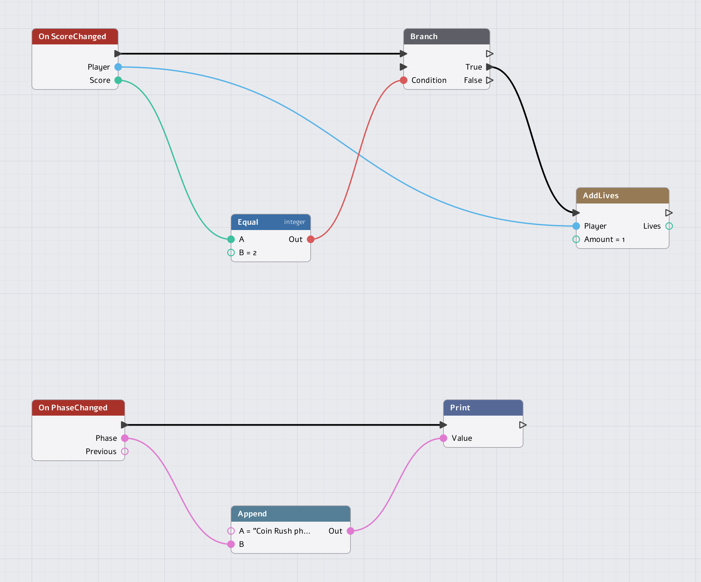

# Game modes in NimbleEngine

A **game mode** is the rules of a level: when the game starts, what ends it,
what a point is worth, what happens when a player joins. This guide builds
**Coin Rush**, a small game that collects coins before the clock or the lives
run out. It does so in three layers that share one rule set:

1. the mode and its state, in **C++**
2. the same game driven from **Lua**
3. the same game driven from a **script graph**

Then it covers **NetGameMode**, the mode for games with avatars and networking,
and explains why a mode is handed a `FrameContext` rather than the engine's
guts.

`Engine/Source/GAMEFRAMEWORK.md` is the reference: every piece, in detail.
This guide is the walkthrough. `Engine/Source/AVATARS_GUIDE.md` continues
where the last section stops.

Every example here is compiled and run by
`Engine/Tests/GameModeGuideTests.cpp` (`NimbleEngine.GameModeGuideTests`). If
you change one, change the other.

---

## The model in one picture

```
 Config/DefaultEngine.ini      the world file                 the game module (a DLL)
 ┌────────────────────────────┐ ┌───────────────────────────┐ ┌───────────────────────────────┐
 │ [World_CoinRush]           │ │ CoinRush.nmworld          │ │ NIMBLE_REGISTER_GAME_MODE(    │
 │ File=...CoinRush.nmworld ──┼►│ <Settings                 │ │   CoinRushMode, "CoinRush")   │
 │ StartupScript=Scripts/...  │ │  GameMode="CoinRush" /> ──┼►│                               │
 └─────────────┬──────────────┘ └───────────────────────────┘ └───────────────────────────────┘
               │ the host makes one LEVEL per listed world
               ▼
 ┌─────────────────────────── Level "CoinRush" ───────────────────────────┐
 │  World         entities loaded from the .nmworld, plus what scripts    │
 │                and the mode add                                        │
 │  GameMode      the RULES         (IGameMode, made when the level loads)│
 │  GameState     the PROGRESS      (the mode's; the engine keeps the     │
 │                                   phase in it)                         │
 └──────────────────────────────▲─────────────────────────────────────────┘
                                │ the mode's context (GetSession)
                          GameSession ◄──── C++ calls   (SetPhase, AddScore, ...)
                                       ◄──── Lua / graphs ("Game" library)
```

Four things that are easy to confuse:

| Piece | Is | Is not |
|---|---|---|
| **World** | The entities and their components: data, saved with the level. | Rules. A coin does not know the game is over. |
| **GameMode** | Logic with a lifecycle. One per level load, destroyed at unload. | A place to keep progress. It is re-runnable against fresh state. |
| **GameState** | What has happened so far: the phase, the round, your own fields. Saved with the game. | Logic. |
| **GameSession** | The running game: loads levels, ticks the World, routes every rule-affecting change through the mode. | Yours to subclass. |

Rule of thumb: **the mode decides, the World does, the state remembers.**

---

## The lifecycle

The host owns the loop. The session loads a level and calls your hooks in this
order:

```
 World created, scripts and renderer bound
 Level populates the World (a listed world: its .nmworld file, then the mode is made)
 ├─ IGameMode::OnLoad          cache handles, register systems, bind delegates
 ├─ the world's startup script (Lua)
 ├─ GameState::OnReset         back to starting values, phase = initial phase
 ├─ [only when restoring a save: OnPrepareForLoadedGame, restore, OnPostLoadSave]
 ├─ AutoPossess                placed avatars go to their players
 └─ IGameMode::OnStart         begin: usually SetPhase("Playing")

 every frame (unless paused)
 ├─ GameState phase timer advances
 ├─ IGameMode::OnTick(FrameContext)
 └─ World::Tick                systems, scripts, physics

 IGameMode::OnUnload           undo OnLoad; above all, unbind delegates
```

Why two hooks, `OnLoad` and `OnStart`? The startup script runs in between.
`OnLoad` is for what the script needs to find ready (systems, bindings).
`OnStart` is for what needs the script's work and a reset state to exist (read
what Lua spawned; begin the game).

Everything on this page runs on the **game thread**; the session checks it, so
a mode never needs to.

The rest of the hooks are optional and sit in four families:

| Family | Hooks | Called when |
|---|---|---|
| Rules | `CanEnterPhase`, `OnPhaseChanged` | A phase change is asked for / has happened. |
| Players | `OnPlayerAdded`, `OnPlayerRemoved`, `OnScoreChanged`, `OnLivesChanged` | A `PlayerState` component comes or goes; a score or life count changed through the session. |
| Saves | `OnPreSaveGame`, `OnPrepareForLoadedGame`, `OnPostLoadSave` | Around a save or restore. |
| Avatars and network | `CanPossess`, `OnAvatarPossessed`, `OnAvatarUnpossessed`, `OnClientConnected`, `OnClientDisconnected` | See **NetGameMode**, below. |

---

## Step 1: the state

The state is what the game remembers. The engine keeps the **phase** in it (a
name, how long it has lasted, a round counter); everything else is yours.

```cpp
class CoinRushState : public NimbleEngine::GameState
{
public:
    /* Back to starting values on every level (re)start, before OnStart. */
    void OnReset() override
    {
        CoinsToWin  = 3;
        SecondsLeft = 30.0;
    }

    int32_t CoinsToWin  = 3;
    double  SecondsLeft = 30.0;
};
```

Anything the game needs after a restart or a reload belongs here, not in the
mode. To keep a field in saved games, override `Serialize` (see `GameState.h`).
The phase is saved by the engine itself.

## Step 2: the mode

```cpp
class CoinRushMode : public NimbleEngine::IGameMode
{
public:
    /* GetSession() is set by the engine from before OnLoad until after OnUnload:
     * the mode keeps no handle of its own. */
    void OnStart() override
    {
        GetSession().SetPhase("Playing");
    }

    /* Once per frame, while the game is not paused. The FrameContext carries
     * this frame's numbers; nothing here reaches for a clock or a window. */
    void OnTick(const NimbleEngine::FrameContext& InFrame) override
    {
        if(!State.IsPhase("Playing")) { return; }

        State.SecondsLeft -= InFrame.DeltaSeconds;
        if(State.SecondsLeft <= 0.0) { GetSession().SetPhase("GameOver"); }
    }

    NimbleEngine::GameState* GetGameState() override { return &State; }

    // --- Rules: asked before, told after ---------------------------------------

    /* A finished round only goes back to the start. */
    bool CanEnterPhase(const char* InFrom, const char* InTo) override
    {
        const bool bFinished = std::strcmp(InFrom, "Won") == 0 || std::strcmp(InFrom, "GameOver") == 0;
        return !bFinished || std::strcmp(InTo, "WaitingToStart") == 0;
    }

    void OnPhaseChanged(const char* InPrevious, const char* InCurrent) override
    {
        CORE_LOG(std::string("[CoinRush] ") + InPrevious + " -> " + InCurrent)
    }

    void OnScoreChanged(GameCore::EntityID /*InPlayer*/, int32_t InScore) override
    {
        if(InScore >= State.CoinsToWin) { GetSession().SetPhase("Won"); }
    }

    void OnLivesChanged(GameCore::EntityID /*InPlayer*/, int32_t InLives) override
    {
        if(InLives <= 0) { GetSession().SetPhase("GameOver"); }
    }

    CoinRushState              State;
};
```

Three things in it deserve a sentence each:

- **`OnTick` is the only method a mode must implement.** Everything else has
  a default.
- **`GetGameState()` is how phases exist.** A mode that returns `nullptr` has
  no phase: `SetPhase` returns false and `Game.IsPhase` is always false.
- **`OnUnload` runs whenever `OnLoad` was called, even if it returned false.**
  Undo whatever `OnLoad` did, and do it without assuming it all happened.
  Systems, event handlers and the avatars' input filter bound as members
  (`AddSystem`, `Subscribe`, `SetAvatarInputFilter`) are taken back for you,
  and per-level state kept in members goes with the mode: `GAMEFRAMEWORK.md`,
  "The mode is the level's context".

### Phases: asked before, told after

A phase is any short name (under 32 characters). The engine suggests
`WaitingToStart`, `InProgress` and `GameOver` (`GamePhases`), and a game adds
its own: Coin Rush uses `Playing` and `Won`.

```
 WaitingToStart ──OnStart──► Playing ──3rd coin──► Won ─┐
                                │                       │ CanEnterPhase allows only
                                └──0 lives / 0 seconds──► GameOver ─┤ "WaitingToStart" from here
                                                                    ▼
                                                              WaitingToStart
```

`GameSession::SetPhase(name)`, from C++, `Game.RequestPhase(name)` from Lua
and **Request Phase** in a graph all do the same thing:

1. same phase as now: nothing happens, and it returns true;
2. otherwise the mode is asked, `CanEnterPhase(from, to)`. If it says no, nothing
   changes and the caller gets false;
3. the state takes the new phase and restarts the phase timer;
4. the mode is told, `OnPhaseChanged(previous, current)`;
5. scripts are told: the world event `PhaseChanged(phase, previous)`.

A request made *while a change is being announced* (from `OnPhaseChanged`, or
from a `PhaseChanged` listener) is queued and applied right after, so every
listener sees the phases in order. It returns true: accepted for later.

Loading is a reset, not a transition: the level starts in
`GetInitialPhase()` (by default `WaitingToStart`) and no hook runs.

### Players, scores and lives

A player is any entity with a `PlayerState` component (name, index, score,
lives). `GameSession::AddScore` and `AddLives` change it *through the rules*:
they write the value, then call `OnScoreChanged` / `OnLivesChanged` on the
mode and emit `ScoreChanged` / `LivesChanged` for scripts. Coin Rush's mode
turns those into phases, which is the whole game: *score reaches the target,
the game is won; lives reach zero, it is lost.*

Scripts cannot write `Score` or `Lives` directly (they are read-only there),
so no script can score behind the mode's back. C++ may set the fields to set
up a player; that tells nobody.

## Step 3: register it, and name it in the project

One line at file scope, after the class, registers the mode by name as the
game module loads and unregisters it as the module goes:

```cpp
NIMBLE_REGISTER_GAME_MODE(CoinRushMode, "CoinRush")
```

The module itself, in its one `NIMBLE_IMPLEMENT_GAME_MODULE` class, then has
nothing to list:

```cpp
class CoinRushModule : public NimbleEngine::IGameModule
{
public:
    const char* GetName() const override          { return "CoinRushGame"; }
    const char* GetVersionString() const override { return "0.1"; }

    bool OnStartup(const EngineCore::ModuleReloadState* /*InPrev*/) override { return true; }
    void OnShutdown(EngineCore::ModuleReloadState& /*OutState*/) override {}
};

NIMBLE_IMPLEMENT_GAME_MODULE(CoinRushModule, "CoinRushGame")   // the name matches the library: CoinRushGame.dll
```

Registration is all a module should do as it loads: the editor loads it
briefly, without playing, to read what it registers. (By hand,
`RegisterGameMode<CoinRushMode>("CoinRush")` in `OnStartup` and
`UnregisterGameMode` in `OnShutdown` do the same. `WorldsLabGame.cpp` and the
new-project template use the macro.)

Then name it in the world: open the world in the editor, **World > World
Settings**, and pick it under **Game mode** (the list is what the loaded module
registers; "(none)" runs no rules). It is saved in the `.nmworld`:

```xml
<World Format="1">
  <Settings GameMode="CoinRush" />   <!-- the name the mode registered with -->
  ...
</World>
```

List the world in `Config/DefaultEngine.ini`, or in the editor's **Project
Settings > Worlds**:

```ini
[Game]
StartLevel=CoinRush

[World_CoinRush]
File=Content/Levels/CoinRush.nmworld   ; the world it loads (and the mode it names)
StartupScript=Scripts/CoinRush.lua     ; run once the mode has loaded; absent: none
Cook=true
```

The host makes one level per `[World_*]` section, named by the section, and
creates a fresh mode -- the one its world names -- each time the level loads.
A `GameMode=` key in a `[World_*]` section is no longer read; the log says so. `[Game] StartLevel`, the
console's `open CoinRush` and saved games use the same name.

---

## Why the mode gets a `FrameContext`

`OnTick(const FrameContext&)` is the one hook that is handed values rather than
asking for them. It holds three:

```cpp
struct FrameContext
{
    double           DeltaSeconds;     // since the previous tick; zero on the first frame
    uint64_t         FrameNumber;      // ticks completed before this one
    EngineCore::Size ViewportPixels;   // PHYSICAL pixels of the surface drawn to
};
```

It is deliberately small, and it is deliberately **plain values with no
pointers into the engine**. The justification, in the order it matters:

**1. The mode runs in more than one place.** The same `CoinRushMode` runs in the
game's executable, in the editor's Play-in-Editor, on a dedicated server with no
window, and in a unit test. What differs between them (a window, a monitor's
size, how frames are paced) is the host's business. The host fills in a
`FrameContext`; the mode reads it. A host with no window (a server, a test) has no
surface to fill `ViewportPixels` from, and a mode that sizes a UI from it has to
cope, which is the point: the dependency is visible in the signature.

**2. Time belongs to the host.** The mode never calls a wall clock. `DeltaSeconds`
is the time *the game* advanced, as the host measured it: the same in the editor
as in a build, absent while paused (the session does not call `OnTick` at all),
and whatever a test says it is. A countdown written with a system clock would keep running through a pause
menu, break in a replay, and need real seconds to test. Written with
`DeltaSeconds`, Coin Rush's timer is tested without waiting:

```cpp
Run<CoinRushMode> R;
R.Frame(10.0);                       // ten game-seconds, instantly
R.Frame(10.0);
Expect(R.Session->GetPhase() == std::string("Playing"), "20 of 30 seconds, still playing");
R.Frame(10.0);
Expect(R.Session->GetPhase() == std::string("GameOver"), "the clock ran out");
```

**3. `OnTick` overlaps the render thread.** The renderer drains the previous
frame while the mode runs. A hook that received a `RenderContext` or a
`RenderProxy` would let game code touch memory the render thread is reading.
A context of copies cannot do that. (To draw, add a `RenderComponent`, or
`ENQUEUE_RENDER_COMMAND` with trivially copyable values, never a pointer to
game-thread state.)

**4. `const`, so a frame is a fact.** A mode cannot rewrite the frame it was
told about, or hold it across frames: it is a parameter, not a service.

**5. It keeps the mode small.** A mode that could reach the host, the renderer
and the input devices would end up tangled in all three, and could not be
re-run against fresh state. What a mode may touch is the **session** (the
other half of its context): `GetWorld()`, `SetPhase`, `AddScore`, `GetPlayer`,
`GetUI`, `SetPaused`, `GetInput`, and `GetHost()` for the few genuine host
services (frame rate limit, mouse capture, clipboard). The header says it
plainly: *a mode sees only the GameSession.*

Put together, a hook gets exactly two kinds of context, and each answers a
different question:

| Question | Answer | Lifetime |
|---|---|---|
| *What is this frame?* | `FrameContext`, a parameter | This call only. Copy what you need. |
| *What can I act on?* | `GameSession`, the mode's `GetSession()` | `OnLoad` to `OnUnload`. |

Do not keep a pointer to the World across a level swap; ask the mode
(`GetWorld()`) each time, and use `GetLoadCount()` if you must know
whether it changed.

### Testing a mode headlessly

Because of all that, a mode needs no window to be tested. The guide's test builds
a session with a host that does nothing, loads a level, and feeds frames by
hand:

```cpp
class TestHost : public NimbleEngine::IGameHost
{
public:
    void     SetFrameRateLimit(uint32_t) override {}
    uint32_t GetFrameRateLimit() const override { return 0; }
};

TestHost               Host;
GameCore::ScriptEngine Scripts;
RenderCore::Renderer   Rendering;       // never initialised: draws nothing
Scripts.Initialize();
NimbleEngine::GameSession Session(Host, Scripts, Rendering);
Session.LoadLevel(Level);               // a small ILevel, owning the mode and its state

NimbleEngine::FrameContext Frame;
Frame.DeltaSeconds = 0.05;
Session.Tick(Frame);                    // one frame
```

---

## NetGameMode: a game with avatars and networking

`NimbleEngine::NetGameMode` is an `IGameMode` with the usual multiplayer rules
filled in. A game that has players walking around, locally or over a network,
derives from it instead of from `IGameMode`. Without further code it:

- gives every **local player** an avatar when the level starts (not on a
  client, not on a dedicated server);
- gives every **joining client** an avatar (`OnClientConnected`);
- spawns each at the level's **Player Starts**, possesses it, and lends it to
  that player's client.

You supply the prefab and decorate the result. `AVATARS_GUIDE.md` builds a whole
game on it; here is Coin Rush's version:

```cpp
static void BuildRunner(GameCore::PrefabBuilder& B)
{
    GameCore::PrefabBuilder::Node Root = B.Root("Runner");
    Root.Add<GameCore::TransformComponent>();
    Root.Add<GameCore::NetComponent>();
    Root.Add<NimbleEngine::AvatarHarnessComponent>();
}
GAMECORE_DEFINE_NATIVE_PREFAB(CoinRushRunner, "CoinRush.Runner", &BuildRunner)

class CoinRushNetMode : public NimbleEngine::NetGameMode
{
public:
    bool OnLoad(NimbleEngine::GameSession& InSession) override
    {
        return NetGameMode::OnLoad(InSession);          // resets the join order
    }

    void OnStart() override
    {
        NetGameMode::OnStart();                         // local players get their Runners
        Session->SetPhase("Playing");
    }

    void OnTick(const NimbleEngine::FrameContext& InFrame) override   // NetGameMode leaves this one to you
    {
        (void)InFrame;
    }

    NimbleEngine::GameState* GetGameState() override { return &State; }   // NetGameMode has no state of its own

    void OnScoreChanged(GameCore::EntityID /*InPlayer*/, int32_t InScore) override
    {
        if(InScore >= State.CoinsToWin) { Session->SetPhase("Won"); }
    }

protected:
    const char* GetAvatarPrefab(GameCore::EntityID /*InPlayer*/) override { return "native:CoinRush.Runner"; }

    void OnAvatarSpawned(GameCore::EntityID /*InPlayer*/, GameCore::EntityID InAvatar, uint32_t InOrdinal) override
    {
        Session->GetWorld().GetEntity(InAvatar).SetName(("Runner " + std::to_string(InOrdinal + 1)).c_str());
    }

private:
    CoinRushState State;
};
```

What to remember when deriving:

| | |
|---|---|
| **Call the base** | when you override `OnLoad`, `OnStart` or `OnClientConnected`: they do the spawning. |
| **`OnTick` and `GetGameState`** | are still yours. `NetGameMode` implements neither, so a game that wants phases supplies a state. |
| **`GetAvatarPrefab`** | returns `nullptr` for "the Player Start's prefab, else `[Avatar] DefaultPrefab`". |
| **`Session`** | is `IGameMode`'s protected member, set by the engine: the same handle as `GetSession()` in Step 2. |

### Rules run on the server

Over a network both ends run the same level and the same mode, and **the server
has authority**. A mode's rules (scoring, phases, spawning) must therefore run
once, on the server, and reach clients by replication. Guard them:

```cpp
if(!NimbleEngine::HasAuthority()) { return; }
```

Standalone, with no network session, `HasAuthority()` is always true, so the
same code plays offline. The networking hooks are the server's only:

| Hook | When |
|---|---|
| `OnClientConnected(client, player)` | A client joined. The host has made `player` for it (a `PlayerState` and a `Net` it owns); give it its pawn here. `NetGameMode` does. |
| `OnClientDisconnected(client, player)` | A client left; its entities are destroyed when this returns. |
| `CanPossess(player, avatar)` | A client asked to drive an avatar marked Requestable. Add your rules (close enough, same team); return false to refuse. |
| `OnAvatarPossessed` / `OnAvatarUnpossessed` | Every process, as it happens or as it replicates. |

Details: `GAMEFRAMEWORK.md`, "Networking", and `Engine/Modules/NetCore`.

---

## The same game from Lua

A mode is C++: it is a class in the game module. Lua does not define one. What
Lua does is *use* the one the level has, through the global **`Game`** library,
and play its part in the rules. That is a good division: C++ owns the few
decisions that must be consistent (when is the game won?), and scripts own
the many small behaviours (what does a coin do?).

| In Lua | Does |
|---|---|
| `Game.IsPhase("Playing")`, `Game.GetPhase()`, `Game.GetPhaseTime()`, `Game.GetRound()` | Read the state. |
| `Game.RequestPhase("Won")` | `SetPhase`, through `CanEnterPhase`. Returns whether it was accepted. |
| `Game.GetPlayer(0)`, `Game.GetPlayerCount()` | Find the players. |
| `Game.AddScore(player, n)`, `Game.AddLives(player, n)` | Change them, through the mode. Return the new value. |
| `Events.On(Game.PhaseChanged, fn(phase, previous))` | Be told. Also `Game.ScoreChanged(player, score)`, `Game.LivesChanged(player, lives)`. `Events.Off(handle)` stops. |
| `Game.SetPaused(bool)`, `Game.IsPaused()` | Pause. |

Called from anywhere without a game running (a bare test World, the editor's
scene), the library raises a script error.

### The startup script

The world's `StartupScript` runs once, after `OnLoad`. It is a Lua file with
the global libraries, and no entity of its own: the place to place things and
subscribe.

```lua
-- Scripts/CoinRush.lua -- the world's StartupScript: runs once the mode has loaded.
for i = 1, 4 do
    World.SpawnPrefab("native:CoinRush.Coin", i * 100, 0, 0)
end

Events.On(Game.PhaseChanged, function(phase, previous)
    print("Coin Rush: " .. previous .. " -> " .. phase)
end)

Events.On(Game.ScoreChanged, function(player, score)
    print(player:GetName() .. " has " .. math.floor(score))
end)
```

(`World.SpawnPrefab` takes a prefab's path, `Prefabs/Coin.nmprefab`, or a
native prefab's `native:Name`.)

### A prefab's script

A prefab names a script; every instance gets its own object, `self`, with
`self.Entity` set. This is the coin:

```lua
-- Scripts/Coin.lua -- the coin prefab's Script: one table; each coin gets its own `self`.
return {
    TickPhase = TickPhase.PostPhysics,

    OnStart = function(self)
        self.Transform = self.Entity:GetComponent("Transform")
    end,

    OnTick = function(self, dt)
        -- Coins are for picking up while the game is on.
        if not Game.IsPhase("Playing") then return end

        local player = Game.GetPlayer(0)
        if not player:IsValid() then return end

        local px, py = player:GetComponent("Transform"):GetPosition()
        local x, y   = self.Transform:GetPosition()
        local dx, dy = px - x, py - y

        if dx * dx + dy * dy < 50 * 50 then
            Game.AddScore(player, 1)      -- through the rules: the mode hears of it
            self.Entity:Destroy()
        end
    end,
}
```

Follow one coin: the player walks onto it; the script calls `Game.AddScore`;
the session writes the score and calls `CoinRushMode::OnScoreChanged`; the
third coin asks for `Won`; `CanEnterPhase` agrees; `OnPhaseChanged` logs it, and
the startup script's `PhaseChanged` listener prints it. Every other coin script
sees `Game.IsPhase("Playing")` turn false and stops. **Nothing in the coin knows
the target is three.** Change `CoinsToWin` and no script changes.

### Lua gotchas

- **Numbers arrive as floats.** An event's `score` prints as `3.0`. Wrap it in
  `math.floor` for display; arithmetic and comparisons are fine.
- **A script hears only what happens after it starts.** The startup script
  registers during load, so it hears `WaitingToStart -> Playing`. A prefab's
  script starts at the beginning of the next tick, so a `Director` spawned
  from the startup script misses the first phase. In `OnStart`, ask
  (`Game.GetPhase()`) as well as listening.
- **Rules of authority apply.** Over a network, guard rules with
  `Net.HasAuthority()` (see the avatar guide's Lua pawn).
- **`Score` and `Lives` are read-only** from Lua: `Game.AddScore` is the only
  road.

---

## The same game from a script graph

A script graph is a visual script that compiles to the same kind of Lua table
(`NodeGraph`, "Script" schema). It reaches the game framework under the
**Game** category:

- values: **Get Phase**, **Is Phase**, **Get Phase Time**, **Get Round**,
  **Get Player**, **Get Player Count**;
- statements: **Request Phase**, **Add Score**, **Add Lives**, **Set Paused**;
- events: **On Phase Changed** (outputs `Phase`, `Previous`), **On Score
  Changed** (`Player`, `Score`), **On Lives Changed** (`Player`, `Lives`).

A graph is a prefab's Script, like Lua, so this one lives on a `Director`
prefab that the level (or the startup script: `World.SpawnPrefab("native:CoinRush.Director")`)
places. It adds two rules to Coin Rush: **a bonus life when the score reaches
exactly 2**, and **a line in the log whenever the phase changes.**

[](Images/GameMode/director-graph.png)

*The graph as the editor's canvas draws it. Top: the bonus life. Bottom: the
phase log. The file itself is `Images/GameMode/CoinRushDirector.script.nmgraph`:
copy it into a project and open it in the editor.*

Read it left to right: black arrows are execution, coloured wires are values
(blue an entity, green an integer, red a bool, pink a string). The same graph,
node by node:

**Bonus life** (nodes 1 to 4, the top chain):

| # | Node (type) | Settings |
|---|---|---|
| 1 | On Score Changed (`Library.Game.OnScoreChanged`) | |
| 2 | Equal (`Compare.Equal`) | B = `2` |
| 3 | Branch (`Flow.Branch`) | |
| 4 | Add Lives (`Library.Game.AddLives`) | Amount = `1` |

| From | To |
|---|---|
| 1 **Score** | 2 **A** |
| 1 **Then** | 3 **Exec** |
| 2 **Out** | 3 **Condition** |
| 3 **True** | 4 **Exec** |
| 1 **Player** | 4 **Player** |

**Say where the game is** (nodes 10 to 12, the bottom chain):

| # | Node (type) | Settings |
|---|---|---|
| 10 | On Phase Changed (`Library.Game.OnPhaseChanged`) | |
| 11 | Append (`String.Append`) | A = `Coin Rush phase: ` |
| 12 | Print (`Debug.Print`) | |

| From | To |
|---|---|
| 10 **Phase** | 11 **B** |
| 10 **Then** | 12 **Exec** |
| 11 **Out** | 12 **Value** |

The editor saves the graph beside the Lua it compiles to. For this one:

```lua
-- Generated by NimbleEditor from the script graph "CoinRushDirector". Do not edit.
return {
    TickPhase = TickPhase.PrePhysics,

    OnStart = function(self)
        self.GraphEventHandles = {
            Events.On("ScoreChanged", function(...) self:Event_ScoreChanged(...) end),
            Events.On("PhaseChanged", function(...) self:Event_PhaseChanged(...) end),
        }
    end,

    OnDestroy = function(self)
        for _, Handle in ipairs(self.GraphEventHandles or {}) do Events.Off(Handle) end
        self.GraphEventHandles = nil
    end,

    Event_ScoreChanged = function(self, Arg1, Arg2, Arg3, Arg4)
        local Lives1
        local t1 = math.floor(Arg2 or 0) == 2
        if t1 then
            Lives1 = Game.AddLives(Arg1, 1)
        end
    end,

    Event_PhaseChanged = function(self, Arg1, Arg2, Arg3, Arg4)
        local t1 = "Coin Rush phase: " .. Arg1
        print(t1)
    end,
}
```

Notice what the graph did *not* need: no access to the mode, no knowledge of
how a win is decided. `Add Lives` goes through the same door as C++'s
`AddLives`, so `OnLivesChanged` still runs, and the mode's "no lives is game
over" rule still holds, even for a life added by a graph.

The graph's own `OnStart` registers its listeners, so a `Director` placed in
the level hears only phases changed after its first tick. Seed it from **Get
Phase** in an **On Start** if it must know the starting phase.

---

## Where should a rule live?

| If the rule | Put it in |
|---|---|
| must be the same everywhere and decides the game's course (win, lose, who may do what) | **the mode**: `CanEnterPhase`, `OnScoreChanged`, `OnTick` |
| is about one kind of thing (a coin, a door, a turret) | **that thing's script**, Lua or graph, asking the framework through `Game` |
| is feedback or flavour (a message, a sound, a bonus) | **a listener** on `PhaseChanged` / `ScoreChanged`, in Lua or a graph |
| needs speed, networking, or compile-time checking | **C++**, in the mode or a system the mode registers (`World.RegisterSystem`) |
| designers should change it without a build | **Lua or a graph**, or data on a component |

Because every change to phase, score and lives goes through the session,
layers can be mixed without surprises: the three of them above played one game.

---

## When something is off

| Symptom | Likely cause |
|---|---|
| `SetPhase` returns false, or `Game.IsPhase` is always false | `GetGameState()` returns `nullptr`. Return your state. (`NetGameMode` has none: add one.) |
| `RequestPhase` returns false | `CanEnterPhase` refused. Check the from/to names; they are case-sensitive. |
| The level loads with no rules | The world's **World Settings > Game mode** is "(none)", or the level fails to load because it names a mode the module did not register (the log says which). A `GameMode=` left in the `[World_*]` section is no longer read. |
| Your mode never runs `OnStart` | `OnLoad` returned false (`OnUnload` still ran), or the level load was refused. |
| A script errors with "needs a running game" | `Game` was called outside a session: a preview, a bare World. |
| A graph or Lua listener misses the first phase | It started after the change. Read the phase on start as well as listening. |
| A score changes but `OnScoreChanged` does not run | The fields were written directly (C++) rather than through `AddScore`. |
| Rules run twice in a network game | They are not guarded by `HasAuthority()`. |
| The countdown ignores a pause | It uses a wall clock, not `FrameContext::DeltaSeconds`; or it runs in a system that is not paused. |
| A cached `EntityID` stops working after a load | Restored entities are new. Re-derive in `OnPostLoadSave`. |
| `NetGameMode` spawns nothing | No avatar prefab is named (`GetAvatarPrefab`, the Player Start's **Avatar Prefab**, or `[Avatar] DefaultPrefab`; the log says so), or this process is a client or a dedicated server: they get no local players, and a server's clients get theirs in `OnClientConnected`. With no Player Start the avatar spawns at the origin. |
