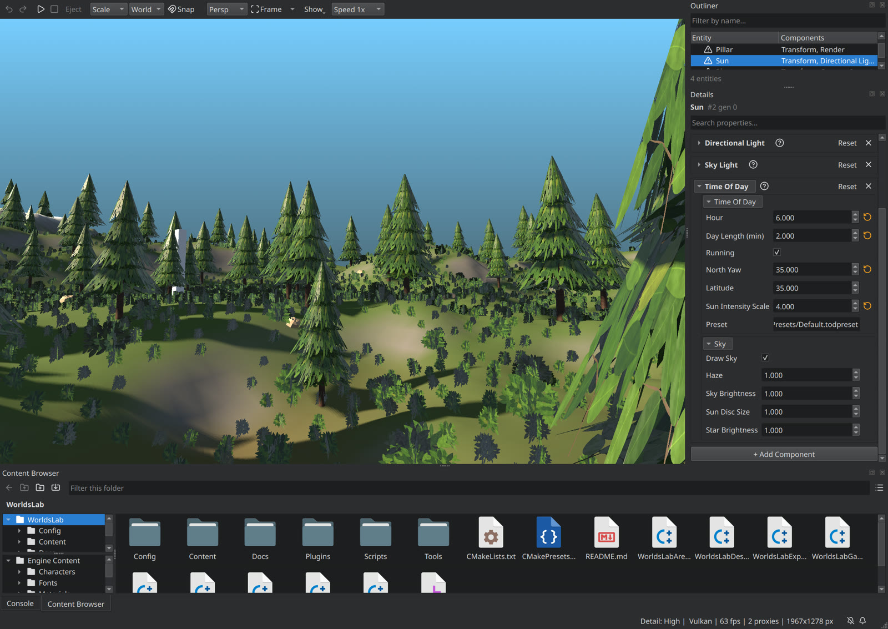
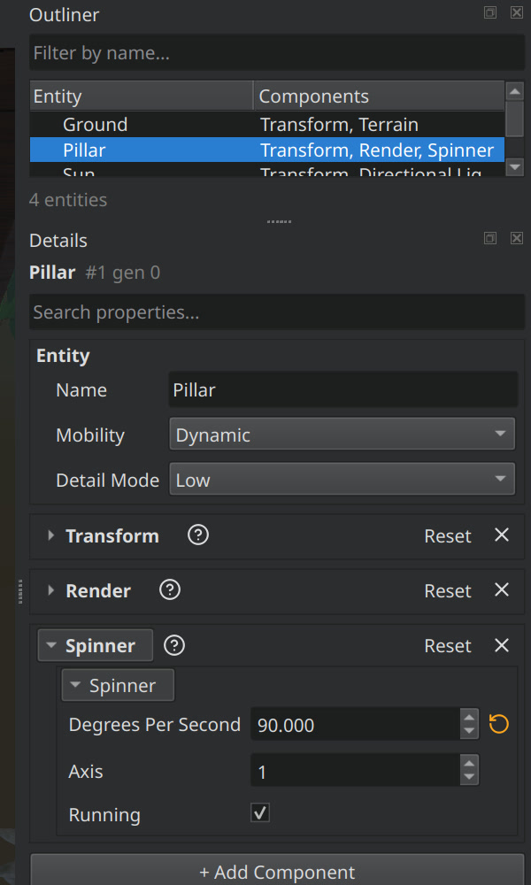

# Plugin implementation guide

How to write a plugin, put it in a project, and share it with other
projects. The guide walks through a small plugin, **Spinner**, step by step,
and uses **TimeOfDay** for the advanced parts (content, shaders, a render
pass). For how the plugin system works inside, read
[PLUGINS.md](../PLUGINS.md).

**2** example plugins · **1** descriptor · **4** module types · **1** manifest · source only


## Contents

1. [What a plugin is](#1-what-a-plugin-is)
2. [Walkthrough: Spinner in seven steps](#2-walkthrough-spinner-in-seven-steps)
3. [The descriptor](#3-the-descriptor)
4. [Writing the module](#4-writing-the-module)
5. [Content and config](#5-content-and-config)
6. [Shaders and render passes](#6-shaders-and-render-passes)
7. [Integrating a plugin into a game](#7-integrating-a-plugin-into-a-game)
8. [Sharing a plugin between projects](#8-sharing-a-plugin-between-projects)
9. [Testing](#9-testing)
10. [Troubleshooting](#10-troubleshooting)
11. [Checklist](#11-checklist)
12. [What plugins can't do yet](#12-what-plugins-cant-do-yet)

---

## 1. What a plugin is

A plugin is a folder you can copy into any project. The project enables it
with one line of config, and the plugin brings everything it needs: code,
content, config defaults and shaders. Nothing in `Engine/CMakeLists.txt` or
in the game's code names it.

```
  Spinner/                              <- the folder you copy
    Spinner.nmplugin                    descriptor: name, version, modules, dependencies
    CMakeLists.txt                      nimble_add_plugin_module(...)
    Source/Spinner/Public/Spinner/      headers a game may include
    Source/Spinner/Private/Spinner/     the code
    Config/DefaultSpinner.ini           defaults, under the project's config
    Content/                            read as "Spinner:/..." and only so
    Content/Shaders/                    custom pass shaders (TimeOfDay has one)
    Tests/
```

What happens to it, from the configure to the running game:

```
  configure   NimblePlugins.cmake finds <Name>/<Name>.nmplugin in
              <Project>/Plugins, NIMBLE_PLUGIN_DIRS, then Engine/Plugins
              -> enabled by [Plugins] in Config/DefaultEngine.ini?
              -> dependencies found, enabled, new enough? (else the configure stops)
              -> add_subdirectory, in dependency order
  build       <Module>.so / .dll beside the engine's libraries
              Plugins/<Name>/ staged (or Paks/Plugins/<Name>.nmpak when packaged)
              Plugins/Plugins.manifest: the enabled plugins, in load order
  run         Discover        its Config/Default<Name>.ini, under the project's file
              MountContent    "<Name>:/..." readable; its shader cache too
              LoadModules     library opened, components and scripts register,
                              IPlugin::OnStartup runs   (before the game module)
              each level      its world hooks attach its systems to the World
              exit            OnShutdown, library closed
```

The game and the editor both host plugins, and Play-in-Editor runs world
hooks just as the game does.

Plugins are **source only**. Every project compiles its plugins with its own
compiler and settings, so the C++ ABI always matches. There are no prebuilt
plugin binaries.

## 2. Walkthrough: Spinner in seven steps

Spinner makes an entity turn. It lives in WorldsLab's own folder,
[`Games/WorldsLab/Plugins/Spinner`](../../../Games/WorldsLab/Plugins/Spinner),
and every piece of it is shown below.

### Step 1: the folder and the descriptor

`Games/WorldsLab/Plugins/Spinner/Spinner.nmplugin`:

```ini
[Plugin]
Name=Spinner
Version=1.0.0
EngineVersion=0.1
Category=Gameplay
Description=Turns an entity about one axis; the plugin guide's worked example
EnabledByDefault=false

[Module_Spinner]
Type=Runtime
```

The folder name, the file name and `Name` must all match.

### Step 2: CMakeLists.txt

```cmake
nimble_add_plugin_module(Spinner
        SOURCES      Source/Spinner/Private/Spinner/Spinner.cpp
                     Source/Spinner/Public/Spinner/SpinnerComponent.h
        PUBLIC_DEPS  GameCore::GameCore)

nimble_add_plugin_test(SpinnerTests
        SOURCES Tests/SpinnerTests.cpp
        LINK    Spinner)
```

There's no `add_library`, export setup or output directory to write;
`nimble_add_plugin_module` does all of it, and links `NimbleEngine` for you.

### Step 3: the public header

`Source/Spinner/Public/Spinner/SpinnerComponent.h`:

```cpp
#include "Public/GameCore/ComponentType.h"
#include "Public/Spinner/SpinnerAPI.h"   // generated by nimble_add_plugin_module

namespace Spinner
{
    struct SPINNER_API SpinnerComponent
    {
        GAMECORE_COMPONENT_BODY()

        float   DegreesPerSecond = 45.0f;
        uint8_t Axis             = 1;      // 0 X, 1 Y, 2 Z
        uint8_t bRunning         = 1;
    };

    SPINNER_API void Tick(GameCore::World& InWorld, float InDeltaSeconds);
    SPINNER_API bool IsStarted();
}
```

`SpinnerAPI.h` is generated from the module name. Anything a game, the
editor or a test calls into needs `SPINNER_API`, or Windows fails to link
it (see the msvc-compat skill).

### Step 4: the code

[`Spinner.cpp`](../../../Games/WorldsLab/Plugins/Spinner/Source/Spinner/Private/Spinner/Spinner.cpp)
holds all four kinds of thing a plugin usually has:

```cpp
// 1. A config var. Its default for games comes from Config/DefaultSpinner.ini.
NIMBLE_CONFIG_FLOAT(GSpinnerSpeedScale, "Spinner", "SpeedScale", 1.0f, nullptr);

namespace Spinner
{
    // 2. The component: registered as the library loads.
    GAMECORE_DEFINE_COMPONENT(SpinnerComponent, "Spinner")

    GAMECORE_DEFINE_COMPONENT_SERIALIZER(SpinnerComponent, 1)      // level files
    {
        Ar.Field("DegreesPerSecond", C.DegreesPerSecond);
        Ar.Field("Axis",             C.Axis);
        Ar.Flag("Running",           C.bRunning);
    }

    GAMECORE_DEFINE_COMPONENT_SCRIPT(SpinnerComponent)              // Lua, script graphs
    {
        Bind.Field("DegreesPerSecond", &SpinnerComponent::DegreesPerSecond);
        Bind.Flag("Running",           &SpinnerComponent::bRunning);
    }

#if WITH_EDITOR
    GAMECORE_DEFINE_COMPONENT_PROPERTIES(SpinnerComponent)          // Details, Add Component
    {
        Props.TypeCategory("Gameplay");
        Props.Field("Degrees Per Second", &SpinnerComponent::DegreesPerSecond);
        Props.Range(-720.0f, 720.0f);
        ...
    }
#endif
}

// 3. A script library: the Lua global "Spinner".
GAMECORE_DEFINE_SCRIPT_LIBRARY(Spinner)
{
    Lib.Function("SetSpeed", &ScriptSetSpeed, "Spinner:Entity, DegreesPerSecond:number");
    Lib.Function("GetSpeed", &ScriptGetSpeed, "Spinner:Entity -> DegreesPerSecond:number");
}

// 4. The plugin itself: its system on every level's World.
class SpinnerPlugin : public NimbleEngine::IPlugin
{
public:
    bool OnStartup(NimbleEngine::PluginContext& InContext) override
    {
        NimbleEngine::PluginWorldHook Hook;
        Hook.Name   = "Spinner";
        Hook.Attach = [](GameCore::World& InWorld, void*)
        {
            InWorld.RegisterSystem("Spinner", GameCore::TP_PostPhysics, &TickSpinners, &GSystemOwner);
        };
        Hook.Detach = [](GameCore::World& InWorld, void*) { InWorld.UnregisterAllSystems(&GSystemOwner); };
        InContext.AddWorldHook(Hook);
        return true;
    }
};
NIMBLE_IMPLEMENT_PLUGIN(SpinnerPlugin)
```

### Step 5: config defaults

`Config/DefaultSpinner.ini`:

```ini
[Spinner]
SpeedScale=1
```

The plugin's file loads first, so a project overrides it with its own
`[Spinner] SpeedScale=...` line.

### Step 6: enable it

In the project's `Config/DefaultEngine.ini`:

```ini
[Plugins]
TimeOfDay=true
Spinner=true
```

### Step 7: build and run

```bash
cmake --build Games/WorldsLab/Build/debug
```

The configure lists the plugins it adds:

```
-- NimbleEngine: plugin Spinner 1.0.0 (.../Games/WorldsLab/Plugins/Spinner)
-- NimbleEngine: plugin TimeOfDay 0.1.0 (.../Engine/Plugins/TimeOfDay)
```

and the game's log lists the ones it loaded:

```
[Plugins] Spinner 1.0.0 from .../Binaries/Linux_Debug/Plugins/Spinner
[LOG] Plugins: Spinner, TimeOfDay
```

The **Spinner** component now appears in the editor's Add Component picker
under Gameplay, and the `Spinner` library in Lua and the script graph
palette.

## 3. The descriptor

| Key | |
|---|---|
| `[Plugin] Name` | A letter, then letters or digits, two characters at least. It must match the folder and the file, and it is the `Name:/` content prefix. |
| `Version` | `major.minor.patch`. Other plugins depend on it with `Name>=x.y.z`. |
| `EngineVersion` | The oldest engine it builds against. A newer requirement stops the configure. |
| `Category`, `Description` | Shown to people; nothing reads them yet. |
| `EnabledByDefault` | Built when the project's `[Plugins]` doesn't list it. Default `false`. |
| `[Module_<Target>] Type` | One section per `nimble_add_plugin_module` target. |
| `[Dependencies] Plugins` | Comma-separated `Name` or `Name>=1.2.0`. Each must be found **and** enabled. |
| `[Dependencies] OptionalPlugins` | Loaded before this plugin when enabled; ignored otherwise. |

| Module type | Built in | Use it for |
|---|---|---|
| `Runtime` | every target | components, systems, scripts |
| `Editor` | Editor builds only (`WITH_EDITOR=1`) | editor-only code (there are no editor hooks yet, §12) |
| `ClientOnly` | Editor and Client | cosmetics a dedicated server never needs |
| `ServerOnly` | Editor and Server | authority-only logic |

A module that its Type excludes isn't created at all. Code that might link it
must check `if(TARGET <Module>)`.

## 4. Writing the module

### What registers itself, and what needs OnStartup

| Thing | How | When |
|---|---|---|
| Component type, its save format, script fields, Details fields | `GAMECORE_DEFINE_COMPONENT*` | as the library loads |
| Script library (Lua global + graph nodes) | `GAMECORE_DEFINE_SCRIPT_LIBRARY` | as the library loads |
| Config var | `NIMBLE_CONFIG_*` | as the library loads; it takes the value the config files already set |
| A system on each level's World | `PluginContext::AddWorldHook` in `OnStartup` | each level load, after the engine's own systems, before the level's `OnLoad` |
| A custom render pass | `RegisterCustomRenderPass` inside a world hook | the same (TimeOfDay's sky, §6) |

`OnStartup` returns `false` to refuse to start. Anything it registered by
hand must be undone in `OnShutdown`. World hooks are removed for you.

### Rules that matter

- **Plugins load once per run.** Unlike the game module, a plugin is never
  hot-reloaded, because the types it registers live for the whole process.
- **One `NIMBLE_IMPLEMENT_PLUGIN` per library**, at file scope, outside any
  namespace. Without it the library still loads and its components still
  register, but it is never started, and the log says so.
- **Key your systems by an address you own** (`&GSystemOwner`), so
  `UnregisterAllSystems` removes only yours.
- **Prefix shared names** with the plugin's name: script libraries, events
  (`TimeOfDayHour`), shader files (`TimeOfDaySky.fsh`). They are one global
  namespace.
- **Read your own files** with `PluginContext::ReadPluginFile("Config/...")`.
  Read your content through the asset provider, as `Name:/...`.

## 5. Content and config

### Content is strict

A plugin's `Content/` can **only** be read with its prefix:

```cpp
// TimeOfDay's default preset: Engine/Plugins/TimeOfDay/Content/Presets/Default.todpreset
EngineCore::GetFileProvider()->ReadAllText("TimeOfDay:/Presets/Default.todpreset", Text);
```

| Path | Result |
|---|---|
| `TimeOfDay:/Presets/Default.todpreset` | the plugin's file |
| `Presets/Default.todpreset`, `Content/Presets/...` | never the plugin's file; a project's own content is never shadowed |
| `Nope:/x` with no plugin `Nope` enabled | nothing, plus one error naming the missing `[Plugins]` line |

Asset fields store the prefixed path. TimeOfDay's component defaults to
`TimeOfDay:/Presets/Default.todpreset`, and a project can point it at its own
`Content/MyDay.todpreset` instead. Mixing the two is fine.

Where the files come from at run time:

| Host | Reads |
|---|---|
| Game, development build | `Plugins/<Name>/` beside the executable (staged by the build) |
| Game with `-uncooked`, and the editor | the plugin's source folder, so edits show without a rebuild |
| Packaged build | `Paks/Plugins/<Name>.nmpak` |

### Config layers

From lowest to highest priority: the var's C++ default, then the plugin's
`Config/Default<Name>.ini`, then the project's `Config/DefaultEngine.ini`,
then the player's `User.ini`, then the command line (`-Spinner.SpeedScale=4`).

## 6. Shaders and render passes

TimeOfDay draws the sky with a custom render pass and its own shader:

| File | |
|---|---|
| [`Content/Shaders/TimeOfDaySky.fsh`](../../Plugins/TimeOfDay/Content/Shaders/TimeOfDaySky.fsh) | the full-screen shader |
| [`TimeOfDaySky.cpp`](../../Plugins/TimeOfDay/Source/TimeOfDay/Private/TimeOfDay/TimeOfDaySky.cpp) | the pass, and the same atmosphere on the CPU |

**1. Put the shader in `Content/Shaders/`**, named for the plugin. Write it
like any custom pass shader ([CustomRenderPassGuide](CustomRenderPassGuide.md)).

**2. Register the pass from a world hook**, and unregister it on detach:

```cpp
void AttachSky(GameCore::World& InWorld)
{
    Handle = RenderCore::RegisterCustomRenderPass(&InWorld, std::make_shared<SkyPass>(InWorld),
                                                  RenderCore::ERenderHook::BeforeScene, -100);
}
```

Inside `Execute`, draw it by file name:

```cpp
InContext.DrawFullscreen("TimeOfDaySky.fsh", RenderCore::RenderPassTarget{}, {}, State.Params);
```

**3. Cook it.** The build never runs a shader compiler, so cook with:

```bash
NimbleCook shaders -project Games/WorldsLab
```

This cooks every plugin the project enables. Each one gets its own cache,
`<plugin>/Saved/Cooked/Shaders/Runtime/Shaders/Cache/<Name>.<Platform>.nmsc`
(git-ignored). The next build stages or packs that cache, and the host
mounts it on the renderer. Outside Shipping, a newer cook in the plugin
folder is used directly, so recook and rerun; there's nothing to rebuild.

```
NimbleCook: cooking TimeOfDay Runtime (Vulkan) into .../Engine/Plugins/TimeOfDay/Saved/Cooked/Shaders/Runtime
[RenderCore] shader cache: mounted 'TimeOfDay' (1 files)
```

A plugin with shaders that haven't been cooked gets a configure warning
(`TimeOfDay: shaders not cooked`), and its pass logs a missing shader.

## 7. Integrating a plugin into a game

### In levels: the editor

Enabled plugins' components appear in **Add Component**, grouped by the
`Props.TypeCategory` you gave them, and edit in the **Details** panel like
any engine component. Entities save them by the component's name
(`<Component Type="Time Of Day" Version="1">`).




### From Lua and script graphs

Each script library is a Lua global named for the plugin, and a category in
the script graph palette. DayCycle's startup script,
[`Scripts/DayCycle.lua`](../../../Games/WorldsLab/Scripts/DayCycle.lua),
uses both plugins:

```lua
-- Spinner: add its component at run time and drive it through its library.
local pillar = World.FindEntity("Pillar")
if pillar then
    pillar:AddComponent("Spinner")
    Spinner.SetSpeed(pillar, 20)
end

-- TimeOfDay: react to the clock. The pillar spins faster at night.
Events.On("TimeOfDayHour", function(hour, clock)
    print(string.format("[DayCycle] %02d:00, %s", hour, TimeOfDay.IsDaytime() and "day" or "night"))
    if pillar then
        Spinner.SetSpeed(pillar, TimeOfDay.IsDaytime() and 20 or 90)
    end
end)
```

It's hooked up in `Config/DefaultEngine.ini`:

```ini
[World_DayCycle]
File=Content/Levels/DayCycle.nmworld
StartupScript=Scripts/DayCycle.lua
```

Run headless at 30x speed, the log shows:

```
[LOG] Plugins: Spinner, TimeOfDay
[GameCore] [Lua] [DayCycle] 07:00, day
[GameCore] [Lua] [DayCycle] 08:00, day
```

In Play mode the Outliner shows the component the script added, and Details
shows the night speed it set:



### From the game's C++

Link the plugin's module, guarded so the game still builds when a project
turns the plugin off:

```cmake
# Games/<Game>/CMakeLists.txt, after nimble_add_hot_module(${GAME_MODULE} ...)
if(TARGET TimeOfDay)
    target_link_libraries(${GAME_MODULE} PRIVATE TimeOfDay)
    target_compile_definitions(${GAME_MODULE} PRIVATE GAME_HAS_TIMEOFDAY=1)
endif()
```

Then include the plugin's public headers and call it:

```cpp
#if GAME_HAS_TIMEOFDAY
#include "Public/TimeOfDay/TimeOfDay.h"
#include "Public/TimeOfDay/TimeOfDayComponent.h"

// In a game mode: is it night where the player is?
bool IsNight(GameCore::World& InWorld)
{
    bool bNight = false;
    InWorld.Each<TimeOfDay::TimeOfDayComponent>([&](GameCore::Entity, TimeOfDay::TimeOfDayComponent& InClock)
    {
        bNight = !TimeOfDay::IsDaytime(InClock.Hour);
    });
    return bNight;
}
#endif
```

The plugin's library is already loaded by the time the game module loads,
so linking it adds no second copy. Both plugins' tests
([`TimeOfDayTests.cpp`](../../Plugins/TimeOfDay/Tests/TimeOfDayTests.cpp),
[`SpinnerTests.cpp`](../../../Games/WorldsLab/Plugins/Spinner/Tests/SpinnerTests.cpp))
call their plugins this way.

### Previewing

Plugin config vars work on the command line like any other. TimeOfDay adds
`Hour`, which pins every clock at a time, handy for checking a look or
taking screenshots:

```bash
Binaries/Linux_Debug/WorldsLab -Game.StartLevel=DayCycle -TimeOfDay.Hour=18.2
```


### Targets and packaging

| Build | What happens |
|---|---|
| Editor | every module type is built |
| Client | `Editor` and `ServerOnly` modules are left out |
| Server | `Editor` and `ClientOnly` modules are left out |
| Packaged (`NIMBLE_PACKAGE_CONTENT`) | each plugin's files go into `Paks/Plugins/<Name>.nmpak`; its libraries and `Plugins/Plugins.manifest` sit beside the executable |

What's inside TimeOfDay's pack:

```
Paks/Plugins/TimeOfDay.nmpak: pack 'Plugin_TimeOfDay', 4 file(s)
  Content/Presets/Default.todpreset
  TimeOfDay.nmplugin
  Shaders/Cache/TimeOfDay.Vulkan.nmsc
  Config/DefaultTimeOfDay.ini
```

Shader and material sources are never shipped, only the cooked cache.

## 8. Sharing a plugin between projects

Choose where the plugin lives:

| Put it in | Found by | Use it for |
|---|---|---|
| `Engine/Plugins/<Name>` | every project on this engine | engine features (TimeOfDay) |
| `<Project>/Plugins/<Name>` | that project only | game-specific plugins (Spinner); also **forking** an engine plugin, since the project's copy wins |
| any folder in `NIMBLE_PLUGIN_DIRS` | projects that set it | a shared plugin library, or a git submodule |

```bash
cmake -S Games/MyGame -B Games/MyGame/Build/debug -DNIMBLE_PLUGIN_DIRS=/path/to/team-plugins
```

To use a plugin in another project, copy the folder (or add the submodule),
add `Name=true` to that project's `[Plugins]`, then configure and cook. Copy
the source folder, never a build's output. Each project compiles its plugins
itself.

When two folders have a plugin of the same name, the first one in the search
order wins, and the configure says so:
`plugin Beta at .../Project/Plugins/Beta overrides the one in .../Engine/Plugins`.

## 9. Testing

```bash
ctest --test-dir Games/WorldsLab/Build/debug -L plugin
```

```
Plugins.Resolve ...................   Passed
Plugin.Spinner.SpinnerTests .......   Passed
Plugin.TimeOfDay.TimeOfDayTests ...   Passed
```

`nimble_add_plugin_test` builds a test beside the game, with the label
`plugin`, and runs it from the runtime folder. That way it exercises the real
manifest and staged files, just as a game sees them. A plugin test usually:

1. installs a `LayeredFileProvider`, as a game does;
2. `Discover`s, mounts content, loads config, then `LoadModules()`;
3. `AttachWorld`s a `GameCore::World`, adds the plugin's components and
   `Tick`s it;
4. checks the results, then `DetachWorld`, `UnmountContent` and `Close`.

[`SpinnerTests.cpp`](../../../Games/WorldsLab/Plugins/Spinner/Tests/SpinnerTests.cpp)
does all four in about 40 lines.

`Plugins.Resolve` tests the build-side rules (descriptors, enabling,
dependency order and each refusal) without needing any plugin to exist.

## 10. Troubleshooting

| You see | Because | Do |
|---|---|---|
| `plugin name 'X' must be a letter then letters or digits` | name too short or has symbols | rename it (folder, file and `Name`) |
| `plugin 'X' must live in X/X.nmplugin` | folder, file and `Name` differ | make all three the same |
| `depends on Y, which is not enabled` | Y was found but isn't on | add `Y=true` to `[Plugins]` |
| `depends on Y, which is in none of: ...` | Y wasn't found | add it to a search folder, or `NIMBLE_PLUGIN_DIRS` |
| `Plugin dependency cycle: A -> B -> A` | the plugins depend on each other | break the cycle; split the shared part out |
| `module X is not declared in P.nmplugin` | a `nimble_add_plugin_module` target has no section | add `[Module_X] Type=...` |
| `[Plugins] X=true, but this build was configured without it` | config edited since the build | rebuild; the configure reruns by itself |
| `'X:/...' names plugin X, which is not enabled` | content asked for by a disabled or missing plugin | enable it, or fix the path |
| `X: shaders not cooked` (configure) | no cook since adding shaders | `NimbleCook shaders -project <game>` |
| `has no NIMBLE_IMPLEMENT_PLUGIN` | the library has no entry point | add one; until then nothing starts it |
| `was built for plugin ABI ...` | the library came from another build | rebuild it with this project |
| a component reads `Time Of Day` but nothing ticks | `OnStartup` didn't add the world hook, or the plugin was refused | check the log for `[Plugins]` lines |
| **Windows:** `LNK2019` on a plugin function | missing `<MODULE>_API` | add it (msvc-compat, rule 1) |

## 11. Checklist

Before committing or sharing a plugin:

- [ ] Folder, file and `Name` match; `Version` bumped if its behaviour changed.
- [ ] Every function or class called from outside the plugin has `<MODULE>_API`.
- [ ] Shared names are prefixed: script library, events, shader files.
- [ ] `OnShutdown` undoes what `OnStartup` registered by hand.
- [ ] Content is referenced as `Name:/...`, never as a path on disk.
- [ ] Shaders cooked (`NimbleCook shaders -project <game>`).
- [ ] `ctest -L plugin` passes.
- [ ] `python3 .claude/skills/msvc-compat/scripts/msvc_lint.py`, plus the
      hidden-visibility build for new exported APIs (msvc-compat skill).
- [ ] It works in a project with the plugin turned off (`if(TARGET ...)` guards).

## 12. What plugins can't do yet

- **No editor extension points.** An `Editor` module builds and loads, but
  there are no menus, panels, Details customizations or importers to
  register into.
- **No plugin asset kinds.** The Details asset pickers are a fixed list, so a
  plugin's own file types (TimeOfDay's `.todpreset`) are edited as text.
- **No Project Settings page.** Edit `[Plugins]` by hand.
- **No hot reload** for plugins; restart the game or editor after rebuilding.
- **No world hooks for the editor's own (non-playing) World.** Plugin systems
  run in games and in Play mode only, so TimeOfDay's sky doesn't show while
  editing.
- **Source only.** No binary plugin distribution.
