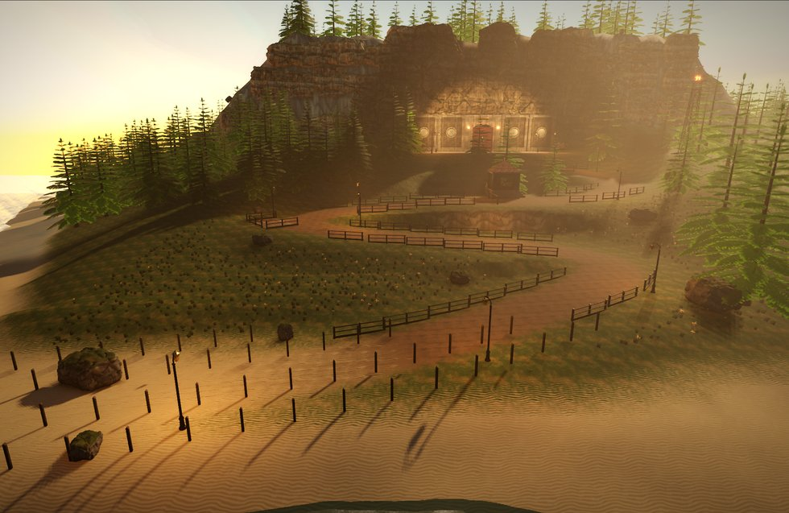
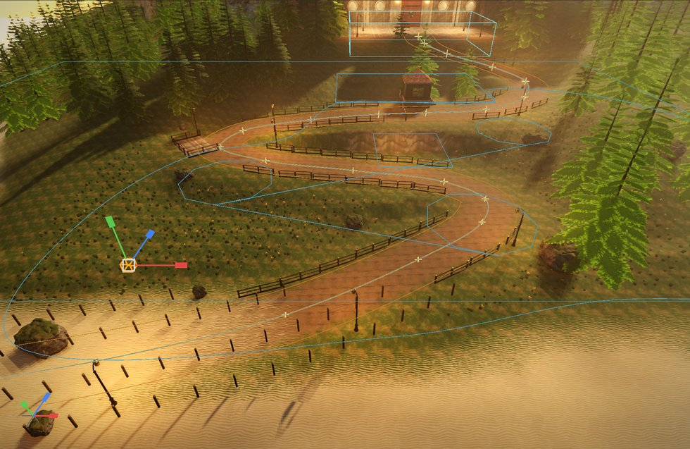
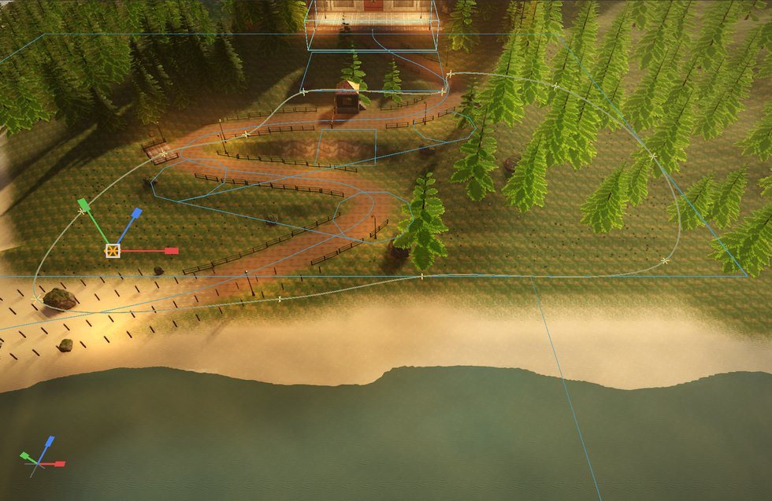
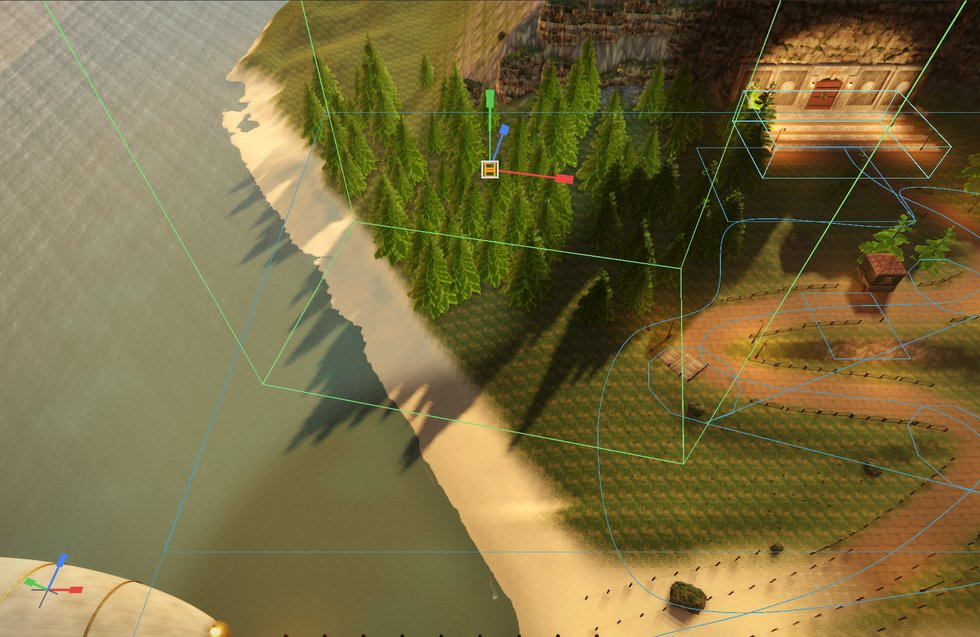
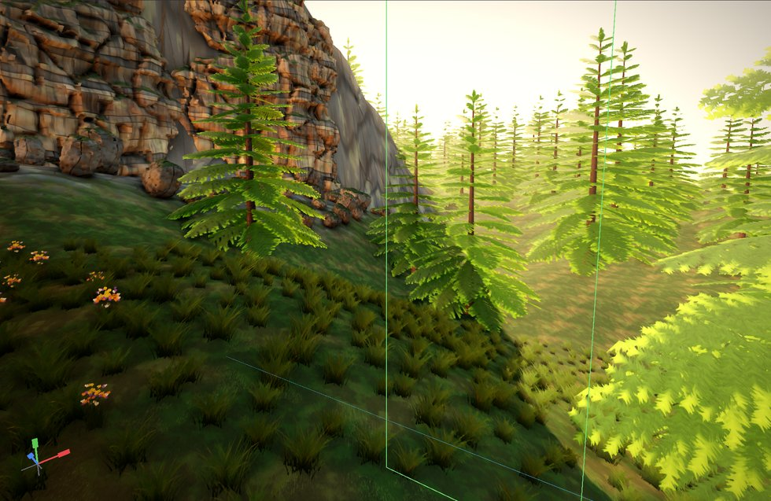

# Procedural content: a guide

Dress a level by rules instead of by hand. This guide walks through Demo
Lab's **L1 Foothills** (`Games/DemoLab`): a road climbing the island in
switchbacks, with lamps along it, guard rails on the uplands and fence posts
on the lowlands; a meadow of grass and wildflowers that keeps off the road;
spruce woods on the gentler slopes; and scree under the cliff. Every one of
those is placed by a rule. None is placed by hand.



Two components do all of it:

- **Spline**: a curve through points, on any entity. It is drawn in the
  editor only. Spawners place things along it, inside it or away from it,
  and games can follow it.
- **Procedural Spawner**: the rules. Where candidate points come from, what
  they land on, which ones survive, and what each becomes. Its instances are
  never saved. They are made again from the rules, on a worker thread,
  whenever something they depend on changes, and drawn as instanced meshes.

`Engine/Modules/RenderCore/PROCEDURAL.md` is the reference for every field.
L1 is generated: `Games/DemoLab/Tools/Levels/dress_l1.py` writes every
spline and spawner below (`dress`, `exclusion_zones` and `foliage`), so open
the level in the editor and compare, or change the script and run
`python3 Tools/Levels/make_levels.py` from `Games/DemoLab` (the
[Demo Lab guide](../../../Games/DemoLab/Docs/Guide.md) has the rest). The
steps below make the same things by hand in the editor.

---

## 1. A road: a spline, and lamps along it

1. **World > Add Spline** puts an entity with a two-point Spline in front of
   the camera. Rename it `Road`.
2. **World > Edit Spline Points** (or `spline edit on` in the Console). With
   the Road selected:
   - drag a point: it follows the ground and meshes under the cursor
     (hold **Shift** to move it up and down instead);
   - **Ctrl + click** adds a point (after the selected one, or at the end);
   - **Delete** removes the selected point;
   - **Esc** cancels a drag; press it again to stop editing points.

   Each change is one undo step. L1's road has 22 points, climbing from the
   dock to the plaza through three hairpins.
3. In the Details panel, set the Spline's **Width** to `600`: the width of
   the road. The selected spline draws it as a band either side.

Now add a **Procedural Spawner** to the same entity (Add Component), and set:

| Field | Value | Why |
|---|---|---|
| Source | Spline Path | one candidate every Spacing along the spline |
| Project, Project Range | Terrain, 3000 | dropped straight down onto the ground |
| Spacing | 1700 | a lamp every 17 m |
| Jitter | 0 | evenly spaced |
| Path Offset | 410 | one row, 4.1 m to the right of the centre line: just off the road's edge |
| Align to Path, Random Yaw | on, off | each lamp faces along the road |
| Scale Min, Scale Max, Color Variation | 1, 1, 0 | every lamp the same |
| Meshes[0].Mesh | `Content/Meshes/L1/L1_RoadLamp_X.nmmesh` | |
| Exclusions | `Zone_Plaza`, `Zone_Gate` | none on the plaza or in the gateway |

The lamps appear as soon as you change a field, and follow when you drag a
road point.



**Rails and fence posts** are two more spawners on copies of the same curve
(`Road_Rails` and `Road_Fence`: a spawner has one mesh list and one set of
rules, so a second row of something else is a second entity):

| Field | `Road_Rails` | `Road_Fence` |
|---|---|---|
| Spacing | 400 | 250 |
| Path Offset, Both Sides | 340, on | 360, on |
| Color Variation | 0.15 | 0.2 |
| LOD 1 Density, LOD 2 Density, Cull Distance | 1, 0.5, 14000 | 1, 0.5, 9000 |
| Mesh | `L1_GuardRail_Z` | `L1_FencePost_Z` |
| Exclusions | `Zone_Lowland`, `Zone_Plaza`, `Zone_Gate`, `Zone_Hairpins` | `Zone_Upland` |

So the uplands get rails and the lowlands get posts: each row is cleared
from the other's zone. `Zone_Hairpins` is a closed outline round the three
hairpins' insides, where a rail would cut across the bend.

**Orientation.** Align to Path turns an instance so its +Z runs along the
curve, so a long piece must be modelled along +Z: the `_Z` meshes are the
kit's rail and post turned that way, and `L1_RoadLamp_X` hangs its lantern
toward -X, over the road (`Tools/Art/make_l1_art.py`).

**Lights are not instances.** A spawner places meshes only. L1's lamp lights
are Point Light entities the level script puts at the same spacing along the
same curve (`road_samples` in `dress_l1.py`), so they stay where the lamps
are as long as the road and the Spacing do.

The road's earth is terrain paint, made by the level script. It does not move
with the spline. Everything procedural does.

## 2. Keeping things off the road: exclusions

**Exclusions** name entities that have a Spline. A closed one clears its
inside. Any one clears half its Width either side of the curve.

L1 keeps its plants off the road with `RoadClear`: one more copy of the road
curve, with a Width of 1300 (the road's 600 and a 3.5 m verge each side),
and no spawner. Every plant spawner excludes it. The closed, linear
`Zone_Plaza`, `Zone_Gate`, `Zone_Lowland`, `Zone_Upland` and
`Zone_Hairpins` splines clear areas instead. A selected spline draws its
outline, so select one to see what it covers.

## 3. A meadow: grass inside an outline, on the grass paint

1. Add another Spline, `Foliage_Meadow`, and draw an outline over the slopes
   east of the road. Tick **Closed**.
2. Give it a Procedural Spawner:

| Field | Value | Why |
|---|---|---|
| Source | Spline Area | a grid Spacing apart, kept inside the outline |
| Project, Project Range | Terrain, 4000 | on the ground |
| Spacing | 60 | one tuft every 60 cm |
| Terrain Layer, Layer Threshold | Layer 0, 0.45 | only where the terrain is painted Grass (L1's layers: Grass, Dirt, Rock, Sand) |
| Noise Scale, Noise Threshold | 2200, 0.28 | in patches about 22 m across |
| Max Slope | 40 | not on the steepest banks |
| Exclusions | `RoadClear`, `Zone_Gate`, `Zone_Plaza` | not on the road or its verges |
| Align to Normal | 0.7 | tufts lean with the slope |
| Scale Min, Scale Max | 0.5, 0.95 | |
| Color Variation | 0.3 | each tuft darkened by up to 30 % |
| Cast Shadows | off | card foliage casts whole-quad shadows |
| Cell Size, LOD Distance | 2500, 2500 | culled and thinned in 25 m squares |
| LOD 1 Density, LOD 2 Density, Cull Distance | 0.4, 0.12, 9000 | thinner with distance, gone past 90 m |
| Meshes[0].Mesh | `Content/Meshes/Foliage/L1_GrassTuft.nmmesh` | |

`Foliage_Flowers` is a second spawner inside the same outline: wildflowers
(`L1_Wildflowers`) every 110, where the grass paint weighs at least 0.55, in
smaller, sparser patches (Noise 1500, 0.55), culled at 60 m.



The editor stays responsive while a field generates on its worker thread,
and the old instances keep drawing until the new ones are ready. Thinning is
stable: the tufts that remain at a distance are always the same ones, so
nothing flickers as the camera moves. Demo Lab's Settings scale every
`Foliage_*` spawner's Density (`DemoLab.FoliageDensity`), so the same rules
serve every quality tier.

## 4. Woods: a box over the hills, gentle slopes only

A **Box** source fills **Box Extent** (half sizes, in the entity's space)
with a grid. Turn and stretch the entity to fit the area. `Foliage_Forest`
covers the western slope below the cliff:

| Field | Value |
|---|---|
| Source, Project | Box, Terrain |
| Box Extent | 4200, 4000, 2600 (the entity turned 12 degrees) |
| Spacing | 520 |
| Noise Scale, Noise Threshold | 3800, 0.32 (clumps and clearings) |
| Max Slope, Min Height | 33, 120 (no trees on cliffs or down on the beach) |
| Scale Min, Scale Max, Sink | 0.75, 1.5, 0.04 |
| Meshes | `L1_Spruce`, with **Far Mesh** `L1_Spruce_LOD1` |
| Cell Size, LOD Distance | 1500, 1200 |
| LOD 1 Density, LOD 2 Density, Cull Distance | 1, 0.7, 30000 (a forest's silhouette must not thin much) |
| Exclusions | `RoadClear`, `Zone_Plaza`, `Zone_Gate` |

A selected Box spawner draws its box. A box also limits the drop
vertically: points land only on surfaces inside it.



The hills further off use the same rules more cheaply: `Foliage_FarWoods`
and `Foliage_Highland` place only the LOD meshes (`L1_Spruce_LOD1`, far mesh
`L1_Spruce_LOD2`), farther apart (700 and 650), with Cast Shadows off, and
Highland only above 15 m (Min Height 1500).

## 5. Scree: rocks on the rock paint

Scree is a Box under the cliff (`Foliage_Scree`, Box Extent 6000, 2500, 900)
filtered to where the terrain is painted Rock:

| Field | Value | Why |
|---|---|---|
| Spacing | 170 | |
| Terrain Layer, Layer Threshold | Layer 2, 0.35 | the Rock paint, which the level script puts on steep ground and under the cliff |
| Max Slope | 48 | not on the cliff face itself |
| Align to Normal, Sink | 1, 0.15 | each rock tilted into the slope and part buried |
| Scale Min, Scale Max | 0.5, 1.6 | |
| Meshes | `Rock_A` (Weight 1), `Rock_B` (0.5), `Rock_D` (0.6) | |
| Exclusions | `Zone_Plaza`, `RoadClear` | |



## 6. From the console and from Lua

Every editor action has a console form, for scripts and tests. Points are in
world space:

```
pcg new Fence 0 0 0
spline add 0 0 0
spline add 2000 0 500
spline add 3500 0 2000
pcg set source path
pcg set project terrain
pcg set spacing 250
pcg set aligntopath on
pcg mesh 0 Content/Meshes/L1/L1_FencePost_Z.nmmesh
pcg stats
```

`pcg new` makes an entity with a spawner and selects it. `spline` acts on the
selection, adding a Spline the first time, so the posts follow that curve.
`spline set <i> <x y z>` moves a point. `pcg regenerate` remakes every
spawner, and `pcg stats` lists their counts and times (in L1: ten spawners).

Games can follow splines. Every query is in world space, and a Vector3 is
three numbers:

```lua
local road = World.FindEntity("Road"):GetComponent("Spline")
local length = road:GetLength()
local x, y, z = road:GetLocationAtDistance(length * 0.5)
local dx, dy, dz = road:GetDirectionAtDistance(length * 0.5)
local along = road:FindDistanceClosestTo(px, py, pz)

local grass = World.FindEntity("Foliage_Meadow"):GetComponent("Procedural Spawner")
grass:SetDensity(0.5)      -- the meadow thins a frame later
```

Demo Lab does the last of these from C++ for its foliage density setting
(`LabGameModeBase::ApplyFoliageDensity`).

## Tips

- **Pivots.** Place a mesh's pivot at its base, +Y up, as for terrain
  foliage. The instance stands on its pivot.
- **Orientation.** With Align to Path, model along +Z (section 1).
- **Normals.** Align to Normal reads the surface's normal, and Mesh Surface
  reads the mesh's. A mesh wound inside-out puts its "up" faces underneath.
- **Spacing first.** Get the count right with Spacing, then thin it with
  Density and noise. Spacing too small for the area is refused (over 20
  million candidate points). Max Instances (200,000 by default) caps the
  rest and says so in the log.
- **Seeds.** Change the Seed for a different arrangement under the same
  rules. Each point's randomness comes from where it is, so an edit
  reshuffles only what is near it.
- **Static meshes only.** Projection onto meshes uses Static entities'
  Render meshes, so a moving prop never regenerates a field.
- **Collision.** Instances have none yet. L1 puts invisible blocker boxes
  where the player must not walk through a rail (`rail_blockers` in
  `dress_l1.py`).
