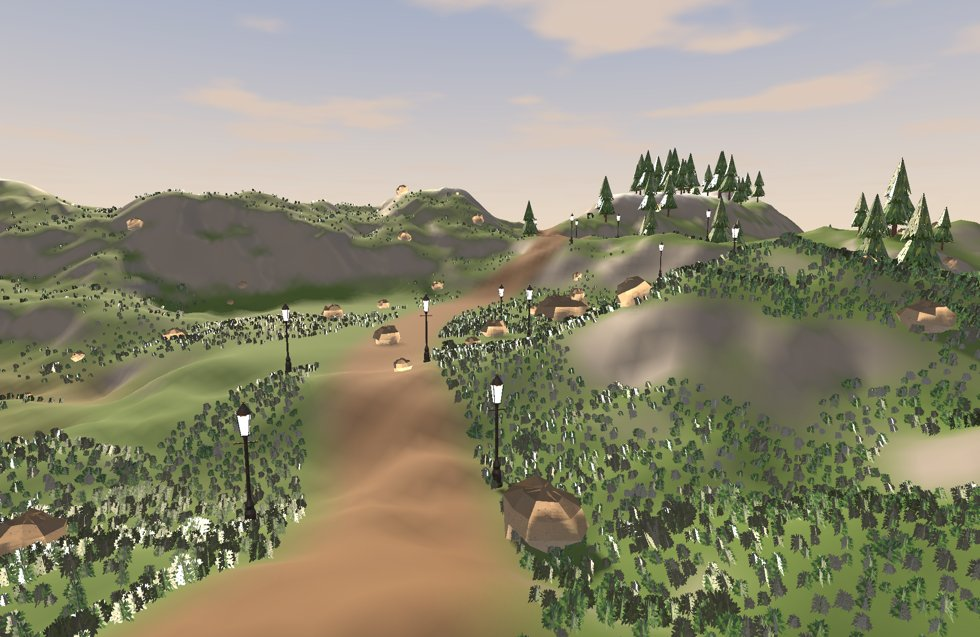
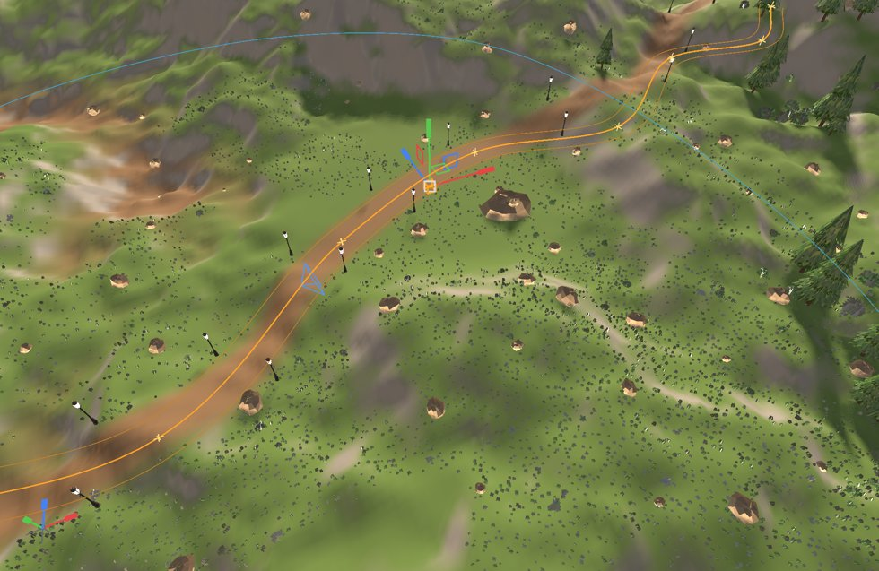
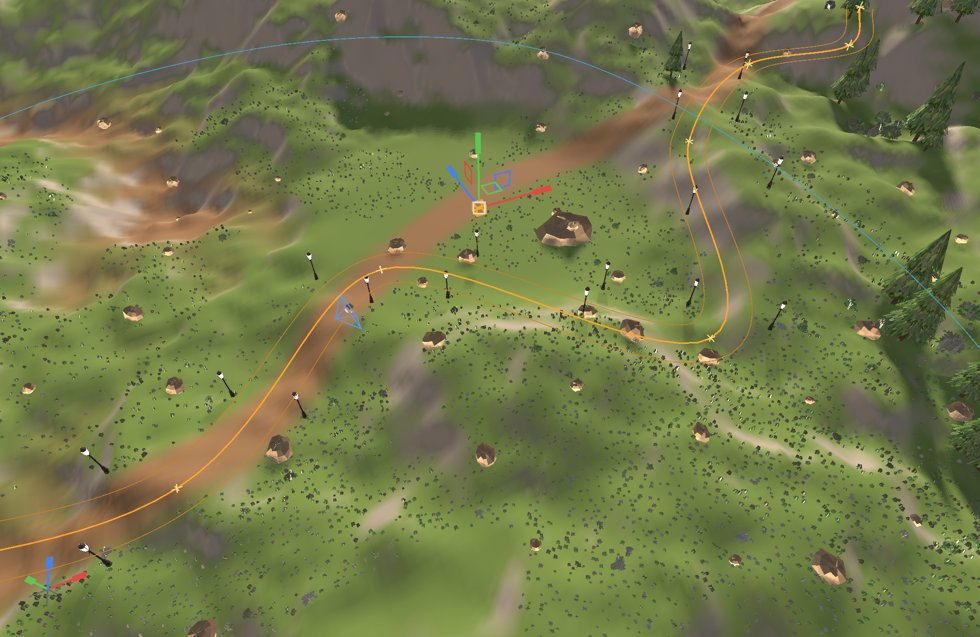
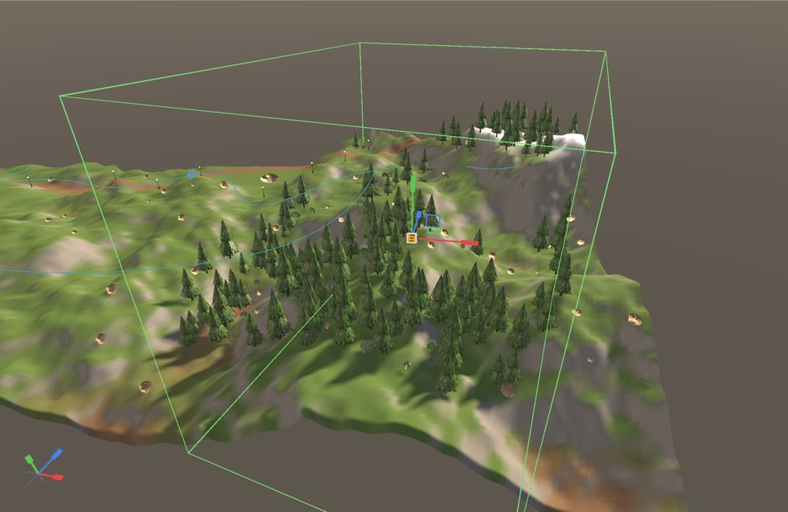
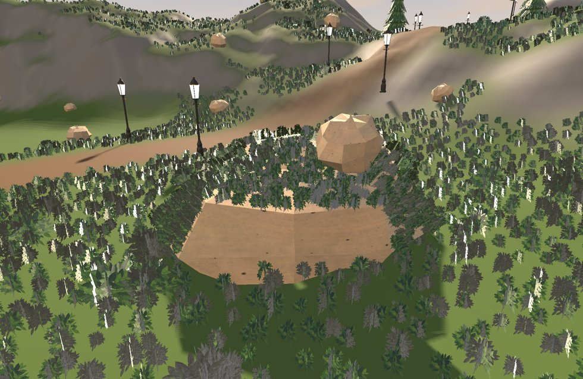

# Procedural content: a guide

Dress a level by rules instead of by hand. This guide builds the WorldsLab
**Meadow** level: a road winding across hills with gas lamps either side, a
meadow of grass that keeps off the road, pines on the gentler slopes, rocks
everywhere, and a boulder with grass on its top. Apart from the boulder,
nothing in it is placed by hand.



Two components do all of it:

- **Spline**: a curve through points, on any entity. It is drawn in the
  editor only. Spawners place things along it, inside it or away from it,
  and games can follow it.
- **Procedural Spawner**: the rules. Where candidate points come from, what
  they land on, which ones survive, and what each becomes. Its instances are
  never saved. They are made again from the rules, on a worker thread,
  whenever something they depend on changes, and drawn as instanced meshes.

`Engine/Modules/RenderCore/PROCEDURAL.md` is the reference for every field.
`Games/WorldsLab/Tools/Procedural/make_meadow_level.py` writes the finished
level, so you can open it and compare.

---

## 1. A road: a spline, and lamps along it

1. **World > Add Spline** puts an entity with a two-point Spline in front of
   the camera. Rename it `Road`.
2. **World > Edit Spline Points** (or `spline edit on` in the Console). With
   the Road selected:
   - drag a point: it follows the ground and meshes under the cursor
     (hold **Shift** to move it up and down instead);
   - **Ctrl + click** adds a point (after the selected one, or at the end);
   - **Delete** removes the selected point;
   - **Esc** cancels a drag; press it again to stop editing points.

   Each change is one undo step.
3. In the Details panel, set the Spline's **Width** to `600`: the width of
   the road. The selected spline draws it as a band either side.

Now add a **Procedural Spawner** to the same entity (Add Component), and set:

| Field | Value | Why |
|---|---|---|
| Source | Spline Path | one candidate every Spacing along the spline |
| Project | Terrain | dropped straight down onto the ground |
| Spacing | 1800 | a lamp every 18 m |
| Jitter | 0 | evenly spaced |
| Path Offset, Both Sides | 480, on | a row 4.8 m to each side of the centre line |
| Align to Path | on | each lamp faces along the road |
| Meshes[0].Mesh | `Content/Meshes/Steampunk/GasLamp.nmmesh` | |

The lamps appear as soon as you change a field. Drag a road point and they
follow:

| Before | After moving one point |
|---|---|
|  |  |

The earth strip under the road is terrain paint, made by the level script.
It does not move with the spline. Everything procedural does: the lamps
move, and the grass (next section) fills the old strip and clears the new
one.

## 2. A meadow: grass inside an outline, off the road

1. Add another Spline, `Meadow`, and draw an outline around the middle of
   the map. Tick **Closed**.
2. Give it a Procedural Spawner:

| Field | Value | Why |
|---|---|---|
| Source | Spline Area | a grid Spacing apart, kept inside the outline |
| Project | Terrain | on the ground |
| Spacing | 55 | one tuft every 55 cm |
| Terrain Layer, Layer Threshold | Layer 0, 0.55 | only where the terrain is painted grass |
| Noise Scale, Noise Threshold | 2600, 0.3 | in patches about 26 m across, 30 % bare |
| Exclusions[0] | `Road` | not inside the road's band |
| Align to Normal | 0.7 | tufts lean with the slope |
| Scale Min, Scale Max | 0.45, 0.85 | |
| Color Variation | 0.25 | each tuft darkened by up to a quarter |
| Cast Shadows | off | card foliage casts whole-quad shadows |
| Cell Size, LOD Distance | 2500, 3000 | culled and thinned in 25 m squares |
| LOD 1 Density, LOD 2 Density, Cull Distance | 0.45, 0.15, 11000 | thinner with distance, gone past 110 m |
| Meshes | GrassTuft (Weight 1), Bush (Weight 0.012) | about one bush per eighty tufts |

That is about 46,000 tufts, made in roughly 60 ms on a worker thread. The
editor stays responsive while it runs, and the old instances keep drawing
until the new ones are ready. Thinning is stable: the tufts that remain at
a distance are always the same ones, so nothing flickers as the camera
moves.

**Exclusions** name entities that have a Spline. A closed one clears its
inside. Any one clears half its Width either side of the curve. The road
clears grass because its Width is 600.

## 3. Woods: a box over the hills, gentle slopes only

A **Box** source fills **Box Extent** (half sizes, in the entity's space)
with a grid. Turn and stretch the entity to fit the area:

| Field | Value |
|---|---|
| Source, Project | Box, Terrain |
| Box Extent | 4600, 5000, 6200 |
| Spacing, Jitter | 480, 1 |
| Noise Scale, Noise Threshold | 4200, 0.3 (clumps) |
| Max Slope | 30 (no trees on cliffs) |
| Meshes | Pine with **Far Mesh** Pine_LOD1, and Bush |
| LOD 1 Density, LOD 2 Density | 1, 1 (a forest's silhouette must not thin) |
| Exclusions[0] | `Road` |

A selected Box spawner draws its box. A box also limits the drop
vertically: points land only on surfaces inside it.



## 4. Rocks everywhere, and grass on a boulder

**Rocks**: a Box over the whole map with Project set to **Terrain and
Meshes**. Rocks land on the terrain or on any static mesh above it,
whichever is higher. One landed on the boulder below. Set **Align to
Normal** to 1 and a little **Sink** (0.18) so they sit tilted into the
ground. Use a wide Scale range (0.6 to 2.6).

**The boulder** is a plain Render mesh (Rock, scaled 7 × 5 × 7). Give it a
spawner with **Mesh Surface**: candidates come from its own triangles, one
per Spacing² of area, standing on the surface.

| Field | Value | Why |
|---|---|---|
| Source | Mesh Surface | over the boulder's own mesh |
| Spacing | 20 | |
| Max Slope | 60 | the top, not the sides |
| Min Height | 10 | not the base, which is buried in the ground |
| Align to Normal | 0.8 | grass grows out of the surface |



## 5. From the console and from Lua

Every editor action has a console form, for scripts and tests. Points are in
world space:

```
pcg new Fence 0 0 0
spline add 0 0 0
spline add 2000 0 500
spline add 3500 0 2000
pcg set source path
pcg set project terrain
pcg set spacing 250
pcg set aligntopath on
pcg mesh 0 Content/Meshes/Steampunk/Bollard.nmmesh
pcg stats
```

`pcg new` makes an entity with a spawner and selects it. `spline` acts on the
selection, adding a Spline the first time, so the posts follow that curve.
`pcg regenerate` remakes every spawner, and `pcg stats` lists their counts and times.

Games can follow splines. Every query is in world space, and a Vector3 is
three numbers:

```lua
local road = World.FindEntity("Road"):GetComponent("Spline")
local length = road:GetLength()
local x, y, z = road:GetLocationAtDistance(length * 0.5)
local dx, dy, dz = road:GetDirectionAtDistance(length * 0.5)
local along = road:FindDistanceClosestTo(px, py, pz)

local grass = World.FindEntity("Meadow"):GetComponent("Procedural Spawner")
grass:SetDensity(0.5)      -- the meadow thins a frame later
```

## Tips

- **Pivots.** Place a mesh's pivot at its base, +Y up, as for terrain
  foliage. The instance stands on its pivot.
- **Normals.** Mesh Surface reads the mesh's normals. A mesh wound
  inside-out puts its "up" faces underneath. The WorldsLab rock was like
  this, and fixing it fixed its shading too.
- **Spacing first.** Get the count right with Spacing, then thin it with
  Density and noise. Spacing too small for the area is refused (over 20
  million candidate points). Max Instances (200,000 by default) caps the
  rest and says so in the log.
- **Seeds.** Change the Seed for a different arrangement under the same
  rules. Each point's randomness comes from where it is, so an edit
  reshuffles only what is near it.
- **Static meshes only.** Projection onto meshes uses Static entities'
  Render meshes, so a moving prop never regenerates a field.
- **Collision.** Instances have none yet. A player walks through a
  procedural lamp post.
