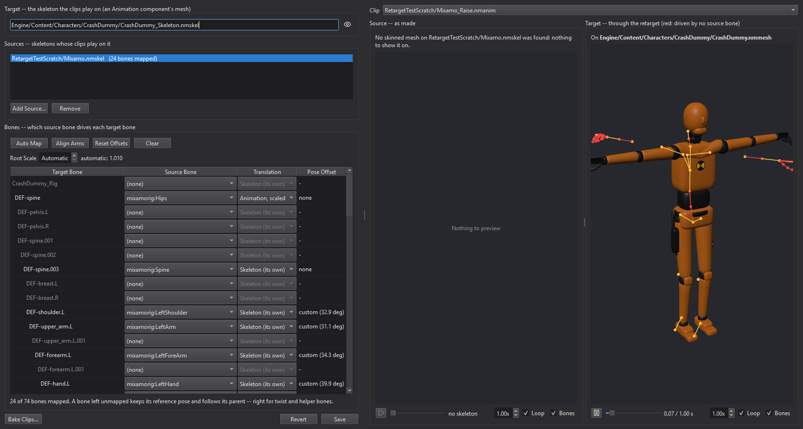

# Playing a clip pack on your character: retargeting

You have a character -- the engine's CrashDummy, say: a Rigify `DEF-*` rig
in an A pose -- and a pack of clips made for another rig: Mixamo's
`mixamorig:*` bones, other proportions, other bone axes, a T pose. This
guide plays the pack on the character through a **retarget**, and then bakes
it so it costs nothing at runtime.

Reference: [ANIMATION.md](../../Modules/RenderCore/ANIMATION.md), "Retargeting"
(the format and the math) and "In the editor".

## Contents

1. [Import the pack](#1-import-the-pack)
2. [Make a retarget](#2-make-a-retarget)
3. [Auto map and align the arms](#3-auto-map-and-align-the-arms)
4. [Preview](#4-preview)
5. [Use it](#5-use-it): [a prefab](#a-prefab), [an anim state](#an-anim-state), [Lua](#lua), [C++](#c)
6. [Bake](#6-bake)
7. [Pitfalls](#7-pitfalls)

---

## 1. Import the pack

Convert the pack to `.glb` (Blender opens Mixamo's FBX) and import the files
with the import wizard. A clip downloaded "without skin" has no mesh; that is
fine -- it imports as a skeleton and its clips.

In the wizard's **Animation** group:

- **Existing Skeleton**: for the first file leave it on "(its own)", which
  writes `<Name>_Skeleton.nmskel`. For every later file of the same rig pick
  that skeleton: no new skeleton is written and the clips name the first
  one, so one retarget covers the whole pack. A file with a bone the
  skeleton lacks is refused, the bones named.
- **Create Retarget To**: pick your character's skeleton
  (`Engine/Content/Characters/CrashDummy/CrashDummy_Skeleton.nmskel`) to have
  the import write `<Name>_to_CrashDummy.nmretarget` beside the clips,
  auto-mapped with its arms aligned -- steps 2 and 3 done for you.

Mixamo's centimetres: glTF from Blender is in metres, and the default Scale
of 100 makes them engine units.

## 2. Make a retarget

If the import did not make one: select your character's skeleton in the
Content Browser, right-click and choose **New Retarget...** (the selected
skeleton becomes the target; with none selected you are asked for it). Then **Add Source...** and pick the pack's skeleton. Adding a
source auto-maps it.

## 3. Auto map and align the arms



**Auto Map** fills the table: pelvis, spine, chest, neck and head,
clavicles, arms, hands, fingers, legs, feet and toes by humanoid role, then
the rest by name. The pelvis's translation is "Animation, scaled" -- the
source's hips, scaled to your character's hip height (Root Scale, automatic)
-- and every other bone keeps its own lengths ("Skeleton"). Twist and helper
bones (`DEF-upper_arm.L.001`, `DEF-breast.L`) stay unmapped and grey: they
keep their reference pose under their parent, which is what they should do.

**Align Arms** fixes the reference poses: Mixamo's arms are out level, the
CrashDummy's hang in an A. Without it every arm pose is 40-odd degrees too
low. The Pose Offset column shows what it set.

Change anything by hand: a row's Source Bone and Translation combos. A red
row names a source bone the source skeleton lacks, or one that drives two
bones. Ctrl+Z undoes; Save writes the file.

## 4. Preview

Pick a clip of the pack in **Clip**. The left view plays it on a mesh of the
source skeleton, if the project has one; the right plays it on your
character through the retarget as it is now -- edits replay at once. Bones
no source bone drives are drawn red.

## 5. Use it

### A prefab

Set the character's Animation component **Retarget** to the `.nmretarget`
and its **Animation** to one of the pack's clips -- or to an anim state that
mixes the pack's clips with your character's own. Clips made on the
character's skeleton play as they always did; the pack's play through the
retarget. The retarget must target the mesh's skeleton, or it is ignored
(the log says so).

### An anim state

An anim state built from a pack's clips can name the retarget itself: the
**Retarget** field at the top of the anim state editor. Then any character
whose mesh is on the retarget's target plays it with no Retarget of its own.
The component's Retarget, when set, wins.

### Lua

```lua
local animation = entity:GetComponent("Animation")
animation:SetRetarget("Content/Packs/Mixamo/Mixamo_to_CrashDummy.nmretarget")
animation:SetAnimation("Content/Packs/Mixamo/Mixamo_Samba.nmanim")
```

### C++

Auto-mapping is RenderCore's, for tools of your own (from
`RenderCore/Tests/RetargetTests.cpp`, `TestAutoMap`):

```cpp
RetargetSource Aligned;
Aligned.Skeleton = "Mixamo.nmskel";
AutoMapRetarget(A.Skeleton, B2.Skeleton, Aligned);
Expect(AlignRetargetArms(A.Skeleton, B2.Skeleton, Aligned), "the arms align");
```

## 6. Bake

A retarget costs a little every frame -- each retargeted bone is a few
quaternion products -- and only plays where a retarget is set. **Bake
Clips...** writes chosen clips as ordinary clips on the target: pick them,
a folder and a name suffix. A baked clip names the target skeleton and its
notifies' target bones, and remembers the clip and retarget it came from:
**Reimport** on it bakes it again, keeping the notifies you added. For a
whole folder from the console:

```
anim retarget-bake Content/Packs/Mixamo/Mixamo_to_CrashDummy.nmretarget Content/Packs/Mixamo Content/Characters/Hero/Clips
```

## 7. Pitfalls

- **The retarget must target the mesh's skeleton**, path for path; a copy of
  the skeleton elsewhere is another skeleton.
- **Clips with no `Skeleton`** (very old imports) never retarget: reimport them.
- **Feet slide** when legs differ in length: there is no IK yet.
- **A pose far from the target's** -- not just the arms -- needs pose offsets
  set by hand (Align Arms sets the arms' only).
- **Root motion** follows the bone the clip's root drives; if the pack's root
  is unmapped, the clip has no root motion on your character (warned).
