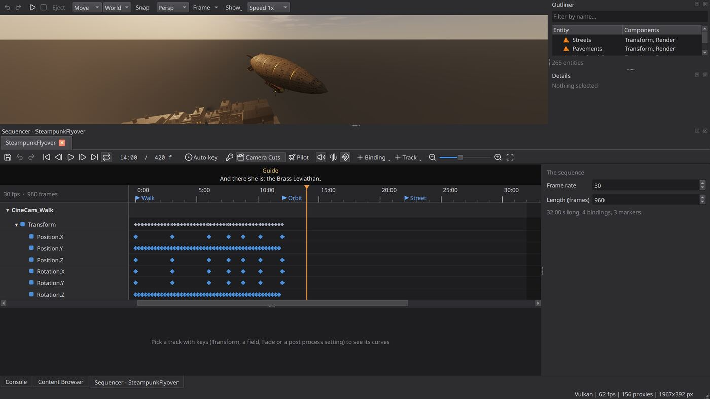
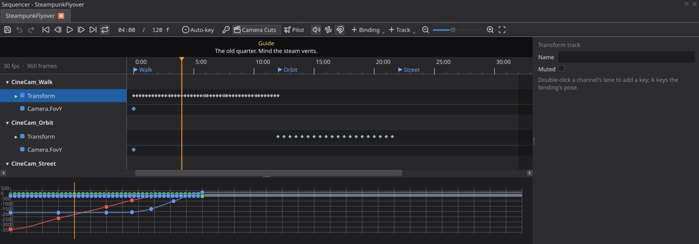
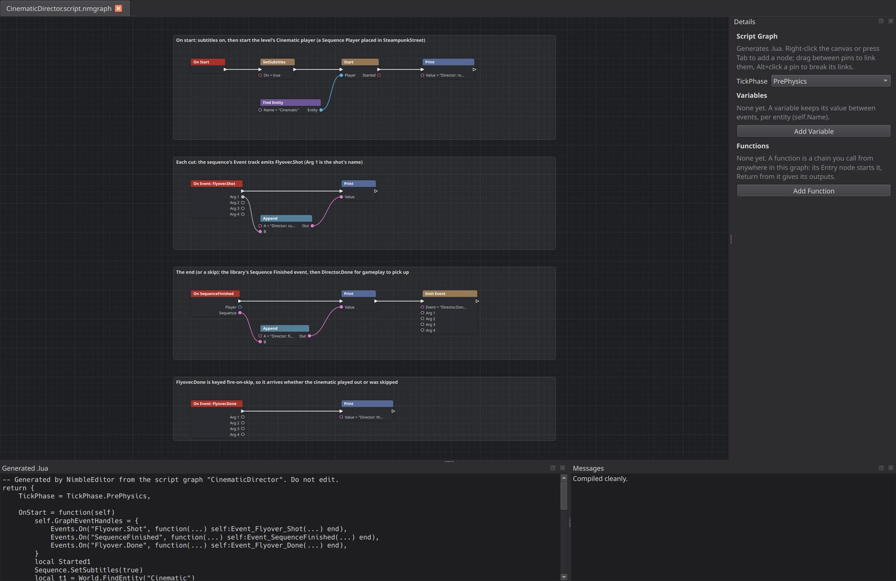
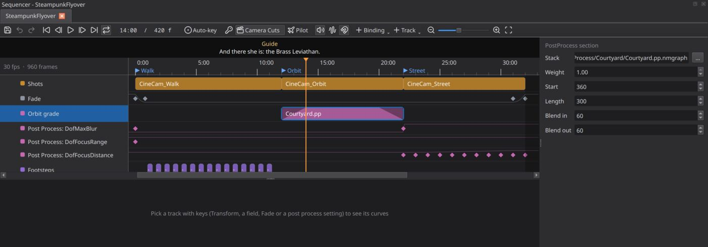

# Sequencer implementation guide

How the cutscene Sequencer is built, how a frame of a cutscene flows through
it, and where to change it. This is for people working on the engine. To
*author* a cutscene, read the [Editor README](../../Modules/Editor/README.md)
("Sequencer"); for the file format and the runtime's behaviour, the
[Sequencer README](../../Modules/Sequencer/README.md).

**13** track types · **1** evaluator · **3** layers (asset, runtime, editor) · **1** host interface · **2** file forms

## Contents

1. [The shape of it](#1-the-shape-of-it)
2. [The asset](#2-the-asset)
3. [Files: XML and cooked](#3-files-xml-and-cooked)
4. [SequenceInstance: one asset on one World](#4-sequenceinstance-one-asset-on-one-world)
5. [SequenceWorld: the players](#5-sequenceworld-the-players)
6. [The host: what the game provides](#6-the-host-what-the-game-provides)
7. [Scripting and C++ entry points](#7-scripting-and-c-entry-points)
8. [Networking](#8-networking)
9. [The editor](#9-the-editor)
10. [Recipe: add a track type](#10-recipe-add-a-track-type)
11. [Recipe: add a host feature](#11-recipe-add-a-host-feature)
12. [Tests](#12-tests)
13. [Invariants and pitfalls](#13-invariants-and-pitfalls)

---

## 1. The shape of it

Three layers, each usable without the one above it.

```
  Editor (Modules/Editor/.../Sequencer/)       Qt only, WITH_EDITOR
    SequencerTab  SequencerDocument  SequencerTimeline  CurveEditor  Details
        |  previews with a SequenceInstance (makes nothing in the level)
        v
  Runtime (Modules/Sequencer/)                 SHARED library
    SequenceWorld   players, ticking, the screen    <-- one per level World
    SequenceInstance  one asset applied to one World  <-- the evaluator
    SequenceAsset / SequenceFile              data and its two file forms
        ^
        |  SequenceHost (function pointers)
  Game (Source/Private/NimbleEngine/GameSession.cpp, SequenceFacade.cpp)
    camera view, fade, letterbox, mix bus, subtitles, "is this a replica?"
```

Link order: `Host exe -> NimbleEngine -> Sequencer -> GameCore`, with RenderCore
linked **PRIVATE** (clips, cameras). No public Sequencer header includes a
RenderCore or NimbleEngine header, so a game can reach cutscenes with the
`Sequence Player` component, the `Sequence` script library or
`NimbleEngine/SequenceFacade.h` and never name a Sequencer type.

The module is SHARED (like Audio) because there must be one asset cache, one
`SequenceWorld` registry and one component registration per process.

The central design decision: **the editor's preview and the game run the same
`SequenceInstance`.** The editor passes options that make it create nothing in
the level; everything else is shared code. What you scrub is what plays.

| Piece | File | Role |
|---|---|---|
| Asset, tracks, keys, sections, cache | `SequenceAsset.h/.cpp` | Plain data, curve sampling, `Validate`, `SequenceAssetCache` |
| XML read/write | `SequenceXml.cpp` | The authored form (`WITH_UNCOOKED` only) |
| Cooked form | `SequenceBinary.cpp` | `NMSQ` chunked binary; the only form Shipping reads |
| File API | `SequenceFile.h` | Load/read/write/cook entry points |
| Evaluator | `SequenceInstance.h/.cpp` | Asset to World at a frame |
| Players | `SequenceWorld.h/.cpp` | Playhead, state, events, the screen, replication |
| Component and `Sequence` library | `SequencePlayerComponent.h/.cpp` | `Sequence Player`, Lua/graph functions |
| Game glue | `GameSession.cpp`, `SequenceFacade.cpp` | `SequenceHost`, cinematic UI, Back key |

## 2. The asset

`SequenceAsset` holds no World state; it is data you can build, copy and diff.

```
SequenceAsset { FrameRate, Length, Bindings[], Tracks[], Markers[] }
  SequenceBinding { Id, Name, Kind (Possess|Spawn), Guid, Prefab, Tracks[] }
  SequenceTrack   { Type, Component, Field, Channels[], Events[], Sections[], Name, bMuted }
    SequenceChannel { Keys[] { Frame, Value, Interp, InTangent, OutTangent } }
    SequenceEventKey { Frame, Event, Args[<=4], bFireOnSkip }
    SequenceSection  { Start, End, Asset, PlayRate, Volume, Offset, BlendIn, BlendOut, bLoop, Bus, Spatial, Speaker }
```

Decisions worth knowing:

- **Frames are integers.** Keys and sections sit exactly where they were put;
  only the playhead is fractional. `FrameRate` is clamped 1..1000 by `Normalize`.
- **One track struct for every type.** `SequenceTrack` carries every field any
  type uses, and `Type` decides which are meaningful (see the comment on each
  member). That keeps the editor's snapshot-based undo, the XML writer and the
  binary writer table-driven.
- **`SequenceSection` is one shape for all section tracks**, and `Asset` means
  a different thing per track: a `.nmanim` for Animation, a `.nmsound` for
  Audio, a `.nmseq` for SubSequence, a binding id for CameraCut, a
  `.pp.nmgraph` for PostProcess, the line's text for Subtitle.
- **Bindings own tracks, the asset owns the rest.** Event, Audio (positionless),
  CameraCut, Fade, SubSequence, PostProcess, PostProcessSetting, BusVolume and
  Subtitle are usually on the asset. `IsSectionTrack` says which types keep
  sections rather than keys.
- **Key interpolation** (`ESequenceInterp`) governs the segment from a key to
  the *next* one. `Auto` is Catmull-Rom clamped flat at the ends and at peaks,
  so it never overshoots. `User` uses the key's tangents (value per frame).
  The named eases are `UIAnimation.h`'s set, via `Ease()`.
- **`Normalize()`** sorts keys and events, drops duplicate frames (a later key
  replaces), and sizes Transform channels to `TC_Count` (9). Every read path
  calls it; call it after building an asset by hand.
- **`Validate()` never blocks loading.** It returns lines for duplicate binding
  ids, keys past the end, an `@id` naming no binding, an unknown bus, and so
  on. The loader logs them, Details lists them, and the cook turns missing
  referenced assets (`GetReferencedAssets`) into failures.
- **`SequenceAssetCache`** shares loaded assets by runtime path across players
  (`shared_ptr<const SequenceAsset>`). A failed load is remembered as failed
  until `Invalidate`. The editor `Set`s an unsaved edit under its path and
  `Invalidate`s after a save; players already holding the old asset keep it
  until they restart.

## 3. Files: XML and cooked

One extension, `.nmseq`. `DetectSequenceFileFormat` tells the forms apart by
their first bytes, as `.nmui` does.

- **XML** (`SequenceXml.cpp`, only with `WITH_UNCOOKED`): the authored form.
  Writing is *deterministic* (same asset, same bytes) so it diffs cleanly, and
  `SaveSequenceXml` writes through a `.tmp` and a rename. Shipping has no XML
  parser, which is why the parser sits behind `WITH_UNCOOKED` and uses pugixml
  PRIVATE.
- **Cooked** (`SequenceBinary.cpp`): magic `NMSQ`, a version (now 3), then
  chunks through `CoreArchive`: `HEAD` (rate, length), `BIND` (bindings and
  their tracks), `TRAK` (the asset's own tracks), `MARK`. A chunk a newer
  build adds is stepped over. Version 2 added tangents, names, mute, sections
  and markers; version 3 added a section's bus, 2D/3D and speaker. **Older
  files still read**, so a new field means: bump the version, write it
  always, read it only when the version is high enough.
- `LoadSequence` goes through the file provider and accepts either form.
  `CookSequenceFile` reads XML and writes the cooked form; the editor's
  **Build > Cook Content** calls it for every `.nmseq`
  (`Editor/Build/ContentCook.cpp`) after validating referenced assets.

## 4. SequenceInstance: one asset on one World

`SequenceInstance(World, Asset, Path, Options)` is where tracks become
changes in a World. It is not a player: it has no clock. You hand it a frame.

```cpp
Instance.Evaluate(Frame);                 // continuous tracks at Frame
Instance.UpdatePlayback(Frame, bPlaying); // sounds in step
Instance.FireEvents(From, To, bIncludeFrom, bSkipOnly);
// outputs: GetShot(), GetFade(), GetPostProcess(), GetBusGains(), GetSubtitle()
Instance.RestoreState(); Instance.Release();
```

### Binding resolution

Lazy, on first use (`ResolveBinding`), in this order: the override set by
`SetBindingOverride`, then the entity with the binding's `Guid`, then the
first with its `Name`; a Spawn binding spawns its prefab. A binding that
resolves to nothing is warned about once and its tracks are skipped. Resolving
also builds a `BoundTrack` per track (`BindTracks`): the component type and
field offset for Float and Bool tracks are looked up once through the script
field binding, not per frame.

### Evaluate

`Evaluate` is a pure function of time for the continuous tracks. It clears the
frame's outputs (`Fade`, `Shot`, `PostProcess`, `BusGains`, `Subtitle`), then
runs every usable, unmuted track through `EvaluateTrack`, a switch on
`ESequenceTrackType`:

| Track | What `EvaluateTrack` does |
|---|---|
| Transform | `WriteTransform`: set the local pose from the keyed channels; an unkeyed channel is left alone |
| Float / Bool | `WriteField`: write through the saved offset into the component; Bool steps |
| Animation | `WriteAnimation`: pause the entity's Animation component, set clip and time, crossfade overlapping sections; `HandBackAnimation` when the playhead leaves |
| CameraCut | `EvaluateShot` fills `SequenceShot` (pose, FOV, a blend between two cameras); the first track with a shot wins |
| Fade | channel 0 clamped to 0..1 |
| SubSequence | `EvaluateSubs`: a child `SequenceInstance` per section, evaluated at `SubFrame` (the section's time and rate); depth capped at 8 |
| PostProcess | each section under the playhead becomes a `Stack{Path, Weight}`, weight times its fade envelope |
| PostProcessSetting | one `Setting{Name, Value}`, appended so later settings win |
| BusVolume | `MultiplyGain` into `BusGains` (gains multiply) |
| Subtitle | the latest-started section under the playhead |
| Event / Audio | nothing here; see below |

If the options allow a camera entity, `Evaluate` then keeps a
`"Sequence Camera"` entity (created on demand, destroyed when no shot) posed
and lensed to the shot. The game sees through it.

### What it overwrites, and giving it back

The first time a track writes a value, `Save` records the original in
`SavedValue` (keyed by entity + component type + offset, so one save per
value; a Transform is saved whole). `RestoreState` writes them all back and
forgets them; `DiscardState` forgets without writing. Two kinds of change are
flagged `bHeld` and go back on `Release` **whatever** Restore State says,
because they are the sequence's only while it plays: an Animation track's
control of its entity, and a rigid body made kinematic by a Transform track
(`HoldRigidBody`).

`Release` lets go of everything the instance made or holds (sounds and their
helper entities, clips, bodies, camera entity, spawned entities); saved values
stay for the caller to restore or discard. Evaluating again takes it all up
afresh.

### Sound

Audio sections do not play from `Evaluate`; `UpdatePlayback(Frame, bPlaying)`
does it, so a scrub (`Evaluate` only) is silent unless the caller also asks for
audio. Each section has a `SoundVoice` whose `Helper` is an entity carrying an
Audio Source: parented to the binding, or at the origin for a track with no
binding. States are Idle, Playing, Paused. The instance seeks a voice back
when it drifts more than a quarter second, and `NoteJump()` forces a re-seek
after a loop or seek. `Options.SoundWorld` lets the helpers live in a World of
the caller's own; they are then placed where their binding is each update.
This is how the editor's preview makes sound without touching the level.

### Events

`FireEvents(From, To, bIncludeFrom, bSkipOnly)` emits keys in `(From, To]` on
the World's EventBus, in frame order, sub-sequences' too. `bIncludeFrom` is
for the first tick after a start (frame 0 included). `bSkipOnly` limits it to
keys marked `fireOnSkip`. Because a handler may destroy the instance whose
events it is hearing, the instance holds `shared_ptr<bool> Alive` and the loop
checks it.

### Options

`SequenceInstanceOptions` is the whole editor/game difference:

| Option | Game | Editor preview |
|---|---|---|
| `bSpawn` | true | false: Spawn bindings show nothing |
| `bAudio` | true | the tab's Sound toggle |
| `SoundWorld` | null (the instance's World) | a World of the tab's own |
| `bCameraEntity` | true | false: the viewport is steered instead |
| `Depth` | 0 | 0 (sub-sequences get +1) |

## 5. SequenceWorld: the players

`SequenceWorld::Attach(World)` makes (or refcounts) the per-World system;
`Detach` releases it. `GameSession` attaches before a level loads so an
Auto Play player starts with it. The system registers a tick in
**TP_PostPhysics**: after gameplay scripts and physics, so a sequence has the
last word on what it binds, and before the animation system (TP_PostUpdate),
which then sees this frame's pose and clip. A World that does not tick (the
editor's, outside Play) plays nothing.

Each entity with a `SequencePlayerComponent` gets a `Player` in a map keyed by
`EntityID::Pack()`. Components are POD, so the playhead, the instance and the
overrides live in the `Player`, not the component.

```
Player { Instance, State (Stopped|Playing|Paused|Finished), Frame (double),
         bIncludeFrame, bFresh, bAutoPlayed, bRestoreState, StartOrder,
         SeenSerial, SeenState, Overrides }
```

### Tick

1. Drop players whose entity or component has gone (`Release` first).
2. Gather the ids first: a sequence may spawn, which may add players.
3. For each: a replica `Follow`s the server; otherwise a not-yet-seen player
   with Auto Play and state Stopped is `Play`ed.
4. If Playing, `Advance`. A `bFresh` player's first tick passes **zero time**,
   so it shows the frame it starts on.
5. After all players, `ApplyToHost()`.

### Advance

`To = From + dt * FrameRate * max(0, PlayRate)`. At the end: if looping, evaluate
the wrapped frame, `NoteJump`, fire the rest of the pass `(From, Length]` and then
`[0, Wrapped]`; otherwise clamp to `Length`, evaluate, fire, and `Finish`.
Finishing restores (or discards) saved values, destroys spawned entities,
emits `SequenceFinished`, and destroys the player entity if
`bDestroyWhenFinished`. Note the re-lookup of the player after every
`FireEvents`: a handler may have stopped it or destroyed it.

### Verbs

| Call | Semantics |
|---|---|
| `Play` | from the start; a paused player resumes instead; emits `SequenceStarted` |
| `Pause` / `Resume` | hold / continue |
| `Stop` | back to the start holding nothing; restores if Restore State; emits `SequenceStopped` |
| `Seek(s)`, `SeekToMarker` | jump and show that frame now; **no events**; a stopped player is left paused there |
| `Skip` | fire only `fireOnSkip` events on the way, then `Finish` |
| `Bind(player, id, entity)` | an override kept across Play and Stop |
| `SkipCinematics` | skips every playing cinematic *and* skippable player |

### Merging many players into one screen

`ApplyToHost` reduces all players to one answer for the host. This is the only
place the rules for several simultaneous sequences live:

- **View:** among players with a valid shot, the one with the greatest
  `StartOrder` wins. When none has one, the view returns to what it was
  (`ViewBefore`, saved when the SequenceWorld first took it).
- **Fade:** the darkest any player asks for.
- **Cinematic:** on while any cinematic player is Playing or Paused.
- **Post process:** every player's stacks and settings, earlier-started first,
  so a later one's settings win; pushed through `PushPostProcess` to
  RenderCore's per-World `PostProcessOverride`. Cleared when nothing plays.
- **Bus gains:** multiplied across players; a bus no player wants is told 1.
- **Subtitle:** the started-last player's line, and none at all while
  `AreSubtitlesEnabled()` is false (a static, game-wide setting).

Each result is compared with what the host was last told (`AppliedCamera`,
`AppliedFade`, ...) and sent only on change.

## 6. The host: what the game provides

`Sequencer` cannot reach the camera, UI or mixer itself (it sits below
NimbleEngine). Instead `GameSession` fills a `SequenceHost` of plain function
pointers with a `UserData`; each may be null and a World without a host plays
everything else.

| Pointer | GameSession implementation |
|---|---|
| `SetViewTarget` / `GetViewTarget` | `GameSession::SetViewTarget`: the game is seen through the camera |
| `SetFade` | writes `Sequencer.Fade` into the cinematic UI document |
| `SetCinematic` | letterbox on/off (`Sequencer.Letterbox`) and the input hold |
| `IsReplica` | whether a Sequence Player is a client's copy of a server's |
| `SetBusGain` | `AudioDevice::SetBusGain` |
| `SetSubtitle` | writes `Sequencer.Speaker` and `Sequencer.Subtitle` |

The fade, bars and subtitle are a UI document `GameSession` **builds in code**
(`Engine/Sequencer/Cinematic.nmui`, bound to `Sequencer.*` values), so there is
no file for a game to ship. Back (Escape, gamepad East) in cinematic mode calls
`SequenceWorld::SkipCinematics()` from `GameSession`'s input path.

`GameSession` clears the host and calls `Detach` when the level unloads, which
puts the mix back to 1 and the view back.

## 7. Scripting and C++ entry points

- **Component:** `SequencePlayerComponent` ("Sequence Player"). It registers a
  serializer (version 1), script field bindings, replication and editor
  properties (`PF_AssetSequence` gives the picker an Edit button). To add a
  field, add it in all four places.
- **`Sequence` script library** (same file, `GAMECORE_DEFINE_SCRIPT_LIBRARY`):
  `Play`, `Start`, `Pause`, `Resume`, `Stop`, `Skip`, `Seek`, `SeekToMarker`,
  `SkipCinematics`, `SetSubtitles`, `GetSubtitles`, `Bind`, `IsPlaying`,
  `GetTime`, `GetDuration`, plus events `SequenceStarted`, `SequenceFinished`,
  `SequenceStopped`. One declaration serves Lua **and** the script graph editor:
  the signature string (`"Player:Entity, Seconds:number -> Done:bool"`) becomes
  the node's pins, and `Lib.Event` becomes an event node. `Lib.Pure` makes a
  node with no exec pins.
- **`NimbleEngine/SequenceFacade.h`:** `PlaySequence`, `StartSequence`,
  `PauseSequence`, `ResumeSequence`, `StopSequence`, `SkipSequence`,
  `BindSequence` and friends. Each is `SequenceWorld::Find(&World)` plus the call,
  so a game needs no Sequencer header.

Engine and tool code may use `Sequencer::SequenceInstance` directly (the
editor does).

## 8. Networking

There is no network clock. A server's `Player` writes its playback into the
component through `Publish`: `NetState` (the `ESequencePlayState`), `NetSerial`
(bumped by every start, seek and skip) and `NetSeconds` (the playhead at the
last change). Those, with `Sequence`, `PlayRate`, `Loop` and `Cinematic`, are
the component's replicated fields.

A client's copy (`SequenceHost::IsReplica` true) never auto plays. `Follow`
compares the replicated fields with `SeenSerial` and `SeenState`: a new serial
means start or seek at `NetSeconds`; a state change means pause, resume, stop
or skip. After that the replica plays locally, a round trip behind. Spawn
bindings spawn on every machine; nothing about them replicates.

Consequences: a replica's events fire locally, so gameplay events from a
sequence should be handled on the server; and a late joiner starts at
`NetSeconds`, not at the beginning.

## 9. The editor

All of it is `WITH_EDITOR` Qt in `Modules/Editor/Source/Private/Editor/Sequencer/`.

```
SequencerWindow   the dock (a tab per sequence), installed by EditorMainWindow
  SequencerTab    one sequence: toolbar, preview, auto-key, sound, camera lock
    SequencerDocument   the asset + selection + playhead + undo   (QObject)
    SequencerTimeline   rows, ruler, lanes (one painted widget)
    SequencerCurveEditor  the current track's curves
    SequencerDetails    whatever is selected
SequencerAssets   EditorSequencer:: open / create / close-all, default folder
```



### The document owns the truth

`SequencerDocument` holds the `SequenceAsset` and the history. **Every edit is
a before/after snapshot of the whole asset**: a cutscene is a few kilobytes of
plain data, so snapshots are simpler and safer than per-operation commands
(the Particle Editor does the same). The API:

- `Edit(Text, Change)`: run `Change(asset)`, record one undo step.
- `BeginDrag` / `PreviewDrag` / `EndDrag(Text, bCancel)`: a drag edits
  `GetLiveAsset()` freely, emits `LiveChanged` to repaint, and records **one**
  step at the end (nothing if nothing changed).
- Convenience edits that are each one step: `AddPossessBinding`,
  `AddSpawnBinding`, `AddTrack`, `SetKey`, `AddSection`, `AddEvent`,
  `AddMarker`, `DeleteSelection`, `KeyTransform` (the auto-key).
- Signals: `Changed`, `LiveChanged`, `SelectionChanged`, `PlayheadChanged`,
  `RowsChanged`.
- Selection items are `SequencerItem { Kind, Track, Channel, Index }` and are
  pruned (`PruneSelection`) after every change so a stale index never
  survives an undo.

Because items are *indices*, never hold a pointer into the asset across an
`Edit`; look it up again by `SequencerTrackRef { Binding, Track }`
(`Binding == -1` is the asset's own tracks).

### The tab drives the preview

`SequencerTab::RefreshPreview` builds a `SequenceInstance` from
`Document.GetSnapshot()` with the preview options (section 4), evaluates it at
the playhead and updates sound, mix and the subtitle strip. The playhead runs
off a `QTimer` (`OnPlayTick`) against a wall clock, not the World's tick, since
the editor's World does not tick outside Play.

- **The level is never edited.** The preview saves what it overwrote like any
  instance. `ReleasePreview` restores it when the tab closes, when Play starts,
  and around every level save: `EditorDocument` emits `AboutToSaveWorld` and
  `WorldSaved`, and the tab releases before and refreshes after. If you add
  another path that serializes the level, hook it the same way.
- **Auto-key.** The tab remembers the pose the preview *showed* for each
  binding (`Shown`); when a gizmo or Details edit moves a bound entity
  (`OnPropertyEdited`, after the drag ends via `FlushAutoKey`), it calls
  `KeyTransform(before, after, frame)`, which keys only the channels that
  changed and back-fills frame 0 with the old value the first time a channel
  is keyed away from the start. `K` keys the whole pose.
- **Camera Cuts / Pilot.** With Camera Cuts on, the tab sets the level
  viewport's camera from `GetShot()`. With Pilot also on, a difference between
  what the shot set last frame (`LastSetCamera`) and the viewport's camera is
  the user flying, and becomes keys on the shot's camera. The viewport's own
  camera is saved (`SavedCamera`) and given back when unlocked.
- **Sound.** A private `PreviewSound` World plays the helpers; an `AudioWorld`
  hears them from the level viewport's camera. Scrub Audio plays a short
  snippet ended by `ScrubTimer`. Bus gains are put on the device and reset by
  `ResetMix` when the preview goes.
- **Saving.** `Save` writes the XML, stages it beside the executable and calls
  `SequenceAssetCache::Invalidate`, so the next Play reads the new file.

### The timeline

`SequencerTimeline` is one painted widget so names and lanes always line up.
`Row` has a kind (Binding, Track, Channel, Header), `Depth`, a `CollapseKey`
and its lane height (`BINDING_HEIGHT`, `TRACK_HEIGHT`, `SECTION_HEIGHT`). Hit
testing, drawing, drag logic (move, Alt-copy, trim edge, box select) and zoom
all live in `SequencerTimeline.cpp`. Track colours come from one switch there.



### Console hooks for scripted runs

`EditorConsole` exposes `sequence <path | new | close | seek | play | pause |
cuts | autokey | sound | scrub | height | collapse | select | windowshot>` and
`graph size|frame|windowshot`, driven from the command line with
`--command "after <ms> ..."`. That is how the screenshots in the docs are
produced and how the editor tests drive the tab.

## 10. Recipe: add a track type

Using `Subtitle` (a section track) or `BusVolume` (a keyed track) as the model.
Search the codebase for either to find every site; the list is:

**Runtime (Modules/Sequencer)**

1. `SequenceAsset.h`: add the value to `ESequenceTrackType` **before `Count`**
   and document it in the enum. Never reorder: the cooked form stores the
   number.
2. `SequenceAsset.cpp`: `TrackTypeName` / `ParseTrackType` (the file's
   spelling), `IsSectionTrack` if it keeps sections, `Normalize` channel
   count, and `Validate` for anything that can be wrong.
3. `SequenceXml.cpp`: the read and write switches (and the `Section` attribute
   that `Asset` maps to, if a section track).
4. `SequenceBinary.cpp`: write/read the track's data. If it needs a **new
   field**, bump `BINARY_VERSION` and gate the read on it.
5. `SequenceInstance.cpp`: a `case` in `EvaluateTrack`. If it produces output
   for the screen or mix, add a field to the instance (cleared at the top of
   `Evaluate`) and a getter. If it needs per-section state, extend `BoundTrack`.
6. `SequenceWorld.cpp`: if the output must be merged across players, add the
   rule to `ApplyToHost` (and an `Applied*` member to avoid redundant sends).
7. `SequenceHost` (section 11) if the game must act on it.
8. `README.md`: the track table.

**Editor (Modules/Editor/.../Sequencer)**

9. `SequencerTab.cpp`: `FillAddTrackMenu` entry; `AddTrackPrompted` if it asks
   for a field first.
10. `SequencerTimeline.cpp`: colour, default label, how a section or key is
    drawn and labelled, and which tracks add a key vs a section on
    double-click.
11. `SequencerDetails.cpp`: the section/track property rows.
12. `SequencerCurveEditor.cpp`: include it in the keyed-track list if it has a
    curve.
13. Tests (section 12), both the round trip and the behaviour.

The compiler helps: `EvaluateTrack` switches over the enum with every value
listed, so the build warns at the sites you missed in the runtime.

## 11. Recipe: add a host feature

When a track needs something only the game can do (a new kind of screen
effect, a game-wide setting):

1. Add a function pointer to `SequenceHost` in `SequenceWorld.h`, documented
   with its "none" value (the pattern: 1 for "as the player set it", empty
   string for "no line", negative for "no fade").
2. Compute the merged value in `SequenceWorld::ApplyToHost` and send it on
   change.
3. Implement it as a static member of `GameSession` (`SequenceSetFoo(..., void*
   UserData)`) and assign it where the host is built (`GameSession.cpp`, near
   "Cutscenes: the level's Sequence Players").
4. Reset it when no player wants it any more and when the level unloads.
5. Guard for null: a World without a host must still play everything else.

## 12. Tests

| Suite | Binary | Covers |
|---|---|---|
| `SequencerTests` | `SequencerTests` | curves and user tangents; XML and binary round trips; validation; an instance writing transforms/fields and restoring; clips through a real AnimationSystem; shots and blends, fades, sub-sequences, sounds, held rigid bodies; bus gains, subtitles, bus and 2D/3D; players auto-playing, pausing, seeking, looping, skipping, finishing on a bare World ticked by hand; the host; a replica following a server |
| `NimbleEditorSequencerTests` | `NimbleEditorSequencerTests` | the document's edits and undo, the timeline's selection and drags, auto-key, preview restore around saves, console commands (runs offscreen) |
| RenderCore overlay test | | the post process override |

```
ctest -R Sequencer
```

A test World needs no GameSession: build a `GameCore::World`, `Attach` a
`SequenceWorld`, set a hand-made `SequenceHost` that records calls, add a
Sequence Player entity and call `Tick(dt)` yourself. Prefer that to going
through a level.

For silent scripted editor or PIE runs on Linux, point audio at nothing:
`PULSE_SERVER=unix:/nonexistent` and an `ALSA_CONFIG_PATH` conf with
`pcm.!default { type null }`.



## 13. Invariants and pitfalls

- **Continuous tracks depend only on time.** Never make `Evaluate` depend on
  the previous frame; scrubbing, seeking and skipping rely on landing on the
  same values. Anything with history (events, sounds) belongs in
  `FireEvents` / `UpdatePlayback`.
- **Events fire during playback only.** Seek fires nothing; Skip fires only
  `fireOnSkip` keys. Gameplay-critical events (open the door, start the fight)
  must be marked `fireOnSkip` or a skipped cutscene leaves the world wrong.
- **Re-find after callbacks.** After `FireEvents` or `Emit`, a handler may have
  stopped, restarted or destroyed the player or instance. Look the `Player` up
  again and compare the instance pointer, as `Advance` does.
- **Components are POD.** No pointers or strings in `SequencePlayerComponent`;
  state belongs in the `Player` map.
- **Save before you write.** Any new code that writes a component field must go
  through `Save` first, or Restore State will not undo it. Anything that must
  always come back needs `bHeld`.
- **The preview must create nothing in the level.** A new feature that spawns
  entities needs an option off in the preview (as `bSpawn`,
  `bCameraEntity` and `SoundWorld` are) or a place of its own to live.
- **Keep the cooked form compatible.** Never reorder `ESequenceTrackType` or
  interpolation values; add a version when adding fields; keep reading old
  versions.
- **Hidden-visibility and MSVC.** The module is exported with
  `SEQUENCER_API`; anything a test or another module calls must be exported.
  Run the `msvc-compat` lint before a PR (dllexport copy constructors on
  structs holding `unique_ptr`, members named like their class, GNU
  extensions). Parts of `SequencerTests` are editor-only (animation tracks)
  and must stay behind `WITH_EDITOR` for client builds.
- **Pause.** A paused game does not tick the World, so sequences pause with
  it; there is no way to play a sequence over a paused game.
- **No time scale.** The World has none, so slow motion is not available;
  `PlayRate` only changes the sequence's own clock.
- **Subtitles are plain text.** The section's `Asset` is the line itself;
  localization would need a string-table indirection there.

## Where to look next

- [Sequencer README](../../Modules/Sequencer/README.md): file format, playback semantics, Lua and C++ reference.
- [Editor README](../../Modules/Editor/README.md): the Sequencer dock's controls and console commands.
- `Modules/Sequencer/Tests/SequencerTests.cpp`: executable examples of every behaviour above.


