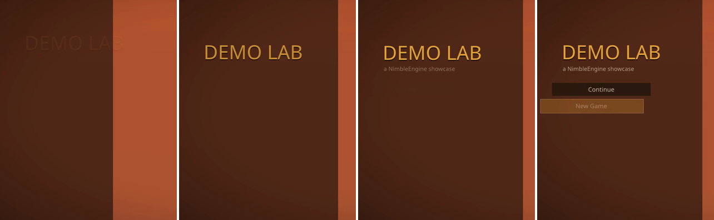
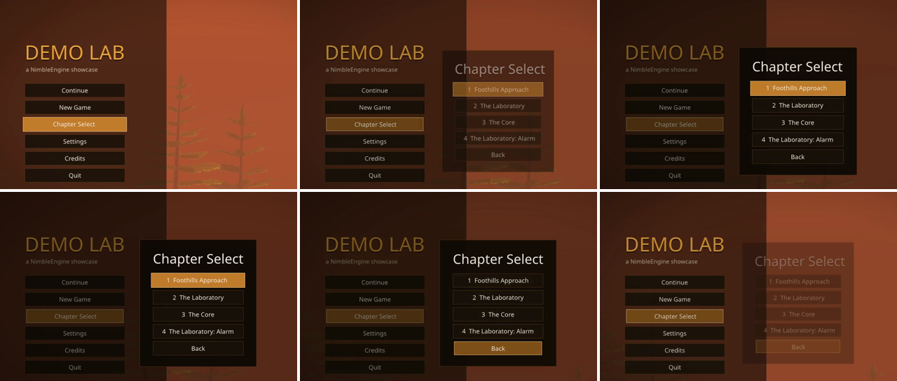
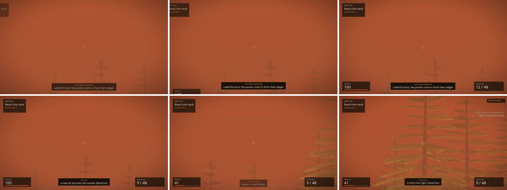
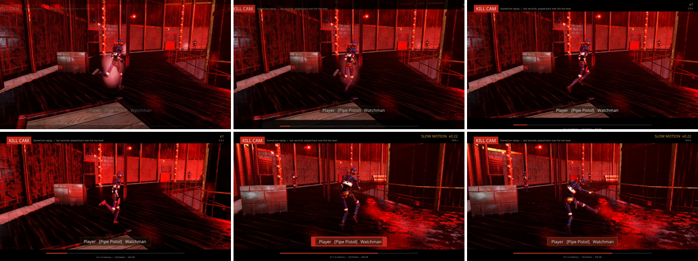

# UI guide 4 of 4: animation

The first three pages build a working interface:

1. [A menu](MenuUIGuide.md)
2. [A HUD](HudGuide.md)
3. [Settings](SettingsUIGuide.md)
4. **Animation** (this page): making that interface move.

This page uses **Demo Lab** (`Games/DemoLab`, unpacked from `Engine/Examples`),
whose documents use every animation feature. They are the game's own files, so what
you read is what runs:

| File | What moves |
|---|---|
| `Content/UI/MainMenu.nmui` | The menu's intro, and every menu button's hover and press |
| `Content/UI/ChapterSelect.nmui`, `PauseMenu.nmui`, `Settings.nmui`, `Credits.nmui` | Panels that spring in and fade out on Back |
| `Content/UI/LabHUD.nmui` + `Source/UI/LabHUD.cpp` | HUD panels sliding in, and hits, wounds, banners, kill-feed lines and intel, each triggered from C++ |
| `Content/UI/KillCam.nmui` + `Source/GameModes/LabKillCamDemo.cpp` | The kill cam's dip to black, letterbox and kill flash |
| `Content/UI/ReplayOverlay.nmui` | A looping REC dot |
| `Source/GameModes/LabUIShowcase.cpp` | A scripted tour of all of the above, with captions |

To watch the tour, build Demo Lab and run it from
`Games/DemoLab/Binaries/<Platform>_<Config>`. Add
`-record=<absolute path>.mp4` to film it:

```bash
DemoLab.exe -DemoLab.UIShowcase=1
```

`Engine/Modules/UI/README.md` ("Animations and visual states") is the reference.
`UITests` (`[animations and visual states]`) checks every rule on this page.

---

## Animation in one minute

A document can hold two kinds of motion, next to its widgets:

```
<UI ... OpenAnimation="Intro" CloseAnimation="Out">
  <Canvas> ... widgets ... </Canvas>
  <Animations>     timelines: tracks of keys, played by name
  <VisualStates>   looks a widget switches between (Hovered, Pressed...) by itself
</UI>
```

| You want | Use |
|---|---|
| Motion when a document opens or closes | `OpenAnimation` / `CloseAnimation` on `<UI>` |
| A button that reacts to the pointer, focus and presses | `<VisualStates>` |
| Motion when something happens in the game (a hit, a pickup) | An animation, played from C++, Lua, a graph or an action |
| Something that keeps moving (a blinking dot) | An animation with `Loop="true"` |
| A number or text the game changes | A binding, as on page 2. Animate how it changes, not the value |

Animations run in the frame's real time, not game time, so a paused game's menus
still move. They work in the editor's **Preview** too. The designer's canvas shows
the document at rest.

---

## 1. A first animation: the main menu's intro

[](../Images/UI/anim-menu-intro.png)

`MainMenu.nmui`, trimmed:

```xml
<UI Format="1" ReferenceSize="1920,1080" ScaleMode="FitHeight" InputMode="UIOnly" Layer="10" OpenAnimation="Intro">
  ...
  <Animations>
    <Animation Name="Intro" Duration="1.3">
      <Track Target="Shade" Property="RenderTranslate" Easing="CubicOut">
        <Key Time="0" Value="-820,0"/>
        <Key Time="0.5" Value="0,0"/>
      </Track>
      <Track Target="Title" Property="Opacity" Easing="QuadOut">
        <Key Time="0.15" Value="0"/>
        <Key Time="0.45" Value="1"/>
      </Track>
      <Track Target="Title" Property="RenderTranslate" Easing="BackOut">
        <Key Time="0.15" Value="0,-50"/>
        <Key Time="0.6" Value="0,0"/>
      </Track>
      <!-- one pair per button, each starting 0.06 s after the last -->
      <Track Target="NewGame" Property="RenderTranslate" Easing="CubicOut">
        <Key Time="0.51" Value="-140,0"/>
        <Key Time="0.86" Value="0,0"/>
      </Track>
      <Track Target="NewGame" Property="Opacity" Easing="QuadOut">
        <Key Time="0.51" Value="0"/>
        <Key Time="0.71" Value="1"/>
      </Track>
      ...
    </Animation>
  </Animations>
</UI>
```

- **An animation** has a `Name` and a `Duration` in seconds. Leave `Duration` out
  and it lasts until its last key.
- **A track** drives one property of one widget, named by `Target` (the widget's
  `Name`). The property must be a number, a colour or a vector: `Opacity`,
  `RenderTranslate`, `RenderScale`, `Color`, a brush's `.Tint`, `Position`,
  `FontSize`, a progress bar's `Value`. A track on anything else (a `Text`'s text,
  say) is skipped, with a warning in the log.
- **Keys** give the value at a time. Values are written as in the XML: `0.5`,
  `-820,0`, `#C9822EF2`.
- **Staggering is free.** Before its first key, a track holds that key's value.
  After its last key, it holds the last. So the title waits, invisible, until
  0.15 s, and each button waits for its turn. You never need a key at 0 just to
  hold a value.
- **When it ends, everything stays where the last keys put it.** End on the
  widget's designed look (`0,0`, opacity `1`), so the document at rest is the
  one you designed.

**Easing** is how a track moves between keys:

| Easing | Feels like | Good for |
|---|---|---|
| `Linear` | constant speed | progress, shakes |
| `QuadOut`, `CubicOut` | fast, then settling | almost everything coming in |
| `QuadIn`, `CubicIn` | slow, then fast | things leaving |
| `QuadInOut`, `CubicInOut` | gentle at both ends | moves between two resting places |
| `BackOut` | overshoots a little, then settles | buttons, titles, panels popping in |
| `ElasticOut` | springs back and forth | a pickup or an alert that should jump out |
| `Step` | holds, then jumps at the next key | blinking, frame-by-frame changes |

**Prefer render properties.** `RenderTranslate`, `RenderScale` and `Opacity`
change only how a widget is drawn: siblings stay put, and a frame costs a repaint.
`Position`, `Size` and margins move the layout, so every frame of them is a
relayout. Use those only when the layout really should change.

---

## 2. Buttons that respond: visual states

[](../Images/UI/anim-panel-in-out.png)

Every `MenuButton` warms and grows under the pointer or focus, and dips when
pressed. That is not an animation anyone plays. It is a group of **visual
states**, which each button moves between by itself:

```xml
<VisualStates Class="MenuButton">
  <State Name="Hovered">
    <Set Property="Normal.Tint" Value="#C9822EF2"/>
    <Set Property="Normal.OutlineColor" Value="#FFE2A8E6"/>
    <Set Property="RenderScale" Value="1.04,1.04"/>
  </State>
  <State Name="Pressed">
    <Set Property="Normal.Tint" Value="#8A561CF2"/>
    <Set Property="Normal.OutlineColor" Value="#FFE2A8E6"/>
    <Set Property="RenderScale" Value="0.97,0.97"/>
  </State>
  <State Name="Disabled">
    <Set Property="Normal.Tint" Value="#1A120A80"/>
    <Set Property="Opacity" Value="0.55"/>
  </State>
  <Transition To="Pressed" Duration="0.05" Easing="QuadOut"/>
  <Transition To="Hovered" Duration="0.12" Easing="BackOut"/>
  <Transition Duration="0.2" Easing="QuadOut"/>
</VisualStates>
```

- **Who it applies to.** `Class="MenuButton"` means every widget that takes the
  `MenuButton` style: one group for the whole menu. `Target="Play"` would mean one
  widget, and a group naming a widget wins over a group for its class. Settings
  has a second group for its `TabButton`s.
- **Which state.** An interactive widget picks its own:

  | State | When |
  |---|---|
  | `Disabled` | It is not enabled (`IsEnabled="false"`, or bound to false) |
  | `Pressed` | It is held down with the pointer over it |
  | `Focused` | It has keyboard or gamepad focus, if the group has a `Focused` state |
  | `Hovered` | The pointer is over it, or it has focus and there is no `Focused` state |
  | `Normal` | None of the above |

- **What a state sets.** Only what it lists. A property the state leaves out goes
  back to the widget's designed value, so `Normal` needs no entry at all.
- **Transitions.** The first `<Transition>` whose `From` and `To` match (`*`, or
  leaving it out, matches anything) gives the duration and easing. Put the
  specific ones first. A state with no matching transition shows at once.
  Transitions start from wherever the properties are now: move the mouse off a
  button halfway through its hover and it turns back smoothly, without a jump.
- **Buttons and brushes.** Without visual states, a Button switches between its
  `Normal`, `Hovered`, `Pressed` and `Disabled` brushes. With states, it always
  paints `Normal`, and the states animate `Normal.Tint` and
  `Normal.OutlineColor`. Copy the colours from those brushes into the states.

From code, `UIWidget::GoToState("Pressed")` or Lua's
`UI.GoToState(path, widget, state)` moves a widget to any state by name. The
showcase uses this to show a press before it clicks.

---

## 3. Panels that come and go

Chapter Select, Pause, Settings and Credits open over the screen and close on
Back. Each names two animations:

```xml
<UI ... OnBack="Native:UI.Close" OpenAnimation="In" CloseAnimation="Out">
  ...
  <Animations>
    <Animation Name="In" Duration="0.32">
      <Track Target="Dim" Property="Opacity" Easing="QuadOut">
        <Key Time="0" Value="0"/><Key Time="0.2" Value="1"/>
      </Track>
      <Track Target="Panel" Property="Opacity" Easing="QuadOut">
        <Key Time="0" Value="0"/><Key Time="0.16" Value="1"/>
      </Track>
      <Track Target="Panel" Property="RenderScale" Easing="BackOut">
        <Key Time="0" Value="0.9,0.9"/><Key Time="0.32" Value="1,1"/>
      </Track>
    </Animation>
    <Animation Name="Out" Duration="0.16">
      <Track Target="Dim" Property="Opacity" Easing="QuadIn">
        <Key Time="0" Value="*"/><Key Time="0.16" Value="0"/>
      </Track>
      <Track Target="Panel" Property="Opacity" Easing="QuadIn">
        <Key Time="0" Value="*"/><Key Time="0.16" Value="0"/>
      </Track>
      <Track Target="Panel" Property="RenderScale" Easing="QuadIn">
        <Key Time="0" Value="*"/><Key Time="0.16" Value="0.94,0.94"/>
      </Track>
    </Animation>
  </Animations>
</UI>
```

- **`OpenAnimation`** plays the moment the document opens. Its first frame is
  applied before anything is drawn, so the panel never flashes at full size first.
- **`CloseAnimation`** changes what closing means. `UI.Close`, a Back press or
  `UISystem::Close` plays `Out` first. Meanwhile the document takes no input, and
  `IsOpen` and `Find` already treat it as gone, so opening it again makes a fresh
  copy. When `Out` ends, the document closes and its `OnClose` runs (Settings saves
  then).
- **`*` keys.** `Value="*"` is what the property held when the animation started.
  An outro written this way leaves from wherever the panel is, even if Back comes
  before `In` has finished.
- **Level changes don't wait.** `CloseAll`, which a level change uses, closes at
  once with no outros.
- **Keep outros short.** About 0.15 to 0.2 s: the player is already moving on.

---

## 4. Playing animations from gameplay

[](../Images/UI/anim-hud.png)

The HUD's motion answers the game: a hit, a wound, a new banner. The document
holds the animations, and the game only says when to play them. The same
`PlayAnimation` call is available four ways.

### C++: play on a change

`LabHUD.cpp` already pushes the HUD's values every frame (page 2). To animate, it
also remembers what it showed last frame, and plays an animation when a value
changes (trimmed to two of its five triggers):

```cpp
/* What the HUD showed last frame: a change plays one of LabHUD.nmui's animations. */
struct Shown
{
    std::string Banner;
    float       HitMarker = 0.f;
    float       Health    = -1.f;
    bool        bIntel    = false;
};
Shown GShown;

void Play(UI::UISystem& InUI, const char* InAnimation)
{
    if(UI::UIDocumentInstance* Hud = InUI.Find(std::string(LabHUD::DOCUMENT))) { Hud->PlayAnimation(InAnimation); }
}

void LabHUD::Update(GameSession& InSession, const Story& InStory)
{
    ...
    SetNumber(UI, "Lab.HealthFill", double(Hp / Max));
    if(GShown.Health >= 0.f && Hp < GShown.Health - 0.5f) { Play(UI, "Hurt"); }
    GShown.Health = Hp;

    /* A new hit restarts the marker's countdown: punch it. */
    const float Marker = Combat ? Combat->HitMarker : 0.f;
    if(Marker > GShown.HitMarker + 1e-4f) { Play(UI, "Hit"); }
    GShown.HitMarker = Marker;
}
```

- `UIDocumentInstance::PlayAnimation(name)` returns a handle, or
  `UI::UI_ANIMATION_INVALID` (logged once per name) if the document has no
  animation by that name.
- Playing an animation that is already playing restarts it. Three quick hits give
  three punches.
- `UI::UIPlayOptions` sets `Speed`, `bReverse` and `StartTime`.
  `StopAnimation(name)` stops it where it is. `IsAnimationPlaying(name)` asks.
- Trigger on a **change**, not on a state. "Hp dropped since last frame" fires
  once per wound. "Hp is low" would restart the animation every frame and it
  would never move.

The `Hurt` animation itself is plain keys: a hand-made shake, and a colour that
fades back:

```xml
<Animation Name="Hurt" Duration="0.45">
  <Track Target="Health" Property="RenderTranslate">
    <Key Time="0" Value="0,0"/>
    <Key Time="0.05" Value="-10,0"/>
    <Key Time="0.1" Value="9,0"/>
    <Key Time="0.16" Value="-6,0"/>
    <Key Time="0.22" Value="4,0"/>
    <Key Time="0.3" Value="0,0"/>
  </Track>
  <Track Target="HealthValue" Property="Color" Easing="QuadOut">
    <Key Time="0" Value="#FF5A3CFF"/>
    <Key Time="0.45" Value="#F4EBDDFF"/>
  </Track>
</Animation>
```

### Lua

```lua
UI.PlayAnimation("Content/UI/LabHUD.nmui", "Hit")
UI.PlayAnimation("Content/UI/LabHUD.nmui", "IntelIn", 0.5)        -- half speed
UI.PlayAnimation("Content/UI/Credits.nmui", "In", 1, true)         -- reversed
if not UI.IsAnimationPlaying("Content/UI/LabHUD.nmui", "Hurt") then ... end
UI.StopAnimation("Content/UI/ReplayOverlay.nmui", "RecPulse")
UI.GoToState("Content/UI/MainMenu.nmui", "NewGame", "Pressed")
```

### Script graph

The `UI` library's palette has **PlayAnimation**, **StopAnimation**,
**IsAnimationPlaying** and **GoToState**, with the same inputs as the Lua
functions. In a UI graph, `self.Document` is the document's path, ready for the
**Path** pin.

### An action, from the document itself

`Native:UI.PlayAnimation('Name')` plays an animation of the document that fired
the action. Add a path to play one in another open document. Actions go anywhere
an action can: a button's `OnClick`, `OnHovered`, the document's `OnOpen`:

```xml
<Button Name="Claim" OnClick="Native:Shop.Claim; Native:UI.PlayAnimation('Coins')"/>
<Button Name="Help" OnHovered="Native:UI.PlayAnimation('Hint', 'Content/UI/LabHUD.nmui')"/>
```

### When an animation ends

`OnFinished` on an `<Animation>` holds actions to run when it reaches its end. It
does not run when the animation is stopped:

```xml
<Animation Name="Countdown" Duration="3" OnFinished="Native:Match.Start; Native:UI.Close">
```

C++ can poll instead: keep the handle and ask `GetAnimator().IsPlaying(handle)`.

---

## 5. Motion that loops

The replay overlay's REC dot blinks by itself, for as long as the overlay is open:

```xml
<UI ... OpenAnimation="RecPulse">
  ...
  <Animation Name="RecPulse" Duration="1" Loop="true">
    <Track Target="RecDot" Property="Opacity" Easing="Step">
      <Key Time="0" Value="1"/>
      <Key Time="0.6" Value="0.25"/>
    </Track>
    <Track Target="RecDot" Property="RenderScale" Easing="QuadOut">
      <Key Time="0" Value="1.4,1.4"/>
      <Key Time="0.3" Value="1,1"/>
    </Track>
  </Animation>
```

`Step` holds the first key until the second key's time, then jumps: on for 0.6 s,
dim for 0.4. Before this, `LabReplayDemo.cpp` worked out the blink from the clock
and pushed it every frame through a binding. That binding and its C++ are gone.

A looping animation repaints its widgets every frame it runs. Stop loops you don't
need (`StopAnimation`), or close their document.

---

## 6. Moving motion out of C++: the kill cam

[](../Images/UI/anim-killcam.png)

Before animations, the kill cam faded in by computing three values in C++ every
frame and binding them in the document:

```cpp
// Before: LabKillCamDemo.cpp, every frame
float Black = std::clamp(1.f - C.Shown / FADE, 0.f, 1.f);
if(C.Closing >= 0.f) { Black = std::clamp(1.f - C.Closing / FADE, 0.f, 1.f); }
SetNumber(UI, "KillCam.Black", Black);
SetNumber(UI, "KillCam.Opacity", std::clamp((C.Shown - FADE) / 0.3f, 0.f, 1.f));
SetNumber(UI, "KillCam.Flash", FromKill >= 0.0 && FromKill < 0.35 ? 1.0 - FromKill / 0.35 : 0.0);
```

Now the document holds `Intro`, `KillFlash` and `Outro`, and the C++ says only
when:

```cpp
// After: at the three moments
PlayOverlay(C, "Intro");                                                       // the kill cam starts
if(!C.bFlashed && C.Time >= C.KillTime) { C.bFlashed = true; PlayOverlay(C, "KillFlash"); }   // the shot lands
if(C.Closing < 0.f && C.Time >= C.Clip.GetEndTime()) { C.Closing = FADE; PlayOverlay(C, "Outro"); }
```

The bindings `{Bind:KillCam.Black}`, `{Bind:KillCam.Opacity}` and
`{Bind:KillCam.Flash}` became plain resting values (`Opacity="1"`,
`Opacity="0"`). The motion gained what was too fiddly to hand-code: the
letterbox sliding in, the badge overshooting, the name line punching. Anyone who
can edit a `.nmui` can now tune the timing.

**The rule:** the game owns values (health, ammo, the playback clock), and the
document owns motion. When C++ is computing an opacity from a timer, that's an
animation waiting to be written.

**Bindings and animations together.** A track can drive a bound property. The
animation wins while it plays, and the binding keeps its place: the store's next
change writes the property again. If the game pushes a value every frame, an
animation on it will flicker, so animate a different property (a wrapper's
`Opacity`, the widget's `RenderScale`), as the HUD does.

---

## 7. Timing and cost

- **Real time.** Animations use the frame's time, not the game's: pause menus
  move, and so does UI over a slow-motion kill cam.
- **Long frames.** A frame that takes longer than 0.1 s (a level load, a hitch)
  moves animations on only 0.1 s, so an intro is seen and not skipped. Change the
  limit with `UISystem::SetAnimationStepLimit`; 0 removes it.
- **Overlap.** If two animations drive the same property of the same widget, the
  one started last takes it over. A hover transition on a button and a scripted
  pulse of its `RenderScale` won't fight; the newer one wins.
- **Cost.**
  - A document with nothing playing costs one check per frame.
  - Starting an animation looks up its widgets and parses its keys, once.
  - Each frame while it plays eases numbers and writes them, with no allocations
    (a gating test).
  - Render properties repaint the document; layout properties relayout it.
- **Shipping builds.** The cook stores animations and states as data, so Shipping
  builds (which have no XML reader) play them. Re-cook documents that were cooked
  before animations existed.

---

## When something is off

| Symptom | Cause |
|---|---|
| Log: `'<doc>' has no animation 'X'` | The name doesn't match an `<Animation Name>`, or the document you asked isn't the one you meant. Check the path. |
| Log: `animation 'X' cannot drive Text of 'Title' (Text)` | The property isn't a number, a colour or a vector. Animate `Opacity`, `Color` or `RenderScale` instead. |
| Log: `visual state 'Hovered' of 'Play' sets ..., which Button cannot animate` | The same rule, for states. |
| A button's hover tint doesn't show | The state sets `Hovered.Tint`. With visual states a Button paints `Normal`, so set `Normal.Tint`. |
| The intro doesn't play in the designer | The designer's canvas doesn't play `OpenAnimation`. Use **Preview**. |
| A panel snaps shut on Back | It has no `CloseAnimation`, or the name doesn't match an animation. |
| A panel never closes | Its `CloseAnimation` loops (`Loop="true"`). An outro must end. |
| An animation stutters or flickers | The game is pushing the same property through a binding every frame. Animate another property. |
| Something stays invisible after an intro was cut short | It was stopped before its last key. Let it finish, or end with a resting-look animation. |
| The animation looks different in a cooked build | The document was cooked by an older build. Cook it again. |

**Not there yet:** a timeline editor in the UI Designer (edit the XML and use
Preview), rotation, sharp text when scaled up (text scaled by `RenderScale` is
drawn from its baked size), and easing per key.
