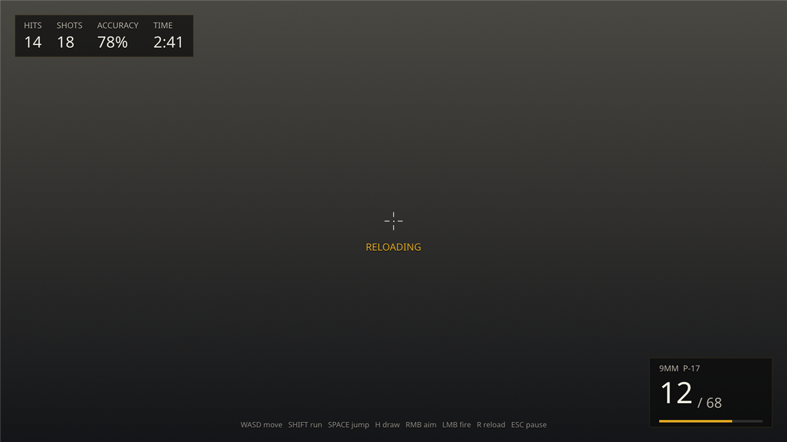
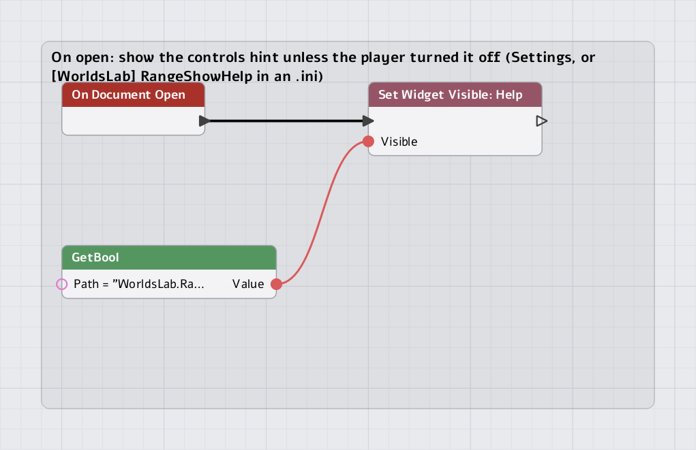

# UI guide 2 of 3: a HUD

A HUD is a document that sits over the game and shows it: ammo, score, a clock, a
crosshair. Unlike a menu it takes no input, and what it shows is *pushed into it*
by whatever knows the number. This page builds the Shooting Range's HUD, and feeds
it from all three places: **Lua**, **C++** and a **script graph**.

1. [A menu](MenuUIGuide.md)
2. **A HUD** (this page)
3. [Settings](SettingsUIGuide.md)

[](../Images/UI/range_hud.png)

*`RangeHUD.nmui`, drawn by the game's own renderer over a plain background. In the game
it is over the range; the values here are made up.*

| On screen | Widget | Fed by |
|---|---|---|
| HITS, SHOTS, ACCURACY | `Hits`, `Shots`, `Accuracy` | **Lua**: `RangeShooter.lua` |
| Rounds and reserve, the magazine bar | `Mag`, `Reserve`, `MagBar` | **Lua** |
| RELOADING, EMPTY, HEADSHOT under the crosshair | `Status` | **Lua** |
| The crosshair, while the pistol is drawn | `Crosshair` | **Lua** (a widget call) |
| TIME | `Time` | **C++**: the game mode's `OnTick` |
| The controls hint | `Help` | a **script graph**, from the player's setting |

---

## 1. How a HUD gets its numbers

A HUD does not ask the game for anything. The game (or Lua, or a graph) **puts
values in the UI's data store**, a table of keys to numbers, strings, bools and
colours that belongs to the session, and the document **binds** widgets to keys:

```xml
<Text Name="Hits"  Class="Value" Text="{Bind:Range.Hits}"/>
<Text Name="Reserve" Class="Value" FontSize="34" Text="/ {Bind:Range.Reserve}"/>
<ProgressBar Name="MagBar" Value="{Bind:Range.MagFill}" .../>
```

```
 RangeShooter.lua  UI.SetString("Range.Hits", "14")  ─┐
 WorldsLabRange.cpp  SetValue("Range.Time", "2:41")   ├─►  data store  ─►  {Bind:Range.Hits} ...  ─►  pixels
 a graph            UI Set Number ("Range.X", n)      ─┘     (version++ on change)
```

- `Text="{Bind:Key}"` binds the whole value. `Text="/ {Bind:Key}"` interpolates it
  into text (**String properties only**, so `Reserve` can say "/ 68").
- A property is bindable only if its definition says so (`Text`, a ProgressBar's
  `Value`, a Slider's `Value`, a CheckBox's `Checked`, a Switcher's
  `ActiveIndex`...). The Designer's Details panel accepts `{Bind:...}` in those fields.
- **It is cheap by construction.** A document re-applies its bindings only when
  the store changed, and it sets a property only if the value differs. A HUD
  whose numbers did not change costs one comparison per binding (measured: about
  0.2 µs, zero allocations), and a static HUD costs no GPU upload. So writing a
  value on every frame is allowed, but writing it **when it changes** is better.
- **A key never set** leaves a whole-value property alone and interpolates as empty
  text, so a HUD opened before the game has published anything shows blanks, not
  garbage.
- **The session publishes some keys itself, every frame:** `Player0.Score`,
  `Player0.Lives` (one pair per player, from its `PlayerState`) and `Game.Phase`.
  A score display needs no code at all: `Text="{Bind:Player0.Score}"`. The Range
  keeps its own `Range.*` keys because its tally (hits, shots) is the shooter's, not a
  player's score.

The choice of **strings** for the Range's numbers is about formatting, not
necessity: `UI.SetString("Range.Accuracy", "78%")` shows a percentage, and
`UI.SetNumber` would show `0.78`. A number bound to a Text shows as a number; for
anything formatted, push the text you want.

---

## 2. The document

`RangeHUD.nmui`, trimmed:

```xml
<UI Format="1" ReferenceSize="1920,1080" ScaleMode="FitHeight" InputMode="GameOnly"
    Graph="Content/UI/ShootingRange/RangeHUD.ui.nmgraph">
  <Styles>
    <Style Name="Label" Type="Text" FontSize="20" Color="#B8B2A6FF" ShadowOffset="0,2" ShadowColor="#000000C0"/>
    <Style Name="Value" Type="Text" FontSize="38" Color="#F2EEE4FF" ShadowOffset="0,2" ShadowColor="#000000C0"/>
  </Styles>
  <Canvas Name="Root">
    <!-- Score, top left. -->
    <Border Name="Score" Position="36,36" AutoSize="true" Padding="22,12" Visibility="HitTestInvisible"
            Background.Tint="#0A0A0AB0" Background.OutlineColor="#E0A82033" Background.OutlineThickness="1">
      <HorizontalBox Spacing="36">
        <VerticalBox>
          <Text Class="Label" Text="HITS"/>
          <Text Name="Hits" Class="Value" Text="{Bind:Range.Hits}"/>
        </VerticalBox>
        <!-- SHOTS, ACCURACY, and the clock: -->
        <VerticalBox>
          <Text Class="Label" Text="TIME"/>
          <Text Name="Time" Class="Value" Text="{Bind:Range.Time}"/>
        </VerticalBox>
      </HorizontalBox>
    </Border>

    <!-- Ammo, bottom right: anchored to the corner, so it stays there at any aspect ratio. -->
    <Border Name="Ammo" Anchors="1,1,1,1" Pivot="1,1" Position="-36,-36" Size="300,170" Padding="24,12"
            Visibility="HitTestInvisible" ...>
      <Canvas>
        <HorizontalBox Position="0,22" AutoSize="true" Spacing="10">
          <Text Name="Mag" Class="Value" FontSize="72" Text="{Bind:Range.Mag}"/>
          <Text Name="Reserve" Class="Value" FontSize="34" Color="#B8B2A6FF" VAlign="Bottom" Text="/ {Bind:Range.Reserve}"/>
        </HorizontalBox>
        <ProgressBar Name="MagBar" Anchors="0,1,1,1" Pivot="0,1" Size="0,6" Value="{Bind:Range.MagFill}"
                     Background.Tint="#FFFFFF22" FillBrush.Tint="#E0A820FF"/>
      </Canvas>
    </Border>

    <!-- Crosshair: four ticks and a dot, shown while drawn. -->
    <Canvas Name="Crosshair" Anchors="0.5,0.5,0.5,0.5" Size="60,60" Pivot="0.5,0.5" Visibility="Hidden"> ... </Canvas>
    <Text Name="Status" Anchors="0.5,0.5,0.5,0.5" Pivot="0.5,0" Position="0,46" AutoSize="true"
          Visibility="HitTestInvisible" Color="#E0A820FF" Text="{Bind:Range.Status}"/>
    <Text Name="Help" Anchors="0.5,1,0.5,1" Pivot="0.5,1" Position="0,-30" AutoSize="true"
          Visibility="HitTestInvisible" Text="WASD move   SHIFT run   ...   ESC pause"/>
  </Canvas>
</UI>
```

What makes a document a HUD:

- **`InputMode="GameOnly"`** takes no input at all: no click or key is
  consumed, so the game reads every one. (`GameAndUI` is the middle: the mouse is
  taken only over a widget, for a HUD with a button.)
- **`Visibility="HitTestInvisible"`** on what is drawn: the widget shows but is never
  hit. (A full-screen container is not hit anyway: layout containers do not take
  hits.)
- **Anchors, not coordinates.** `Anchors="1,1,1,1" Pivot="1,1" Position="-36,-36"` pins
  the ammo box's bottom-right corner 36 units in from the screen's corner;
  `0.5,0.5,0.5,0.5` pins the crosshair to the centre. On an ultrawide the layout
  space is wider, and anything anchored follows the edge it is anchored to.
- **Layer 0** (the default) is below menus: the pause menu (layer 10) draws over it
  and, being `UIOnly`, takes the input.

### Opening and closing it

Whoever owns the HUD's lifetime opens it. The Range's shooter opens it as it starts and
closes it as it goes (`RangeShooter.lua`):

```lua
local HUD = "Content/UI/ShootingRange/RangeHUD.nmui"

OnStart = function(self)
    ...
    UI.Open(HUD)
    self:UpdateHud()
end,

OnDestroy = function(self)
    UI.Close(HUD)
end,
```

A game that has no such script opens it from its mode instead:

```cpp
bool OnLoad(NimbleEngine::GameSession& InSession) override
{
    InSession.GetUI().Open("Content/UI/ShootingRange/RangeHUD.nmui");
    return true;
}
```

Either way, documents close with their level unless they were opened as persistent
(`UI.Open(path, true)`, `Open(path, true)`), so a level swap cleans the HUD up. While the
game is paused the UI keeps running: a HUD stays on screen under the pause menu.

---

## 3. Feeding it from Lua

The shooter knows the ammo, the hits and the status, and it is a Lua script, so it
pushes them. This is the whole HUD feed (`RangeShooter.lua`):

```lua
UpdateHud = function(self)
    UI.SetString("Range.Mag", tostring(self.Mag))
    UI.SetString("Range.Reserve", tostring(self.Reserve))
    UI.SetNumber("Range.MagFill", self.Mag / MAGAZINE)
    UI.SetString("Range.Hits", tostring(self.Hits))
    UI.SetString("Range.Shots", tostring(self.Shots))
    UI.SetString("Range.Accuracy", self.Shots > 0 and string.format("%d%%", math.floor(100 * self.Hits / self.Shots + 0.5)) or "--")
    UI.SetVisible(HUD, "Crosshair", self.Drawn and self.Ready)
end,

SetStatus = function(self, text, seconds)
    UI.SetString("Range.Status", text)
    self.StatusTime = seconds or 0.0
end,
```

`UpdateHud` is called when something changed (a shot, a reload, drawing the pistol),
**not every frame**: it costs nothing between shots. `SetStatus("RELOADING")` shows
the word under the crosshair and `SetStatus("")` clears it.

Note the two kinds of call:

| Call | For | Why |
|---|---|---|
| `UI.SetString/SetNumber/SetBool(key, value)` | what a widget **shows** | a binding follows it: no widget name, no document path, nothing breaks if the HUD is renamed or not open yet |
| `UI.SetVisible(path, widget, bool)`, `UI.SetText`, `UI.SetEnabled`, `UI.SetProperty` | what a widget **is** (structure, state) | there is no binding for `Visibility`: you reach the widget by its `Name` |

Prefer the store for anything a number or a string can say. The crosshair is shown
and hidden, which is state, so it is a widget call. (`UI.SetVisible` collapses; a
widget that must keep its space is hidden with
`UI.SetProperty(path, "Crosshair", "Visibility", "Hidden")`.)

**Use Lua for** a HUD whose numbers come from a script's own state, the usual case
for gameplay that lives in scripts.

---

## 4. Feeding it from C++

The clock is the *mode's*: it counts game time, and the mode already has the frame's
time. So the mode pushes it (`WorldsLabRange.cpp`):

```cpp
/* "M:SS", for the HUD. */
std::string FormatClock(const int InSeconds)
{
    char Text[16];
    std::snprintf(Text, sizeof(Text), "%d:%02d", InSeconds / 60, InSeconds % 60);
    return Text;
}
```

```cpp
void OnStart() override
{
    NetGameMode::OnStart();
    ...
    /* The HUD's clock starts at zero: a string the HUD's {Bind:Range.Time} follows. */
    RunSeconds   = 0.0;
    ShownSeconds = 0;
    Session->GetUI().SetValue("Range.Time", UI::UIValue::String(FormatClock(0)));
}

void OnTick(const NimbleEngine::FrameContext& InFrame) override
{
    /* The clock counts game time: OnTick is not called while paused, so the pause menu stops it.
     * The store is written when the shown second changes, not every frame. */
    RunSeconds += InFrame.DeltaSeconds;
    if(const int Seconds = int(RunSeconds); Seconds != ShownSeconds)
    {
        ShownSeconds = Seconds;
        Session->GetUI().SetValue("Range.Time", UI::UIValue::String(FormatClock(Seconds)));
    }
    ...
}
```

- `GetUI()` is the session's `UISystem`. `SetValue(key, UI::UIValue::Number(...))`,
  `UIValue::String(...)`, `UIValue::Bool(...)` and `UIValue::Color(...)` are the value
  types.
- Only a **changed** second is written. `SetValue` with an equal value is a no-op
  anyway, but formatting a string 60 times a second to throw it away is a cost
  you chose.
- It counts `FrameContext::DeltaSeconds`, so it pauses with the game and a test can
  run it a minute in a millisecond (see the
  [game mode guide](../GameModeGuide.md), on the frame context).

To read a value back, `GetUI().GetValue("Key")` returns a `const UIValue*` (null if
never set). To change a widget directly from C++:

```cpp
if(UI::UIDocumentInstance* Hud = Session->GetUI().Find("Content/UI/ShootingRange/RangeHUD.nmui"))
{
    if(UI::UIWidget* Crosshair = Hud->FindWidget("Crosshair"))
    {
        Hud->SetPropertyText(*Crosshair, "Visibility", "Visible");
    }
}
```

`SetPropertyText` takes the property as text, exactly as written in XML, and returns
false if the text is not valid for it.

**Use C++ for** numbers the engine or the mode owns (time, phase, round, ping, a
physics stat) and for anything per-frame.

---

## 5. Feeding it from a script graph

The controls hint (`Help`) should follow the player's setting: hidden if they turned
it off on the Settings page (page 3). That is a UI rule with no gameplay in it, so it
is a **UI graph** on the HUD itself, `RangeHUD.ui.nmgraph`, named by the document's
`Graph` setting:

[](../Images/UI/hud-graph.png)

| # | Node (type) | Settings |
|---|---|---|
| 1 | On Document Open (`UI.Event.Open`) | |
| 2 | Set Widget Visible (`UI.Widget.SetVisible`) | Widget = `Help` |
| 3 | GetBool (`Library.Config.GetBool`) | Path = `WorldsLab.RangeShowHelp` |

| From | To |
|---|---|
| 1 **Then** | 2 **Exec** |
| 3 **Value** | 2 **Visible** |

Node 2 is one of the **Document** nodes: **Set Widget Text, Set Widget Visible, Set
Widget Enabled, Set Widget Focus, Show Page**. Each chooses its widget from a
dropdown of this document's names and acts on this document, so there is no path to
type. The compiled Lua, stored in the graph file, is:

```lua
return {

    OnOpen = function(self)
        local t1 = Config.GetBool("WorldsLab.RangeShowHelp")
        UI.SetVisible(self.Document, "Help", t1)
    end,
}
```

`OnOpen` runs once, after the document opens, so when the shooter opens the HUD
the hint is already right. The graph can do more of the same kind of thing: an
**On Tick** event runs every frame while the document is open (a graph that has
one costs something per frame; this one has none), and **On Event** nodes listen to
the world's events while it is open.

A graph reaches **values** the same way as Lua. A UI graph has a node for each
`UI` library function, so pushing a value is **UI > SetNumber** or **SetString**
with a key and a value, and reading one is **UI > GetNumber**; **Game** and
**Config** and every library you declare in C++ are there too. When a HUD needs a
number that only the game has, expose a function (`GAMECORE_DEFINE_SCRIPT_LIBRARY`, see
`UIGRAPHS.md`, section 4) rather than reading components from the graph; or push the
value to the store from C++ and bind to it, which costs nothing while nothing
changes.

**Use a graph for** HUD behaviour a designer owns: show this when that setting is
on, flash when this event fires, switch a page.

---

## 6. The same job, three ways

Say the HUD should show how many targets are down. The store key is the same in all
three; only the writer differs.

```cpp
// C++, anywhere the session is at hand
Session->GetUI().SetValue("Range.Down", UI::UIValue::String(std::to_string(Down)));
```

```lua
-- Lua
UI.SetString("Range.Down", tostring(down))
```

In a graph: **UI > SetString** with Key = `Range.Down` and the string from wherever
it was made (a variable, **Append**, a library function's result), after whichever
event should trigger it. And in the document, once:

```xml
<Text Name="Down" Class="Value" Text="{Bind:Range.Down}"/>
```

| If the number | Push it from |
|---|---|
| lives in a script | Lua, where the script changes it |
| is the engine's or the mode's | C++ `OnTick` or the event that changes it |
| is a rule of the UI itself | a UI graph on the document |
| is a player's score or lives, or the phase | nothing: bind `Player0.Score`, `Player0.Lives`, `Game.Phase` |

---

## When something is off

| Symptom | Likely cause |
|---|---|
| The HUD is blank | The document did not open (check the log), or a Client build has no cooked copy: `cook ui`. |
| A text shows nothing | The key was never set (a whole-value binding leaves the text alone; an interpolation shows empty), or its name differs: keys are case-sensitive. |
| A fraction shows as `0.78` where you wanted `78%` | You pushed a number where you wanted formatted text: push the string. |
| `UI.SetVisible` returns false | The HUD is not open yet, or no widget has that `Name`. Open it first. |
| The hint ignores the setting | The graph did not run: the document's `Graph` is not set, or the graph was not saved (a graph with errors keeps its last good Lua). |
| Clicks do not reach the game under the HUD | A widget on it takes hits: use `Visibility="HitTestInvisible"`, and `InputMode="GameOnly"` for the document. |
| The HUD counts while paused | It is fed from something that runs while paused (a UI graph's On Tick does). A mode's `OnTick` does not run paused. |
| It is slow | Something writes a store key with a *different* value every frame: each change re-applies the document's bindings. Write when it changes. |

Next: [settings](SettingsUIGuide.md).
