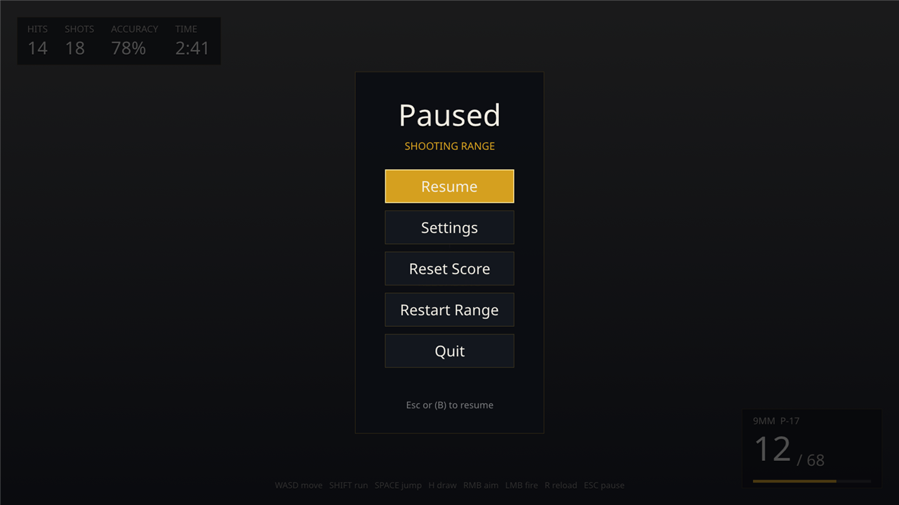
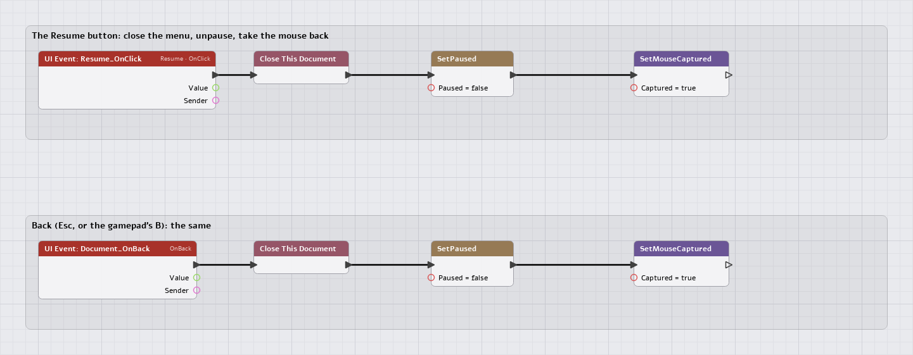

# UI guide 1 of 3: a menu

This is the first of three pages that build the **Shooting Range's** interface
(`Games/WorldsLab`) and use it to teach the UI system:

1. **A menu** (this page): the pause menu, opened with Escape.
2. [A HUD](HudGuide.md): rounds, score and a clock over the game.
3. [Settings](SettingsUIGuide.md): sliders and check boxes that control the game's `.ini` values.

Each page does the same job three ways, so you can pick the tool that suits the
person writing the logic: **C++** (a game module), **Lua** (a script), and a
**script graph** (a visual UI graph). `Engine/Modules/UI/README.md` is the
reference for every widget and property; `UIGRAPHS.md` is the how-to for exposing
your own C++ to graphs. These pages are the walkthrough.

The files they describe are the game's own, so what you read is what runs:

| File | What it is |
|---|---|
| `Content/UI/ShootingRange/PauseMenu.nmui` | The menu's document |
| `Content/UI/ShootingRange/PauseMenu.lua` | The document's script |
| `Content/UI/ShootingRange/Settings.nmui`, `Settings.ui.nmgraph` | Page 3 |
| `Content/UI/ShootingRange/RangeHUD.nmui`, `RangeHUD.ui.nmgraph` | Page 2 |
| `WorldsLabRange.cpp` | The game mode: opens the menu, the HUD's clock, a C++ action |
| `Scripts/ShootingRange/RangeShooter.lua` | The shooter: feeds the HUD, hears the menu |

The documents' logic is covered by `UITests` (`[worldslab range ui]`). Click a screenshot to open it at full size.

---

## The UI system in one minute

A **document** is an XML file, `*.nmui`: a tree of **widgets** (`Canvas`, `Border`,
`Text`, `Button`, `Slider`, `CheckBox`, boxes for layout...). The editor's **UI
Designer** edits it as you see it; the game draws it with its own renderer, over the
scene.

```
 PauseMenu.nmui ─ opened ─► GameSession::GetUI()  (one UISystem per game)
   <Button OnClick="Native:Range.Resume"/>      ──► an ACTION: C++, Lua, Event or Graph
   <Text Text="{Bind:Range.Time}"/>             ◄── a VALUE the game pushed (page 2)
```

Three settings of a document decide how it behaves in a game:

| Setting | Pause menu | Meaning |
|---|---|---|
| `InputMode` | `UIOnly` | `UIOnly` takes every input and shows the cursor (a menu). `GameAndUI` takes the mouse only over a widget. `GameOnly` takes none (a HUD). |
| `Layer` | `10` | Higher layers draw over lower ones and take input first. Settings is `11`, so it sits over the menu. |
| `ReferenceSize`, `ScaleMode` | `1920,1080`, `FitHeight` | You design at 1080p; it scales to the window. At 1440p the layout is drawn at 4/3 scale. |

A document can also name a `Script` (Lua, run once when it first opens), a `Graph`
(its logic as a script graph), and the actions `OnOpen`, `OnClose` and `OnBack`.

---

## What we are building

[](../Images/UI/range_pause.png)

Press **Escape** in the range. The game stops, the cursor comes back, and the menu
opens over the HUD:

| Button | Does | Written in |
|---|---|---|
| Resume | closes the menu, unpauses, takes the mouse back | **C++** action |
| Settings | opens the settings document over the menu | built-in action |
| Reset Score | zeroes the shooter's hits and shots | **Lua** function |
| Restart Range | reloads the level | built-in action |
| Quit | ends the game | built-in action |
| Esc, or the gamepad's B | Resume | `OnBack` |

---

## 1. The document

`PauseMenu.nmui`, trimmed to its shape:

```xml
<UI Format="1" ReferenceSize="1920,1080" ScaleMode="FitHeight" InputMode="UIOnly" Layer="10"
    Script="Content/UI/ShootingRange/PauseMenu.lua" OnBack="Native:Range.Resume">
  <Styles>
    <Style Name="MenuButton" Type="Button" Padding="32,14" Margin="0,8" Size="520,0"
           Normal.Tint="#14181FE6" Normal.OutlineColor="#E0A82040" Normal.OutlineThickness="1"
           Hovered.Tint="#E0A820F2" Hovered.OutlineColor="#FFE9A8E6" Hovered.OutlineThickness="2"
           Pressed.Tint="#9A7414F2"/>
    <Style Name="MenuLabel" Type="Text" FontSize="32" Color="#F2EEE4FF" HAlign="Center" VAlign="Center"/>
    <Style Name="Heading" Type="Text" FontSize="64" Color="#F2EEE4FF" HAlign="Center" Margin="0,0,0,8"
           ShadowOffset="0,3" ShadowColor="#000000A0"/>
  </Styles>
  <Canvas Name="Root">
    <Border Name="Dim" Anchors="0,0,1,1" Background.Tint="#05060AB0"/>
    <Border Name="Panel" Anchors="0.5,0.5,0.5,0.5" Pivot="0.5,0.5" AutoSize="true" Padding="64,48"
            Background.Tint="#0B0D12E8" Background.OutlineColor="#E0A82033" Background.OutlineThickness="1">
      <VerticalBox Name="Content">
        <Text Name="Title" Class="Heading" Text="Paused"/>
        <Button Name="Resume" Class="MenuButton" InitialFocus="true" OnClick="Native:Range.Resume">
          <Text Class="MenuLabel" Text="Resume"/>
        </Button>
        <Button Name="SettingsButton" Class="MenuButton"
                OnClick="Native:UI.Open('Content/UI/ShootingRange/Settings.nmui')">
          <Text Class="MenuLabel" Text="Settings"/>
        </Button>
        <Button Name="ResetScore" Class="MenuButton" OnClick="Lua:RangeMenu.ResetScore">
          <Text Class="MenuLabel" Text="Reset Score"/>
        </Button>
        <!-- Restart Range, Quit ... -->
        <Text Name="Notice" Text="" FontSize="22" Color="#E0A820FF" HAlign="Center" Margin="0,18,0,0"/>
      </VerticalBox>
    </Border>
  </Canvas>
</UI>
```

Read it as the layout it describes:

- **`Dim`** is a full-screen `Border` (anchors `0,0,1,1`: stretch between the parent's
  corners) that darkens the game.
- **`Panel`** is anchored to the centre (`0.5,0.5,0.5,0.5`) with its pivot at its own
  centre, and `AutoSize` makes it as big as its contents. Nothing is positioned in
  pixels, so it stays centred at every resolution.
- **A `Style`** is a reusable bundle of properties. `Class="MenuButton"` applies
  one; its `Type="Button"` makes it apply to buttons only. Colours are
  `#RRGGBBAA`. A button has four brushes (`Normal`, `Hovered`, `Pressed`,
  `Disabled`), and **keyboard or gamepad focus shows the Hovered one**: the amber
  Resume above is focus, not the mouse.
- **`InitialFocus="true"`** gives Resume focus when the document opens, so the
  gamepad and Enter work without a first click.
- **`Name`** is how code finds a widget: `Notice` is set from Lua below.

Edit it in the editor by opening it from the Content Browser. The Designer's
**Preview** runs it (its actions and graph run in a scratch world), and saving
reloads it in Play-in-Editor.

---

## 2. Opening it from C++

The menu belongs to the game mode, `WorldsLabRange`, because the mode is what
reads the player's input and owns the session
([the game mode guide](../GameModeGuide.md) comes first). Its whole
relationship with the menu is two helpers and one hook, from `WorldsLabRange.cpp`:

```cpp
constexpr const char* PauseMenuPath = "Content/UI/ShootingRange/PauseMenu.nmui";
constexpr const char* SettingsPath  = "Content/UI/ShootingRange/Settings.nmui";

/* Escape: the menu opens over the game, the game stops, the cursor comes back. */
void OpenPauseMenu(NimbleEngine::GameSession& InSession)
{
    if(InSession.GetUI().IsOpen(PauseMenuPath)) { return; }
    InSession.GetUI().Open(PauseMenuPath);
    InSession.SetPaused(true);
    InSession.SetMouseCaptured(false);
}

/* Resume: the same three things, undone. */
void ClosePauseMenu(NimbleEngine::GameSession& InSession)
{
    InSession.GetUI().Close(SettingsPath);
    InSession.GetUI().Close(PauseMenuPath);
    InSession.SetPaused(false);
    InSession.SetMouseCaptured(true);
}
```

and, in the mode's `OnTick`, where it already reads each avatar's input:

```cpp
if(InHarness.WasPressed("Pause"))   // an action of the range's input map: Escape, or the gamepad's Start
{
    OpenPauseMenu(*Session);
}
```

What each call does:

| Call | Effect |
|---|---|
| `GetUI().Open(path)` | Loads the document (through the file system, so staged or cooked) and shows it. Returns a handle, or `UI_DOCUMENT_INVALID` if it will not load. |
| `SetPaused(true)` | Stops the World and the mode's `OnTick`. **The UI keeps running**, which is what lets a pause menu resume. |
| `SetMouseCaptured(false)` | Gives the cursor back. The game captures it for mouse-look. |

Three things make this safe without more code:

- **The UI takes input first, and the game gets what it leaves.** With the menu open
  (`UIOnly`) it takes everything, so the shooter neither fires nor looks around
  behind it; a click on a button never reaches the game.
- **The Escape that opens the menu is not the Escape that closes it.** The
  menu's `OnBack` is the UI's own `Back` action (Escape, or the gamepad's East),
  consumed by the UI while it is open. The game sees Escape only while no menu is.
- **The mode's clock stops.** `OnTick` is not called while paused, and the HUD's
  clock (page 2) counts `FrameContext::DeltaSeconds`, so the pause menu stops it
  for free.

---

## 3. What a button can do

An action property is text: one or more actions separated by `;`, run in order:

```
OnClick="Native:Range.Resume"
OnClick="Lua:RangeMenu.ResetScore"
OnClick="Native:UI.Close; Lua:Menu.Closed($self)"
```

| Kind | Runs | Arguments |
|---|---|---|
| `Native:Group.Name` | a C++ function registered with `UI_DEFINE_ACTIONS` | up to four: numbers, `'strings'`, `true`/`false`, `$self` (the widget's name), `$value` (a slider's value, a check box's 1 or 0) |
| `Lua:Path.To.Fn` | a Lua function found by its global path | the same |
| `Event:Name` | an event on the world's bus, heard by `Events.On` | the same |
| `Graph:Handler` | a handler in the document's UI graph | none (the sender's value and name are passed) |

Actions are **queued** and run after the input that fired them, before the game
ticks. So an action that closes its own document, like Resume, is safe.

### Built in: nothing to write

Quit, Restart and Settings use actions the engine provides:

| Action | What it does |
|---|---|
| `Game.Quit` | Ends the game. |
| `Game.Pause`, `Game.Resume`, `Game.TogglePause` | `GameSession::SetPaused`. |
| `Game.OpenLevel('Name', 'Entry', 'Key=Value')` | Loads a registered level (`[World_Name]`); the swap closes every document and unpauses. Entry and travel state are optional (GameModeGuide.md, "Changing level"). |
| `UI.Open('path')`, `UI.Close('path')`, `UI.Toggle('path')` | Open, close or toggle a document. `UI.Close` with no path closes its own. |
| `UI.ShowPage('Switcher', page)` | Shows a Switcher's page, by name or number. |
| `UI.SetValue('Key', value)` | Sets a data store value. |

### C++: your own native action

Resume has to do three things at once (close, unpause, recapture the mouse), and
the first two are about the **session**, so it is a C++ action. The registration
is a `UI_DEFINE_ACTIONS(Group)` at file scope, in the game module
(`WorldsLabRange.cpp`):

```cpp
/* Native:Range.Resume, for the pause menu's Resume button and its Back. HostData is the GameSession. */
UI_DEFINE_ACTIONS(Range)
{
    Actions.Add("Resume", [](const UI::UIActionContext& InContext)
    {
        if(auto* Session = static_cast<NimbleEngine::GameSession*>(InContext.HostData)) { ClosePauseMenu(*Session); }
    }, "Closes the pause menu, unpauses and takes the mouse back");
}
```

`UIActionContext` gives an action the system, the document, the sender widget, the
arguments (`*InContext.Args`) and `HostData`, which for a game is the
`GameSession*`. The action's full name is `Group.Name`, so a document writes
`Native:Range.Resume`. It is registered while the game module is loaded and
withdrawn when it unloads, so a hot reload cannot leave a dangling function. The
last string is the tooltip the Designer shows in its action picker.

**Use C++ for:** anything about the session (`Game.*`), anything that must be exact
and fast, anything that touches game-module types.

### Lua: a function named by path

Reset Score is a game script's business, so it is a Lua function. `PauseMenu.nmui`
names `Script="Content/UI/ShootingRange/PauseMenu.lua"`, which runs **once, the
first time the document opens**, in the game's Lua state:

```lua
local MENU = "Content/UI/ShootingRange/PauseMenu.nmui"

RangeMenu = RangeMenu or {}

-- Reset Score: the shooter (RangeShooter.lua) listens for the event and zeroes its
-- tally; the menu says it happened.
function RangeMenu.ResetScore()
    Events.Emit("Range.ResetScore")
    UI.SetText(MENU, "Notice", "Score reset")
end
```

`Lua:RangeMenu.ResetScore` finds it by its global path (`RangeMenu` is a global
table, `ResetScore` a field). The tally lives in the shooter, which is a different
script, so the menu does not reach into it: it **emits an event**, and the shooter,
in `RangeShooter.lua`, listens:

```lua
self.ResetHandle = Events.On("Range.ResetScore", function()
    self.Shots, self.Hits, self.Kills = 0, 0, 0
    self.Wounds = {}
    self:UpdateHud()
end)
```

(and `Events.Off(self.ResetHandle)` in its `OnDestroy`). An event name is a plain
string: prefix it (`Range.`) so it cannot collide with gameplay events. This is
also how Lua tells a graph, or C++, that something happened.

**Use Lua for:** logic designers iterate on, glue between scripts, anything that
changes more often than the game module is rebuilt.

### Script graph: a handler, no code

A button's logic can be a node graph instead. In the UI Designer, select the
button; on its `OnClick` field choose **+ > Graph handler**. The Designer makes the
document's graph (`<Document>.ui.nmgraph`, set as its `Graph`) if there is none,
adds a **UI Event** node named `Resume_OnClick`, opens the Graph Editor on it, and
writes `Graph:Resume_OnClick` into the field.

Here is Resume as a graph, if it were one. (The shipped menu uses the C++ action;
this is the equivalent, in `Images/UI/PauseResume.ui.nmgraph`.)

[](../Images/UI/pause-resume-graph.png)

| # | Node (type) | Settings |
|---|---|---|
| 1 | UI Event (`UI.Event.Handler`) | Handler = `Resume_OnClick`, Widget = `Resume`, Event = `OnClick` |
| 2 | Close This Document (`UI.CloseDocument`) | |
| 3 | SetPaused (`Library.Game.SetPaused`) | Paused = `false` |
| 4 | SetMouseCaptured (`Library.Input.SetMouseCaptured`) | Captured = `true` |

Each node's **Then** pin goes to the next node's **Exec**. The second chain starts at
a UI Event with no widget, Handler = `Document_OnBack` and Event = `OnBack`, and
is wired to the document's `OnBack="Graph:Document_OnBack"`. The editor saves the
graph beside the Lua it compiles to:

```lua
return {
    Resume_OnClick = function(self, Value, Sender)
        UI.Close(self.Document)
        Game.SetPaused(false)
        Input.SetMouseCaptured(true)
    end,

    Document_OnBack = function(self, Value, Sender)
        UI.Close(self.Document)
        Game.SetPaused(false)
        Input.SetMouseCaptured(true)
    end,
}
```

A graph is a Lua class: each open copy of the document gets its own instance
(`self`), and `self.Document` is the document's path, the first argument of every
`UI.*` call. A UI graph has every script library as nodes (`UI`, `Config`, `Game`,
`Input`, and any you declare in C++), but no node needs an entity.

**Use a graph for:** logic a designer builds without a compiler, and anything that is
mostly "when this happens, call these".

---

## 4. The same call, three ways

Everything the UI can be told to do has a form in each language:

| To | C++ (`UISystem`, `GameSession`) | Lua | Graph node |
|---|---|---|---|
| Open a document | `Session.GetUI().Open(path)` | `UI.Open(path)` | UI > Open |
| Close it | `GetUI().Close(path)` | `UI.Close(path)` | UI > Close, or Close This Document |
| Is it open? | `GetUI().IsOpen(path)` | `UI.IsOpen(path)` | UI > IsOpen |
| Set a Text's text | `Doc->SetPropertyText(*Doc->FindWidget("Notice"), "Text", "Hi")` | `UI.SetText(path, "Notice", "Hi")` | Set Widget Text |
| Show or collapse | `SetPropertyText(*W, "Visibility", "Collapsed")` | `UI.SetVisible(path, "Notice", false)` | Set Widget Visible |
| Enable or grey out | `SetPropertyText(*W, "IsEnabled", "false")` | `UI.SetEnabled(path, "Resume", false)` | Set Widget Enabled |
| Move focus | `Doc->SetFocus(int32_t(W->GetIndex()))` | `UI.SetFocus(path, "Resume")` | Set Widget Focus |
| Any property | `Doc->SetPropertyText(*W, "Opacity", "0.5")` | `UI.SetProperty(path, "Panel", "Opacity", "0.5")` | UI > SetProperty |
| Switch a page | `UISwitcher::ShowPage` | `UI.ShowPage(path, "Pages", "Graphics")` | Show Page |
| Push a value | `GetUI().SetValue("Key", UI::UIValue::Number(3))` | `UI.SetNumber("Key", 3)` | UI > SetNumber / SetString / SetBool |
| Read a value | `GetUI().GetValue("Key")` | `UI.GetNumber("Key")` | UI > GetNumber / GetString / GetBool |
| Pause | `Session.SetPaused(true)` | `Game.SetPaused(true)` | Game > SetPaused |
| Take the mouse | `Session.SetMouseCaptured(true)` | `Input.SetMouseCaptured(true)` | Input > SetMouseCaptured |

In C++ `Doc` is a `UIDocumentInstance*` from `GetUI().Find(path)`; a property is
written as text, exactly as in XML (`"Collapsed"`, `"0.5"`, `"#FF0000"`), and a
`false` return (Lua: `false`) means the document is not open or the widget name
does not exist. In a graph, **Set Widget ...** nodes pick the widget from a
dropdown of this document's names and use `self.Document` for you; the **UI
library** nodes take a path, which is how a graph changes *another* document (the
settings graph on page 3 hides the HUD's hint that way).

Calling an action by hand is also possible from C++ (for a button you cannot
click, say):

```cpp
UI::UIActionList Run;
Run.Parse("Lua:RangeMenu.ResetScore");
Session.GetUI().QueueActions(Run, nullptr, nullptr);   // runs with the session's next RunQueuedActions
```

---

## 5. Focus, keys and the gamepad

- The UI has its own input map, `UI` (`Up`, `Down`, `Left`, `Right`, `Accept`,
  `Back`, `Next`): the arrow keys or D-pad move focus, Return, Space or the
  gamepad's South press the focused button, Escape or East is Back, Tab cycles.
  Rebind it like any map: `[Input_UI] Accept=...` in the config.
- **Back** runs the document's `OnBack`. With Settings open over the menu, the top
  layer takes input first: Back closes Settings, a second Back resumes.
- Focus moves to the nearest focusable widget in the direction pressed, or to the
  widget a `NavUp`/`NavDown`/`NavLeft`/`NavRight` property names.
- A slider uses Left and Right itself, so up and down still move focus off it.

---

## When something is off

| Symptom | Likely cause |
|---|---|
| Escape does nothing | The shooter has no possessor yet, or `[WorldsLab] RangeAutoPlay=1` (autoplay never opens the menu). |
| The menu opens but the game does not stop | Your open path forgot `SetPaused(true)`: opening a document does not pause. |
| The cursor is missing or locked in the menu | `SetMouseCaptured(false)` was not called: the game captured the mouse for mouse-look, and a menu needs it released. |
| A button does nothing; log: `no native action 'Range.Resume'` | The action is not registered: the game module is not loaded, or the group/name differ (`UI_DEFINE_ACTIONS(Range)` + `"Resume"` is `Range.Resume`). |
| Log: `Lua:RangeMenu.ResetScore` not found | The document's `Script` has not run (it runs when the document first opens) or sets a different global. |
| Log: `Graph:X did not run: has no UI graph running` | The document has no `Graph` setting, or the graph did not load. |
| Resume leaves the cursor visible | Something else captured it later; check which of `ClosePauseMenu` or the graph's Set Mouse Captured ran. |
| `UI.SetText` returns false | The document is not open yet (open it first), or no widget has that `Name`. |
| A client build shows nothing | A Client build reads only cooked documents: run `cook ui` (Build > Cook Content) so `Saved/Cooked/Content/UI/` has them. |

Next: [the HUD](HudGuide.md).
