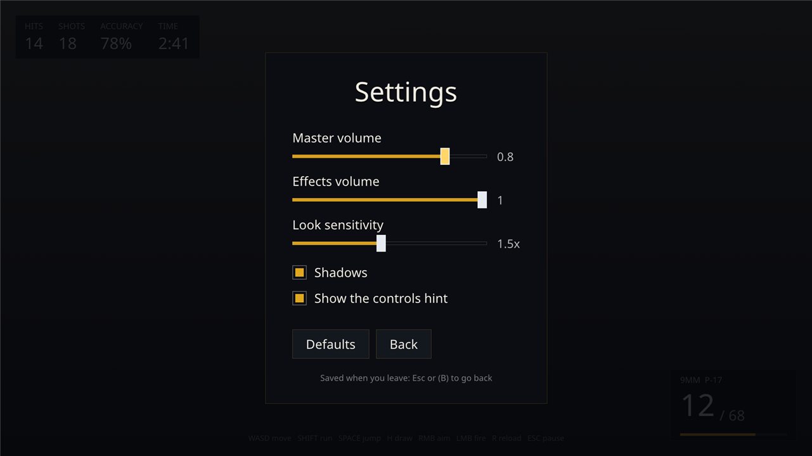
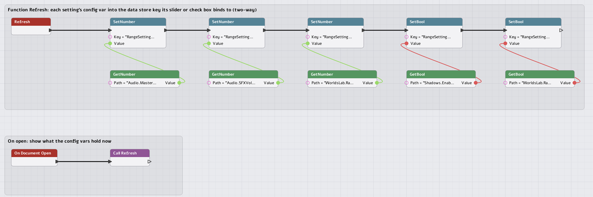
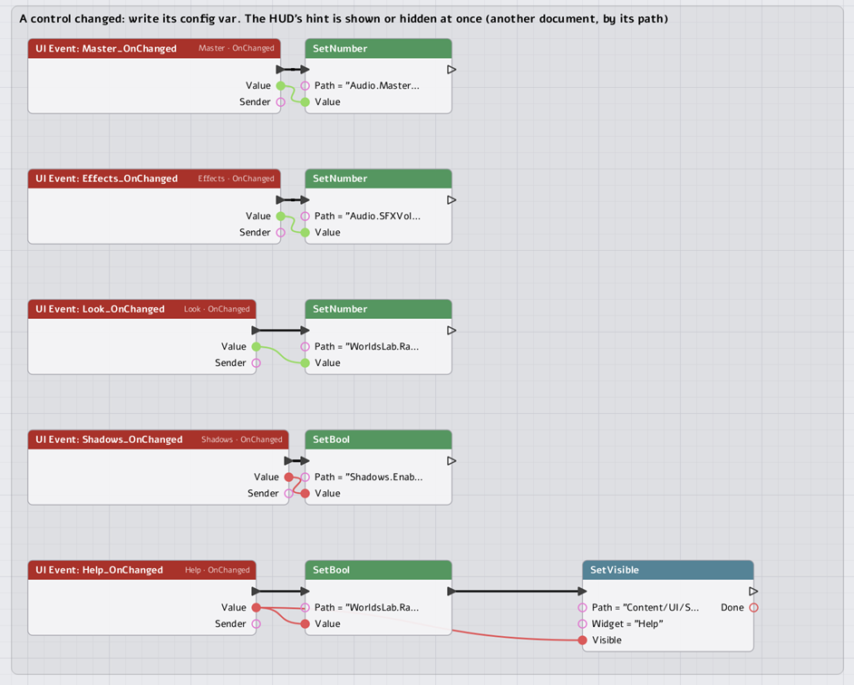
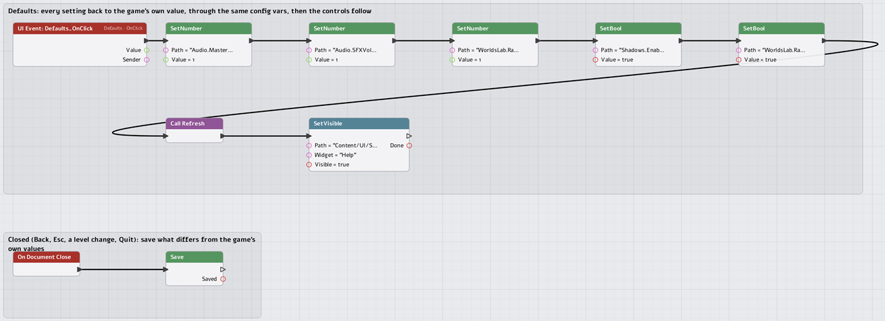

# UI guide 3 of 3: settings that control the game's `.ini`

A settings menu is a document whose controls read and write **config vars**: the
named, typed values the engine and the game declare in C++ and that a `.ini`
file can set. This page builds the Shooting Range's Settings (master and effects
volume, look sensitivity, shadows, the controls hint) and shows the whole loop:
the `.ini` the game ships, the menu that changes the values, and the file where
the player's changes are kept. Logic in a **script graph** first, then the same in
**Lua** and **C++**.

1. [A menu](MenuUIGuide.md)
2. [A HUD](HudGuide.md)
3. **Settings** (this page)

[](../Images/UI/range_settings.png)

*`Settings.nmui`, opened from the pause menu (Settings button) over it.*

---

## 1. Where a setting lives

A setting is not stored in the menu. It is a **config var**, and a var's value comes
from the first of these that has one:

```
 compiled default            NIMBLE_CONFIG_FLOAT(GRangeLookSensitivity, "WorldsLab", "RangeLookSensitivity", 1.0f, nullptr)
      ▲ overridden by
 the project's .ini          Games/WorldsLab/Config/DefaultEngine.ini        the game's own values
      ▲ overridden by
 the player's User.ini       <AppData>/NimbleEngine/WorldsLabGame/User.ini   only what the player changed
```

The project's file is the **baseline**. Here is the range's part of
`Config/DefaultEngine.ini`:

```ini
; The Shooting Range's settings (WorldsLabRange.cpp): RangeLookSensitivity scales the mouse
; and stick look, RangeShowHelp shows the HUD's controls hint.
[WorldsLab]
RangeLookSensitivity=1
RangeShowHelp=true

; Volumes, 0 to 1 (Engine/Modules/Audio): the range's Settings menu sets two.
[Audio]
MasterVolume=1
SFXVolume=1

[Shadows]
Enabled=1
```

A key is `Key=Value` under `[Section]`; the pair `Section.Key` is the var's
**path**, which is how Lua and graphs name it: `"WorldsLab.RangeLookSensitivity"`,
`"Audio.MasterVolume"`, `"Shadows.Enabled"`. A key that matches no var is logged and
ignored, so a typo shows in the log.

When the player changes a setting and the menu closes, the game writes
`User.ini`, holding **one line per var that now differs from the baseline**:

```ini
[Audio]
MasterVolume=0.8

[WorldsLab]
RangeLookSensitivity=1.5
```

- Put a value back to the baseline and its line drops out; nothing is stored that
  the game would give anyway. So if you later change `DefaultEngine.ini` for a
  setting the player never touched, they get the new value.
- The launcher loads `User.ini` over the project's file at start-up (the log says
  `User settings from <path>`). The folder is `<AppData>/NimbleEngine/<name>`,
  where `<name>` is `[Application] UserDataName`, else the game module's name
  (`WorldsLabGame`).
- Delete `User.ini` and the game is back to the baseline. Edit it by hand and the
  next launch uses it.
- **The editor has no User file.** In Play-in-Editor the menu changes the vars (so
  you can see and hear the result) but there is nowhere to save them, and `Config.Save`
  does nothing. Run the game from its launcher to test saving.

### Declaring a var

Settings the game owns are declared in its module, at file scope, from `WorldsLabRange.cpp`:

```cpp
NIMBLE_CONFIG_FLOAT(GRangeLookSensitivity, "WorldsLab", "RangeLookSensitivity", 1.0f, nullptr);
NIMBLE_CONFIG_BOOL(GRangeAutoPlay,         "WorldsLab", "RangeAutoPlay",        false, nullptr);
NIMBLE_CONFIG_BOOL(GRangeShowHelp,         "WorldsLab", "RangeShowHelp",        true,  nullptr);   // the HUD's controls hint (Settings)
```

`NIMBLE_CONFIG_BOOL`, `_INT`, `_FLOAT` and `_STRING` take a variable name, the
section and key, the compiled default, and an optional callback. The code reads
the var where it uses it; the Range reads its look sensitivity every frame:

```cpp
return double(GRangeLookSensitivity.GetFloat()) * Lerp(1.0, ScopeLook, InState.Scope);
```

so a slider takes effect as it is dragged, with no "apply" step. A var that needs to
*do* something when it changes names a callback (`ConfigChangedFn`): the Audio
module's volumes do, which is why dragging the master volume is heard at once.
`Engine/Source/Private/NimbleEngine/NimbleEngine.cpp` and each module declare the
rest; `Shadows.Enabled`, `Audio.MasterVolume` and `Audio.SFXVolume`, which this menu
sets, are the engine's.

| Setting | Var path | Type | Takes effect |
|---|---|---|---|
| Master volume | `Audio.MasterVolume` | float 0..1 | at once (the audio module's callback) |
| Effects volume | `Audio.SFXVolume` | float 0..1 | at once (callback) |
| Look sensitivity | `WorldsLab.RangeLookSensitivity` | float | next frame (read where used) |
| Shadows | `Shadows.Enabled` | bool | read by the renderer |
| Controls hint | `WorldsLab.RangeShowHelp` | bool | the Settings graph hides the HUD's hint at once; the HUD's own graph reads it as it opens |

Vars are **typed**: `Config.GetBool` of a float var is a script error, and a bool is
written with `SetBool`. Not every var is a good setting: `[Display] ResolutionX` or
`[Display] RHI` are read once at start-up, so a menu that writes them changes
nothing until the next launch.

---

## 2. The document

Every control binds, **two-way**, to a key in the UI's data store:

```xml
<UI Format="1" ReferenceSize="1920,1080" ScaleMode="FitHeight" InputMode="UIOnly" Layer="11"
    Graph="Content/UI/ShootingRange/Settings.ui.nmgraph" OnBack="Native:UI.Close">
  ...
  <Text Class="SliderLabel" Text="Master volume"/>
  <HorizontalBox>
    <Slider Name="Master" Class="SettingSlider" Min="0" Max="1" Step="0.05" InitialFocus="true"
            Value="{Bind:RangeSettings.Master}" OnChanged="Graph:Master_OnChanged"/>
    <Text Class="SliderValue" Text="{Bind:RangeSettings.Master}"/>
  </HorizontalBox>
  ...
  <CheckBox Name="Shadows" Class="Setting" Margin="0,28,0,10" Checked="{Bind:RangeSettings.Shadows}"
            OnChanged="Graph:Shadows_OnChanged">
    <Text Class="SettingLabel" Text="Shadows"/>
  </CheckBox>
  ...
  <Button Name="Defaults" Class="MenuButton" OnClick="Graph:Defaults_OnClick">
    <Text Class="MenuLabel" Text="Defaults"/>
  </Button>
  <Button Name="Back" Class="MenuButton" OnClick="Native:UI.Close">
    <Text Class="MenuLabel" Text="Back"/>
  </Button>
```

- **A Slider** has `Min`, `Max` and `Step` (the value snaps to `Min + n * Step`). A
  press jumps the thumb to the pointer and a drag carries it; with focus, Left and
  Right step it. **A CheckBox** has its label as its one child and `Checked`.
- **Two-way** means: the widget *shows* the store's value, and when the player changes
  it the new value is *written back to the store*. So the "0.8" beside the slider,
  bound to the same key, follows the thumb with no code, and anything else bound to
  `RangeSettings.Master` would too.
- **`OnChanged`** then runs, after each change, with `$value`: the slider's
  value, or 1 or 0 for a check box. That is where the setting is applied.
- The store key is **not** the config var. The widget binds to the data store
  (the UI's own table); something has to copy the var into the key as the menu opens,
  and copy a change back to the var. That something is what the rest of this page
  writes three ways. (The key's name, `RangeSettings.*`, is the menu's own; it
  keeps these keys apart from the HUD's `Range.*`.)
- **`Layer="11"`** puts it over the pause menu (layer 10), so **Back** (`OnBack`) closes
  only Settings, and `Native:UI.Close` with no path closes the document the
  action is in.

---

## 3. The logic as a script graph

`Settings.ui.nmgraph` has four jobs. Every one is a few nodes, and there is no C++
(the config vars are declared once, in the module, and a graph reaches any of them
by its path through the **Config** library).

### Showing what the vars hold: a function, `Refresh`

[](../Images/UI/settings-graph-refresh.png)

A **function** is a reusable chain made in the Graph Editor's Details panel (give it a
name; **Function Entry** starts it, **Call** runs it). `Refresh` copies each var into
the key its control binds to, one **UI > SetNumber / SetBool** fed by one **Config >
GetNumber / GetBool**:

| # | Node (type) | Settings |
|---|---|---|
| 1 | Function Entry (`Function.Entry`) | Function = `Refresh` |
| 2 | SetNumber (`Library.UI.SetNumber`) | Key = `RangeSettings.Master` |
| 3 | GetNumber (`Library.Config.GetNumber`) | Path = `Audio.MasterVolume` |
| 4 | SetNumber | Key = `RangeSettings.Effects` |
| 5 | GetNumber | Path = `Audio.SFXVolume` |
| 6 | SetNumber | Key = `RangeSettings.Look` |
| 7 | GetNumber | Path = `WorldsLab.RangeLookSensitivity` |
| 8 | SetBool (`Library.UI.SetBool`) | Key = `RangeSettings.Shadows` |
| 9 | GetBool (`Library.Config.GetBool`) | Path = `Shadows.Enabled` |
| 10 | SetBool | Key = `RangeSettings.Help` |
| 11 | GetBool | Path = `WorldsLab.RangeShowHelp` |

Then each statement's **Then** goes to the next one's **Exec** (1, 2, 4, 6, 8, 10), and
each GetX's **Value** to its SetX's **Value** (3 to 2, 5 to 4, 7 to 6, 9 to 8, 11 to 10).
**On Document Open** (`UI.Event.Open`) is wired to a **Call** node (`Function.Call`,
Function = `Refresh`), so the controls show the current vars the moment the menu opens
(and it shows what a *previous* session saved: the vars already hold it).

### A control changed: write the var

[](../Images/UI/settings-graph-changed.png)

Each control's `OnChanged="Graph:Master_OnChanged"` calls a **UI Event** node of that
name. The handler's **Value** pin is the new value (a bool for a check box: the node's
`ValueType` is `Bool`, set automatically for a CheckBox's `OnChanged`), wired to
the var's setter:

| Handler (UI Event) | Then | Settings |
|---|---|---|
| `Master_OnChanged` (Widget `Master`, Event `OnChanged`, ValueType `Number`) | **Config > SetNumber** | Path = `Audio.MasterVolume`; Value from the event's **Value** |
| `Effects_OnChanged` | SetNumber | Path = `Audio.SFXVolume` |
| `Look_OnChanged` | SetNumber | Path = `WorldsLab.RangeLookSensitivity` |
| `Shadows_OnChanged` (ValueType `Bool`) | **Config > SetBool** | Path = `Shadows.Enabled` |
| `Help_OnChanged` (ValueType `Bool`) | SetBool, then **UI > SetVisible** | Path = `WorldsLab.RangeShowHelp`; then Path = `Content/UI/ShootingRange/RangeHUD.nmui`, Widget = `Help`, Visible from **Value** |

Setting a var fires its callback, as an `.ini` would, which is why the volumes are
heard while the thumb moves. The last handler shows the other thing a graph can do:
**UI > SetVisible** takes a document *path*, so a graph can change a different
document: the HUD's hint appears or goes away the instant the box is ticked.

You make a handler with the Designer: select the control, on `OnChanged` choose **+ >
Graph handler**. It adds the UI Event `<Widget>_OnChanged` and writes
`Graph:<Widget>_OnChanged` into the field.

### Defaults, and saving on close

[](../Images/UI/settings-graph-defaults.png)

| Handler | Does |
|---|---|
| `Defaults_OnClick` | sets every var to the game's own value (fixed here: 1, 1, 1, true, true), calls `Refresh` so the controls follow, and shows the HUD's hint again |
| On Document Close (`UI.Event.Close`) | **Config > Save** |

**Config > Save** is the whole persistence story: it writes `User.ini` with the vars that
differ from the baseline (section 1). It runs when the document closes, whichever way
it closes: **Back**, Escape, a level change, or Quit. There is no Apply button.

(`Defaults` is hard-wired to the values in `DefaultEngine.ini` for simplicity. To go
back to whatever the *project file* says, C++ has `ConfigResetToBaseline(var)`, below.)

### The compiled Lua

The editor saves the graph with the Lua it compiles to, and that Lua is what runs. For
`Settings.ui.nmgraph`:

```lua
local Fn_Refresh
Fn_Refresh = function(self)
    local t1 = Config.GetNumber("Audio.MasterVolume")
    UI.SetNumber("RangeSettings.Master", t1)
    local t2 = Config.GetNumber("Audio.SFXVolume")
    UI.SetNumber("RangeSettings.Effects", t2)
    local t3 = Config.GetNumber("WorldsLab.RangeLookSensitivity")
    UI.SetNumber("RangeSettings.Look", t3)
    local t4 = Config.GetBool("Shadows.Enabled")
    UI.SetBool("RangeSettings.Shadows", t4)
    local t5 = Config.GetBool("WorldsLab.RangeShowHelp")
    UI.SetBool("RangeSettings.Help", t5)
end

return {

    OnOpen = function(self)
        Fn_Refresh(self)
    end,

    OnClose = function(self)
        local Saved1
        Saved1 = Config.Save()
    end,

    Master_OnChanged = function(self, Value, Sender)
        Config.SetNumber("Audio.MasterVolume", Value)
    end,

    Shadows_OnChanged = function(self, Value, Sender)
        Config.SetBool("Shadows.Enabled", (Value ~= 0))
    end,

    Help_OnChanged = function(self, Value, Sender)
        local Done2
        Config.SetBool("WorldsLab.RangeShowHelp", (Value ~= 0))
        Done2 = UI.SetVisible("Content/UI/ShootingRange/RangeHUD.nmui", "Help", (Value ~= 0))
    end,
    -- Effects_OnChanged, Look_OnChanged and Defaults_OnClick, the same way
}
```

Reading it is the easiest way to learn what the nodes do. Note that this is plain Lua
you could have written yourself, which is the next section.

**Use a graph for** settings pages. The logic is "copy this var to that key, and back",
the Config nodes need no C++, and a designer can add a setting without a build.

---

## 4. The same settings in Lua

Instead of `Graph:` handlers, name Lua functions. Give the document a `Script` (run
once, when it first opens, in the game's Lua state) and call the functions as actions:

```xml
<UI ... Script="Content/UI/ShootingRange/Settings.lua" OnOpen="Lua:RangeSettings.Refresh"
    OnClose="Lua:RangeSettings.Close" OnBack="Native:UI.Close">
  <Slider Name="Look" ... Value="{Bind:RangeSettings.Look}"
          OnChanged="Lua:RangeSettings.SetLook($value)"/>
  <CheckBox Name="Help" ... Checked="{Bind:RangeSettings.Help}"
            OnChanged="Lua:RangeSettings.SetHelp($value)"/>
```

```lua
RangeSettings = RangeSettings or {}

function RangeSettings.Refresh()
    UI.SetNumber("RangeSettings.Look", Config.GetNumber("WorldsLab.RangeLookSensitivity"))
    UI.SetBool("RangeSettings.Help", Config.GetBool("WorldsLab.RangeShowHelp"))
end

function RangeSettings.SetLook(value)
    Config.SetNumber("WorldsLab.RangeLookSensitivity", value)
end

function RangeSettings.SetHelp(on)                       -- a check box's $value is 1 or 0
    Config.SetBool("WorldsLab.RangeShowHelp", on ~= 0)
    UI.SetVisible("Content/UI/ShootingRange/RangeHUD.nmui", "Help", on ~= 0)
end

function RangeSettings.Close()
    Config.Save()
end
```

The `Config` library is the whole API: `Config.GetBool`, `GetNumber`, `GetString`, the
matching `SetBool`, `SetNumber`, `SetString` (a set fires the var's callback), `Has(path)`
and `Save()`. `Config.Save()` returns whether the file was written.

- **`Lua:Group.Fn($value)`** passes the control's value; for a check box that is `1` or
  `0` (compare with `~= 0`, as the graph's Lua does; do not use it as a Lua boolean,
  because `0` is true in Lua).
- Actions chain with `;`: `OnChanged="Lua:RangeSettings.SetLook($value); Event:Range.SettingsChanged"`.
- Use `UI.GetNumber(key)` to read a key the controls have written back, if the function
  needs the value of a control other than the one that fired.

**Use Lua for** a settings page that has game rules in it (this slider is only
allowed in singleplayer, that option greys another out), or if your scripters live in
Lua.

---

## 5. The same settings in C++

A native action does the same with a typed API. Register the action in the game
module, and name it in the document:

```cpp
UI_DEFINE_ACTIONS(RangeSettings)
{
    Actions.Add("SetLook", [](const UI::UIActionContext& InContext)
    {
        const GameCore::EventArgs& Args = *InContext.Args;
        if(Args.Count < 1 || Args.Args[0].Type != GameCore::EventArg::ET_Number) { return; }
        if(EngineCore::ConfigVar* Var = EngineCore::ConfigFindVarByPath("WorldsLab.RangeLookSensitivity"))
        {
            Var->SetFloat(float(Args.Args[0].Number));
        }
    }, "Sets the range's look sensitivity");
}
```

```xml
<Slider Name="Look" ... Value="{Bind:RangeSettings.Look}" OnChanged="Native:RangeSettings.SetLook($value)"/>
```

The pieces of the C++ config API (`Public/Core/CoreConfig.h`):

| To | Call |
|---|---|
| Find a var | `EngineCore::ConfigFindVarByPath("Audio.MasterVolume")` (null if undeclared) |
| Read, write | `Var->GetFloat()` / `GetBool()` / `GetInt()` / `GetString()`, and `SetFloat(v)` etc. (a set fires the callback; it returns whether the value changed) |
| Declared in your own code | read the global directly: `GRangeLookSensitivity.GetFloat()` |
| Put it back | `Var->ResetToDefault()` (the compiled default), `EngineCore::ConfigResetToBaseline(*Var)` (the project file's value, else the default) |
| Save the player's changes | `EngineCore::ConfigSaveUserFile()` |
| See what would be saved | `EngineCore::ConfigBuildUserText()` |

Filling the store as the document opens is a `UISystem::SetValue` per key, from the mode
or from your own action:

```cpp
UI::UISystem& UI = Session->GetUI();
UI.SetValue("RangeSettings.Look", UI::UIValue::Number(GRangeLookSensitivity.GetFloat()));
UI.SetValue("RangeSettings.Help", UI::UIValue::Bool(GRangeShowHelp.GetBool()));
```

**Use C++ for** settings that must validate or apply something (resize a window, rebuild
a cache, ask the user to confirm), and for vars you declare yourself.

---

## 6. Which one

| If the settings page... | Use |
|---|---|
| copies vars to controls and back, and saves | the **graph** (this page's shipped Settings) |
| has game rules, or you script in Lua | **Lua** `OnChanged="Lua:..."` |
| must apply a change with real work | a **C++** native action |
| needs a value computed by the game | a C++ **script library** function (`UIGRAPHS.md`, section 4) the graph or Lua calls |

You can mix them on one document: each control names its own action, and they chain
with `;`: `OnChanged="Graph:Look_OnChanged; Lua:RangeSettings.Echo($value)"`.

---

## Trying it

1. Run the game from its launcher (not Play-in-Editor, or nothing is saved), press
   Escape, choose Settings.
2. Drag the master volume while something plays: it follows at once. Untick Shadows.
3. Press Back, quit, and open `<AppData>/NimbleEngine/WorldsLabGame/User.ini`: it holds
   the lines that differ from `DefaultEngine.ini`. Delete it to start over.

In the editor, the UI Designer's **Preview** runs the document's logic in a scratch
world: config vars it changes are put back when the Preview stops, and `Config.Save`
does nothing. A var the game module declares (`WorldsLab.*`) is **not declared in the
editor until the module loads**, so a Preview reads a default and warns.

---

## When something is off

| Symptom | Likely cause |
|---|---|
| Moving a control changes nothing | Its `OnChanged` names no handler (the field is outlined orange in the Designer if it names a handler the graph lacks), or the handler never calls `Config.Set*`. The binding only *shows* a value; the handler applies it. |
| The controls show defaults, not the saved values | `Refresh` did not run on open (no `OnOpen` handler), or the User file was not loaded (check the log for `User settings from`). |
| Log: `Config: no config var 'X.Y'` | The path is wrong, or the var's module is not loaded (a Preview without the game module). Paths are `Section.Key`, case-sensitive. |
| Script error: a typed getter | `Config.GetBool` on a float var (or the reverse). Match the type the var is declared with. |
| A check box acts inverted | You used `$value` as a Lua boolean. It is 1 or 0: compare `~= 0`. |
| It works in Play-in-Editor but is lost on restart | The editor has no User file. Run from the launcher. |
| It is saved, but the next run ignores it | The key is in `User.ini` for a var not declared in that process, or the section/key changed since. A line for an undeclared var is kept, not applied. |
| `Defaults` does not reset one setting | Its value is fixed in the graph: add the var to the chain, or use `ConfigResetToBaseline` from C++. |
| A volume slider is silent | `Audio` is built out of this game (`[Modules] Audio`), or the output device is offline. |
| `Graph:X did not run: has no UI graph running` | The document's `Graph` is unset or the graph did not load. |

Back to [the menu](MenuUIGuide.md), or [the HUD](HudGuide.md).
