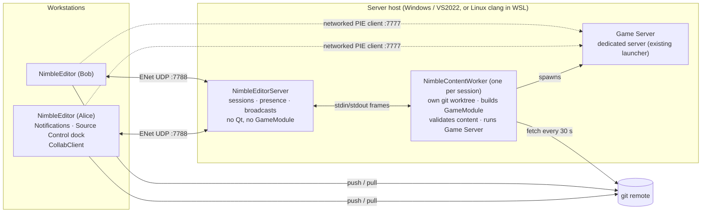

# Editor Collaboration — design and implementation plan

Status: **plan, not implemented** (2026-10-11). Branch `feat-editor-collab`.

Several people work on one game project at once. An **EditorServer** on a host
machine tracks who is in the session, tells everyone when the shared branch
moves, and runs the game server for shared Play-in-Editor. Content travels
through **git**. Only **GameModule** changes are supported during a session;
engine changes are refused.

Decisions already made:

| Question | Decision |
|---|---|
| Scope | Coordinate first (v1: P0–P5), live level co-editing second (v2: P6) |
| Content transport | The git remote. The server never stores asset bytes. |
| Shared PIE | The server host's content worker runs `<Game>Server` |
| Work order | One commit per phase on `feat-editor-collab` |

---

## How it fits together



The server process stays small and stable. Anything that loads game code
(building, schema hashing, content validation, the game server) runs in the
**content worker**, a separate child process. A crash in a GameModule takes
down the worker, not the session, and a rebuilt module just means restarting
the worker.

---

## What already exists to build on

Paths are relative to `Engine/Modules/Editor/` unless they start with `Engine/`.

| Need | Existing piece | Gap |
|---|---|---|
| Transient messages | `statusBar()->showMessage` (~20 calls in `Source/Private/Editor/EditorMainWindow.cpp`, e.g. compile 759–838, play failed 695, saved 2352); panel `StatusMessage(QString)` signals wired at `EditorMainWindow.cpp:253-257`; `EditorLog` (`Source/Public/Editor/EditorLog.h`, thread-safe `Append`, `EntriesAppended`) | No toasts, actions, history or unread state |
| Dock windows | Plain `QDockWidget` (Console, `EditorMainWindow.cpp:194-218`) or the singleton pattern `SequencerWindow::Install/Get` (`Source/Private/Editor/Sequencer/SequencerWindow.h:24`, `.cpp:31-56`). The View menu (`EditorMainWindow.cpp:566-570`) lists every dock that exists before `BuildMenus()` (line 306). | Dock layout isn't persisted |
| Running external tools | `SourceBuild` (`Source/Private/Editor/SourceBuild.h`): async `QProcess`, `Started` / `OutputLine` / `Finished(bool, QString)`, `Cancel()` | No git integration at all |
| Per-frame tick | `EditorContext::RunFrame` (16 ms `QTimer`), `BeforeFrame(float)` signal (`EditorContext.h:223`) | — |
| Transport | ENet 1.3.18 (MIT), `Engine/Modules/NetCore/External/enet-1.3.18`, static target `ENet::ENet`; `NetTransport` (`Engine/Modules/NetCore/Source/Private/NetCore/NetTransport.h`); `EngineCore::Archive` (`Engine/Modules/Core/Source/Public/Core/CoreArchive.h`) | `NetTransport` is private to NetCore, and NetCore depends on GameCore |
| Editor-to-editor link | `NetCore::NetEditorLink` stub (`Engine/Modules/NetCore/Source/Public/NetCore/NetEditorLink.h`), `net.host/join/leave/status`, port 7787, relays undo text only | Applies nothing. Its road is in the NetCore README "Editor link (stub)". |
| Shared PIE | Networked PIE: `PlaySession` / `PlayNetSettings` (`Source/Private/Editor/PlaySession.h`, `ServerAddress` at line 31); `EditorContext::StartPlay` (`EditorContext.cpp:569`); `nimble_add_server_launcher` (`Engine/cmake/NimbleModule.cmake:205`); `Engine/Source/Launcher/ServerLauncherMain.cpp` (headless) | Server address comes from settings, not an invite |
| Game code mismatch | `NetSchema::GetHash` (`Engine/Modules/NetCore/Source/Private/NetCore/NetSchema.h:29`), checked at the PIE handshake | Nothing checks before a mismatch |
| Game code reload | Compile Source F7 (`EditorMainWindow::CompileSource`, line 755; `OnCompileFinished` 803-841), `EditorContext::ReloadAuthoringGame` (`EditorContext.cpp:763`) | Manual only; nothing says it's needed |
| Content change detection | None. `ContentBrowserPanel` uses `QFileSystemModel`; the only `QFileSystemWatcher` is in `DocumentationWindow.cpp:283` | No editor-wide content-changed event |
| Document events | `EditorDocument` (`Source/Public/Editor/EditorDocument.h`): `WorldSaved`, `AboutToSaveWorld`, `PropertyEdited`, `CommandRecorded`, `BeginEditGesture/EndEditGesture` | — |

---

## Phases

Sizes are relative: S < M < L.

### P0 · Editor notifications (prerequisite, S)

A new `EditorNotifications` singleton QObject, installed beside `EditorLog`
in `Source/Private/Editor/EditorMain.cpp` (`EditorLog::Install()` is at line 77).
`Post()` is safe from any thread and is queued to the GUI thread.

- **Notification:** severity (Info / Success / Warning / Error), title, body,
  up to 3 actions (label + callback), optional progress (indeterminate or
  percent), sticky or timed, source tag, and a **replace key**. Posting the
  same key updates the existing card, so "3 new commits" becomes "4 new
  commits" instead of stacking.
- **Toasts:** an overlay stack anchored to the bottom right of the main
  window, at most 3 visible, the rest queued. Errors and anything with actions
  stay until dismissed; everything else fades after 6 s.
- **Notification Center dock:** history with clear-all, plus a status bar bell
  (`statusBar()->addPermanentWidget`, as at `EditorMainWindow.cpp:264-274`)
  with an unread count and a Do Not Disturb toggle that keeps errors visible.
- Migrate the compile result, play failures and bake completion to
  notifications. Plain "Saved" stays in the status bar.

The model (toasts, center, status item, sticky errors with actions,
do-not-disturb) follows VS Code's workbench notifications (MIT). Design
reference only; no code is ported.

**Done when:** an offscreen editor test posts, replaces, actions and expires
notifications, and F7 reports its result as a toast.

### P1 · Source Control dock, git (prerequisite, M)

- **`GitClient`** (editor, modeled on `SourceBuild`): a serialized queue of
  `git` CLI calls through `QProcess`. Run with `GIT_TERMINAL_PROMPT=0` so a
  missing credential fails instead of hanging. Authentication is left to the
  user's credential helper (Git Credential Manager on Windows); the editor
  never sees a password. Commit messages go in through stdin (`git commit -F -`).
- **Status** from `git status --porcelain=v2 --branch -z`, parsed into entries
  (types `1`, `2`, `u`, `?`) plus `# branch.oid/head/upstream/ab` headers. The
  parser is pure C++ (no Qt) with fixture tests.
- **Dock** (singleton `QDockWidget`, `SequencerWindow` pattern): current
  branch, ahead/behind counts, and changed files grouped as **Content ·
  Scripts · GameModule source · Config · Engine**. Engine files are flagged as
  unsupported in a session. Stage/unstage per file or group, text diff for XML
  assets and source, commit, Fetch, Pull (fast-forward only by default, rebase
  offered when there are local commits), Push.
- **Path classifier** (shared with P3), from the project root:
  `Engine/**` → Engine; `<Game>/Source/**`, `<Game>/CMakeLists.txt`,
  `CMakePresets.json` → GameModule; `<Game>/Scripts/**` → Scripts;
  `<Game>/Config/**` → Config; `<Game>/Content/**` → Content.
- **Working branch:** choose or create the session branch, stored in project
  config as `[Collaboration] Branch=`. The dock warns when HEAD is elsewhere.
- Refresh on `.git/HEAD` and `.git/index` changes (`QFileSystemWatcher`) and
  on `EditorDocument::WorldSaved`, debounced to 500 ms.
- Recommendation, not enforced: Git LFS for `.nmmesh/.nmtexture/.nmanim/.nmsound`.
  The dock detects LFS and shows lock state when present.

**Done when:** the porcelain v2 parser passes fixture tests (rename, conflict,
detached HEAD, no upstream), and stage, commit, pull and push work against a
local bare repo in a test.

### P2 · Collab module and NimbleEditorServer (L)

- **`Engine/Modules/Collab`**: STATIC library, **no Qt, no GameCore**. Holds
  the protocol, `CollabClient` and the `CollabServer` session logic. Links
  `ENet::ENet` directly with its own small transport (NetCore's is private and
  tied to GameCore). Messages are `EngineCore::Archive` chunks with versions,
  as NetCore's are.
- **`NimbleEditorServer`** (`Engine/Tools/EditorServer/`): console executable,
  many sessions, UDP port 7788 by default, logs to `Saved/Logs`.
- **Handshake:** protocol version, user name, project ID (`[Game] Module` +
  normalized remote URL), session branch, HEAD, and the **engine identity**:
  the git tree hash `git rev-parse HEAD:Engine` plus a dirty flag from
  `git diff --quiet HEAD -- Engine`. A mismatched or dirty engine is refused
  with a notification that says what differs. This is how "engine changes
  during a session are not supported" is enforced.
- **Presence:** connected users, their HEAD, open level, PIE state, and their
  **dirty file paths** (paths only, sent as diffs). Two people with unsaved
  edits to the same binary or level file get a warning before git has a
  conflict to report. Content Browser shows a badge on files someone else has dirty.
- **Editor UI:** a Session dock (connect, users and their state), File menu
  entries, `collab.connect/leave/status` console commands. The
  `NetEditorLink` stub and `net.host/join` are retired; P6 takes over its road.

**Done when:** a loopback test (server + 2 clients in one process, like
`NetCore.Loopback`) covers join, presence, an engine-mismatch reject and a
timeout, and two editors on one machine see each other.

### P3 · Resync when the branch moves (M)

- The server learns of new commits two ways: an editor that pushes sends
  `Pushed{branch, oid}`, and the worker runs `git fetch` every 30 s to catch
  pushes made outside the editor.
- It broadcasts `BranchAdvanced{old oid, new oid, commits, changed paths}`.
  Each editor classifies the paths (P1 classifier) and posts one replaceable
  notification, e.g. "Alice pushed 3 commits: 12 content files, 2 GameModule
  source files. [Pull & Reload] [Later]".
- **Pull & Reload**, in order:
  1. Fast-forward pull, or rebase if there are local commits.
  2. Reload the open level if its files changed; if it has unsaved edits, ask first.
  3. If GameModule source changed: Compile Source, then `ReloadAuthoringGame`.
  4. If `Config/` changed: reload it, or ask for a restart where a key can't hot-reload.

  If Engine paths changed, do none of this: explain that an engine rebuild and
  restart are needed, and leave the session.
- Content Browser, materials and scripts get a refresh signal for the changed
  paths: the first editor-wide content-changed event.

**Done when:** in a two-editor test, a push from one produces a toast on the
other, Pull & Reload brings in a level edit and a GameModule change, and an
engine change is refused.

### P4 · Content worker (L)

- **`NimbleContentWorker`**, started by the server per session; talks to it
  over stdin/stdout length-prefixed frames using the same message types as
  the network protocol.
- Keeps its own `git worktree` of the session branch under the server's data
  folder and fast-forwards it on every `BranchAdvanced`.
- Builds GameModule and `<Game>Server` with a server preset —
  `server-relwithdebinfo-msvc` (VS2022) or `server-relwithdebinfo-clang`
  (Linux, including WSL) — then loads the module headless
  (`ApplicationDesc::bHeadless`, `Engine/Source/Public/NimbleEngine/NimbleEngine.h:49`) to:
  - publish the **NetSchema hash** for that oid. An editor whose locally built
    hash differs is told to recompile before joining PIE.
  - **validate content**: load every `.nmworld` / `.nmentity` and report
    unknown component types, failed deserializes and missing referenced asset
    paths, sent as a notification to whoever pushed.
- A failed build is broadcast as an Error notification with the first compiler
  error and the commit's author.

**Done when:** the worker builds WorldsLab's module and server from a
worktree, reports a schema hash, and flags a deliberately broken entity file.

### P5 · Shared Play-in-Editor (M)

- **Play Together** in the Play menu (`EditorMainWindow::BuildPlayControls`,
  line 614) sends `PlayRequest{level, net settings}`. The server checks the
  worker is built at the session oid, launches `<Game>Server` on that level,
  and broadcasts `PlayInvite{from, level, address:port, oid, schema hash}`.
- Each editor gets a notification with **Join** / **Decline**. Join runs
  `EditorContext::StartPlay` as a networked-PIE client pointed at the invite's
  address (`PlayNetSettings::ServerAddress`). Editors behind the oid or with a
  different schema hash see "Pull & Reload first" in place of Join.
- The session tracks who is in the run; the initiator or an idle timeout stops it.

**Done when:** two editors join one worker-hosted WorldsLab server and see
each other's avatars, and a mismatched editor is refused before it connects.

### P6 · Live level co-editing (v2, L)

Finishes the `NetEditorLink` road from the NetCore README, on the Collab channel:

- **Snapshot:** the level at the session oid plus the server's edit ledger, replayed on join.
- **Edits as data:** entity GUID, component type *name*, and the component's
  text serialization (the same XML as a `.nmentity` `<Component>` element).
  Never the undo history's raw bytes, whose layout depends on the build.
- **Ordering and conflicts:** the server orders everything; each
  (entity, component) is last-writer-wins. While a local edit is still waiting
  for the server, older remote values for it are ignored so they don't flicker
  back. Entity GUIDs are already client-generated (`GameCore/EntityGuid.h`).
- Remote edits are applied through `EditorDocument`, so every panel hears of
  them and they can be undone.
- **Entity lock** held from `BeginEditGesture` to `EndEditGesture`; others see
  the outline tinted with the holder's color.
- **Persist:** the level file's lock holder saves and commits from the Source
  Control dock; the ledger is truncated at that commit.

Approach follows Figma's server-ordered, per-property last-writer-wins model,
with CRDT terminology from Shapiro et al.; Unreal's Multi-User Editing (ledger,
locks, "persist session changes") is a workflow reference. Design references only.

---

## Protocol, v1

| Message | Direction | Payload |
|---|---|---|
| `Hello` / `Welcome` / `Reject` | C→S / S→C | protocol, user, project ID, branch, engine tree + dirty, HEAD · session ID, roster · reason text |
| `Presence` | C→S→all | HEAD, open level, PIE state, dirty paths (diffed) |
| `Pushed` | C→S | branch, oid |
| `BranchAdvanced` | S→all | old oid, new oid, commits (author, summary), changed paths |
| `BuildStatus` | S→all | oid, state, schema hash, first error |
| `ValidationReport` | S→author | oid, problems (path, message) |
| `PlayRequest` / `PlayInvite` / `PlayEnded` | C→S / S→all | level, net settings · address:port, oid, schema hash · reason |
| `Notify` | S→C | severity, title, body: a server message shown as is |

---

## Building and hosting the server

- Server targets link Core, Collab and ENet, not Qt, so a Windows host needs
  only VS2022 and CMake. The worker also needs the engine and game build.
- Add presets to the game template (`Engine/Templates/Game`) and WorldsLab:
  `server-relwithdebinfo-msvc` and `server-relwithdebinfo-clang` (Linux/WSL,
  clang + lld).
- All new code follows the msvc-compat rules: `*_API` export macros on every
  cross-module symbol, no copy constructors on dllexported classes that hold
  non-copyable members, no members named like their class, C++17 only, no GNU
  extensions. Run the msvc lint before each phase's commit.
- **WSL:** WSL 2 is behind NAT by default. ENet runs over **UDP**, and
  `netsh interface portproxy` forwards TCP only, so the usual workaround does
  not apply. Hosting in WSL needs `networkingMode=mirrored` under `[wsl2]` in
  `.wslconfig` (Windows 11 22H2+) plus a Hyper-V firewall inbound rule for UDP
  7788 and 7777. A native Windows build needs neither. Write a `HOSTING.md`
  covering both.

> **Trust boundary.** The worker builds and runs whatever is pushed to the
> session branch: remote code execution by design. A session is for a trusted
> team on a LAN or VPN. v1 adds an optional session password
> (`[Collaboration] Password`, compared in constant time). Do not expose it to
> the internet.

## Defaults

- Pull is fast-forward only; rebase offered with local commits; never an automatic merge.
- Server address entered by hand; LAN discovery later.
- Ports: 7788 Collab, 7777 game server (NetCore default); 7787 freed with `NetEditorLink` retired.
- The worker runs on the server's own checkout; each user builds their own editor and GameModule.

---

## Sources and citation rule

Any algorithm or structure derived from outside work gets a header comment in
the source file:

```
Derived from: <project> (<license>) <url> @ <commit or version> — <what was taken>
```

Each is also listed in `Engine/Modules/Collab/README.md` under Sources. Code
from source-available or closed products (Unreal, Figma) is never copied; they
are cited as design references only.

| Source | License | Used for | Kind |
|---|---|---|---|
| [VS Code workbench notifications](https://github.com/microsoft/vscode/tree/main/src/vs/workbench/browser/parts/notifications) | MIT | P0 toast / center / status-item model | design |
| [git status, porcelain format v2](https://git-scm.com/docs/git-status#_porcelain_format_version_2) | spec | P1 status parser, written from the documented format | spec |
| [git worktree](https://git-scm.com/docs/git-worktree), [git rev-parse](https://git-scm.com/docs/git-rev-parse) (`HEAD:<path>` tree ids) | spec | P2 engine identity, P4 worker checkout | spec |
| [Git Credential Manager](https://github.com/git-ecosystem/git-credential-manager) | MIT | P1 credentials stay with git's helper | user-installed dependency |
| [ENet 1.3.18](http://enet.bespin.org/) | MIT | P2 transport (already vendored in NetCore) | library |
| [Wallace, "How Figma's multiplayer technology works" (2019)](https://www.figma.com/blog/how-figmas-multiplayer-technology-works/) | article | P6 server ordering, last-writer-wins, pending-change rule, client-made IDs | design |
| [Shapiro, Preguiça, Baquero, Zawirski, "A comprehensive study of Convergent and Commutative Replicated Data Types", INRIA RR-7506 (2011)](https://inria.hal.science/inria-00555588) | paper | P6 LWW-register semantics | design |
| [Unreal Engine Multi-User Editing](https://dev.epicgames.com/documentation/en-us/unreal-engine/multi-user-editing-overview-for-unreal-engine) | docs (EULA code, not used) | P6 ledger, locks, persist-to-source-control workflow | design |
| [WSL networking](https://learn.microsoft.com/en-us/windows/wsl/networking) | docs | HOSTING.md: mirrored mode for UDP, Hyper-V firewall | reference |

## Order of work

1. P0 and P1 are useful without a server and land first.
2. P2 then P3 give a working v1 for coordination.
3. P4 and P5 make the server game-aware and add shared PIE.
4. P6 (v2) starts after v1 has been used on a real host.

Each phase ends with its tests green and its own commit.
