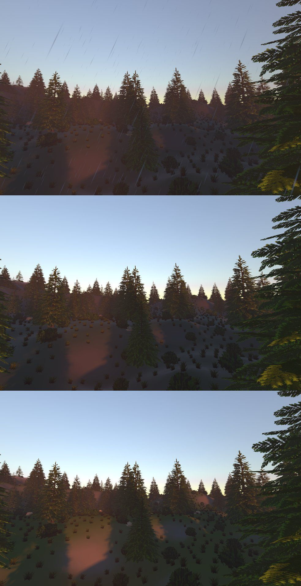

# Weather

Rain, mist, wet surfaces and wind for a level's exterior, from one
**Weather** component per World. Made for an island at golden hour and dusk
that can turn to drizzle and fog, but nothing in it is specific to one level.

The plugin adds no new rendering systems. It drives what the renderer already
has, through `RenderCore/RenderWeather.h` (see RENDERPIPELINE.md, "Weather"):

| Feature | What it drives |
|---|---|
| Mist | the renderer's **Volumetric Fog** (density, base height, falloff) |
| Wind | the scene block's `Scene_Wind`, which materials read through the **Wind** node: foliage sways along it |
| Wetness | `Scene_Weather.x`: the deferred Lighting stage, IBL and SSR darken and smooth upward-facing hard surfaces |
| Rain | a camera-following **Particle System** (`Content/Particles/Rain.nmparticle`) |

## Enabling

```ini
; Config/DefaultEngine.ini
[Plugins]
Weather=true
```

Then rebuild, and cook the shaders. The rain's material is in the plugin's
`Content/Materials`, and the engine's shaders changed for wetness and wind:

```bash
NimbleCook shaders -project Games/<Game>
```

Add a **Weather** component (Add Component > Lighting) to any entity in the
level, such as the one that has the Time Of Day and Sky Light. Only the first
Weather in a World is used. If there are more, a warning is logged once.

## The component

| Field | Range | |
|---|---|---|
| Rain | 0-1 | The drops round the camera. Also thickens the mist by Rain Mist x Rain and, with Follows Rain, wets the ground |
| Rain Particles | on/off | Draws the drops. When off, rain still affects mist and wetness |
| Rain Mist | 0-1 | Mist Density added at Rain 1 (default 0.2) |
| Mist Density | 0-1 | Turns on and drives Volumetric Fog. 1 is thick: x0.001 per world unit, about 30 m of sight at 1 unit = 1 cm. At 0, with no rain mist, the level's own fog is left alone |
| Mist Height | world Y | Full density at and below this height |
| Mist Falloff | world units | Height above Mist Height over which the mist thins to 1/e |
| Wetness | 0-1 | Darker, glossier upward-facing surfaces |
| Follows Rain | on/off | Wetness soaks up under rain (fully in Wet Seconds at Rain 1, slower in lighter rain) and dries in Dry Seconds after it stops |
| Wet Seconds, Dry Seconds | s | 60 and 240 by default |
| Wind Yaw | degrees | Direction the wind blows toward, about +Y: 0 is +Z, 90 is +X. The default, 53.13, is the (0.8, 0, 0.6) foliage was authored for |
| Wind Strength | 0-5 | 0 is calm, 1 is the breeze foliage is made for, higher is a gale. The rain drifts 250 units/s per 1 |

Every field is saved, replicated (the server's weather is the weather) and
editable in Details.

### From Lua and script graphs

The component's fields are bound like any component's:

```lua
local weather = World.FindEntity("Sky"):GetComponent("Weather")
weather.Rain = 0.6
weather.WindStrength = 2
```

There is also a `Weather` library for the World's (first) Weather:

```lua
Weather.SetRain(0.7)           -- 0-1
Weather.SetMist(0.3)           -- Mist Density, 0-1
Weather.SetWetness(1)          -- 0-1; Follows Rain keeps stepping it
Weather.SetWind(90, 2.5)       -- yaw degrees, strength
print(Weather.GetRain(), Weather.GetWetness())
```

### From C++

Link `Weather` (guarded with `if(TARGET Weather)`, as PLUGINS.md shows) and
include `Public/Weather/Weather.h` and `Public/Weather/WeatherComponent.h`:
`Weather::FindWeather(World)`, `ToRenderWeather`, `StepWetness`,
`WindDirection`.

## Config

`Config/DefaultWeather.ini`, which the project's `[Weather]` section and the
command line can override:

| Key | |
|---|---|
| `Rain` | 0-1 sets every Weather's Rain (a preview or screenshot: `-Weather.Rain=0.8`). Below 0, off |
| `Wetness` | Same, for Wetness |
| `RainDensity` | Multiplies the drops: 0 draws no rain particles. A scalability setting; mist and wetness are unaffected |

## How each part works

**Wind.** Before this plugin, WorldsLab's foliage hard-coded its wind into
its materials: a sway along (0.8, 0, 0.6) built from `Input.Time` and world
position (`Tools/Terrain/make_foliage_materials.py`,
`Tools/GrassLab/make_grasslab_materials.py`). The material graph now has a
**Wind** node (`Input.Wind`: Direction, Strength, Vector) that reads
`Scene_Wind`. Those generators lean the plants along Direction and scale the
sway and flutter by Strength. The material looks the same without a Weather,
because a World with no weather gets that same breeze of 1. Courtyard's
plants (`make_courtyard_materials.py`) still have their own fixed wind.

**Wetness.** This uses no per-material authoring. `Engine/Content/Shaders/Wetness.glsl`
is applied to the G-buffer's values where they are read: in the Lighting
stage (`DeferredLighting.fsh`), the image-based lighting pass
(`IBLLighting.fsh`) and screen-space reflections (`PPScreenReflections.fsh`).
The effect is limited to surfaces whose normal faces the sky. It fades in
from about 80 to 45 degrees off vertical, so walls and the undersides of
things stay dry. A wet dielectric darkens in proportion to its roughness (its
porosity), down to 0.35 of its linear albedo when soaked. Every wet surface's
roughness halves, but goes no smoother than 0.2, since there is no standing
water (after Lagarde, "Water drop", 2013). Normal maps count, so the tops of
bumps get wet first. Only the Default, Clear Coat and Anisotropic shading
models get wet. Foliage cards (Subsurface) keep their look, because a card's
normal doesn't say where water would stand. Skin, cloth and volumes also keep
their look. Change the constants at the top of `Wetness.glsl` to retune.

**Mist.** `ApplyRenderWeatherFog` runs after the Post Process volumes blend
and before a sequence's override. It turns Volumetric Fog on with the
weather's density, base height and falloff. The fog's steps, anisotropy and
albedo come from the volumes, or from the Volumetric Fog node's defaults if
no volume has fog. Volumetric Fog needs an HDR scene, and the
`AllowVolumetricFog` scalability cap still applies.

**Rain.** A `WeatherRain` entity with a Particle System is made the first time
it rains, and the plugin moves it each frame:

- **Position:** RAIN_HEIGHT (900) above the eye, moved upwind by the distance
  a drop drifts on the way down. The eye is the last frame's main view, which
  a `BeforeScene` custom pass reads on the render thread, so the rain follows
  a game's camera and Play-in-Editor's alike. Before any frame has drawn, it
  falls back to the first active Camera.
- **Amount:** Spawn Rate Scale = Rain x `RainDensity`.
- **Colour:** Tint comes from the first Sky Light, so dusk rain is warm and
  night rain is dim.
- **Wind:** the shipped system is stored in `ParticleSystemCache` under its
  own path with the wind added to every emitter's Velocity. If the Particle
  Editor saves the file, the plugin picks up the new version and blows it
  again.

The system has three Velocity Aligned emitters of 2048 drops each. One is
near the eye (16 m square). The other two cover a 40 m square. All are drawn
as thin streaks by `WeatherRain.material.nmgraph`, which is Translucent Unlit.
Particles need a backend with compute shaders (Vulkan).

## Previewing

The test world `Tests/WeatherLab.nmworld` is WorldsLab's Hills at 17:36 on a
stopped Time Of Day. Its Weather is set to Rain 0.6, Mist 0.15, Wetness 1 and
Wind Strength 1.5. It uses WorldsLab's content, so it isn't in WorldsLab's
world list. To play it, list it in Project Settings > Worlds, or add
`[World_WeatherLab] File=<path>` to the staged config, then Play.

The three shots below were taken from the same ejected camera: raining, then
`Weather.Rain 0` (wet, no rain, still misty), then also `Weather.Wetness 0`
(dry). Each shot ran `NimbleEditor --play <world> --command "after 3000
eject" ... --command "after 12000 windowshot <png>"`.



## Not done

- **Splashes:** the plugin doesn't know where the ground is.
- **Rain occlusion:** rain falls through roofs, and indoor floors get wet.
  There is no rain depth map. Keep interiors in their own World, or set
  Wetness 0 while inside.
- **Puddles, ripples, drips, wet-surface normal changes.** Forward-lit
  surfaces (Translucent Lit) don't get wet, and neither does foliage.
- **Materials:** Courtyard's plants still have a fixed wind. Other projects'
  materials pick up wind only once they use the Wind node.
- **The edit world:** plugins hook only the Worlds a GameSession makes. In the
  editor, the weather therefore shows in Play-in-Editor, not while editing.
  When editing, foliage sways with the default breeze.

## Tests

`Plugin.Weather.WeatherTests` (ctest, label `plugin`) covers the following:

- **Host:** the plugin's config and content through the host, and its
  library and world hook.
- **Component:** wind direction, wetness stepping and drying, mist as fog
  settings, and the `[Weather] Rain` pin.
- **Rain:** the rain's system parsing and being blown by the wind, the rain
  entity placed above and upwind of the camera and lit by the sky, and
  everything cleared on detach.
- **RenderCore:** `RenderWeather` normalising its input.
