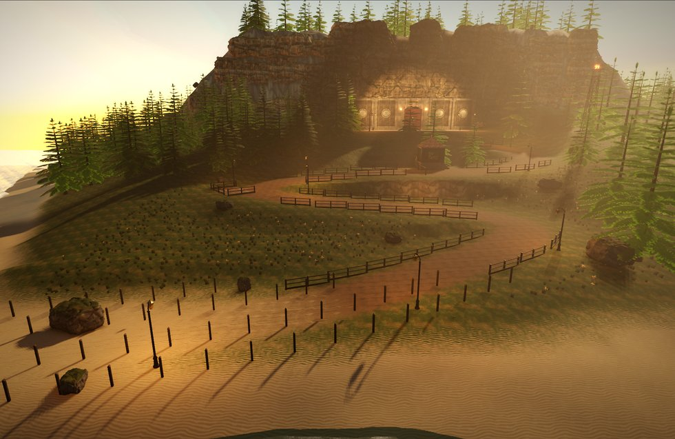

# Demo Lab guide

Demo Lab is NimbleEngine's showcase game and the sample project that
replaced WorldsLab: a 15-minute, single-player, third-person slice in a
steampunk laboratory, built so the renderer gets looked at. This guide says
how to run it, which engine feature each level and cinematic shows, how to
rebuild its generated content, how to watch one cinematic, how it is
tested, and how to measure it.



The spec is [Design.md](Design.md). The project layout is in the
[README](../README.md). [GettingStarted.md](GettingStarted.md) is the
template's general guide to a project's files.

## 1. Build and run

From `Games/DemoLab`, on Linux with Clang (the presets use Ninja):

```
cmake --preset editor-debug
cmake --build Build/editor-debug --target DemoLab NimbleEditor -j4
```

The first build compiles the engine as well. Everything lands in
`Binaries/Linux_Debug/`, and the build copies `Config/`, `Scripts/` and
`Content/` there. Materials are cooked, not built: after a material changes,
cook the shaders (from the repository root):

```
Games/DemoLab/Binaries/Linux_Debug/NimbleCook shaders -project Games/DemoLab -module DemoLabGame -editor
```

Run the game from its binaries folder: `Binaries/Linux_Debug/DemoLab` starts
at the main menu, and `Binaries/Linux_Debug/NimbleEditor` opens L1 in the
editor (`[Editor] StartupWorld`). Some useful command lines:

| Command line | What it does |
|---|---|
| `DemoLab -Game.StartLevel=L1_Foothills` | Goes straight into a level (`L1_Foothills`, `L2_Laboratory`, `L3_Core`). L2 starts in its Calm state |
| `DemoLab -DemoLab.Cinematic=C3` | Plays one cinematic and quits (section 4) |
| `DemoLab -DemoLab.AutoPlay=1` | The game plays itself, from the menu to the credits (section 5) |
| `DemoLab -DemoLab.PerfLog=1` | Logs a `[DemoLab] Perf` line (frame, game, render and each GPU span) every second |
| `DemoLab -TimeOfDay.Hour=12` | Pins every Time Of Day clock at an hour |
| `DemoLab -Weather.Rain=0.6` | Sets every Weather's rain |

To play L2 in its Alarm state, use the menu's **Chapter Select** (row 4).

**Controls:** WASD move, Shift sprint, C crouch, E use (hold it on cranks),
left mouse fire, right mouse aim, R reload, Escape pause, F1 the
engine-features overlay. The overlay lists what the current level shows and
live `stat unit` numbers.

**Settings** (main menu or pause menu) change config vars and save them to
the player's `User.ini`: the quality tier (`[Scalability] DetailMode`, Low
to Ultra, High by default), resolution, GI (`Rendering.DynamicGI` and
`ScreenSpaceGI` together), shadows, reflections, volumetric fog, foliage
density (`DemoLab.FoliageDensity`, which scales L1's `Foliage_*` spawners),
VSync and the frame limit, the audio buses, look sensitivity, invert Y and
subtitles.

## 2. What each level shows

| World | What happens | What it shows |
|---|---|---|
| `MainMenu` | The lab's facade at dusk behind the menus, a looping camera dolly | **TimeOfDay** sky at 18.2, **Weather** mist, the **Sequencer** (an ambient loop), the **UI** module (menus, settings, data binding) |
| `L1_Foothills` | C1 arrival, the dock, the switchback road, the gatehouse crank (hold E), the plaza, C2 blast door | A 385 x 385 **terrain** (a heightfield body walks the player), **Procedural Spawners** (below), TimeOfDay golden hour (17.5), Weather sea mist, the **Character Mover** on terraced road, a translucent sea with World Position Offset swell, SSGI, SSR and volumetric fog, one GI Volume and three reflection probes, AICore's navmesh built at runtime, signals and interactables |
| `L2_Laboratory` (Calm) | The airlock, the dark foyer, C3 breaker, the atrium, the workshop, the archive (keycard), the turbine hall (three valves in order), C4 elevator | **Dynamic GI**: seven GI Volumes (DDGI) under SSGI, relit live as C3 switches the lab on room by room, within the **capture budget**; a reflection probe a room; the workshop's **shading-model** samples (Anisotropic brass, Clear Coat walnut and enamel, Cloth velvet and leather, Subsurface marble, wax and a backlit leaf, frosted glass, Volume steam) |
| `L3_Core` | The ring gallery, the vault, C5 theft and alarm, the sidearm, W1, the tunnel, W2 in the pump hall while the beacon charges (40 s), the freight lift | Volumetric fog and light shafts round the reactor, two GI Volumes (the shaft, the pump hall) under SSGI, the reactor's calm and alarm looks, **AICore** (navmesh, behavior trees, perception: Watchmen and Brutes), hitscan combat, **Jolt ragdolls**, SaveGame checkpoints |
| `L2_Laboratory` (Alarm) | Arrive at the freight lift; red light, shutters reroute; W3 in the turbine hall, archive stragglers, W4 in the atrium (a 60 s hold), the orrery gantry, the roof hatch, C6, credits | One world, two states (the `Calm_*` and `Alarm_*` entity groups), emergency lighting and sweeping beacons, sprinklers, sparks and smoke, glass that shatters when shot (**Destructible**), AICore waves |

### L1's procedural content

Every plant, lamp, rail, fence post and scree rock in L1 is placed by a
Procedural Spawner (`Tools/Levels/dress_l1.py`; the walkthrough is
`Engine/Docs/Guides/ProceduralGuide.md`):

- `Road`: the one road Spline, whose Spline Path spawner stands a lamp every
  17 m; `Road_Rails` and `Road_Fence` are copies of the curve that spawn
  guard rails on the uplands and fence posts on the lowlands, both sides.
- `Foliage_Forest`, `Foliage_FarWoods`, `Foliage_Highland`: Box spawners of
  spruces filtered by slope, height and noise.
- `Foliage_Meadow`, `Foliage_Flowers`: Spline Area spawners of grass and
  wildflowers inside one outline, on the Grass paint layer, in noise patches.
- `Foliage_Scree`: rocks on the Rock paint layer below the cliff, slope-limited.
- `RoadClear` and the `Zone_*` splines are the exclusions that keep things
  off the road, the plaza and the gate.

### The cinematics

Each is a Sequencer sequence (`Content/Cinematics/C*.nmseq`) whose last shot
blends into the player's own camera before control comes back (the Sequence
Player's blend-out), except where a fade leads to a level change.

| Id | Level | Length | What it shows |
|---|---|---|---|
| C1 Arrival | L1 | 20 s | Camera cuts and blends round the airship rig flying in over the sea at golden hour; the music handing over to the level's; Blend Out into the player |
| C2 Blast door | L1 | 16 s | Transform tracks on the door's cog and leaves, raised by an Event key (`L1.BlastDoor`); a fade into the travel to L2 |
| C3 Power-up | L2 | 16 s | The breaker: 13 power signals over about 6 s, a cut per room, while DDGI and SSGI relight each room live; `L2.Powered` and a checkpoint |
| C4 Elevator | L2 | 15 s | The cage dropping down a shaft past lamp bands into the core's blue glow; the travel to L3 |
| C5 Theft | L3 | 18 s | The intel lifted, the reactor dropping to red, klaxons, shutters and vents (`L3.Alarm`); the player placed at the locker for the hand-over |
| C6 Extraction | L2 Alarm | 22 s | The roof hatch, the airship over the dome, the winch, the climb away into the dusk; the credits |

`Tools/Cinematics/README.md` has each shot and hand-over.

## 3. Regenerating the content

Nearly everything under `Content/` is written by a generator under `Tools/`.
Edit the generator and run it again; never hand-edit a generated
`.nmentity`, `.nmseq` or material graph, because the next run overwrites it.
Then rebuild, which stages the new files into `Binaries/`.

### Art: Tools/Art

`Tools/Art/README.md` has the details. From the repository root:

```
python Games/DemoLab/Tools/Art/build_all.py               # every kit asset, ~5 min
python Games/DemoLab/Tools/Art/build_all.py l2 manifest   # one or two steps
python Games/DemoLab/Tools/Art/make_l1_art.py             # L1's own: post stacks, road kit pieces, foliage
python3 Games/DemoLab/Tools/Art/make_l2_dress.py          # L2's own: plaques, plants, post stacks, particles
```

`build_all.py`'s steps are textures, steamdummy, armour, l1, l2, l3,
materials (and particles), generate (NodeGraphGenerate fills each graph's
code) and manifest (`Tools/Art/assets.json`, which the level scripts read).
It needs python3 with numpy and Pillow, Blender 4.2 or later on `PATH` (or
`$BLENDER`) and a built `NodeGraphGenerate` (any editor build). Cook the
shaders afterwards (section 1).

### Levels: Tools/Levels

From `Games/DemoLab`:

```
python3 Tools/Levels/make_levels.py
```

writes all four worlds (`Content/Levels/{MainMenu,L1_Foothills,L2_Laboratory,L3_Core}`)
and the cinematics. `layout.py` holds the rooms, spawns, interactable spots
and AutoPlay routes; `make_levels.py` turns them into the grey box and wires
the gameplay by signal name; each level's art pass then dresses it in place:
`dress_l1.py` (L1's terrain, road and spawners, kit, sea and light; the menu
backdrop), `dress_l2_laboratory.py` (L2's architecture, lights, GI volumes,
the C3 light cascade, the alarm state) and `dress_l3.py` (L3's shaft,
reactor and alarm).

### Cinematics: Tools/Cinematics

`make_levels.py` calls `make_cinematics.build(lv)` for L1, L2 and L3 before
writing each one, so the command above also writes the six sequences, their
shot cameras and marks. `python3 Tools/Cinematics/make_cinematics.py` does
the same. `seq.py` writes the sequence XML.

### Sound and credits

```
python Games/DemoLab/Tools/Audio/build_audio.py      # Content/Sounds, Content/Music
python3 Tools/UI/make_credits.py                     # Content/UI/Credits.lua from Docs/Credits.md (from Games/DemoLab)
```

`build_audio.py --cc0 <folder>` also rebuilds the sounds made from CC0
recordings, which `Tools/Audio/fetch_cc0.py <folder>` downloads; each is cited
in `Docs/Credits.md`.

## 4. Watching one cinematic

```
Binaries/Linux_Debug/DemoLab -DemoLab.Cinematic=C3
```

travels to the cinematic's level (L2's Alarm state for C6), sets the
signals the story would have set by then, stands the player on its
`CineMark_<Cn>`, plays the cutscene and quits a few seconds after it ends
(`LabStoryMode.cpp`, `LAB_CINEMATICS`). Add `-record=<file.mp4>` for a video
(an Editor-target build's recorder; needs `ffmpeg` on `PATH`).

`Tools/Cinematics/record.sh` does both and makes a contact sheet, from
`Games/DemoLab`:

```
Tools/Cinematics/record.sh C3 <folder> [Debug|RelWithDebInfo]    # RelWithDebInfo by default
```

It writes `<folder>/C3.mp4`, `C3_sheet.jpg` (a frame a second) and `C3.log`.
The recorder takes pictures only, no sound.

## 5. Tests

```
cd Build/editor-debug && PULSE_SERVER=unix:/nonexistent ctest -R DemoLab.AutoPlay --output-on-failure
```

`DemoLab.AutoPlay` runs the game headless with `-DemoLab.AutoPlay=1` and
plays all of it through the same input a player gives
(`Source/GameModes/LabAutoPlay.cpp`): New Game; L1 and the crank; L2's
breaker, keycard, valves and elevator; L3's theft, W1, a deliberate fall and
the checkpoint reload, W2 with the beacon and the freight lift; L2 on alarm
(W3, the stragglers, the W4 hold, the roof hatch); the credits; and back to
the menu. It passes on `[DemoLab] AutoPlay PASS` and fails on a step it
cannot finish. It takes about 11 minutes; enemy damage is scaled down
(`-DemoLab.StoryDamageScale=0.15`) so a run does not die by chance.
`PULSE_SERVER=unix:/nonexistent` keeps it silent.

Three short tests sit beside it (each well under a minute, headless and
silent):

```
cd Build/editor-debug && PULSE_SERVER=unix:/nonexistent ctest -R 'DemoLab\.(MenuTest|SettingsPersist|C5Handover)'
```

- `DemoLab.MenuTest` (`-DemoLab.MenuTest=1`, `Source/GameModes/LabMenuTest.h`)
  drives the menus through their documents -- it clicks the named buttons,
  moves the sliders and ticks the boxes in the open `.nmui`, so each
  control's own action runs. Settings: a check box, the tier, display mode,
  resolution, volume, look sensitivity and subtitles apply (the config vars,
  the tier, what the game reads) and Back writes them to the user file.
  Chapter Select: each of the four rows starts its level in its state (Calm
  or Alarm, armed only for row 4) at its entry, with a checkpoint. F1: the
  overlay opens, names the level, shows stat unit numbers that change, and
  closes. Pause (Escape): it pauses; Resume; Restart checkpoint reloads the
  checkpoint; Main menu goes back.
- `DemoLab.SettingsPersist` (`-DemoLab.MenuTest=2`, run after MenuTest as a
  CTest fixture) is a new process that loads the user file the first left
  and finds every value, on the config vars and on the Settings page, then
  deletes it. Both use `Saved/DemoLabTest/User.ini` beside the executable,
  never the player's own settings.
- `DemoLab.C5Handover` (`-DemoLab.Cinematic=C5 -DemoLab.CineMashInteract=1`)
  plays C5 alone and presses Interact every other frame through it and the
  hand-over at the sidearm locker; nothing may be picked up (the pistol once
  was, from a press that arrived as control came back).

Each passes on `[DemoLab] MenuTest PASS` (or `cinematic test C5: hand-over
PASS`) and fails on a `FAIL` line naming the step.

The same build tree also registers the engine's own tests (`ctest -N` lists
them). Run the ones for the modules you changed.

## 6. Measuring performance at 1440p

Demo Lab's target is 2560 x 1440 at 60 fps on the High tier on the
development machine. **Every frame-time or GPU number must come from a
freshly built RelWithDebInfo build.** Debug timings are not the engine's and
their ratios differ, so never quote them. The general method is the
perf-testing recipe (`.claude/skills/perf-testing/SKILL.md`): A/B in one
build, interleaved, medians of many samples.

1. Cook the shaders (the section 1 command: what it writes under
   `Saved/Cooked/Shaders/Runtime` is staged by every build), then build
   RelWithDebInfo from `Games/DemoLab`:

   ```
   cmake --preset client-relwithdebinfo
   cmake --build Build/client-relwithdebinfo --target DemoLab -j4
   ```

   The binaries land in `Binaries/Linux_RelWithDebInfo_Client/`. The
   `editor-relwithdebinfo` preset (binaries in `Binaries/Linux_RelWithDebInfo/`)
   works too, and is what `record.sh` uses. Check that the binary's time is
   after your last change: a stale RelWithDebInfo tree measures old code.
2. Run a level at 1440p with the frame limit and VSync off, and the perf log on:

   ```
   cd Binaries/Linux_RelWithDebInfo_Client
   PULSE_SERVER=unix:/nonexistent ./DemoLab -Game.StartLevel=L2_Laboratory \
       -Display.ResolutionX=2560 -Display.ResolutionY=1440 \
       -Display.FrameRateLimit=0 -Display.VSync=false -DemoLab.PerfLog=1
   ```

   The tier is `[Scalability] DetailMode=High` from `Config/DefaultEngine.ini`;
   pass `-Scalability.DetailMode=<tier>` to measure another.
3. Read the `[DemoLab] Perf <level> frame ... game ... render ... | GPU ...`
   lines from the log: the frame, game-thread and render-thread times and
   each GPU span (`stat frame`'s). Skip the first ones: a GI Volume's first
   fill is a raster round that takes tens of seconds in L2's rooms, and the
   Captures span is high until it converges (`-Rendering.CaptureLog=1` logs
   its progress; GLOBAL_ILLUMINATION.md, Phase 7).
4. For a fixed view or a cutscene, measure under `-DemoLab.Cinematic=Cn`:
   the same frames play every run. Don't add `-record` while timing: reading
   each frame back stalls the GPU.
5. To find what a feature costs, run with it on and off (`-Rendering.DynamicGI=false`,
   `-Rendering.ScreenSpaceGI=false`, `-Shadows.Enabled=false`, ...) in the
   same build, interleaved, at least two launches each, and compare medians.

Write the numbers up with the build type, resolution, tier, level and view.

## 7. Where the engine features are documented

| Feature | Document |
|---|---|
| Procedural Spawners and splines (L1) | `Engine/Docs/Guides/ProceduralGuide.md`, `Engine/Modules/RenderCore/PROCEDURAL.md` |
| Plugins: TimeOfDay and Weather | `Engine/Docs/Guides/PluginGuide.md`, `Engine/Plugins/TimeOfDay/README.md`, `Engine/Plugins/Weather/README.md` |
| DDGI, SSGI and the capture budget (L2) | `Engine/Modules/RenderCore/GLOBAL_ILLUMINATION.md` |
| Cinematics | `Engine/Docs/Guides/SequencerImplementationGuide.md` |
| Bots | `Engine/Docs/Guides/AICoreImplementationGuide.md` |
| The player's movement | `Engine/Docs/Guides/CharacterMoverGuide.md` |
| Shading models (L2's workshop) | `Engine/Modules/RenderCore/SHADING_MODELS.md` |
