# Making a game with NimbleEngine: a Demo Lab tutorial

This tutorial is for a developer new to NimbleEngine. It explains how a game
is put together, using Demo Lab (`Games/DemoLab`) as the worked example. It
covers three things:

1. **[The game loop](#part-1-the-game-loop):** what a game needs before it runs
   and ticks, and what happens each frame.
2. **[The UI](#part-2-the-ui):** how the menus, the HUD and settings are built,
   where their data comes from, and how input reaches them.
3. **[Components](#part-3-components):** how a game component is declared,
   registered, saved, edited, replicated and ticked, and how it works with the
   engine's own components. It also covers
   [the same kind of piece in Lua and a script graph](#39-the-same-kind-of-piece-in-c-lua-and-a-script-graph).

It ends with **[Make your own](#part-4-make-your-own-a-component-a-system-a-level-piece)**:
a new component and system, placed in a level and seen working.

Every excerpt is from the code as it stands, shortened with `...` where lines
are left out. Every screenshot comes from the RelWithDebInfo editor (its
`windowshot` and `ui screenshot` commands), most of them with the game playing
itself in Play-in-Editor.

**What this page does not repeat:**

| For | Read |
|---|---|
| Building, running, the tests, regenerating content, perf | [Guide.md](Guide.md) |
| What the game is: levels, cinematics, flow | [Design.md](Design.md), the [README](../README.md) |
| Game modes in depth (phases, players, NetGameMode, Lua and script graphs) | [GameModeGuide.md](../../../Engine/Docs/Guides/GameModeGuide.md) |
| UI documents in depth (a menu, a HUD, settings, built on the Shooting Range) | [MenuUIGuide.md](../../../Engine/Docs/Guides/UI/MenuUIGuide.md), [HudGuide.md](../../../Engine/Docs/Guides/UI/HudGuide.md), [SettingsUIGuide.md](../../../Engine/Docs/Guides/UI/SettingsUIGuide.md) |
| The player's movement | [CharacterMoverGuide.md](../../../Engine/Docs/Guides/CharacterMoverGuide.md) |
| Cinematics and bots | [SequencerImplementationGuide.md](../../../Engine/Docs/Guides/SequencerImplementationGuide.md), [AICoreImplementationGuide.md](../../../Engine/Docs/Guides/AICoreImplementationGuide.md) |
| Each engine component (Transform, Render, Rigid Body, ...) | `Engine/Docs/Components/` ([Render](../../../Engine/Docs/Components/Render.md), [Rigid Body](../../../Engine/Docs/Components/RigidBody.md), [AvatarHarness](../../../Engine/Docs/Components/AvatarHarness.md), ...) |

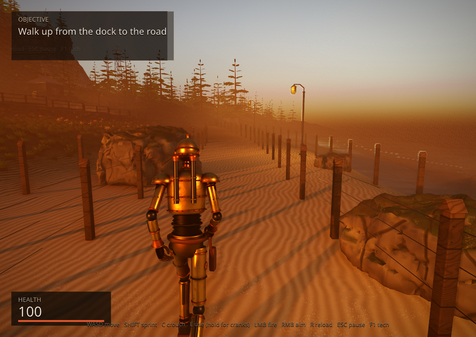

---

## The whole thing on one page

```
 CMakePresets.json ─► CMakeLists.txt ─► DemoLabGame   the game module (a shared library, loaded by name)
                                     ─► DemoLab       the engine's launcher, built under the game's name
                                     ─► NimbleEditor  the editor, which loads the same module to Play

 Config/DefaultEngine.ini   [Game] Module=DemoLabGame  StartLevel=MainMenu
                            [World_L1_Foothills] File=Content/Levels/L1_Foothills.nmworld   (one per level)
 Config/DefaultGame.ini     the game's own settings, input bindings, the loading card

 Content/Levels/L1_Foothills.nmworld     <Settings GameMode="LabStory"/> + a list of entity GUIDs
 Content/Levels/L1_Foothills/<guid>.nmentity   one entity each: its components and their values
          ▲
          └── written by Tools/Levels/make_levels.py (+ dress_*.py, Tools/Art): never edited by hand

 a level loads ─► the mode named by the world (NIMBLE_REGISTER_GAME_MODE "LabStory")
                  OnLoad: registers its systems and event handlers
 every frame   ─► mode OnTick ─► World::Tick: systems by phase, which iterate components (World::Each)
                                  and talk through events ("Lab.Signal") 
 the UI        ─► .nmui documents bound to keys the code sets each frame; buttons call native actions
```

---

## Part 1: the game loop

### 1.1 The project and its presets

Demo Lab was made by the editor's **File > New Project** from
`Engine/Templates/Game`, and grew from there. Everything the game owns lives
under `Games/DemoLab`:

| Path | What |
|---|---|
| `CMakeLists.txt`, `CMakePresets.json` | The build: the game module, the launcher, staging, the tests |
| `DemoLabGame.cpp` | The module itself |
| `Source/` | All the game's C++: `Core/` (the player, health, input), `Weapons/`, `AI/`, `World/` (level pieces), `Flow/` (travel, chapters), `UI/`, `GameModes/` |
| `Config/` | `DefaultEngine.ini` and `DefaultGame.ini` |
| `Content/` | Levels, UI documents, materials, meshes, sounds, cinematics, behavior trees |
| `Scripts/` | Lua run at level load (`Scripts/Main.lua`) |
| `Tools/` | The generators that write most of `Content/` (`Tools/Levels`, `Tools/Art`, `Tools/Cinematics`, `Tools/Audio`, `Tools/UI`) |
| `Binaries/<Platform>_<Config>[_Client]/` | Where everything runs from: the build stages `Config/`, `Scripts/` and `Content/` here |

`CMakePresets.json` gives one build tree per preset under `Build/`. All of
them use Ninja, and on Linux the game builds with Clang only:

| Preset | Builds |
|---|---|
| `editor-debug`, `editor-relwithdebinfo` | The game module, the `DemoLab` launcher and `NimbleEditor` (`NIMBLE_TARGET=Editor`) |
| `client-debug`, `client-relwithdebinfo`, `client-shipping` | The game module and the launcher only |

```
cd Games/DemoLab
cmake --preset editor-relwithdebinfo
cmake --build Build/editor-relwithdebinfo -j6
```

Build, test and measure on RelWithDebInfo. Use Debug only to debug a crash.
[Guide.md](Guide.md) section 1 has the run commands.

`CMakeLists.txt` adds the engine tree itself (`add_subdirectory` of
`../../Engine`), so nothing under `Engine/` names the game. Then it declares
three targets:

```cmake
# CMakeLists.txt
nimble_add_hot_module(${GAME_MODULE}            # DemoLabGame
        SOURCES      DemoLabGame.cpp
                    Source/LabVersion.h
                    Source/Core/LabTypes.h
                    ...
                    Source/World/LabInteractable.h
                    Source/World/LabInteractable.cpp
                    ...
        PRIVATE_DEPS NimbleEngine::NimbleEngine)
...
nimble_add_game_launcher(${GAME_NAME} MODULE ${GAME_MODULE})          # DemoLab
nimble_add_server_launcher(${GAME_NAME}Server MODULE ${GAME_MODULE})  # DemoLabServer
```

**Every new `.cpp` and `.h` goes in that `SOURCES` list.** The `game_stage(...)`
calls below it copy `Config/`, `Scripts/` and `Content/` beside the executable
at the same relative paths. That relative path is the asset's name at runtime,
for example `Content/UI/LabHUD.nmui`. Edit the files under `Games/DemoLab`,
never the copies in `Binaries/`: the next build overwrites them. The tests are
at the bottom of `CMakeLists.txt` (`DemoLab.AutoPlay`, `DemoLab.MenuTest`,
`DemoLab.SettingsPersist`, `DemoLab.C5Handover`).

### 1.2 The game module, and how it loads

The game is a **module**: a shared library that is loaded by name and never
linked. The launcher (`DemoLab`) and the editor's Play both read `[Game] Module`
from the config and load `DemoLabGame`. The module class does almost nothing:

```cpp
// DemoLabGame.cpp
class DemoLabGameModule : public NimbleEngine::IGameModule
{
public:
    const char* GetName() const override          { return "DemoLabGame"; }
    const char* GetVersionString() const override { return "0.1"; }

    bool OnStartup(const EngineCore::ModuleReloadState* /*InPrev*/) override { return true; }
    void OnShutdown(EngineCore::ModuleReloadState& /*OutState*/) override {}
};

NIMBLE_IMPLEMENT_GAME_MODULE(DemoLabGameModule, "DemoLabGame")
```

The real content registers itself **as the library loads**, through static
registration macros spread over `Source/`. Nothing lists them centrally:

| Macro | Registers | Demo Lab example |
|---|---|---|
| `NIMBLE_REGISTER_GAME_MODE` | a game mode, by name | `NIMBLE_REGISTER_GAME_MODE(LabStoryMode, "LabStory")` in `Source/GameModes/LabStoryMode.cpp` |
| `GAMECORE_DEFINE_COMPONENT` (+ serializer, properties, replication, RPCs) | a component type | `LabInteractableComponent` as `"LabInteractable"` in `Source/World/LabInteractable.cpp` |
| `GAMECORE_DEFINE_NATIVE_PREFAB` | an entity built in C++ | `native:DemoLab.Player` in `Source/Core/LabPlayer.cpp` |
| `NIMBLE_DEFINE_INPUT_MAP` | an input map | `DemoLabPlayer` in `Source/Core/LabInput.cpp` |
| `NIMBLE_GAME_CONFIG_BOOL` / `_FLOAT` / `_STRING` | a game config var | `[DemoLab] AutoPlay` in `LabStoryMode.cpp` |
| `UI_DEFINE_ACTIONS` | UI actions callable from documents | `Lab.*` in `Source/UI/LabUI.cpp` |
| `NIMBLE_CONSOLE_COMMAND` | a console command | `lab_signal`, `lab_damage`, `lab_give` in `LabGameModeBase.cpp` |
| `GAMECORE_DEFINE_SCRIPT_LIBRARY`, `GAMECORE_DEFINE_COMPONENT_SCRIPT` | what Lua and script graphs can call and see | the `Lab` library in `Source/World/LabScripting.cpp` (section 3.9) |

There is no `main()` to write: `nimble_add_game_launcher` builds the engine's
own launcher under the game's name.

### 1.3 Config: DefaultEngine.ini and DefaultGame.ini

`Config/DefaultEngine.ini` is the project's master configuration (the editor's
**Edit > Project Settings** edits it). The parts that make Demo Lab a game:

```ini
; Config/DefaultEngine.ini
[Game]
Module=DemoLabGame
StartLevel=MainMenu

[World_MainMenu]
File=Content/Levels/MainMenu.nmworld
StartupScript=Scripts/Main.lua
Cook=true

[World_L1_Foothills]
File=Content/Levels/L1_Foothills.nmworld
Cook=true
...
[Modules]
NetCore=true
JoltPhysics=true
Audio=true
AICore=true

[Plugins]
TimeOfDay=true
Weather=true

[Editor]
StartupWorld=Content/Levels/L1_Foothills.nmworld
```

- **Each `[World_<Name>]` section is a level.** The name after `World_` is how
  code and travel refer to it (`"L2_Laboratory"`), and `File` is its world
  file. Worlds are not declared in C++.
- **`[Modules]` and `[Plugins]` are read by CMake** when the project
  configures (`Engine/cmake/NimbleProject.cmake`), so a change there takes
  effect at the next build. Demo Lab turns on networking (NetCore: its
  components replicate even though the game is single-player), Jolt physics
  (Rigid Body, ragdolls), audio, AICore, and the TimeOfDay and Weather plugins.
- `[Display]`, `[Scalability]` and `[Scalability_High]` are engine settings:
  the window, the quality tier, and High's resolution scale with dynamic
  resolution (see [Guide.md](Guide.md) section 6).

`Config/DefaultGame.ini` is read after it, and a key in both takes this file's
value. It holds the **game's** settings: game-scope config vars, input
bindings (`[Input_<Map>]` sections) and, in Demo Lab, VSync and the level
transition's loading card:

```ini
; Config/DefaultGame.ini
[LevelTransition]
Enabled=true
FadeOut=0.4
FadeIn=0.6
RevealFrames=2
Title=Demo Lab
Tip=
Document=Content/UI/Loading.nmui
```

A key exists only if code declares it. Demo Lab's own keys are declared next to
the code that reads them:

```cpp
// Source/GameModes/LabStoryMode.cpp
/* The test hook: the game plays itself (GameModes/LabAutoPlay.h). */
NIMBLE_GAME_CONFIG_BOOL(GLabAutoPlay, "DemoLab", "AutoPlay", false, nullptr);
/* The story's difficulty: the share of enemy damage the player takes. */
NIMBLE_GAME_CONFIG_FLOAT(GLabStoryDamageScale, "DemoLab", "StoryDamageScale", 0.25f, nullptr);
```

Every config var can be set in an `.ini` (`[DemoLab] AutoPlay=true`), on the
command line (`-DemoLab.AutoPlay=1`) or in the console (`DemoLab.AutoPlay true`).
Code reads it with `GLabAutoPlay.GetBool()`. A player's changes, made through
the Settings page, go to their own `User.ini` (section 2.4).

### 1.4 Levels: .nmworld and .nmentity

A world on disk is a small manifest plus a folder with one file per entity.
The manifest names the **game mode** and lists the entities:

```xml
<!-- Content/Levels/L1_Foothills.nmworld -->
<World Format="1">
  <Settings GameMode="LabStory" />
  <Entity Guid="b44975614805e0bebc472f33f92bbb69" />
  <Entity Guid="c63f7be12b0cfbd480dc997353f27775" />
  ...
```

Each `.nmentity` holds one entity's components, by their registered names,
with their fields. This is the gatehouse crank in L1. `LabInteractable` is a
Demo Lab component; `Transform` is the engine's:

```xml
<!-- Content/Levels/L1_Foothills/557d8ceb1678f0787713998070ddbc00.nmentity -->
<Entity Guid="557d8ceb1678f0787713998070ddbc00" Name="Crank_Gatehouse">
  <Component Type="LabInteractable" Version="1">
    <Prompt Value="Turn the crank" />
    <Radius Value="170" />
    ...
    <Channel Value="L1.GateOpen" />
    ...
    <HoldSeconds Value="2.5" />
    <Sound Value="Content/Sounds/World/Valve_Squeak_01.nmsound" />
    <Highlight Value="Crank_Gatehouse_Kit" />
  </Component>
  <Component Type="Transform" Version="1">
      <Position X="3055" Y="810" Z="3100" />
      ...
```

The field names (`Prompt`, `HoldSeconds`) are the names the component's
**serializer** gives them (section 3.3). One file per entity keeps diffs and
merges small. A placed **prefab** is an `<Instance>` in the manifest with its
own `.nmprefabinst` file, which records only what that instance changed. L2's
scripted keycard reader and valve controller are two (section 3.9).

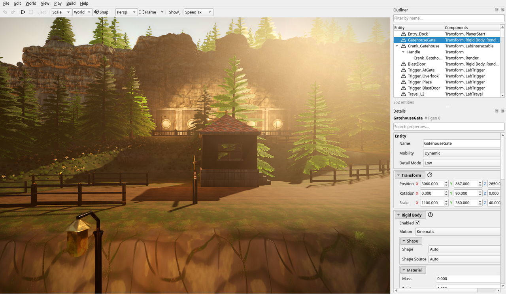

**Demo Lab's levels are generated. Do not edit them by hand.**
`Tools/Levels/make_levels.py` writes all four worlds and their entities, and
also writes the cinematics (through `Tools/Cinematics/make_cinematics.py`):

- `Tools/Levels/layout.py` holds the rooms, spawn points, interactable spots
  and AutoPlay routes.
- `make_levels.py` turns that layout into the grey box and wires the gameplay
  by signal name.
- Each level's art pass then dresses it in place: `dress_l1.py`,
  `dress_l2_laboratory.py` and `dress_l3.py`.
- They read the generated art kit from `Tools/Art`, through its manifest
  `Tools/Art/assets.json`.

The next run overwrites every `.nmworld`, `.nmentity` and `.nmseq` it wrote,
so an edit made in the editor or a text editor is lost. Change the generator
instead, then run `python3 Tools/Levels/make_levels.py` and rebuild
([Guide.md](Guide.md) section 3). The editor is still the place to *look* at a
level and to try a change before putting it into the generator.

A world can have more than one state. L2 Laboratory is one world used twice:
entities whose names start with `Calm_` exist only on the first visit, and
those starting with `Alarm_` only on the second.
`LabLogic::ApplyStateGroups` (`Source/World/LabLogic.h`) destroys the group
that is not active as the level loads.

### 1.5 Game modes

A **game mode** is the rules of a level. The world names its mode, and the
mode registers itself by that name:

```cpp
// Source/GameModes/LabMenuMode.cpp
NIMBLE_REGISTER_GAME_MODE(LabMenuMode, "LabMenu")
// Source/GameModes/LabStoryMode.cpp
NIMBLE_REGISTER_GAME_MODE(LabStoryMode, "LabStory")
```

Demo Lab has two modes and a base class that holds what they share:

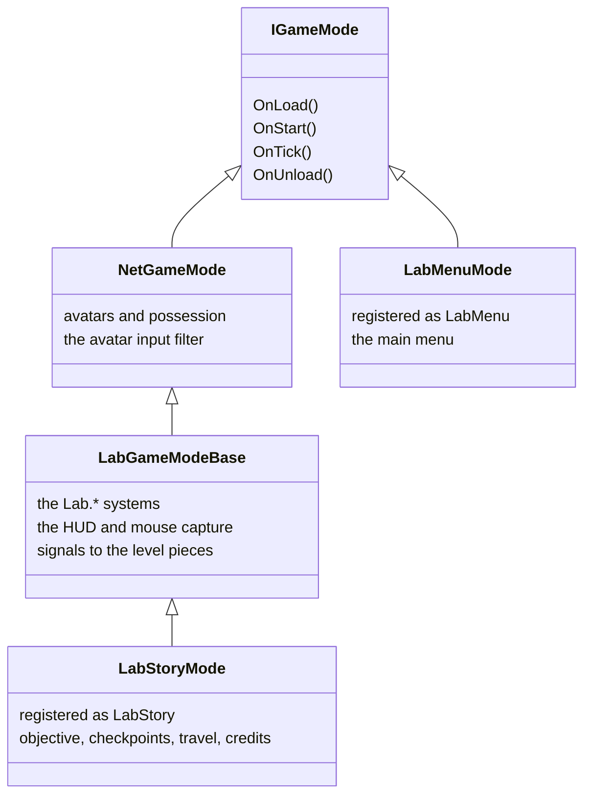

- **`LabMenuMode`** (`Source/GameModes/LabMenuMode.cpp`) runs
  `MainMenu.nmworld`. It is a plain `IGameMode` with no avatar: it opens
  `Content/UI/MainMenu.nmui` and frees the mouse.
- **`LabGameModeBase`** (`Source/GameModes/LabGameModeBase.h`) is a
  `NetGameMode`, the engine's mode for games with avatars (a player's
  character). It spawns each player's character from `native:DemoLab.Player`,
  registers the gameplay systems, opens the HUD, and passes every signal on to
  the level pieces.
- **`LabStoryMode`** (`Source/GameModes/LabStoryMode.cpp`) runs every story
  level. It keeps the objective and banner, applies the travel state (entry
  point, Calm or Alarm), travels when a level's end signal fires, saves and
  reloads checkpoints, and rolls the credits.

**The lifecycle.** The session loads the level's world, makes the mode and
calls its hooks in order: `OnLoad` (the world is loaded; register systems,
subscribe to events), the startup script, `OnStart`, then `OnTick` every
frame, and `OnUnload` at the end. The order and the save hooks around it are
drawn in [GameModeGuide.md, "The lifecycle"](../../../Engine/Docs/Guides/GameModeGuide.md#the-lifecycle).
This is Demo Lab's `OnLoad`, where the base registers everything that ticks:

```cpp
// Source/GameModes/LabGameModeBase.cpp
bool LabGameModeBase::OnLoad(GameSession& InSession)
{
    if(!Super::OnLoad(InSession)) { return false; }

    LabWeapons::ResetCache();
    LabSignals::Reset(InSession.GetWorld());
    LabFootsteps::Reset();

    AddSystem<&LabGameModeBase::TickCombatInput>("Lab.Combat", TP_PrePhysics);
    AddSystem<&LabGameModeBase::TickInteractInput>("Lab.Interact", TP_PrePhysics);
    AddSystem<&LabGameModeBase::TickCombatServer>("Lab.CombatServer", TP_PrePhysics);
    AddSystem<&LabGameModeBase::TickProjectiles>("Lab.Projectiles", TP_PrePhysics);
    AddSystem<&LabGameModeBase::TickWorld>("Lab.World", TP_PostPhysics);
    AddSystem<&LabGameModeBase::TickWeaponPresentation>("Lab.WeaponPresentation", TP_PostPhysics);
    AddSystem<&LabGameModeBase::TickWorldPresentation>("Lab.WorldPresentation", TP_PostPhysics);

    Subscribe<&LabGameModeBase::OnSignalEvent>(LabSignals::EVENT);
    Subscribe<&LabGameModeBase::OnEncounterStartEvent>("Encounter.Start");
    ...
    SetAvatarInputFilter<&LabGameModeBase::FilterInput>();
    ...
}
```

`AddSystem` and `Subscribe` take member functions and unregister themselves
when the mode unloads. `LabStoryMode::OnLoad` calls the base first, then adds
its own subscriptions (`"Objective.Set"`, `"Story.Banner"`,
`"Lab.Checkpoint"`, ...).

**State that a save keeps.** A checkpoint saves the World, which covers every
component on every entity. Whatever lives outside the World goes in a
`GameState`. Demo Lab uses `LabStoryState` for the objective, the latched
signals, the checkpoint pose and the travel state. `Serialize` writes and
reads the same fields; a new field goes at the end, behind a version check:

```cpp
// Source/GameModes/LabStoryMode.cpp
class LabStoryState : public GameState
{
public:
    ...
    /* A new field goes at the end, behind Ar.GetChunkVersion() >= 2, with this bumped. */
    uint16_t GetSerialVersion() const override { return 1; }

    void Serialize(EngineCore::Archive& Ar) override
    {
        Ar << Objective;
        ...
        Ar << Travel;
    }
```

The mode fills it in `OnPreSaveGame` and reads it back in `OnPostLoadSave`.
It saves with `SaveGameToFile(GetSession(), LabFlow::CHECKPOINT_PATH)` from
`OnTick`, between frames, never from inside a system.

**The AutoPlay mode.** `DemoLab.AutoPlay` is not a separate registered mode.
It is a test driver (`LabAutoPlay`, `Source/GameModes/LabAutoPlay.h`) that the
menu and story modes call when `[DemoLab] AutoPlay` is on. It plays the whole
game through the same input path a player uses: the story mode's
`FilterPlayerInput` hands the character's input over to it.

```cpp
// Source/GameModes/LabStoryMode.cpp
void FilterPlayerInput(World& InWorld, const EntityID InAvatar, InputSnapshot& InOutInput) override
{
    if(InAvatar != GetLocalAvatar(InWorld, 0)) { return; }
    if(GLabAutoPlay.GetBool())
    {
        GetLabAutoPlay().Drive(InWorld, InAvatar, InOutInput, GetFrameSeconds(), IsSequencePlaying());
        return;
    }
    ...
```

Because the test presses the buttons a player would, it exercises travel,
interaction, holds, cinematics, fights and checkpoints exactly as a player
does. `ctest -R DemoLab.AutoPlay` runs it headless ([Guide.md](Guide.md)
section 5), and the screenshots on this page come from the same driver running
in the editor.

### 1.6 One frame

Each frame, the session calls the mode's `OnTick`, then `World::Tick`. The
World runs its systems phase by phase. Within a phase, systems run in the
order they were registered:

```
 GameSession frame
 ├─ LabStoryMode::OnTick          banner timers, checkpoint save/reload, regen, travel, F1, then
 │   └─ LabGameModeBase::OnTick   signals flushed, bot stimuli and tactics, footsteps, HUD update
 └─ World::Tick
     ├─ TP_PrePhysics    Lab.Combat  Lab.Interact  Lab.CombatServer  Lab.Projectiles     (+ the Character Mover)
     ├─ TP_Physics       Jolt steps; the spatial index refits
     ├─ TP_PostPhysics   Lab.World (triggers, encounters, timers)
     │                   Lab.WeaponPresentation (weapons in hand, anim params, ragdolls)
     │                   Lab.WorldPresentation (gates slide, levers swing, objectives glow, spinners)
     └─ TP_PostUpdate    last word before the render commands are built
```

The phases are defined in
`Engine/Modules/GameCore/Source/Public/GameCore/TickPhase.h`. The rule of
thumb:

- **PrePhysics:** respond to input, make decisions, spawn.
- **PostPhysics:** react to where things ended up (triggers, presentation).

The comment block at the top of `LabGameModeBase.h` lists each system with its
phase, and says whether it runs on the **authority** (the process that owns
the game's state) or on **every process**. Demo Lab is single-player, so
there is one process and it is the authority. Its code is still written the
networked way: gameplay changes happen where `HasAuthority()` is true, and
presentation follows replicated fields. That keeps the code honest, and the
same components would work in a networked game.

Gameplay pieces do not call each other; they communicate through **events**.
`LabSignals::Emit` broadcasts the World event `"Lab.Signal"`. The mode's
`OnSignalEvent` handler latches its value and passes it to each listener in
turn:

```cpp
// Source/GameModes/LabGameModeBase.cpp
    LabSignals::Latch(W, Name.c_str(), bValue);
    ...
    LabSignals::BeginHandling(W);
    LabWorld::OnSignal(W, Name.c_str(), bValue);       // gates
    LabEncounters::OnSignal(W, Name.c_str(), bValue);  // fights
    LabLogic::OnSignal(W, Name.c_str(), bValue);       // timers, AllOf
    OnSignal(Name.c_str(), bValue);                    // the derived mode: travel, objectives, credits
    LabSignals::EndHandling(W);
```

A signal emitted while another is being handled waits in a queue, and
`LabSignals::Flush` sends it afterwards. That stops listeners re-entering the
event broadcast.

### 1.7 Input

An **input map** names the game's actions and axes and binds them to devices:

```cpp
// Source/Core/LabInput.cpp
NIMBLE_DEFINE_INPUT_MAP(DemoLabPlayer) {
    Map.Axis("MoveForward", "W, -S, -Gamepad.LeftY");
    Map.Axis("MoveRight", "D, -A, Gamepad.LeftX");
    Map.Axis("LookX", "Mouse.DeltaX*0.15, Gamepad.RightX*2.5");
    ...
    Map.Action("Interact", "E, Gamepad.North");
    ...
    Map.Action("Pause", "Escape, Gamepad.Start");
    Map.Action("TechOverlay", "F1, Gamepad.Back");
}
```

A `[Input_DemoLabPlayer]` section in `Config/DefaultGame.ini` can override any
of these bindings; **Project Settings > Input** writes it. The map is attached
to the character through its **AvatarHarness** component, which the player
prefab sets up (section 3.7):

```cpp
// Source/Core/LabPlayer.cpp, BuildLabPlayer
    AvatarHarnessComponent Harness;
    std::snprintf(Harness.InputMap, sizeof(Harness.InputMap), "%s", "DemoLabPlayer");
    std::snprintf(Harness.Simulation, sizeof(Harness.Simulation), "%s", "LabMove");
    Root.Add(Harness);
```

Every frame the engine samples the devices into an `InputSnapshot` for each
possessed character. The snapshot passes through the mode's avatar input
filter, and the movement simulation (`LabMove`, built on the Character Mover)
then consumes it. There are two ways to take input:

- **Change it in the filter.** `LabGameModeBase::FilterInput` hands bots'
  input to `LabBots::Drive`. `LabStoryMode::FilterPlayerInput` applies the
  look-sensitivity and invert-Y settings, or lets AutoPlay drive.
- **Read actions in a system.** Gameplay systems ask the harness directly:

```cpp
// Source/World/LabInteractable.cpp, LabWorld::TickInteractInput
    InWorld.Each<AvatarHarnessComponent>([&](Entity InEntity, AvatarHarnessComponent& InHarness)
    {
        if(bInHeld || !InHarness.bEnabled || !InHarness.IsLocallyControlled()) { return; }
        if(InHarness.WasPressed("Interact")) { Pressed.push_back(InEntity.GetID()); }
        if(InHarness.IsDown("Interact")) { Holding.push_back(InEntity.GetID()); }
    });
```

`WasPressed` is true for one frame; `IsDown` stays true while the input is
held, which is what the crank's 2.5 s hold needs. The UI's own input is in
section 2.5. `Engine/Source/INPUT.md` is the reference.

### 1.8 Level transitions

A level ends when a `LabTravel` entity's signal fires. The generator places
one in each level:

```xml
<!-- an .nmentity in Content/Levels/L1_Foothills/ -->
<Entity Guid="89fcb32611e8b7d617e6f1db649a965a" Name="Travel_L2">
  <Component Type="LabTravel" Version="1">
    <OnSignal Value="L1.Done" />
    <World Value="L2_Laboratory" />
    <Entry Value="Entry_Airlock" />
    <Flags Value="" />
    <Title Value="The Laboratory" />
  </Component>
```

The chain from the signal to the new level:

```mermaid
sequenceDiagram
    participant C2 as C2 cinematic (Event key)
    participant Story as LabStoryMode
    participant Travel as LabTravel::Travel
    participant Session as GameSession
    C2->>Story: Lab.Signal "L1.Done"
    Story->>Story: OnSignal: a LabTravelComponent listens for it; PendingTravel = it
    Story->>Story: TickTravel: waits until no cinematic plays
    Story->>Travel: Travel(session, "L2_Laboratory", "Entry_Airlock", flags, "The Laboratory")
    Travel->>Session: OpenLevel(world, LevelTravel{Entry, values, Title, Tip})
    Session->>Session: fade out, loading card (Content/UI/Loading.nmui), swap, fade in
    Session->>Story: the new level's LabStoryMode::OnLoad: LabTravel::Arrive reads the travel state
```

`LabTravel::Travel` (`Source/Flow/LabTravel.cpp`) is the one function every
level change goes through: New Game, Chapter Select, the end of each level,
and the way back to the menu. It wraps the engine's level travel:

```cpp
// Source/Flow/LabTravel.cpp
    LevelTravel Travel;
    Travel.Entry = GState.Entry;
    Travel.SetFromText(GState.Flags.c_str());
    Travel.Title = GState.LoadingTitle;
    Travel.Tip   = TipFor(GState.World);
    Travel.Transition = GState.LoadingTitle.empty() ? TT_Default : TT_Fade;
    InSession.SetPaused(false);
    return InSession.OpenLevel(InWorld, Travel);
```

- **`Entry`** names a Player Start in the new world. The engine stands the
  avatar there.
- **Flags** such as `"Alarm=1,Armed=1"` ride along as the travel's values. In
  the arriving mode, `LabTravel::Arrive` reads them back and
  `LabTravel::GetFlag("Alarm")` selects L2's state.
- The engine does not save its travel state, so the story's checkpoint keeps a
  copy (`LabTravel::Save`, `LabTravel::Restore`).
- **`LabFlow`** (`Source/Flow/LabFlow.h`) holds the four chapters that Chapter
  Select starts, plus New Game, Continue (load the checkpoint) and
  `ToMainMenu`. Each one ends in `LabTravel::Travel` or a checkpoint load.

![The loading card between L1 and L2: the title and tip come from LabTravel::Travel, the document from [LevelTransition]](Images/Tutorial/game_loading.png)

The whole flow, played by AutoPlay in the editor. Each level is a different
world with the same mode (`LabStory`), and L2 is visited twice:

| | |
|---|---|
|  | 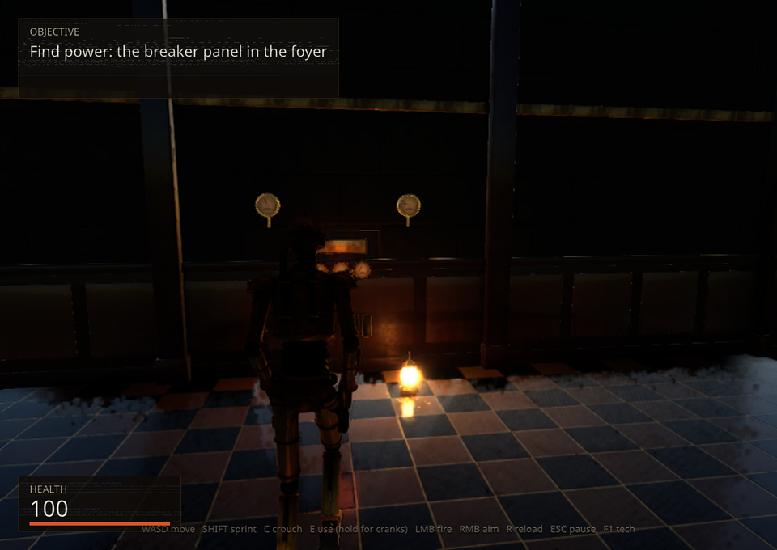 |
| L1 Foothills (`L1_Foothills`) | L2 Laboratory, Calm |
| 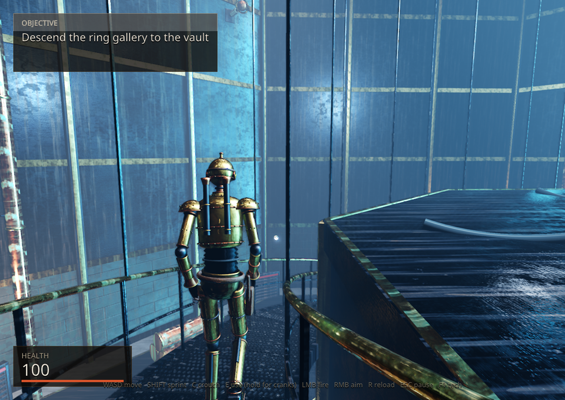 | 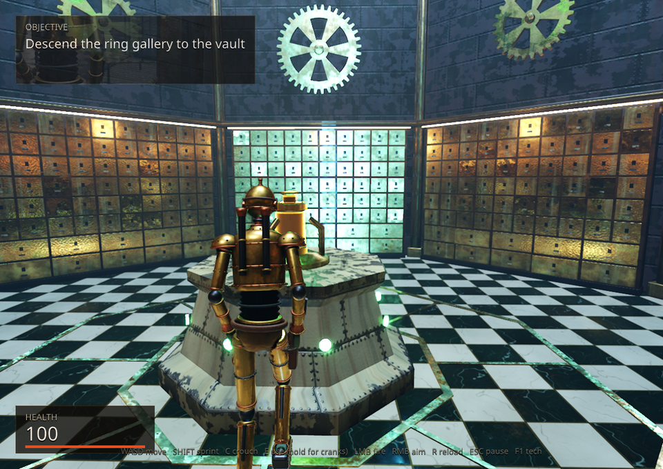 |
| L3 Core: the ring gallery | L3 Core: the vault, before C5 trips the alarm |
| 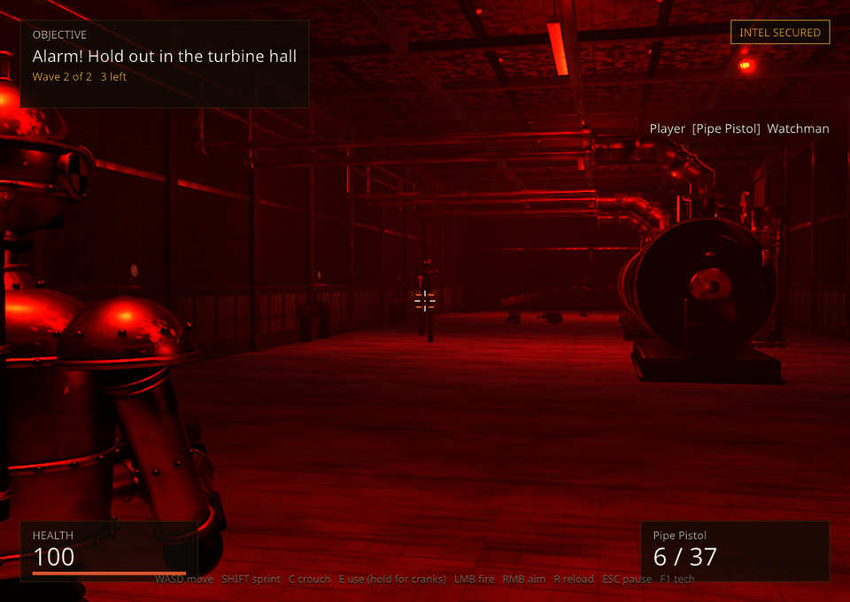 | 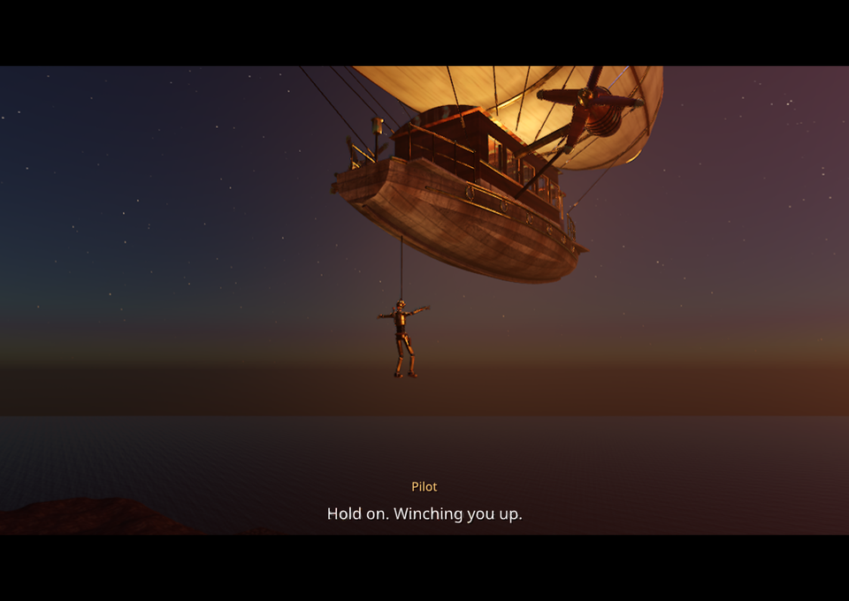 |
| L2 Laboratory, Alarm (`Alarm=1`): the `Alarm_*` group is in, the `Calm_*` group is gone | C6, the extraction: `Game.Complete` rolls the credits, then `LabFlow::ToMainMenu` |

---

## Part 2: the UI

### 2.1 Documents

Every screen is a **UI document**, an `.nmui` XML file in `Content/UI/`, edited
in the editor's **UI Designer** (double-click it in the Content Browser):

| Document | Opened by | `InputMode` |
|---|---|---|
| `LabHUD.nmui` | `LabHUD::Open`, from `LabGameModeBase::OnStart` | `GameOnly` |
| `MainMenu.nmui` | `LabMenuMode::OnStart` | `UIOnly` |
| `ChapterSelect.nmui`, `Settings.nmui`, `Credits.nmui` | the menu's buttons (`Native:UI.Open('...')`) | `UIOnly` |
| `PauseMenu.nmui` | `LabUI::OpenPauseMenu`, on Escape | `UIOnly` |
| `TechOverlay.nmui` | `LabUI::ToggleTechOverlay`, on F1 | `GameOnly` |
| `Loading.nmui` | the engine's level transition (`[LevelTransition] Document`) | `GameOnly` |

`InputMode` decides who gets the keyboard and pad while a document is open.
`GameOnly` documents (the HUD, the overlay) only display things, and input
still goes to the game. `UIOnly` documents (menus) take focus: arrows, Enter
and the pad move between buttons, starting from the one marked
`InitialFocus="true"`. `Layer` orders documents that are open together; the
loading card's 960 sits over everything.

`Source/UI/LabUI.h` names the documents once, as constants
(`LabUI::MAIN_MENU`, `LabUI::SETTINGS`, ...), and the HUD's is
`LabHUD::DOCUMENT`.

| | |
|---|---|
| 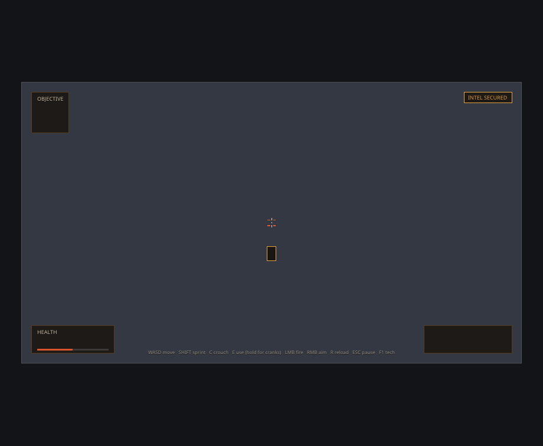 | 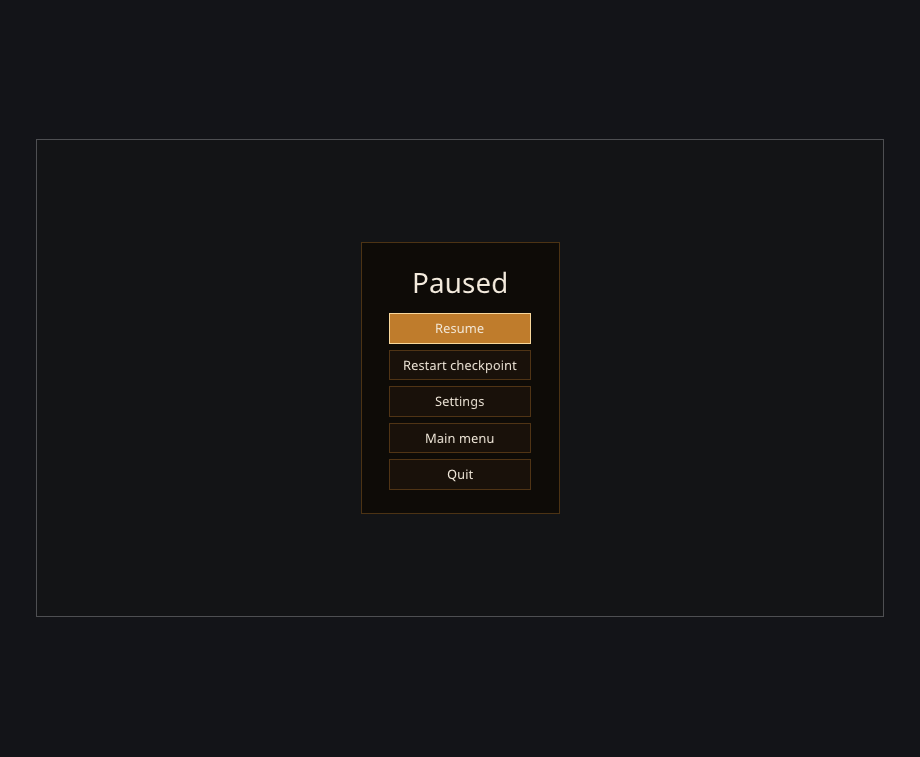 |
| `LabHUD.nmui`: the panels are empty at design time; the game fills them | `PauseMenu.nmui` |
| 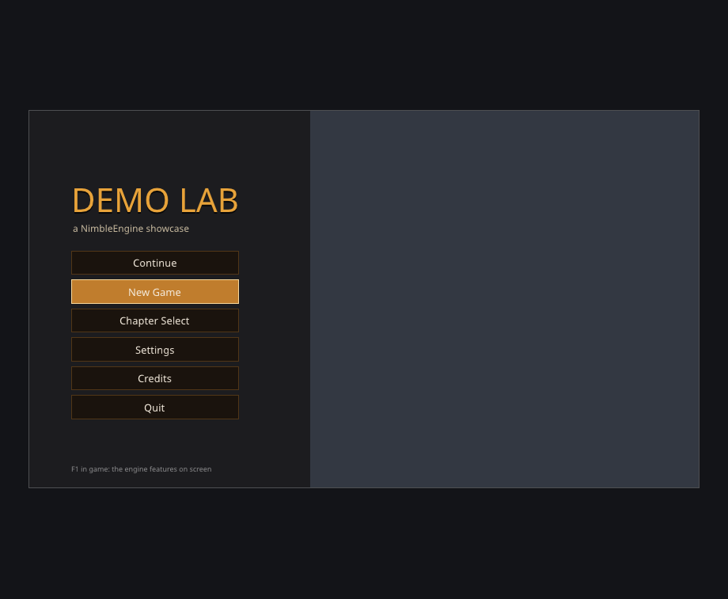 | 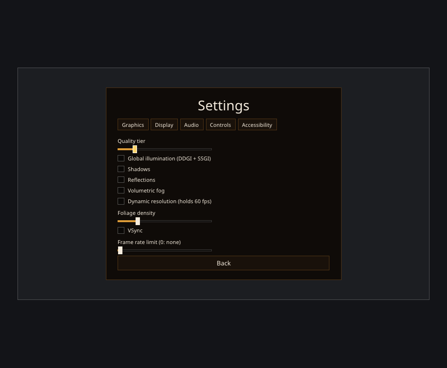 |
| `MainMenu.nmui` | `Settings.nmui`: the boxes are unticked at design time; `Lab.RefreshSettings` ticks them as it opens |

### 2.2 Getting data in: the data store and `{Bind:...}`

Documents do not read the game. The game writes **values** into the UI
system's data store under string keys, and widgets **bind** to those keys.
This is the HUD's objective panel:

```xml
<!-- Content/UI/LabHUD.nmui -->
<Text Name="ObjectiveText" Class="Value" FontSize="30" Text="{Bind:Story.Objective}"/>
<Text Name="Encounter" Class="Label" Color="#E8A33AFF" Text="{Bind:Story.Encounter}"/>
<Text Name="Timer" Class="Label" Color="#7FC8FFFF" Text="{Bind:Story.Timer}"/>
...
<ProgressBar Name="HealthBar" ... Value="{Bind:Lab.HealthFill}" .../>
```

`LabHUD::Update` (`Source/UI/LabHUD.cpp`) runs once a frame from
`LabGameModeBase::OnTick` and fills every key. The full list of keys is in the
comment at the top of `Source/UI/LabHUD.h`. Each value is read from where it
lives:

| HUD shows | Key | Comes from |
|---|---|---|
| Objective | `Story.Objective` | `LabHUD::Story::Objective`, which the story mode sets when a `LabObjective` entity's signal fires (`ShowObjectivesFor`) or on an `"Objective.Set"` event |
| Prompt, hold bar | `Lab.Prompt`, `Lab.HoldFill` | `LabWorld::PromptFor` and `LabWorld::HoldFraction`: the nearest usable `LabInteractable` |
| Timer | `Story.Timer` | `LabLogic::TimerLine`: a running `LabTimer` |
| Wave | `Story.Encounter` | `LabEncounters::GetActive`, `GetWave` |
| Health | `Lab.Health`, `Lab.HealthFill` | the local character's `LabHealthComponent` |
| Weapon, ammo | `Lab.Weapon`, `Lab.Ammo` | its `LabInventoryComponent` and the weapon registry |

```cpp
// Source/UI/LabHUD.cpp
    const LabHealthComponent* Health = Self.GetComponent<LabHealthComponent>();
    const float Hp = Health ? Health->Health : 0.f;
    const float Max = Health && Health->MaxHealth > 0.f ? Health->MaxHealth : 100.f;
    SetText(UI, "Lab.Health", std::to_string(int(std::ceil(Hp))));
    SetNumber(UI, "Lab.HealthFill", double(Hp / Max));
    ...
    const std::string Prompt = LabWorld::PromptFor(W, Avatar);
    SetText(UI, "Lab.Prompt", Prompt.empty() ? Prompt : "[E]  " + Prompt);
    SetNumber(UI, "Lab.PromptVis", Prompt.empty() ? VIS_HIDDEN : VIS_SHOWN);
```

Two details:

- **Visibility is bound as a number:** the index of the `EUIVisibility` value
  (`VIS_SHOWN = 3.0`, HitTestInvisible; `VIS_HIDDEN = 1.0`, Hidden). The whole
  HUD binds `Visibility="{Bind:Lab.HudVis}"`, which is how it hides during a
  cutscene (`HudStory.bCinematic`).

  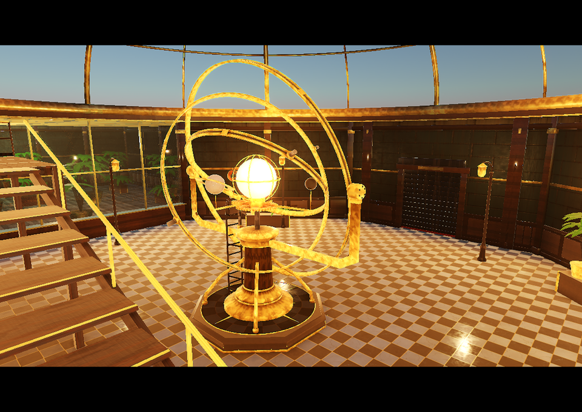

- **The mode owns the story text, the HUD owns the formatting.** A mode fills
  `LabHUD::Story` (objective, banner, kill feed, intel marker), and
  `LabHUD::Update` reads everything else straight from components.

| | |
|---|---|
| 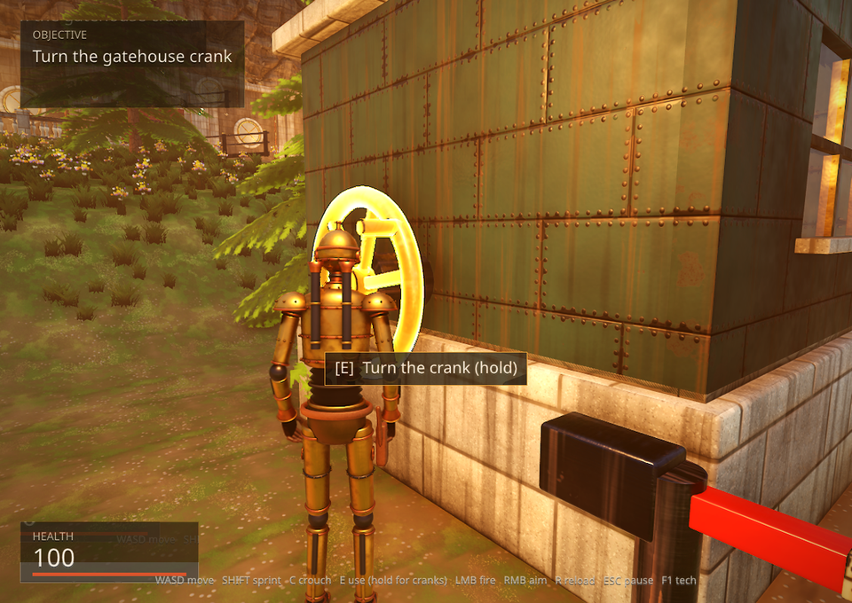 |  |
| L1: the prompt and the hold bar come from `LabWorld::PromptFor` and `HoldFraction`. The glow on the crank is the objective highlight (section 3.7) | L2: a new objective as the level starts (`LabObjective` with an empty `OnSignal`) |
| 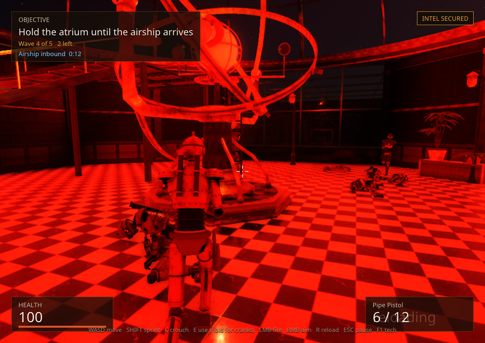 |  |
| L2 on alarm: `Story.Encounter` ("Wave 4 of 5  2 left"), `Story.Timer` ("Airship inbound 0:12", a running `LabTimer`), `Lab.Weapon` and `Lab.Ammo`, and `Story.IntelVis` (top right) | `Feed.Line0..3`, the kill feed (top right), filled from `LabGameModeBase::PushFeed` |

### 2.3 Getting actions out: native actions

Buttons call **actions** by name. `Native:` actions are C++ functions that
the game registers in groups:

```xml
<!-- Content/UI/MainMenu.nmui -->
<Button Name="Continue" Class="MenuButton" OnClick="Native:Lab.Continue" Visibility="{Bind:Menu.ContinueVis}">
<Button Name="NewGame" Class="MenuButton" OnClick="Native:Lab.NewGame" InitialFocus="true">
<Button Name="ChapterSelect" Class="MenuButton" OnClick="Native:UI.Open('Content/UI/ChapterSelect.nmui')">
...
<Button Name="Quit" Class="MenuButton" OnClick="Native:Game.Quit">
```

```cpp
// Source/UI/LabUI.cpp
UI_DEFINE_ACTIONS(Lab)
{
    ...
    Actions.Add("NewGame", [](const UI::UIActionContext& InContext)
    {
        if(GameSession* Session = SessionOf(InContext)) { Click(*Session, SND_CONFIRM); LabFlow::NewGame(*Session); }
    }, "Starts the story at Level 1");

    Actions.Add("Chapter", [](const UI::UIActionContext& InContext)
    {
        ...
            LabFlow::StartChapter(*Session, int(NumberArg(InContext, 0, 0.0)));
    }, "Starts a chapter (0..3) of the flow table");
    ...
}
```

`UI_DEFINE_ACTIONS(Lab)` makes the group `Lab`, so `"NewGame"` is called as
`Native:Lab.NewGame`. Arguments arrive in `InContext.Args`; for example,
Chapter Select's rows pass their index. `InContext.HostData` is the
`GameSession` (`SessionOf`). The engine provides `UI.Open`, `UI.Close` and
`Game.Quit`. A document can also call Lua: the credits run
`OnOpen="Lua:LabCredits.Show"` from `Content/UI/Credits.lua`.

| | |
|---|---|
| 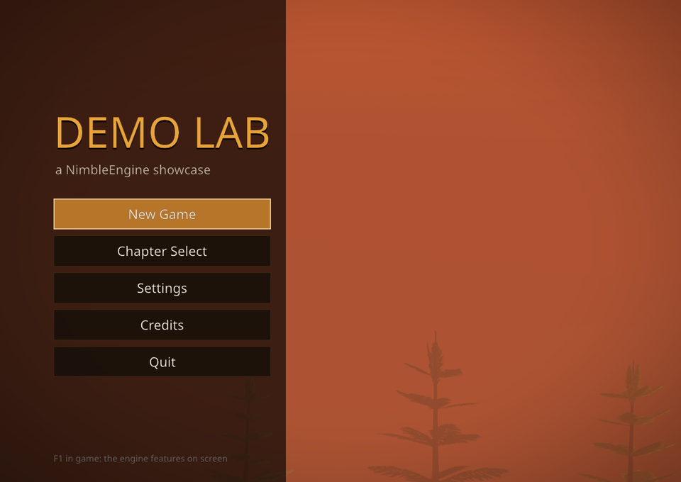 | 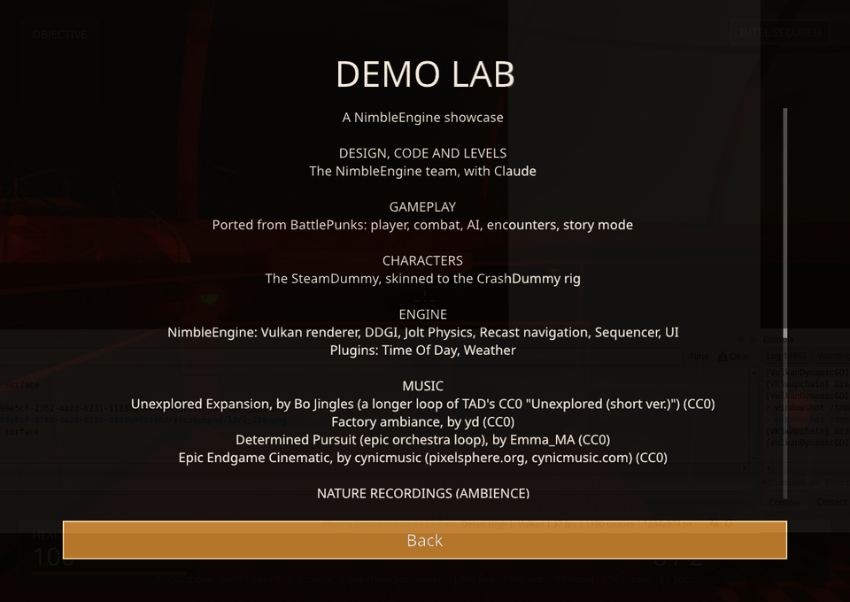 |
| `MainMenu.nmui` in play, over `MainMenu.nmworld`'s Sequencer dolly (`LabMenuMode`) | `Credits.nmui`, opened by `LabStoryMode::StartCredits`; its text is `Content/UI/Credits.lua`, written by `Tools/UI/make_credits.py` from `Docs/Credits.md` |

The flow back the other way also uses keys. `LabMenuMode::OnStart` sets
`Menu.CanContinue` and `Menu.ContinueVis` from `LabFlow::HasCheckpoint()`
before it opens the menu, so Continue only shows when there is something to
continue.

### 2.4 Settings

The Settings page edits **config vars** directly, through one action:

```xml
<!-- Content/UI/Settings.nmui -->
<UI ... InputMode="UIOnly" Layer="12" OnOpen="Native:Lab.RefreshSettings" OnClose="Native:Lab.SaveSettings" OnBack="Native:UI.Close">
...
<CheckBox Name="Shadows" Class="Setting" Checked="{Bind:Set.Shadows.Enabled}" OnChanged="Native:Lab.SetVar('Shadows.Enabled', $value)">
```

The page runs a loop of three actions:

1. **`Lab.RefreshSettings`**, when the page opens, copies each var in
   `SETTING_VARS` (`Source/UI/LabUI.cpp`) into a `Set.<path>` key that the
   controls bind to.
2. **`Lab.SetVar('A.B|C.D', $value)`** sets every var named to the control's
   new value, as a bool, int or float according to how the var was declared.
   `'Rendering.DynamicGI|Rendering.ScreenSpaceGI'` sets two vars together.
3. **`Lab.SaveSettings`**, when the page closes, calls
   `EngineCore::ConfigSaveUserFile`, which writes the player's `User.ini`.

The game reads its own settings through small accessors, for example
`LabUI::LookScale()` and `LabUI::FoliageDensity()`. Most engine settings
apply live. [SettingsUIGuide.md](../../../Engine/Docs/Guides/UI/SettingsUIGuide.md)
builds the same pattern from scratch.

### 2.5 How input reaches the UI

- **Menus own input while they are open.** A `UIOnly` document takes the
  keyboard and pad; the mode frees the mouse (`Session.SetMouseCaptured(false)`
  in `LabMenuMode::OnStart`, and in `LabUI::OpenPauseMenu`). `OnBack` names
  what Escape or the pad's Back does: the pause menu's is `Native:Lab.Resume`.
- **The game opens UI in response to its own input actions.** Escape is the
  `Pause` action of the player's input map, not a UI key.
  `LabGameModeBase::UpdateMouseCapture` sees `Harness->WasPressed("Pause")` and
  calls `OnPausePressed`. In the story mode, that opens the pause menu:

```cpp
// Source/UI/LabUI.cpp
void LabUI::OpenPauseMenu(GameSession& InSession)
{
    if(InSession.GetUI().IsOpen(PAUSE_MENU)) { return; }
    InSession.GetUI().SetValue("Pause.CanRestart", UI::UIValue::Bool(LabFlow::HasCheckpoint()));
    InSession.GetUI().Open(PAUSE_MENU);
    InSession.SetPaused(true);
    InSession.SetMouseCaptured(false);
}
```

  F1 works the same way: the `TechOverlay` action, read in
  `LabStoryMode::UpdateLocalInput`, calls `LabUI::ToggleTechOverlay`. While
  the overlay is open, `LabUI::UpdateTechOverlay` fills `Tech.Stats`,
  `Tech.Level` and `Tech.Features`.
- **`GameOnly` documents never take input.** The HUD's root says
  `InputMode="GameOnly"` and its panels are `HitTestInvisible`, so a click
  goes through to the game, where a press of Fire or Aim recaptures the mouse.
- **Tests drive documents as a player would.** `DemoLab.MenuTest`
  (`Source/GameModes/LabMenuTest.h`) clicks named buttons and moves sliders in
  the open `.nmui`, so each control's own action runs.

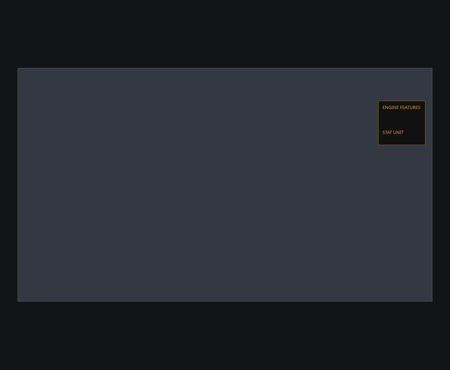

---

## Part 3: Components

Entities are IDs. A **component** is a plain struct attached to an entity,
and a **system** is a function that runs every frame and visits every
component of one type. Demo Lab's level pieces are good small examples,
declared in `Source/World/LabInteractable.h`:

| Component | Name in files | Does |
|---|---|---|
| `LabInteractableComponent` | `LabInteractable` | press (or hold) Interact nearby: emit a signal, play a cinematic, give a weapon or ammo |
| `LabGateComponent` | `LabGate` | slide open while a signal is on (or shut, with `Invert`: a shutter) |
| `LabTriggerComponent` | `LabTrigger` | a box the player walks into: a signal, a cinematic, a checkpoint |
| `LabObjectiveComponent` | `LabObjective` | set the HUD objective when a signal fires |

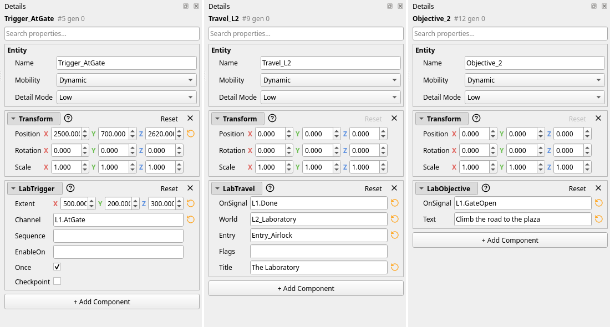

### 3.1 Declaring a component

```cpp
// Source/World/LabInteractable.h
struct LabObjectiveComponent {
    GAMECORE_COMPONENT_BODY()
    char    OnSignal[32] = "";       // "" : from the level's start
    char    Text[96] = "";
    uint8_t bShown = 0;
};
```

The rules (`Engine/Modules/GameCore/Source/Public/GameCore/ComponentType.h`
enforces them with `static_assert`):

- **`GAMECORE_COMPONENT_BODY()` comes first.** It declares the `Owner` header
  (the World and EntityID the component belongs to) and `StaticType()`.
- **Trivially copyable.** Component pools move components with `memcpy`, so
  use no `std::string`, `std::vector` or virtual functions. Use fixed `char`
  arrays for text, as above, `uint8_t` for flags, and `GameCore::EntityID` and
  `EngineCore::Vector3` for references and positions.
- **Every field has a default.** That is what a freshly added component, and a
  field missing from an older file, gets.

A component may hold three kinds of field: **authored** fields set in the
level (`Prompt`, `HoldSeconds`), **replicated** state (`bUsed`, `bOn`), and
**this run** working values (`HoldProgress`, `HighlightShell`). In
`LabInteractableComponent` each group is marked with a comment. Only the
first two are serialized.

### 3.2 Registering it

One line, in exactly one `.cpp`:

```cpp
// Source/World/LabInteractable.cpp
GAMECORE_DEFINE_COMPONENT(LabInteractableComponent, "LabInteractable")
```

The string is the component's name everywhere outside C++: in `.nmentity`
files (`<Component Type="LabInteractable">`), in the editor's **Add
Component** list, and in Lua. Registration happens when the module loads.
Demo Lab's names are not uniform: `LabHealthComponent` is registered as
`"LabHealthComponent"`, and `LabInteractableComponent` as `"LabInteractable"`.
Pick a name once and keep it, because changing it orphans every saved level
that uses it.

### 3.3 The serializer: levels and saves

The serializer names the fields that are written to `.nmentity` files,
prefabs and save games:

```cpp
// Source/World/LabInteractable.cpp
GAMECORE_DEFINE_COMPONENT_SERIALIZER(LabInteractableComponent, LabVersion::GetCurrentVersion()) {
    Ar.Field("Prompt", C.Prompt);
    Ar.Field("Radius", C.Radius);
    ...
    Ar.Flag("Toggle", C.bToggle);
    ...
    Ar.Field("Highlight", C.Highlight);
    Ar.Flag("Used", C.bUsed);
    Ar.Flag("On", C.bOn);
}
```

- **`Ar.Field`** handles numbers, `char` arrays and vectors. **`Ar.Flag`** is
  a `uint8_t` written as `true` or `false`. **`Ar.Entity`** is an `EntityID`,
  remapped when a prefab or save is loaded (`LabHealthComponent`'s
  `LastInstigator`).
- `C` is the component and `Ar` the archive. **Never serialize `C.Owner`.**
- A field can be read and thrown away to stay compatible with old files:
  `LabHealthComponent` still reads a `DownedCoolOff` it no longer keeps.
- **To add a field to a shipped component,** bump the version and read the new
  field behind a check: `if(Ar.GetVersion() >= 2) { Ar.Field("NewField", C.NewField); }`
  (the comment above the macro in `ComponentSerializer.h`). Demo Lab versions
  all its components together through `Source/LabVersion.h`.
  `LabCombatComponent` keeps its own (`LAB_COMBAT_VER`).
- **Runtime state that a checkpoint must keep is serialized too.**
  `LabTrigger` writes `Fired` ("a checkpoint load must not fire it again"), and
  `LabInteractable` writes `Used`. The checkpoint is a save of the World, so
  any field missing from the serializer is reset when a checkpoint loads.

### 3.4 Editor properties

What the **Details** panel shows is declared separately, and only in editor
builds:

```cpp
// Source/World/LabInteractable.cpp
#if WITH_EDITOR
GAMECORE_DEFINE_COMPONENT_PROPERTIES(LabInteractableComponent) {
    Props.TypeCategory("DemoLab");
    Props.Field("Prompt", &LabInteractableComponent::Prompt);
    Props.Field("Radius", &LabInteractableComponent::Radius);
    Props.Category("Use");
    Props.Field("WeaponID", &LabInteractableComponent::WeaponID);
    ...
    Props.Field("Sound", &LabInteractableComponent::Sound, PF_AssetSound);
    Props.Field("Highlight", &LabInteractableComponent::Highlight);
    Props.Category("State");
    Props.Flag("Used", &LabInteractableComponent::bUsed);
    Props.Flag("On", &LabInteractableComponent::bOn);
}
#endif
```

- `TypeCategory` files the component under **Add Component > DemoLab**.
- `Category` starts a collapsible group (Use, State).
- Flags change the editor widget: `PF_AssetSound` gives the Sound field an
  asset picker with a play button; `PF_ReadOnly` shows a value without
  allowing edits (`LabHealthComponent`'s Dead and Down).
- A field left out here still serializes but cannot be edited. That suits
  this-run fields such as `HoldProgress`.

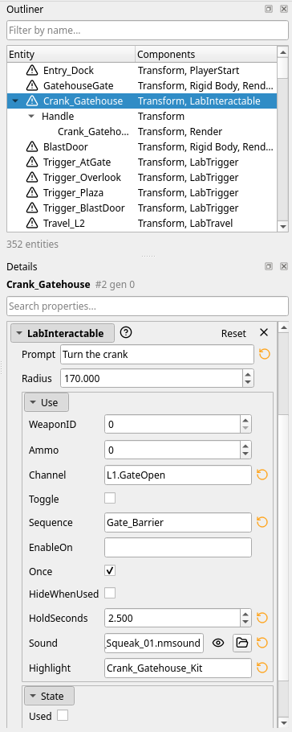

### 3.5 Replication and RPCs

Gameplay state changes on the authority. Other processes see it through
**replicated** fields, declared only when NetCore is built in:

```cpp
// Source/Core/LabHealth.cpp
#if WITH_NETCORE
GAMECORE_DEFINE_COMPONENT_REPLICATION(LabHealthComponent) {
    Rep.Field("MaxHealth", &LabHealthComponent::MaxHealth);
    Rep.Field("Health", &LabHealthComponent::Health).Precision(0.1f);
    Rep.Flag("bDead", &LabHealthComponent::bDead);
    Rep.Flag("bDown", &LabHealthComponent::bDown);
    Rep.Entity("LastInstigator", &LabHealthComponent::LastInstigator);
    Rep.Field("ReviveProgress", &LabHealthComponent::ReviveProgress).Precision(0.01f);
}
#endif

GAMECORE_DEFINE_COMPONENT_RPCS(LabHealthComponent) {
    Rpc.Multicast<&LabHealthComponent::MulticastKilled>("MulticastKilled");   // reliable: the ragdoll
}
```

`.Precision` sets how finely a float is sent. **RPCs** are member functions
that take a `RpcContext` first. They are called through `GAMECORE_RPC`, and
the declaration chooses where they run:

- `Rpc.Server` runs on the authority, from the client that owns the entity.
  `LabCombatComponent::ServerInteract` is one, rate-limited with
  `.RateLimit(4)`.
- `Rpc.Multicast` runs everywhere.
- `Rpc.Client` runs on the owning client only.

The pattern that results, from `LabWorld::TickInteractInput`:

```cpp
// Source/World/LabInteractable.cpp
        if(HasAuthority()) { Interact(InWorld, Avatar, Target); }
        else { GAMECORE_RPC(LabCombatComponent, ServerInteract)(InWorld.GetEntity(Avatar), Target); }
```

The authority runs `LabWorld::Interact`, which sets the replicated `bUsed` and
`bOn`. Every process's presentation system then follows those flags: a used
pickup hides, a lever swings. `LabGate` replicates only `Open`, and each
process slides its own gate toward it. **Replicate the decision, not the
animation.**

### 3.6 Systems: `World::Each`

A system visits every component of one type with `World::Each`:

```cpp
// Source/World/LabInteractable.cpp, LabWorld::TickTriggers (authority, Lab.World in TP_PostPhysics)
    struct Fired { EntityID Trigger; LabTriggerComponent Data; };
    std::vector<Fired> Fires;
    InWorld.Each<LabTriggerComponent>([&](Entity InEntity, LabTriggerComponent& InTrigger)
    {
        if(InTrigger.bOnce && InTrigger.bFired) { return; }
        if(InTrigger.EnableOn[0] && !LabSignals::Get(InWorld, InTrigger.EnableOn)) { return; }
        const Vector3 Centre = InEntity.GetWorldPose().Position;
        ...
        if(bAny && !InTrigger.bOccupied)
        {
            InTrigger.bFired = 1;
            Fires.push_back({ InEntity.GetID(), InTrigger });
        }
        InTrigger.bOccupied = bAny ? 1 : 0;
    });

    for(const Fired& F : Fires)
    {
        ...
        if(F.Data.Channel[0]) { LabSignals::Emit(InWorld, F.Data.Channel, true, F.Trigger); }
        if(F.Data.Sequence[0]) { PlaySequence(InWorld, F.Data.Sequence); }
    }
```

The pattern every Demo Lab system follows:

- **Collect inside `Each`, act after it.** `Each` must not add or remove a
  component of that type on any entity while it runs. Emitting a signal or
  playing a sequence may spawn entities, so the trigger only records what
  fired and acts once the loop is over.
- **Pointers and references go stale when a pool changes.** After anything
  that may create entities, fetch the component again. The highlight code does
  exactly that: `CreateEntity may move components` (`LabWorld::TickPresentation`).
  Copy the data you need first, as `LabWorld::Interact` does
  (`const LabInteractableComponent Data = *Thing;`).
- **Reach sibling components through the entity:**
  `InEntity.GetComponent<TransformComponent>()`. The result is `nullptr` when
  the entity has none.
- **Systems are plain functions in a namespace** (`LabWorld::TickTriggers`,
  `LabLogic::Tick`, `LabCombat::TickServer`). The mode registers one `Lab.*`
  system per phase and calls them from it (section 1.6). That keeps their
  order explicit.

### 3.7 Engine components and game components together

Game components do not inherit from engine components. They sit **beside**
them on the same entity, and systems read both.

**The player character** is a native prefab: an entity tree built in C++,
then spawned (and forked in the editor) like any prefab. Seven engine
components and five Demo Lab components sit on one root:

```cpp
// Source/Core/LabPlayer.cpp
static void BuildLabPlayer(PrefabBuilder& Builder)
{
    PrefabBuilder::Node Root = Builder.Root("LabPlayer");
    Root.Add<TransformComponent>();
    NetComponent Net;               ... Root.Add(Net);        // replicated, predicted
    AvatarHarnessComponent Harness; ... Root.Add(Harness);    // input map, simulation
    CharacterMoverComponent Mover;  ... Root.Add(Mover);      // walking, the camera boom
    RenderCore::RenderComponent Render;       ... Root.Add(Render);     // SteamDummy mesh, material
    RenderCore::AnimationComponent Animation; ... Root.Add(Animation);  // CrashDummy's anim state
    RagdollComponent Ragdoll;       ... Root.Add(Ragdoll);    // Jolt ragdoll and hit boxes
    LagCompensatedComponent Capsule; ... Root.Add(Capsule);

    Root.Add<LabCharacterComponent>();
    Root.Add<LabHealthComponent>();
    LabTeamComponent Team;
    Team.Team = LabTeams::PLAYERS;
    Root.Add(Team);
    Root.Add<LabInventoryComponent>();
    Root.Add<LabCombatComponent>();
    ...
}

GAMECORE_DEFINE_NATIVE_PREFAB(LabPlayer, "DemoLab.Player", &BuildLabPlayer)
```

(The excerpt folds each engine component's setup lines into `...`.)

How they work together:

- **Input to action.** `LabCombat::TickInput` iterates `LabCombatComponent`,
  and on the same entity reads the `AvatarHarnessComponent` (Fire, Reload,
  Slot1..3), the `LabInventoryComponent` and the `LabHealthComponent` (the
  dead do not shoot).
- **Damage to ragdoll.** `LabDamage::Apply` (`Source/Core/LabHealth.cpp`)
  changes `LabHealthComponent::Health` and `bDead` on the authority.
  `MulticastKilled` calls `RagdollComponent::ActivateWithImpulse` on every
  process. As a backstop, `LabCombat::TickPresentation` turns a replicated
  `bDead` into `Ragdoll->Activate()` (so a late joiner sees the body) and a
  revive into `Ragdoll->Reset()`.
- **Animation.** The same presentation system sets anim params on the
  `AnimationComponent` (`SetAnimBool(... "Stagger" ...)`) from
  `LabCombatComponent`'s replicated counters.

**A gate** is a level entity with a `LabGate` beside a `Render` and a
**Kinematic** `Rigid Body`. The generator adds the body
(`Level.gate` in `make_levels.py`; `body(1)`, where 1 is Kinematic). The gate
logic only moves the `Transform`, and the physics body follows it, so a shut
gate blocks the player and an open one lets them through:

```cpp
// Source/World/LabInteractable.cpp, LabWorld::TickPresentation
    InWorld.Each<LabGateComponent>([&](Entity InEntity, LabGateComponent& InGate)
    {
        TransformComponent* Transform = InEntity.GetComponent<TransformComponent>();
        ...
        const Vector3 Want = InGate.ClosedPosition + Vector3(0, double(InGate.Offset), 0);
        if((Transform->Position - Want).GetLength() > 1e-3) { Transform->Position = Want; }
    });
```

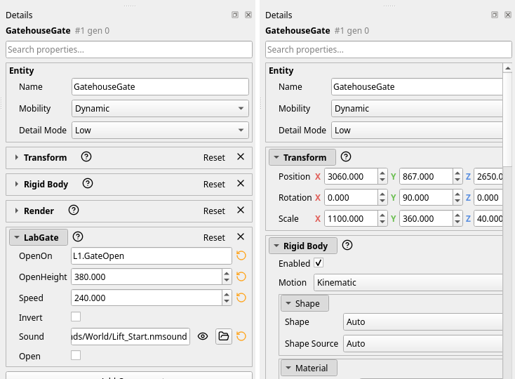

**The objective highlight** is the newest example: a game component that
makes engine entities for itself. While an objective interactable is usable,
`LabWorld::TickPresentation` lays a glow shell over its mesh. The shell is a
new entity with a `TransformComponent` and a `RenderCore::RenderComponent`
that copies the target's mesh, with the glow material in every slot. The
component keeps the shell's ID in `HighlightShell` and fades it with a
material parameter:

```cpp
// Source/World/LabInteractable.cpp, MakeHighlightShell
        Entity Shell = InWorld.CreateEntity((std::string("LabHighlight_") + InOwner.GetName()).c_str());
        ...
        RenderCore::RenderComponent Render;
        std::snprintf(Render.Mesh, sizeof(Render.Mesh), "%s", Source->Mesh);
        for(int32_t Slot = 0; Slot < int32_t(RenderCore::RENDER_MATERIAL_SLOTS); ++Slot) { Render.SetMaterial(Slot, HIGHLIGHT_MATERIAL); }
        Render.bCastShadows = 0;
        Render.bVisible = 0;
        Shell.AddComponent(Render);
...
// and each frame, in LabWorld::TickPresentation
            Render->SetMaterialParameter(Slot, "Glow", InThing.HighlightGlow, 0.f, 0.f, 0.f);
```

The fields involved are `Highlight`, an authored entity name. Set it when a
dressing prop stands in for a hidden grey-box mesh: the crank's is
`Crank_Gatehouse_Kit`, and `"none"` turns the highlight off. The runtime
fields are `HighlightShell`, `HighlightTarget`, `HighlightGlow` and
`bHighlightTried`. The shell is made the first time it is wanted, only on
processes with a screen (`IsDedicatedServer()` returns first), and glows
brighter on the one thing Interact would use now (`HIGHLIGHT_REACH`).

### 3.8 Signals: wiring components without references

The Details panel has no EntityID picker, so Demo Lab wires its level pieces
**by channel name**:

```
 Crank_Gatehouse  LabInteractable  Channel  = "L1.GateOpen"  ──emits──┐
 GatehouseGate    LabGate          OpenOn   = "L1.GateOpen"  ◄────────┤
 Objective_2      LabObjective     OnSignal = "L1.GateOpen"  ◄────────┘  "Climb the road to the plaza"
```

```cpp
// Source/World/LabSignals.h
 *   C++        LabSignals::Emit(World, "Vault.Open", true, Lever)
 *   Lua        Events.Emit("Lab.Signal", "Vault.Open", true)
 *   Sequencer  an Event key: event="Lab.Signal" arg0="Vault.Open" arg1="true"
```

The last value on each channel is **latched** (`LabSignals::Get`), so a piece
can be gated by a signal that fired earlier: `EnableOn`, a `LabSignalToggle`
light, or a gate placed after its signal. The latches are saved with a
checkpoint (`LabSignals::Snapshot`). In a running game, `lab_signal <channel> [0|1]`
in the console emits one by hand.

`LabSignals` itself is not a component. It is a namespace over a World event,
and it shows the other half of the design: components hold data, systems hold
behaviour, and events connect systems that should not know about each other.

### 3.9 The same kind of piece in C++, Lua and a script graph

Most of Demo Lab's interactables are pure data: a `LabInteractable` whose
fields say what a press does, run by C++ systems. When a piece needs its own
logic, that logic doesn't have to be C++. Two pieces in L2 move theirs into
scripts, and the C++ part stays the same for all three kinds:

| Piece | Behaviour lives in | What the script decides |
|---|---|---|
| The gatehouse crank, the breaker, the keycard, the elevator panel, ... | **C++**, data only: `LabInteractable` fields run by `LabWorld::*` | nothing: the fields say it all |
| `Calm_KeycardReader` | **Lua**: `Content/Prefabs/Lab/KeycardReader.lua` | open the archive with the keycard, or deny access without it; its prompt and glow follow the story |
| `Calm_Valve1..3` + `Calm_ValveControl` | **a script graph**: `Content/Prefabs/Lab/ValveControl.script.nmgraph` | a banner per valve, and `L2.ValvesDone` once the third is open |

The split is the same in both scripted pieces:

- **C++ keeps what every interactable shares:** the prompt, the reach and aim
  test, the press or hold, the objective glow, replication and saving. The
  scripted pieces still have a `LabInteractable`, so the HUD, AutoPlay and the
  highlight treat them like any other.
- **A press emits a signal** that only the script listens to
  (`L2.ReaderSwiped`, `L2.Valve3`). The **script decides what follows**.

**What the scripts can reach.** Three C++ registrations make the game visible
to scripts:

```cpp
// Source/World/LabScripting.cpp: the "Lab" library, a global table in Lua, a palette group in graphs
GAMECORE_DEFINE_SCRIPT_LIBRARY(Lab)
{
    Lib.NativePure<&ScriptGetSignal>("GetSignal", "Channel -> On")
       .Tooltip("The last value emitted on a Demo Lab signal channel in this level; false if never");
    Lib.Native<&ScriptEmit>("Emit", "Channel, Value")
       .Tooltip("Emit a Demo Lab signal (Lab.Signal), as a lever or trigger would; sent later this frame");
    Lib.Native<&ScriptShowBanner>("ShowBanner", "Text, Seconds")
       .Tooltip("Show the story's centred banner for a few seconds");
}

// Source/World/LabInteractable.cpp: what e:GetComponent("LabInteractable") offers
GAMECORE_DEFINE_COMPONENT_SCRIPT(LabInteractableComponent)
{
    Bind.Field("Prompt", &LabInteractableComponent::Prompt);
    Bind.Field("Channel", &LabInteractableComponent::Channel);
    Bind.Field("Highlight", &LabInteractableComponent::Highlight);
    Bind.Flag("Once", &LabInteractableComponent::bOnce);
    Bind.ReadOnly("Used", &LabInteractableComponent::bUsed);
    Bind.ReadOnly("On", &LabInteractableComponent::bOn);
}
```

- `Native` writes the glue from the C++ function's own types. Each function
  takes `World&` first, which the engine fills in, so it is not a script
  argument.
- `ScriptEmit` queues its signal (`LabSignals::BeginHandling` around the
  emit). Scripts usually emit from inside a `"Lab.Signal"` listener, and the
  event bus refuses an event that re-enters its own broadcast.
- Signals themselves need no binding. Scripts hear the World event
  `"Lab.Signal"` directly: `Events.On` in Lua, an **On Event** node in a graph.

GameCore's README ("Scripting", "A prefab's script") and
[GameModeGuide.md](../../../Engine/Docs/Guides/GameModeGuide.md) ("The same
game from Lua", "... from a script graph") are the reference.

**A script belongs to a prefab.** Each instance of the prefab runs its own
copy. The reader's prefab carries its components and names its Lua:

```xml
<!-- Content/Prefabs/Lab/KeycardReader.nmprefab -->
<Prefab Format="1" Name="KeycardReader" NextId="2">
  <Script Path="Content/Prefabs/Lab/KeycardReader.lua" />
  <Tick Mode="EventsOnly" />
  <Entity Id="1" Name="KeycardReader">
    <Component Type="LabInteractable" Version="1">
      <Prompt Value="Keycard reader" />
      ...
      <Channel Value="L2.ReaderSwiped" />
      ...
      <Once Value="false" />
      ...
      <Highlight Value="none" />
    </Component>
    <Component Type="Render" Version="7"> ...
```

`Tick Mode="EventsOnly"` runs `OnStart`, `OnDestroy` and event handlers but no
per-frame function: neither script needs one. The level places the prefab as
an instance, an `.nmprefabinst` file beside the `.nmentity` files. The
generator writes it with `Level.instance` in `Tools/Levels/make_levels.py`,
which renames the instance's root so AutoPlay and the `Calm_` group find it
by name:

```python
# Tools/Levels/make_levels.py, make_l2()
    lv.instance('Calm_KeycardReader', 'Content/Prefabs/Lab/KeycardReader.nmprefab', p['KeycardReader'][:3], p['KeycardReader'][3])
    ...
    lv.instance('Calm_ValveControl', 'Content/Prefabs/Lab/ValveControl.nmprefab', (0, 0, 0))
```

**The Lua interactable.** The reader's script reads the latched signals, so
it starts in the right state after a checkpoint reload. It changes its own
`LabInteractable` through the binding above:

```lua
-- Content/Prefabs/Lab/KeycardReader.lua
    OnSignal = function(self, channel, value)
        if channel == "L2.ReaderSwiped" then
            local x, y, z = self.Entity:GetComponent("Transform"):GetPosition()
            if Lab.GetSignal("L2.Keycard") then
                Audio.PlaySoundAt(ACCEPT, x, y, z, 1.0)
                Lab.Emit("L2.ArchiveOpen", true)
                self.Use:SetOnce(true)              -- used and Once: the C++ side stops offering it
                self.Use:SetPrompt("Archive open")
                self.Use:SetHighlight("none")
            else
                Audio.PlaySoundAt(DENY, x, y, z, 1.0)
                Lab.ShowBanner("Access denied. The keycard is in the workshop.", 3)
            end
        elseif channel == "L2.Keycard" then
            self:Refresh()
        end
    end,
```

The C++ version could only make the reader *unusable* until the keycard
(`EnableOn`). The Lua version adds behaviour no field describes: a refusal
with its own sound, a prompt that changes ("Keycard reader (locked)", then
"Swipe the keycard"), and a glow that waits for the keycard. `self.Use` is the
proxy from `self.Entity:GetComponent("LabInteractable")`, kept in `OnStart`.

**The script-graph interactable.** The valves keep their C++ ordering
(`EnableOn`, valve by valve). Their completion moves into a graph on
`Calm_ValveControl`, a prefab with no mesh. In the graph, one **On Event**
node named `Lab.Signal` fans out through a **Sequence** into three
**Equal** / **Branch** pairs:

| # | Node (type) | Settings |
|---|---|---|
| 1 | On Event (`Event.Custom`) | EventName = `Lab.Signal` |
| 2 | Sequence (`Flow.Sequence`) | |
| 10, 20, 30 | Equal (`Compare.Equal`, wildcard `string`) | B = `L2.Valve1`, `L2.Valve2`, `L2.Valve3` |
| 11, 21, 31 | Branch (`Flow.Branch`) | |
| 12, 22 | Show Banner (`Library.Lab.ShowBanner`) | "Valve 1 of 3 open. Pressure rising.", "Valve 2 of 3 open." |
| 32 | Emit (`Library.Lab.Emit`) | Channel = `L2.ValvesDone`, Value = true |
| 33 | Show Banner | "Pressure up: the elevator has power." |


The editor saves a graph together with the Lua it compiles to (`<gen_code>`),
and that Lua is what runs. Outside the editor,
`NodeGraphGenerate -module ./DemoLabGame.so <graph>` (run from the binaries
folder) regenerates it with the game's script declarations loaded. This is
what it wrote for the valves:

```lua
    Event_Lab_Signal = function(self, Arg1, Arg2, Arg3, Arg4)
        local t1 = Arg1 == "L2.Valve1"
        if t1 then
            Lab.ShowBanner("Valve 1 of 3 open. Pressure rising.", 2.5)
        end
        ...
        local t3 = Arg1 == "L2.Valve3"
        if t3 then
            Lab.Emit("L2.ValvesDone", true)
            Lab.ShowBanner("Pressure up: the elevator has power.", 3)
        end
    end,
```

**Choosing between them.**

| Use | When |
|---|---|
| **C++ component + system** | Many instances, every frame, networked state, or anything the engine's other code reads (the HUD, AutoPlay, saving). Fastest, typed, and in the debugger |
| **Lua on a prefab** | One-off behaviour of a single piece: conditions, feedback, story beats. It changes without a C++ rebuild, and can read and write any bound component |
| **A script graph** | The same reach as Lua, for people who prefer to wire nodes; the graph shows the logic at a glance. Keep graphs small: a branch per case, as here |

All three meet on the same events and components, so a piece can move from
one to another without the rest of the game noticing. AutoPlay still uses
the reader and the valves the same way, and waits for the same
`L2.ArchiveOpen` and `L2.ValvesDone`.

**Rules that keep scripts working.**

- **State comes from latches, not memory.** A checkpoint reload restarts the
  script (`OnStart` runs again), so read `Lab.GetSignal` there rather than
  relying on what a listener saw earlier.
- **Scripts run on every process.** Over a network, put a story decision
  behind `Net.HasAuthority()`, as C++ uses `HasAuthority()`. Demo Lab is
  single-player, so its scripts don't.
- **Unsubscribe in `OnDestroy`.** `Events.Off(handle)` (graphs do it for you).
  The Alarm state destroys every `Calm_*` entity, these instances included.

---

## Part 4: make your own: a component, a system, a level piece

This walkthrough adds **`LabBob`**: a component that bobs its entity up and
down while a signal is on. The steps:

1. Write the component, its registration and its system.
2. Register the system with the mode.
3. Put one in L1 through the generator.
4. Build and see it move when the gate opens.

The code below was compiled against the module's headers with its own compile
flags. `LabBob` is new: nothing in the tree is called that yet.

**1. The component and its system.** Create `Source/World/LabBob.h`:

```cpp
#ifndef DEMOLAB_LABBOB_H
#define DEMOLAB_LABBOB_H

#include "Public/GameCore/ComponentType.h"
#include "Public/Math/Vector.h"

#include <cstdint>

namespace GameCore { class World; }

/*
 * LabBob: bobs its entity up and down while a signal is on (or always, with
 * no Channel). Cosmetic, every process.
 */
struct LabBobComponent {
    GAMECORE_COMPONENT_BODY()
    char    Channel[32] = "";        // bobs while this signal is true; "" always
    float   Height = 20.f;           // units above and below where it was placed
    float   Speed = 0.5f;            // bobs per second

    // This run.
    EngineCore::Vector3 Rest;
    float   Phase = 0.f;
    uint8_t bHasRest = 0;
};

namespace LabBob {
    /* Every process: bobs move. */
    void Tick(GameCore::World& InWorld, float InSeconds);
}

#endif //DEMOLAB_LABBOB_H
```

and `Source/World/LabBob.cpp`:

```cpp
#include "World/LabBob.h"

#include "Public/GameCore/ComponentSerializer.h"
#include "Public/GameCore/Components/TransformComponent.h"
#include "Public/GameCore/Entity.h"
#include "Public/GameCore/World.h"

#if WITH_EDITOR
#include "Public/GameCore/ComponentProperties.h"
#endif

#include "World/LabSignals.h"

#include <cmath>

#include "LabVersion.h"

using namespace GameCore;

GAMECORE_DEFINE_COMPONENT(LabBobComponent, "LabBob")

GAMECORE_DEFINE_COMPONENT_SERIALIZER(LabBobComponent, LabVersion::GetCurrentVersion()) {
    Ar.Field("Channel", C.Channel);
    Ar.Field("Height", C.Height);
    Ar.Field("Speed", C.Speed);
}

#if WITH_EDITOR
GAMECORE_DEFINE_COMPONENT_PROPERTIES(LabBobComponent) {
    Props.TypeCategory("DemoLab");
    Props.Field("Channel", &LabBobComponent::Channel);
    Props.Field("Height", &LabBobComponent::Height);
    Props.Field("Speed", &LabBobComponent::Speed);
}
#endif

void LabBob::Tick(World& InWorld, const float InSeconds)
{
    InWorld.Each<LabBobComponent>([&](Entity InEntity, LabBobComponent& InBob)
    {
        TransformComponent* Transform = InEntity.GetComponent<TransformComponent>();
        if(!Transform) { return; }
        if(!InBob.bHasRest)
        {
            InBob.Rest = Transform->Position;
            InBob.bHasRest = 1;
        }
        const bool bOn = !InBob.Channel[0] || LabSignals::Get(InWorld, InBob.Channel);
        if(bOn) { InBob.Phase += InSeconds * InBob.Speed; }
        const double Lift = bOn ? std::sin(double(InBob.Phase) * 6.283185307) * double(InBob.Height) : 0.0;
        Transform->Position = InBob.Rest + EngineCore::Vector3(0, Lift, 0);
    });
}
```

What each part does:

- **The struct** follows section 3.1: the body macro first, `char` text, all
  defaults. The authored fields (`Channel`, `Height`, `Speed`) come first and
  the this-run fields (`Rest`, `Phase`, `bHasRest`) after.
- **The serializer** writes only the authored fields. It is purely cosmetic,
  so it has no replication block: every process runs the system itself and
  reads the latched signal.
- **The properties** block puts it under **Add Component > DemoLab**.
- **The system** changes nothing structural inside `Each`, so it can act in
  the loop. It only writes the `Transform`, which the renderer (and a Rigid
  Body, if there were one) follows.

Add both files to `nimble_add_hot_module(...)`'s `SOURCES` in
`CMakeLists.txt`, next to the other `Source/World/` files:

```cmake
                    Source/World/LabBob.h
                    Source/World/LabBob.cpp
```

**2. Tick it.** A system needs a phase and a place in the order. It moves a
Transform for show, so it belongs in `TP_PostPhysics` with the other
presentation. Register it in the base mode, so that every Demo Lab level gets
it. In `Source/GameModes/LabGameModeBase.h`, add a private member beside the
other `Tick*` functions:

```cpp
    void TickBobs(GameCore::World& InWorld, float InSeconds);
```

In `Source/GameModes/LabGameModeBase.cpp`, include `"World/LabBob.h"` and
register and define the system:

```cpp
    // in LabGameModeBase::OnLoad, after Lab.WorldPresentation
    AddSystem<&LabGameModeBase::TickBobs>("Lab.Bobs", TP_PostPhysics);

void LabGameModeBase::TickBobs(World& InWorld, const float InSeconds)
{
    LabBob::Tick(InWorld, InSeconds);
}
```

The alternative is one line in the existing `TickWorldPresentation`
(`LabBob::Tick(InWorld, InSeconds);`). That is what `LabMotion::Tick` and
`LabLogic::TickSpinners` do. A separate `AddSystem` gives the system its own
name in the profiler and the system list.

**3. Place it in a level, through the generator.** Demo Lab's levels are
generated (section 1.4), so put the piece in `Tools/Levels/make_levels.py`,
not in the editor. In `make_l1()`, after the crank:

```python
    cx, cy, cz, _ = p['Crank_Gatehouse']
    lv.entity('Bob_GateLamp', [lv.fields('LabBob', Channel='L1.GateOpen', Height=30, Speed=0.5),
                               lv.render(SPH), lv.transform((cx, cy + 250, cz), (0, 0, 0), (40, 40, 40))])
```

- `Level.fields` writes a component by its registered name and serializer
  field names (`Channel`, `Height`, `Speed`).
- `Level.render` and `Level.transform` add the engine's `Render` and
  `Transform`.
- `SPH` is the engine's sphere mesh, so the piece is a 40-unit ball 2.5 m
  above the crank.

Then regenerate and build, from `Games/DemoLab`:

```
python3 Tools/Levels/make_levels.py
cmake --build Build/editor-relwithdebinfo -j6
```

The build stages the new `.nmentity` into `Binaries/`. To try values before
writing them into the generator, open L1 in the editor, select any entity and
use **Add Component > DemoLab > LabBob**. That edit is lost at the next
generator run, which is why the generator is the real home.

**4. See it work.**

```
Binaries/Linux_RelWithDebInfo/DemoLab -Game.StartLevel=L1_Foothills
```

Walk to the gatehouse and hold E on the crank. When `L1.GateOpen` fires, the
gate rises and the ball starts to bob. To skip the walk, open the console (the
key under Escape) and type `lab_signal L1.GateOpen 1`. In the editor, press
**Play** (F5) with L1 open: while playing, the Outliner and Details follow the
game's World, so you can select `Bob_GateLamp` and watch its Transform move.

**Where to go next:**

- **Make it gameplay.** Replicate a field, and make the authority set it in
  `OnSignal` the way `LabWorld::OnSignal` sets `LabGate::bOpen` (sections 3.5
  and 1.6).
- **Make it save.** Serialize a runtime field if a checkpoint must keep it
  (section 3.3).
- **Show it on the HUD.** Write a value with `UI.SetValue` in
  `LabHUD::Update` and bind a widget to it (section 2.2).
- **Test it.** Add an AutoPlay step, so `DemoLab.AutoPlay` keeps testing it
  (`Source/GameModes/LabAutoPlay.h`).
- **Script it instead.** A bob needs no C++ at all. A prefab with a Lua
  `OnPostPhysics` that moves its `Transform` does the same job (section 3.9).
  Keep the C++ version for when many entities bob, or when other code must
  read the component.

---

## Appendix: the screenshots

Every image on this page is a PNG in `Docs/Images/Tutorial/`. All were taken
from the RelWithDebInfo editor running offscreen (`QT_QPA_PLATFORM=offscreen`),
so no window opened and no desktop was captured:

- The editor views use the console's `select`, `details focus`, `frame` and
  `windowshot`.
- The designer views use `ui <path>`, `ui resolution 1920x1080` and
  `ui screenshot`.
- The in-game views are Play-in-Editor with `Game.StartLevel` set to the
  level and `DemoLab.AutoPlay true` typed once play started. AutoPlay walked
  the player, and `windowshot` captured frames on a timer.

Commands go on the command line as `--command "after <ms> <command>"`
(`Engine/Modules/Editor/README.md`, the Console section).

Two shots are missing because no console command reaches them offscreen. The
F1 overlay in play needs a real F1 press, so the page shows its document in
the designer instead. The **Add Component** picker is a popup menu that
`windowshot` does not capture.
